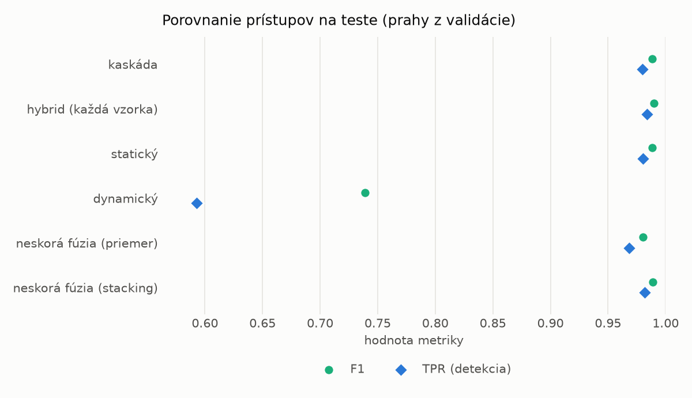
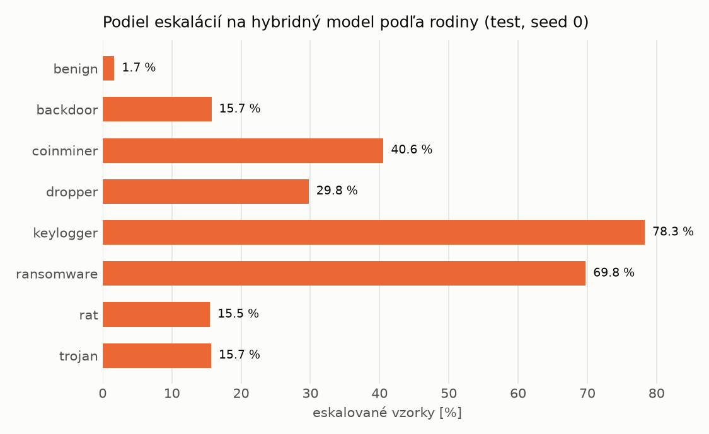

# Kaskáda `baselines` – beh `20261104-080050`

> Generované `src/cascade/evaluate.py` (2026-11-04T08:00:50+01:00). Seedy: [0, 1, 2]; hodnoty = priemer ± sm. odchýlka.
> Všetky prahy sú určené na validácii (FPR ≤ 1 %); test sa na nič nenastavuje.

| rola | beh |
|---|---|
| static | `runs_v2/lofo/ransomware/static/lightgbm/20261104-055157` |
| dynamic | `runs_v2/lofo/ransomware/dynamic/lightgbm/20261104-060251` |
| hybrid | `runs_v2/lofo/ransomware/hybrid/lightgbm/20261104-063626` |

## Test
| prístup | accuracy | balanced_accuracy | precision | recall_tpr | fpr | f1 | mcc |
|---|---|---|---|---|---|---|---|
| kaskáda | 0.9874 ± 0.0008 | 0.9881 ± 0.0007 | 0.9971 ± 0.0004 | 0.9796 ± 0.0010 | 0.0034 ± 0.0005 | 0.9883 ± 0.0007 | 0.9749 ± 0.0015 |
| hybrid (každá vzorka) | 0.9893 ± 0.0008 | 0.9898 ± 0.0007 | 0.9965 ± 0.0008 | 0.9836 ± 0.0017 | 0.0041 ± 0.0009 | 0.9900 ± 0.0007 | 0.9785 ± 0.0015 |
| statický | 0.9873 ± 0.0010 | 0.9879 ± 0.0009 | 0.9959 ± 0.0002 | 0.9805 ± 0.0020 | 0.0048 ± 0.0003 | 0.9882 ± 0.0009 | 0.9745 ± 0.0020 |
| dynamický | 0.7734 ± 0.0067 | 0.7900 ± 0.0062 | 0.9820 ± 0.0004 | 0.5928 ± 0.0124 | 0.0128 ± 0.0000 | 0.7393 ± 0.0097 | 0.6158 ± 0.0099 |
| neskorá fúzia (priemer) | 0.9787 ± 0.0004 | 0.9797 ± 0.0004 | 0.9920 ± 0.0005 | 0.9686 ± 0.0003 | 0.0093 ± 0.0006 | 0.9801 ± 0.0004 | 0.9575 ± 0.0008 |
| neskorá fúzia (stacking) | 0.9880 ± 0.0011 | 0.9885 ± 0.0010 | 0.9958 ± 0.0003 | 0.9819 ± 0.0023 | 0.0049 ± 0.0003 | 0.9888 ± 0.0010 | 0.9759 ± 0.0021 |

## Validácia
| prístup | accuracy | balanced_accuracy | precision | recall_tpr | fpr | f1 | mcc |
|---|---|---|---|---|---|---|---|
| kaskáda | 0.9945 ± 0.0004 | 0.9940 ± 0.0004 | 0.9951 ± 0.0001 | 0.9961 ± 0.0006 | 0.0081 ± 0.0002 | 0.9956 ± 0.0004 | 0.9884 ± 0.0009 |
| hybrid (každá vzorka) | 0.9942 ± 0.0006 | 0.9934 ± 0.0005 | 0.9942 ± 0.0001 | 0.9964 ± 0.0009 | 0.0096 ± 0.0002 | 0.9953 ± 0.0005 | 0.9876 ± 0.0013 |
| statický | 0.9945 ± 0.0004 | 0.9938 ± 0.0004 | 0.9945 ± 0.0004 | 0.9968 ± 0.0004 | 0.0091 ± 0.0006 | 0.9956 ± 0.0003 | 0.9884 ± 0.0008 |
| dynamický | 0.9646 ± 0.0006 | 0.9697 ± 0.0005 | 0.9938 ± 0.0002 | 0.9490 ± 0.0009 | 0.0097 ± 0.0002 | 0.9709 ± 0.0005 | 0.9274 ± 0.0012 |
| neskorá fúzia (priemer) | 0.9933 ± 0.0005 | 0.9930 ± 0.0005 | 0.9949 ± 0.0005 | 0.9944 ± 0.0004 | 0.0085 ± 0.0009 | 0.9946 ± 0.0004 | 0.9857 ± 0.0010 |
| neskorá fúzia (stacking) | 0.9948 ± 0.0002 | 0.9941 ± 0.0001 | 0.9946 ± 0.0003 | 0.9970 ± 0.0005 | 0.0089 ± 0.0005 | 0.9958 ± 0.0001 | 0.9889 ± 0.0004 |

## Správanie kaskády (test, seed 0)
- podiel eskalácií na hybrid: **22.31%** (3869 vzoriek)
- chyby pri zhode študentov (kaskáda ich nemôže opraviť): **179**
  (1.329% zo zhôd; FP 3, FN 176)
- úspešnosť na eskalovaných vzorkách: hybrid 0.9868182993021453, statický 0.9863013698630136,
  dynamický 0.0136986301369863  → prínos hybridu pri nezhode

## Výpočtové nároky (odhad z benchmarkov komponentov)
_Chýba benchmark niektorého komponentu (`python -m src.evaluation.benchmark`)._

