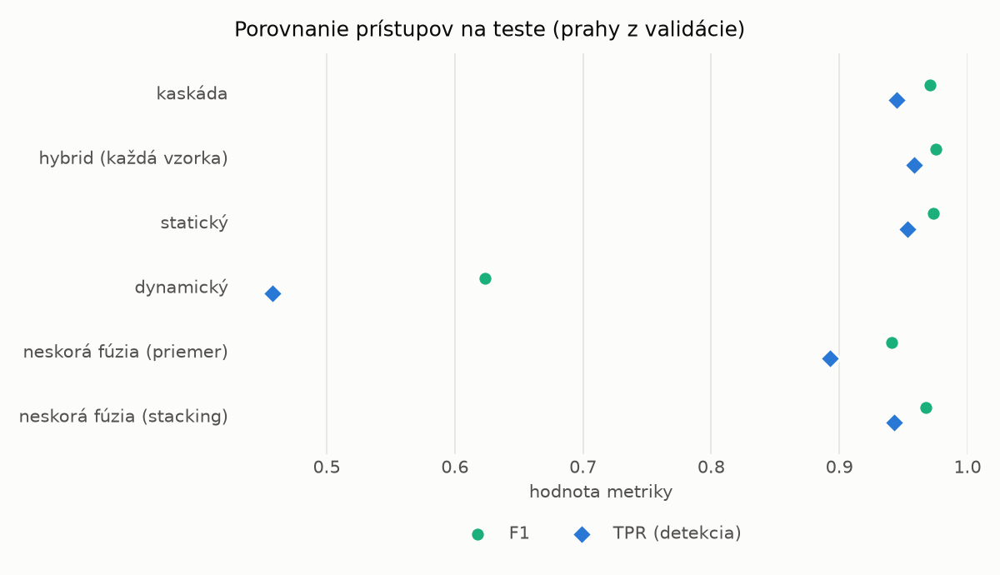
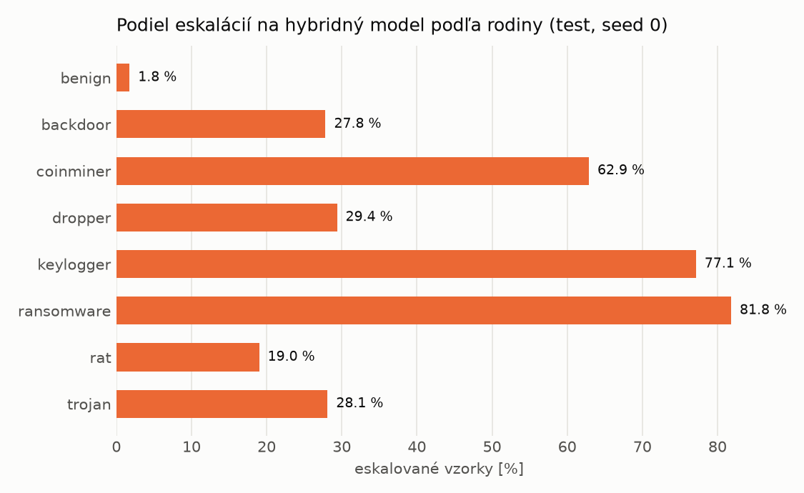

# Kaskáda `heavy` – beh `20261104-080047`

> Generované `src/cascade/evaluate.py` (2026-11-04T08:00:48+01:00). Seedy: [0, 1, 2]; hodnoty = priemer ± sm. odchýlka.
> Všetky prahy sú určené na validácii (FPR ≤ 1 %); test sa na nič nenastavuje.

| rola | beh |
|---|---|
| static | `runs_v2/lofo/ransomware/students_static/mlp_kd/20261104-075704` |
| dynamic | `runs_v2/lofo/ransomware/students_dynamic/mlp_kd/20261104-075845` |
| hybrid | `runs_v2/lofo/ransomware/hybrid/two_branch/20261104-063823` |

## Test
| prístup | accuracy | balanced_accuracy | precision | recall_tpr | fpr | f1 | mcc |
|---|---|---|---|---|---|---|---|
| kaskáda | 0.9688 ± 0.0005 | 0.9710 ± 0.0005 | 0.9975 ± 0.0004 | 0.9448 ± 0.0014 | 0.0028 ± 0.0005 | 0.9704 ± 0.0005 | 0.9390 ± 0.0010 |
| hybrid (každá vzorka) | 0.9739 ± 0.0022 | 0.9754 ± 0.0020 | 0.9936 ± 0.0010 | 0.9581 ± 0.0049 | 0.0073 ± 0.0012 | 0.9755 ± 0.0022 | 0.9484 ± 0.0042 |
| statický | 0.9718 ± 0.0031 | 0.9735 ± 0.0029 | 0.9946 ± 0.0001 | 0.9531 ± 0.0058 | 0.0061 ± 0.0001 | 0.9734 ± 0.0030 | 0.9444 ± 0.0059 |
| dynamický | 0.7005 ± 0.0047 | 0.7228 ± 0.0043 | 0.9780 ± 0.0003 | 0.4578 ± 0.0087 | 0.0122 ± 0.0002 | 0.6237 ± 0.0081 | 0.5102 ± 0.0067 |
| neskorá fúzia (priemer) | 0.9394 ± 0.0265 | 0.9437 ± 0.0244 | 0.9952 ± 0.0006 | 0.8925 ± 0.0493 | 0.0051 ± 0.0009 | 0.9406 ± 0.0277 | 0.8854 ± 0.0467 |
| neskorá fúzia (stacking) | 0.9659 ± 0.0038 | 0.9681 ± 0.0035 | 0.9943 ± 0.0007 | 0.9425 ± 0.0064 | 0.0064 ± 0.0008 | 0.9677 ± 0.0037 | 0.9332 ± 0.0072 |

## Validácia
| prístup | accuracy | balanced_accuracy | precision | recall_tpr | fpr | f1 | mcc |
|---|---|---|---|---|---|---|---|
| kaskáda | 0.9893 ± 0.0006 | 0.9902 ± 0.0005 | 0.9962 ± 0.0001 | 0.9867 ± 0.0009 | 0.0063 ± 0.0002 | 0.9914 ± 0.0005 | 0.9774 ± 0.0012 |
| hybrid (každá vzorka) | 0.9930 ± 0.0002 | 0.9925 ± 0.0001 | 0.9943 ± 0.0002 | 0.9944 ± 0.0006 | 0.0094 ± 0.0004 | 0.9944 ± 0.0002 | 0.9851 ± 0.0005 |
| statický | 0.9875 ± 0.0006 | 0.9880 ± 0.0005 | 0.9940 ± 0.0000 | 0.9859 ± 0.0010 | 0.0098 ± 0.0000 | 0.9899 ± 0.0005 | 0.9736 ± 0.0013 |
| dynamický | 0.9486 ± 0.0012 | 0.9568 ± 0.0010 | 0.9936 ± 0.0000 | 0.9233 ± 0.0019 | 0.0098 ± 0.0000 | 0.9572 ± 0.0010 | 0.8968 ± 0.0022 |
| neskorá fúzia (priemer) | 0.9906 ± 0.0018 | 0.9907 ± 0.0016 | 0.9947 ± 0.0004 | 0.9902 ± 0.0025 | 0.0087 ± 0.0006 | 0.9924 ± 0.0015 | 0.9801 ± 0.0038 |
| neskorá fúzia (stacking) | 0.9911 ± 0.0015 | 0.9911 ± 0.0014 | 0.9946 ± 0.0006 | 0.9911 ± 0.0018 | 0.0089 ± 0.0010 | 0.9929 ± 0.0012 | 0.9812 ± 0.0031 |

## Správanie kaskády (test, seed 0)
- podiel eskalácií na hybrid: **28.31%** (4909 vzoriek)
- chyby pri zhode študentov (kaskáda ich nemôže opraviť): **359**
  (2.888% zo zhôd; FP 4, FN 355)
- úspešnosť na eskalovaných vzorkách: hybrid 0.9606844571195763, statický 0.9861478916276227,
  dynamický 0.013852108372377266  → prínos hybridu pri nezhode

## Výpočtové nároky (odhad z benchmarkov komponentov)
_Chýba benchmark niektorého komponentu (`python -m src.evaluation.benchmark`)._

