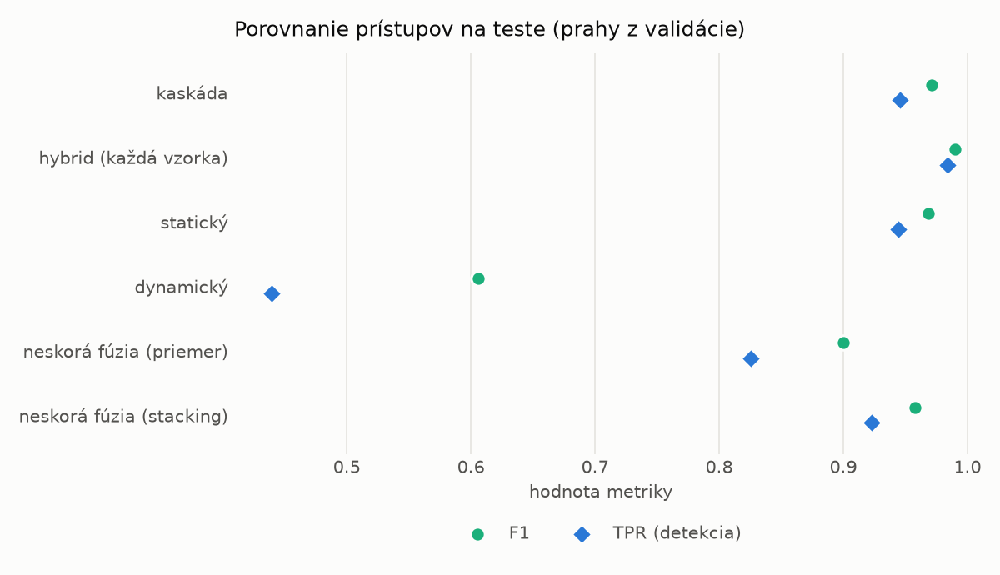
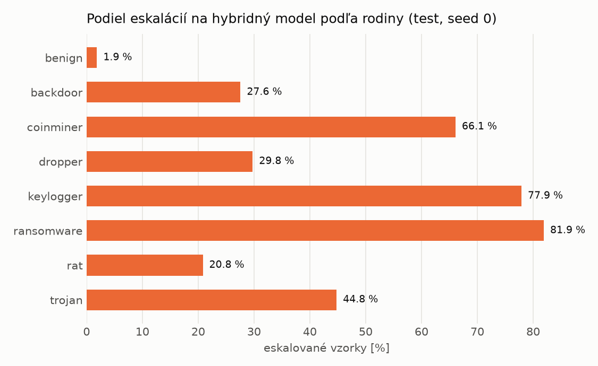

# Kaskáda `modal` – beh `20261104-080045`

> Generované `src/cascade/evaluate.py` (2026-11-04T08:00:46+01:00). Seedy: [0, 1, 2]; hodnoty = priemer ± sm. odchýlka.
> Všetky prahy sú určené na validácii (FPR ≤ 1 %); test sa na nič nenastavuje.

| rola | beh |
|---|---|
| static | `runs_v2/lofo/ransomware/students_static/mlp_kd_modal/20261104-075749` |
| dynamic | `runs_v2/lofo/ransomware/students_dynamic/mlp_kd_modal/20261104-075936` |
| hybrid | `runs_v2/lofo/ransomware/hybrid/lightgbm/20261104-063626` |

## Test
| prístup | accuracy | balanced_accuracy | precision | recall_tpr | fpr | f1 | mcc |
|---|---|---|---|---|---|---|---|
| kaskáda | 0.9693 ± 0.0058 | 0.9715 ± 0.0053 | 0.9979 ± 0.0005 | 0.9453 ± 0.0113 | 0.0023 ± 0.0006 | 0.9709 ± 0.0057 | 0.9401 ± 0.0109 |
| hybrid (každá vzorka) | 0.9893 ± 0.0008 | 0.9898 ± 0.0007 | 0.9965 ± 0.0008 | 0.9836 ± 0.0017 | 0.0041 ± 0.0009 | 0.9900 ± 0.0007 | 0.9785 ± 0.0015 |
| statický | 0.9667 ± 0.0079 | 0.9688 ± 0.0073 | 0.9937 ± 0.0005 | 0.9446 ± 0.0151 | 0.0071 ± 0.0007 | 0.9685 ± 0.0078 | 0.9347 ± 0.0149 |
| dynamický | 0.6908 ± 0.0131 | 0.7139 ± 0.0121 | 0.9785 ± 0.0014 | 0.4392 ± 0.0242 | 0.0114 ± 0.0004 | 0.6060 ± 0.0231 | 0.4967 ± 0.0190 |
| neskorá fúzia (priemer) | 0.9023 ± 0.0505 | 0.9094 ± 0.0463 | 0.9931 ± 0.0024 | 0.8257 ± 0.0960 | 0.0070 ± 0.0033 | 0.8997 ± 0.0546 | 0.8226 ± 0.0868 |
| neskorá fúzia (stacking) | 0.9555 ± 0.0101 | 0.9585 ± 0.0092 | 0.9945 ± 0.0017 | 0.9231 ± 0.0198 | 0.0060 ± 0.0019 | 0.9574 ± 0.0102 | 0.9140 ± 0.0186 |

## Validácia
| prístup | accuracy | balanced_accuracy | precision | recall_tpr | fpr | f1 | mcc |
|---|---|---|---|---|---|---|---|
| kaskáda | 0.9888 ± 0.0016 | 0.9899 ± 0.0012 | 0.9964 ± 0.0001 | 0.9856 ± 0.0026 | 0.0059 ± 0.0002 | 0.9910 ± 0.0013 | 0.9764 ± 0.0032 |
| hybrid (každá vzorka) | 0.9942 ± 0.0006 | 0.9934 ± 0.0005 | 0.9942 ± 0.0001 | 0.9964 ± 0.0009 | 0.0096 ± 0.0002 | 0.9953 ± 0.0005 | 0.9876 ± 0.0013 |
| statický | 0.9855 ± 0.0029 | 0.9864 ± 0.0023 | 0.9940 ± 0.0000 | 0.9827 ± 0.0047 | 0.0098 ± 0.0000 | 0.9883 ± 0.0024 | 0.9694 ± 0.0060 |
| dynamický | 0.9473 ± 0.0005 | 0.9557 ± 0.0004 | 0.9937 ± 0.0002 | 0.9212 ± 0.0007 | 0.0097 ± 0.0002 | 0.9560 ± 0.0004 | 0.8945 ± 0.0009 |
| neskorá fúzia (priemer) | 0.9892 ± 0.0022 | 0.9894 ± 0.0017 | 0.9940 ± 0.0000 | 0.9886 ± 0.0035 | 0.0098 ± 0.0000 | 0.9913 ± 0.0018 | 0.9771 ± 0.0046 |
| neskorá fúzia (stacking) | 0.9892 ± 0.0029 | 0.9894 ± 0.0023 | 0.9942 ± 0.0003 | 0.9884 ± 0.0048 | 0.0096 ± 0.0005 | 0.9913 ± 0.0024 | 0.9771 ± 0.0062 |

## Správanie kaskády (test, seed 0)
- podiel eskalácií na hybrid: **29.89%** (5182 vzoriek)
- chyby pri zhode študentov (kaskáda ich nemôže opraviť): **400**
  (3.290% zo zhôd; FP 4, FN 396)
- úspešnosť na eskalovaných vzorkách: hybrid 0.9868776534156696, statický 0.9845619451949055,
  dynamický 0.015438054805094558  → prínos hybridu pri nezhode

## Výpočtové nároky (odhad z benchmarkov komponentov)
_Chýba benchmark niektorého komponentu (`python -m src.evaluation.benchmark`)._

