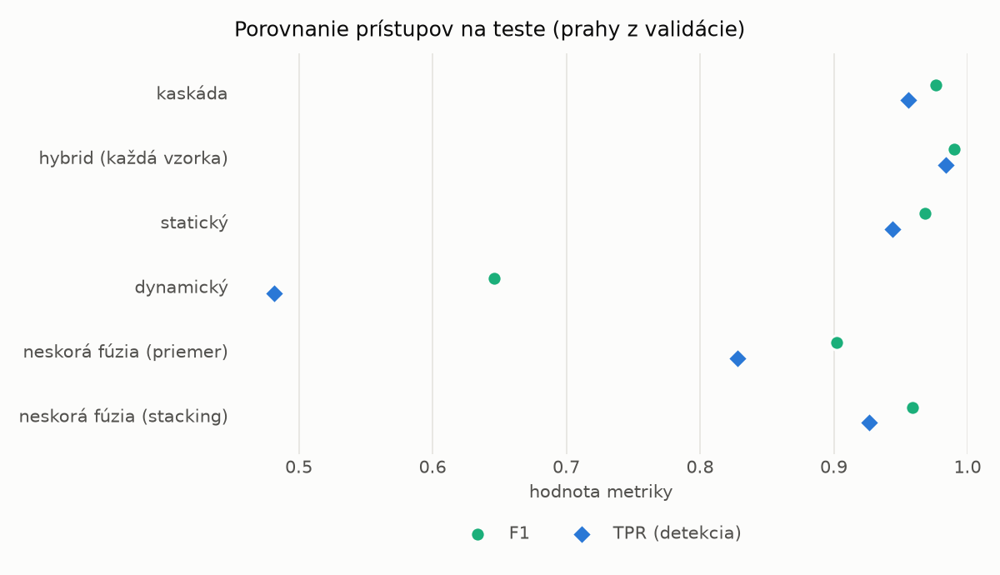
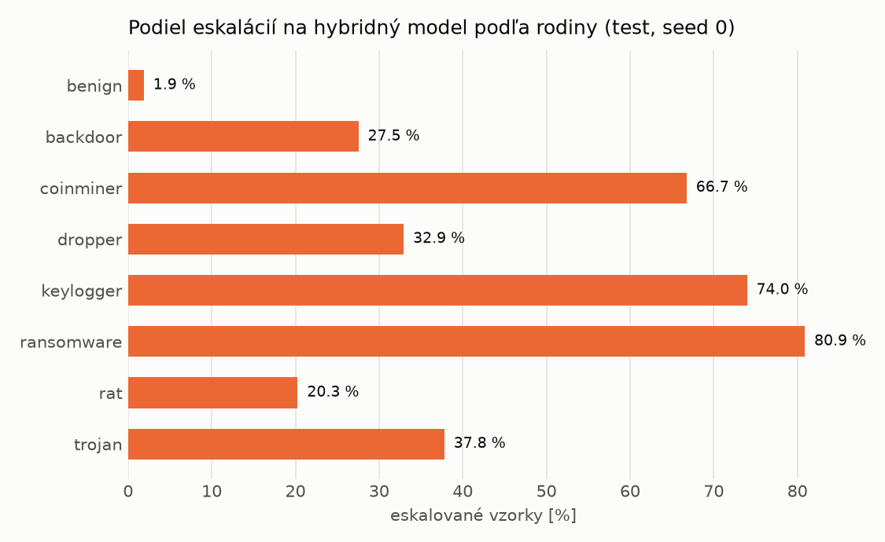

# Kaskáda `nokd` – beh `20261104-080043`

> Generované `src/cascade/evaluate.py` (2026-11-04T08:00:44+01:00). Seedy: [0, 1, 2]; hodnoty = priemer ± sm. odchýlka.
> Všetky prahy sú určené na validácii (FPR ≤ 1 %); test sa na nič nenastavuje.

| rola | beh |
|---|---|
| static | `runs_v2/lofo/ransomware/students_static/mlp_nokd/20261104-075733` |
| dynamic | `runs_v2/lofo/ransomware/students_dynamic/mlp_nokd/20261104-075916` |
| hybrid | `runs_v2/lofo/ransomware/hybrid/lightgbm/20261104-063626` |

## Test
| prístup | accuracy | balanced_accuracy | precision | recall_tpr | fpr | f1 | mcc |
|---|---|---|---|---|---|---|---|
| kaskáda | 0.9751 ± 0.0030 | 0.9768 ± 0.0027 | 0.9980 ± 0.0004 | 0.9560 ± 0.0058 | 0.0023 ± 0.0004 | 0.9765 ± 0.0029 | 0.9510 ± 0.0056 |
| hybrid (každá vzorka) | 0.9893 ± 0.0008 | 0.9898 ± 0.0007 | 0.9965 ± 0.0008 | 0.9836 ± 0.0017 | 0.0041 ± 0.0009 | 0.9900 ± 0.0007 | 0.9785 ± 0.0015 |
| statický | 0.9662 ± 0.0006 | 0.9683 ± 0.0005 | 0.9933 ± 0.0006 | 0.9440 ± 0.0018 | 0.0075 ± 0.0007 | 0.9681 ± 0.0006 | 0.9336 ± 0.0011 |
| dynamický | 0.7139 ± 0.0075 | 0.7353 ± 0.0069 | 0.9809 ± 0.0011 | 0.4817 ± 0.0142 | 0.0111 ± 0.0008 | 0.6460 ± 0.0128 | 0.5305 ± 0.0105 |
| neskorá fúzia (priemer) | 0.9036 ± 0.0374 | 0.9106 ± 0.0346 | 0.9932 ± 0.0017 | 0.8277 ± 0.0681 | 0.0066 ± 0.0011 | 0.9020 ± 0.0414 | 0.8232 ± 0.0636 |
| neskorá fúzia (stacking) | 0.9568 ± 0.0079 | 0.9597 ± 0.0072 | 0.9937 ± 0.0008 | 0.9262 ± 0.0150 | 0.0069 ± 0.0010 | 0.9587 ± 0.0079 | 0.9162 ± 0.0145 |

## Validácia
| prístup | accuracy | balanced_accuracy | precision | recall_tpr | fpr | f1 | mcc |
|---|---|---|---|---|---|---|---|
| kaskáda | 0.9897 ± 0.0012 | 0.9906 ± 0.0011 | 0.9964 ± 0.0004 | 0.9871 ± 0.0016 | 0.0059 ± 0.0006 | 0.9917 ± 0.0010 | 0.9783 ± 0.0025 |
| hybrid (každá vzorka) | 0.9942 ± 0.0006 | 0.9934 ± 0.0005 | 0.9942 ± 0.0001 | 0.9964 ± 0.0009 | 0.0096 ± 0.0002 | 0.9953 ± 0.0005 | 0.9876 ± 0.0013 |
| statický | 0.9874 ± 0.0014 | 0.9881 ± 0.0012 | 0.9945 ± 0.0002 | 0.9852 ± 0.0023 | 0.0090 ± 0.0004 | 0.9898 ± 0.0012 | 0.9734 ± 0.0030 |
| dynamický | 0.9414 ± 0.0123 | 0.9511 ± 0.0097 | 0.9939 ± 0.0003 | 0.9115 ± 0.0201 | 0.0093 ± 0.0006 | 0.9508 ± 0.0109 | 0.8840 ± 0.0221 |
| neskorá fúzia (priemer) | 0.9913 ± 0.0010 | 0.9912 ± 0.0010 | 0.9945 ± 0.0007 | 0.9915 ± 0.0009 | 0.0090 ± 0.0011 | 0.9930 ± 0.0008 | 0.9815 ± 0.0021 |
| neskorá fúzia (stacking) | 0.9914 ± 0.0009 | 0.9912 ± 0.0008 | 0.9942 ± 0.0003 | 0.9920 ± 0.0013 | 0.0096 ± 0.0005 | 0.9931 ± 0.0007 | 0.9818 ± 0.0019 |

## Správanie kaskády (test, seed 0)
- podiel eskalácií na hybrid: **29.15%** (5055 vzoriek)
- chyby pri zhode študentov (kaskáda ich nemôže opraviť): **310**
  (2.524% zo zhôd; FP 2, FN 308)
- úspešnosť na eskalovaných vzorkách: hybrid 0.979624134520277, statický 0.9475766567754699,
  dynamický 0.05242334322453017  → prínos hybridu pri nezhode

## Výpočtové nároky (odhad z benchmarkov komponentov)
_Chýba benchmark niektorého komponentu (`python -m src.evaluation.benchmark`)._

