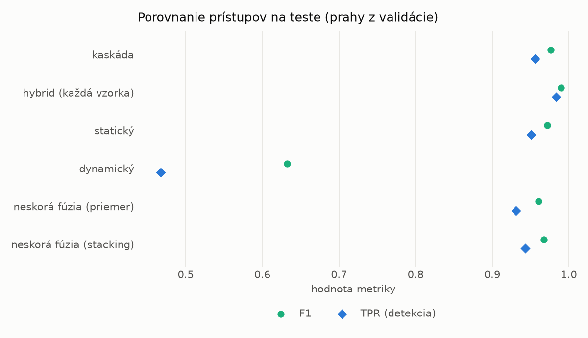
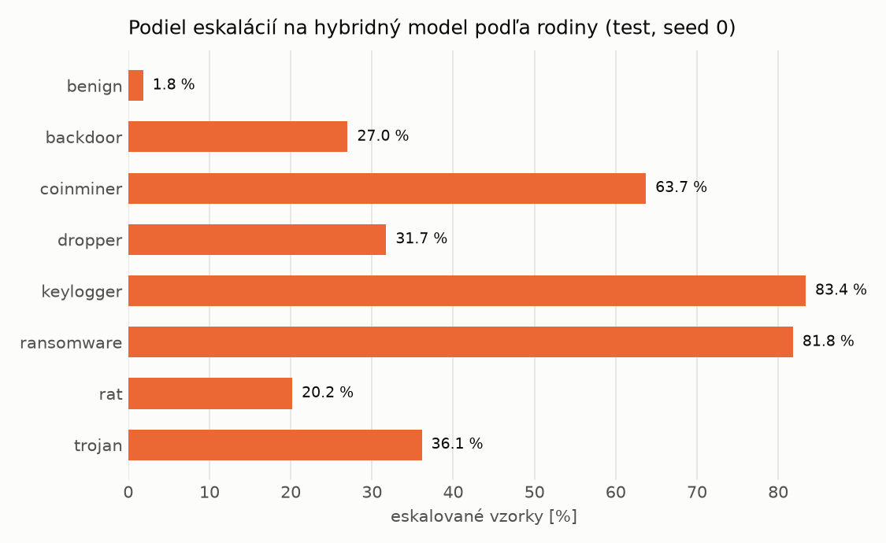

# Kaskáda `twobranch` – beh `20261104-080052`

> Generované `src/cascade/evaluate.py` (2026-11-04T08:00:52+01:00). Seedy: [0, 1, 2]; hodnoty = priemer ± sm. odchýlka.
> Všetky prahy sú určené na validácii (FPR ≤ 1 %); test sa na nič nenastavuje.

| rola | beh |
|---|---|
| static | `runs_v2/lofo/ransomware/students_static/mlp_kd_twobranch/20261104-075815` |
| dynamic | `runs_v2/lofo/ransomware/students_dynamic/mlp_kd_twobranch/20261104-080011` |
| hybrid | `runs_v2/lofo/ransomware/hybrid/lightgbm/20261104-063626` |

## Test
| prístup | accuracy | balanced_accuracy | precision | recall_tpr | fpr | f1 | mcc |
|---|---|---|---|---|---|---|---|
| kaskáda | 0.9752 ± 0.0025 | 0.9769 ± 0.0023 | 0.9981 ± 0.0003 | 0.9560 ± 0.0047 | 0.0021 ± 0.0003 | 0.9766 ± 0.0024 | 0.9512 ± 0.0047 |
| hybrid (každá vzorka) | 0.9893 ± 0.0008 | 0.9898 ± 0.0007 | 0.9965 ± 0.0008 | 0.9836 ± 0.0017 | 0.0041 ± 0.0009 | 0.9900 ± 0.0007 | 0.9785 ± 0.0015 |
| statický | 0.9700 ± 0.0020 | 0.9718 ± 0.0018 | 0.9938 ± 0.0005 | 0.9506 ± 0.0042 | 0.0070 ± 0.0006 | 0.9717 ± 0.0019 | 0.9409 ± 0.0037 |
| dynamický | 0.7060 ± 0.0151 | 0.7280 ± 0.0138 | 0.9798 ± 0.0006 | 0.4673 ± 0.0283 | 0.0114 ± 0.0007 | 0.6325 ± 0.0257 | 0.5188 ± 0.0213 |
| neskorá fúzia (priemer) | 0.9584 ± 0.0084 | 0.9609 ± 0.0076 | 0.9918 ± 0.0023 | 0.9310 ± 0.0175 | 0.0092 ± 0.0027 | 0.9604 ± 0.0084 | 0.9188 ± 0.0155 |
| neskorá fúzia (stacking) | 0.9659 ± 0.0084 | 0.9680 ± 0.0077 | 0.9938 ± 0.0014 | 0.9429 ± 0.0162 | 0.0069 ± 0.0016 | 0.9676 ± 0.0082 | 0.9331 ± 0.0158 |

## Validácia
| prístup | accuracy | balanced_accuracy | precision | recall_tpr | fpr | f1 | mcc |
|---|---|---|---|---|---|---|---|
| kaskáda | 0.9908 ± 0.0010 | 0.9915 ± 0.0008 | 0.9966 ± 0.0004 | 0.9886 ± 0.0017 | 0.0056 ± 0.0006 | 0.9926 ± 0.0008 | 0.9805 ± 0.0022 |
| hybrid (každá vzorka) | 0.9942 ± 0.0006 | 0.9934 ± 0.0005 | 0.9942 ± 0.0001 | 0.9964 ± 0.0009 | 0.0096 ± 0.0002 | 0.9953 ± 0.0005 | 0.9876 ± 0.0013 |
| statický | 0.9888 ± 0.0008 | 0.9891 ± 0.0006 | 0.9940 ± 0.0000 | 0.9880 ± 0.0013 | 0.0098 ± 0.0000 | 0.9910 ± 0.0006 | 0.9763 ± 0.0016 |
| dynamický | 0.9479 ± 0.0011 | 0.9562 ± 0.0008 | 0.9937 ± 0.0001 | 0.9221 ± 0.0019 | 0.0097 ± 0.0002 | 0.9565 ± 0.0009 | 0.8955 ± 0.0020 |
| neskorá fúzia (priemer) | 0.9921 ± 0.0003 | 0.9918 ± 0.0003 | 0.9943 ± 0.0002 | 0.9930 ± 0.0002 | 0.0094 ± 0.0004 | 0.9937 ± 0.0002 | 0.9832 ± 0.0007 |
| neskorá fúzia (stacking) | 0.9919 ± 0.0009 | 0.9916 ± 0.0008 | 0.9942 ± 0.0003 | 0.9928 ± 0.0013 | 0.0096 ± 0.0005 | 0.9935 ± 0.0007 | 0.9828 ± 0.0019 |

## Správanie kaskády (test, seed 0)
- podiel eskalácií na hybrid: **29.33%** (5086 vzoriek)
- chyby pri zhode študentov (kaskáda ich nemôže opraviť): **318**
  (2.595% zo zhôd; FP 3, FN 315)
- úspešnosť na eskalovaných vzorkách: hybrid 0.9870232009437672, statický 0.967558002359418,
  dynamický 0.03244199764058199  → prínos hybridu pri nezhode

## Výpočtové nároky (odhad z benchmarkov komponentov)
_Chýba benchmark niektorého komponentu (`python -m src.evaluation.benchmark`)._

