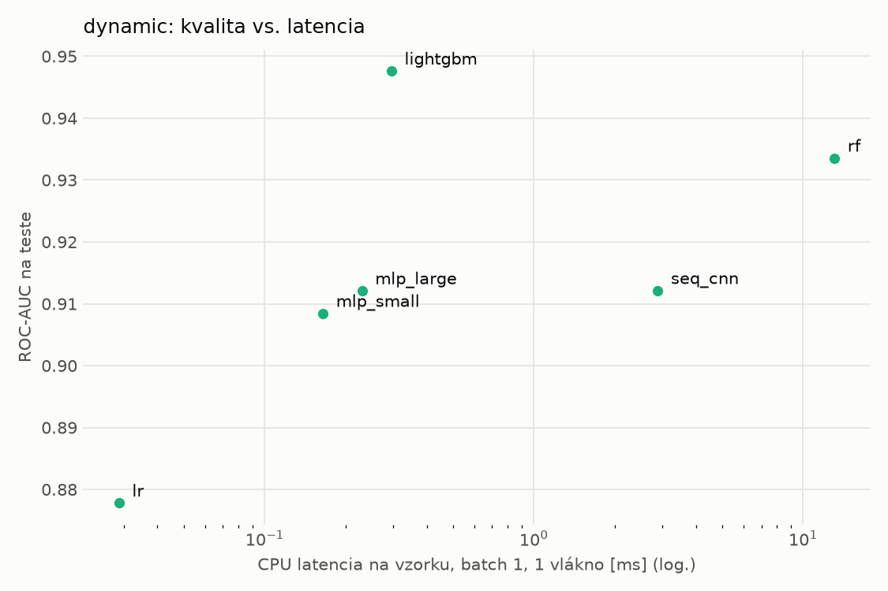
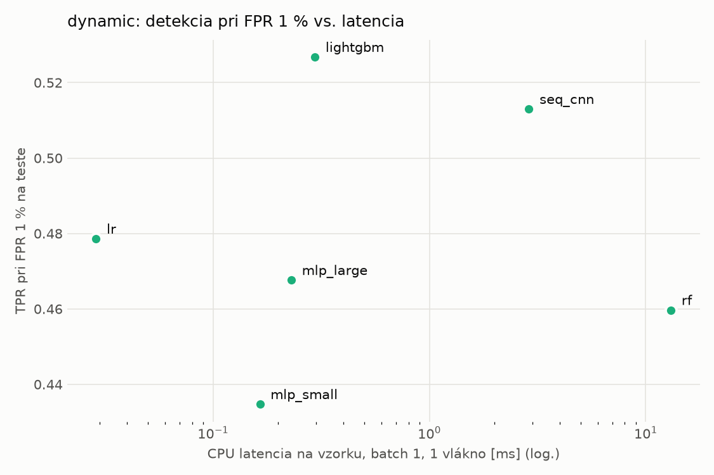
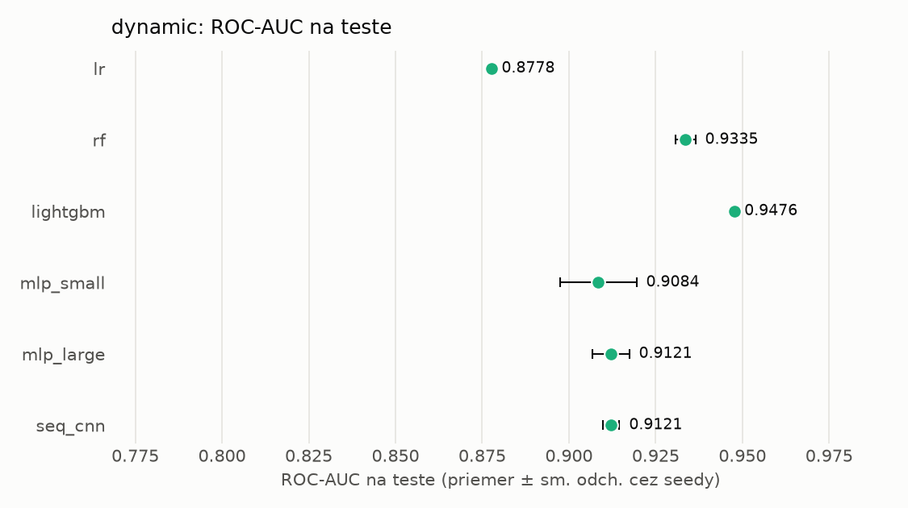
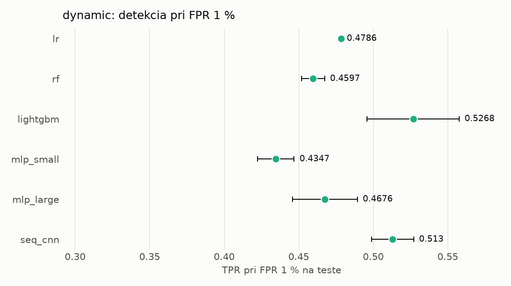

# Porovnanie modelov – dynamic

> Generované `src/evaluation/compare.py` (2026-11-04T06:29:31+01:00); použitý je posledný beh každého modelu.
> Metriky sú priemer cez seedy. \* = pri prahu určenom na validácii (FPR ≤ 1 %).
> CPU ms/vz. = medián latencie jednej vzorky na 1 vlákne vrátane transformácie vstupu (meranie hneď po tréningu,
> orientačné). Oficiálne merania spotreby sú v časti „Spotreba zdrojov pri inferencii“.

## Detekčná kvalita a orientačné časy
| model | ROC-AUC val | ROC-AUC test | TPR@FPR 1 % test | TPR@FPR 0,1 % test | F1 test* | FPR test* | gap train−val | CPU ms/vz. | CPU vz./s | GPU ms/vz. | parametre | MB | tréning s | ladenie min |
|---|---|---|---|---|---|---|---|---|---|---|---|---|---|---|
| [lr](../../dynamic/lr/20261104-060047/README.md) | 0.9938 | 0.8778 ± 0.0000 | 0.4786 | 0.0528 | 0.6554 | 0.0136 | 0.0013 | 0.029 | 346 763 | – | 2 001 | 0.06 | 4.5 | 0.0 |
| [rf](../../dynamic/rf/20261104-060107/README.md) | 0.9965 | 0.9335 ± 0.0029 | 0.4597 | 0.0000 | 0.6659 | 0.0173 | 0.0016 | 13.078 | 85 466 | – | 933 280 | 75.08 | 31.2 | 0.0 |
| [lightgbm](../../dynamic/lightgbm/20261104-060251/README.md) | 0.9967 | 0.9476 ± 0.0001 | 0.5268 | 0.2514 | 0.7393 | 0.0128 | 0.0013 | 0.296 | 58 125 | – | 631 524 | 35.83 | 23.2 | 0.0 |
| [mlp_small](../../dynamic/mlp_small/20261104-060421/README.md) | 0.9954 | 0.9084 ± 0.0110 | 0.4347 | 0.2278 | 0.6347 | 0.0128 | 0.0011 | 0.165 | 86 121 | 0.399 | 546 049 | 2.24 | 4.0 | 0.0 |
| [mlp_large](../../dynamic/mlp_large/20261104-060442/README.md) | 0.9952 | 0.9121 ± 0.0053 | 0.4676 | 0.2608 | 0.6857 | 0.0141 | 0.0012 | 0.230 | 75 825 | 0.451 | 1 190 657 | 4.83 | 14.5 | 0.0 |
| [seq_cnn](../../dynamic/seq_cnn/20261104-060533/README.md) | 0.9964 | 0.9121 ± 0.0024 | 0.5130 | 0.2845 | 0.7152 | 0.0123 | 0.0010 | 2.885 | 1 178 | 1.017 | 206 081 | 0.83 | 438.4 | 0.0 |

## Nízka prevalencia malvéru (test, prah z validácie)
| model | TPR | FPR | precision @ 1 % | falošné na 1 skutočný poplach @ 1 % | precision @ 0.1 % | falošné na 1 skutočný poplach @ 0.1 % |
|---|---|---|---|---|---|---|
| lr | 0.4930 | 0.0136 | 0.268 | 2.73 | 0.035 | 27.56 |
| rf | 0.5064 | 0.0173 | 0.228 | 3.38 | 0.028 | 34.12 |
| lightgbm | 0.5928 | 0.0128 | 0.318 | 2.15 | 0.044 | 21.65 |
| mlp_small | 0.4699 | 0.0128 | 0.271 | 2.69 | 0.036 | 27.13 |
| mlp_large | 0.5280 | 0.0141 | 0.274 | 2.64 | 0.036 | 26.69 |
| seq_cnn | 0.5625 | 0.0123 | 0.317 | 2.16 | 0.044 | 21.77 |

Prepočet: TPR a FPR nezávisia od podielu malvéru, preto sa dajú preniesť na nízku prevalenciu (v reálnej prevádzke je malvéru ~1 % alebo menej; v teste 54 %). „Falošné na 1 skutočný poplach“ = koľko neškodných súborov je označených na každý zachytený malvér.

## Spotreba zdrojov pri inferencii (benchmark, testovacia množina)
_Benchmark zatiaľ nebol spustený (`python -m src.evaluation.benchmark --approach dynamic`)._

## Grafy

