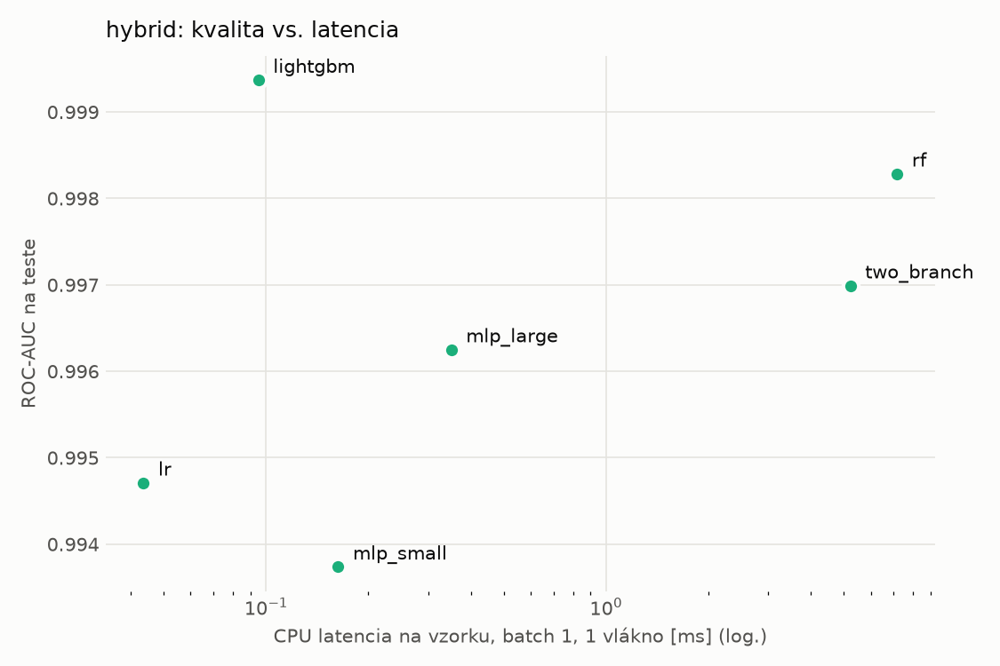
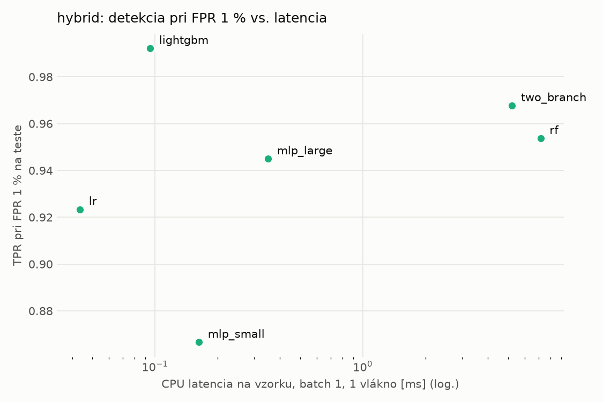
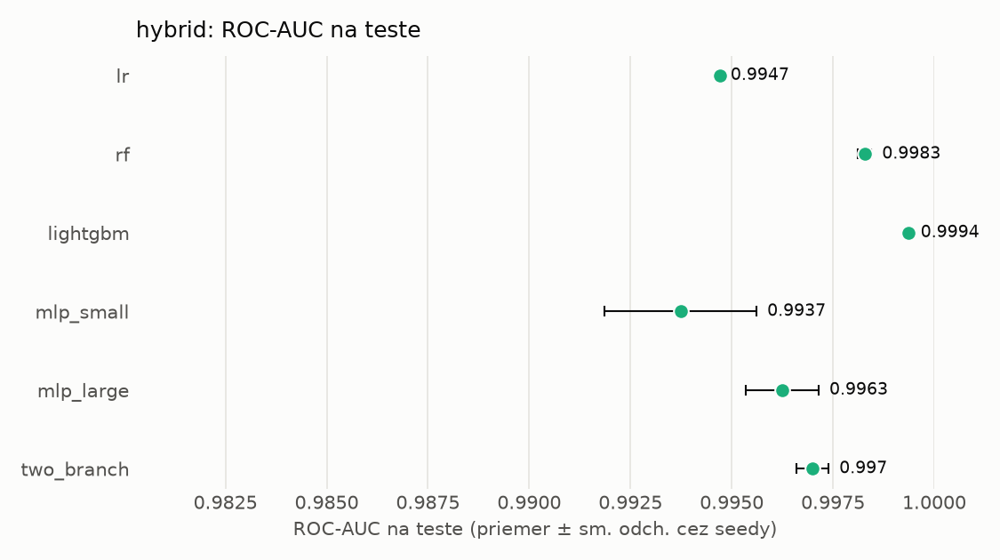
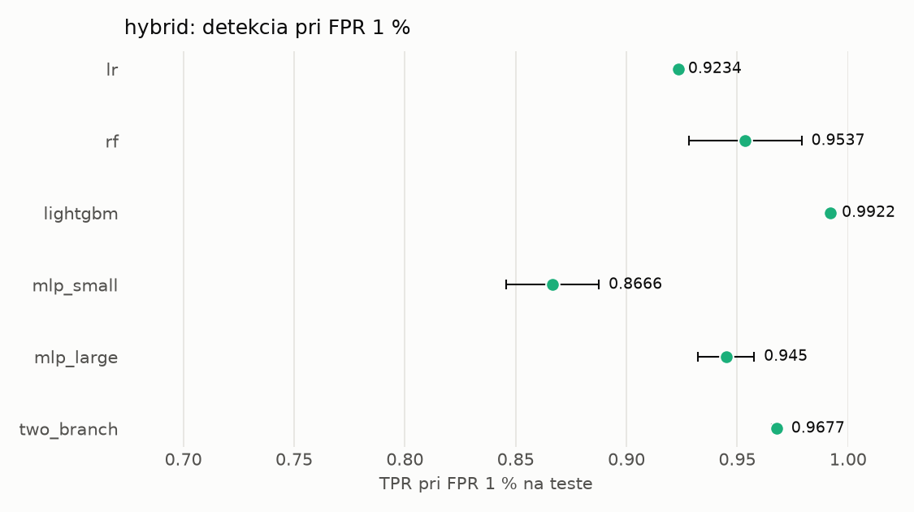

# Porovnanie modelov – hybrid

> Generované `src/evaluation/compare.py` (2026-11-04T07:00:29+01:00); použitý je posledný beh každého modelu.
> Metriky sú priemer cez seedy. \* = pri prahu určenom na validácii (FPR ≤ 1 %).
> CPU ms/vz. = medián latencie jednej vzorky na 1 vlákne vrátane transformácie vstupu (meranie hneď po tréningu,
> orientačné). Oficiálne merania spotreby sú v časti „Spotreba zdrojov pri inferencii“.

## Detekčná kvalita a orientačné časy
| model | ROC-AUC val | ROC-AUC test | TPR@FPR 1 % test | TPR@FPR 0,1 % test | F1 test* | FPR test* | gap train−val | CPU ms/vz. | CPU vz./s | GPU ms/vz. | parametre | MB | tréning s | ladenie min |
|---|---|---|---|---|---|---|---|---|---|---|---|---|---|---|
| [lr](../../hybrid/lr/20261104-062934/README.md) | 0.9986 | 0.9947 ± 0.0000 | 0.9234 | 0.6237 | 0.9454 | 0.0067 | 0.0011 | 0.044 | 164 417 | – | 4 320 | 0.13 | 4.9 | 0.0 |
| [rf](../../hybrid/rf/20261104-063004/README.md) | 0.9998 | 0.9983 ± 0.0002 | 0.9537 | 0.8103 | 0.9703 | 0.0087 | 0.0002 | 7.174 | 97 379 | – | 264 578 | 21.50 | 124.7 | 0.0 |
| [lightgbm](../../hybrid/lightgbm/20261104-063626/README.md) | 0.9998 | 0.9994 ± 0.0000 | 0.9922 | 0.9482 | 0.9900 | 0.0041 | 0.0002 | 0.095 | 266 298 | – | 29 188 | 1.64 | 16.7 | 0.0 |
| [mlp_small](../../hybrid/mlp_small/20261104-063721/README.md) | 0.9989 | 0.9937 ± 0.0019 | 0.8666 | 0.6504 | 0.9101 | 0.0068 | 0.0009 | 0.163 | 46 387 | 0.423 | 138 881 | 0.67 | 3.6 | 0.0 |
| [mlp_large](../../hybrid/mlp_large/20261104-063750/README.md) | 0.9993 | 0.9963 ± 0.0009 | 0.9450 | 0.7263 | 0.9569 | 0.0060 | 0.0006 | 0.351 | 28 991 | 0.624 | 2 386 305 | 9.67 | 4.6 | 0.0 |
| [two_branch](../../hybrid/two_branch/20261104-063823/README.md) | 0.9994 | 0.9970 ± 0.0004 | 0.9677 | 0.7402 | 0.9755 | 0.0073 | 0.0005 | 5.227 | 659 | 1.170 | 1 753 666 | 7.09 | 368.3 | 0.0 |

## Nízka prevalencia malvéru (test, prah z validácie)
| model | TPR | FPR | precision @ 1 % | falošné na 1 skutočný poplach @ 1 % | precision @ 0.1 % | falošné na 1 skutočný poplach @ 0.1 % |
|---|---|---|---|---|---|---|
| lr | 0.9016 | 0.0067 | 0.577 | 0.73 | 0.119 | 7.40 |
| rf | 0.9495 | 0.0087 | 0.523 | 0.91 | 0.098 | 9.19 |
| lightgbm | 0.9836 | 0.0041 | 0.709 | 0.41 | 0.195 | 4.14 |
| mlp_small | 0.8406 | 0.0068 | 0.554 | 0.81 | 0.109 | 8.13 |
| mlp_large | 0.9220 | 0.0060 | 0.606 | 0.65 | 0.132 | 6.55 |
| two_branch | 0.9581 | 0.0073 | 0.568 | 0.76 | 0.115 | 7.66 |

Prepočet: TPR a FPR nezávisia od podielu malvéru, preto sa dajú preniesť na nízku prevalenciu (v reálnej prevádzke je malvéru ~1 % alebo menej; v teste 54 %). „Falošné na 1 skutočný poplach“ = koľko neškodných súborov je označených na každý zachytený malvér.

## Spotreba zdrojov pri inferencii (benchmark, testovacia množina)
_Benchmark zatiaľ nebol spustený (`python -m src.evaluation.benchmark --approach hybrid`)._

## Grafy

