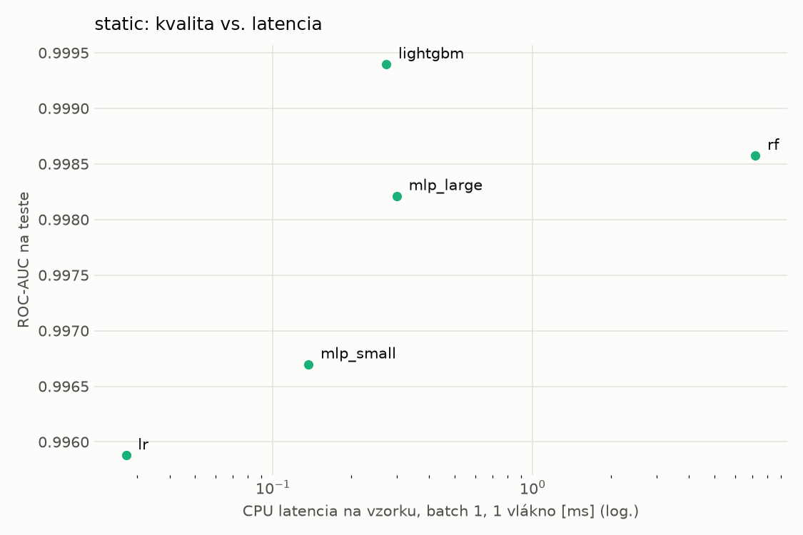
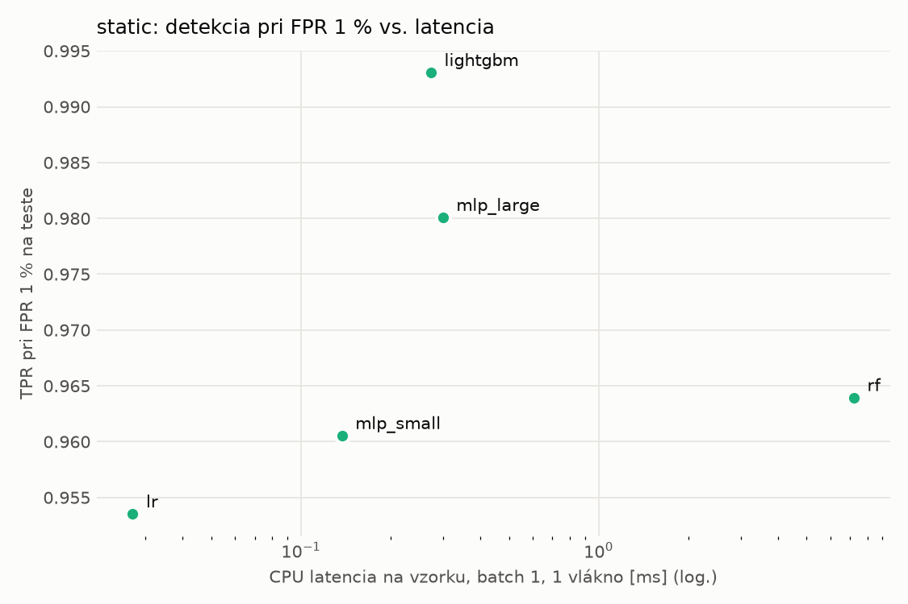
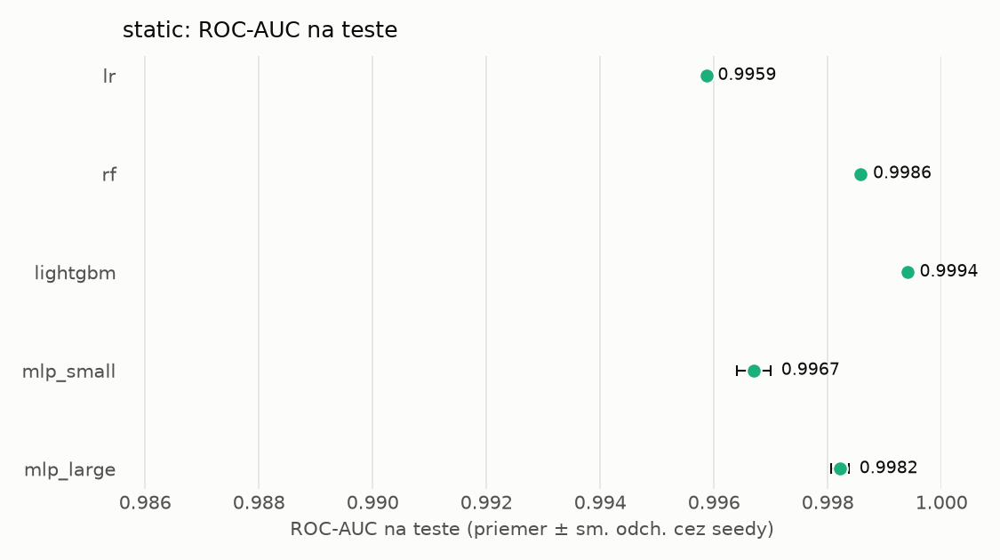
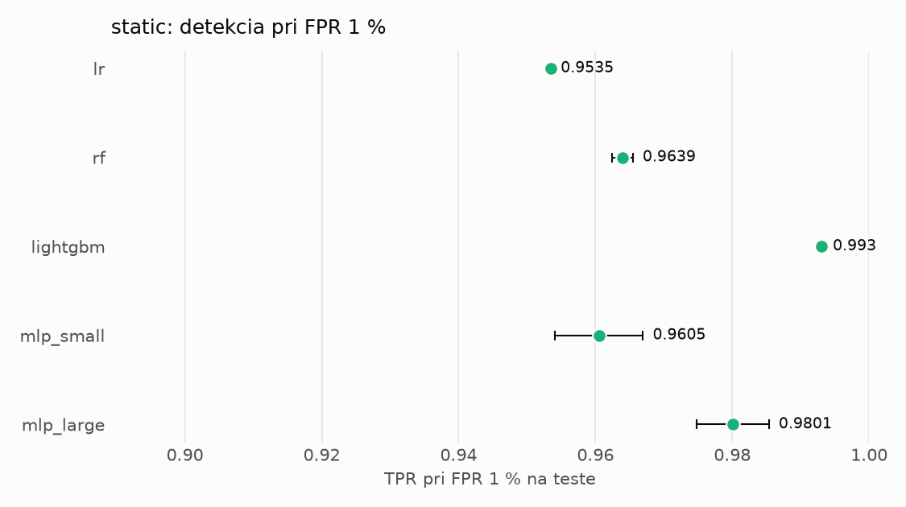

# Porovnanie modelov – static

> Generované `src/evaluation/compare.py` (2026-11-04T06:00:43+01:00); použitý je posledný beh každého modelu.
> Metriky sú priemer cez seedy. \* = pri prahu určenom na validácii (FPR ≤ 1 %).
> CPU ms/vz. = medián latencie jednej vzorky na 1 vlákne vrátane transformácie vstupu (meranie hneď po tréningu,
> orientačné). Oficiálne merania spotreby sú v časti „Spotreba zdrojov pri inferencii“.

## Detekčná kvalita a orientačné časy
| model | ROC-AUC val | ROC-AUC test | TPR@FPR 1 % test | TPR@FPR 0,1 % test | F1 test* | FPR test* | gap train−val | CPU ms/vz. | CPU vz./s | GPU ms/vz. | parametre | MB | tréning s | ladenie min |
|---|---|---|---|---|---|---|---|---|---|---|---|---|---|---|
| [lr](../../static/lr/20261104-055029/README.md) | 0.9980 | 0.9959 ± 0.0000 | 0.9535 | 0.2730 | 0.9555 | 0.0073 | 0.0015 | 0.027 | 291 444 | – | 2 320 | 0.07 | 2.0 | 0.0 |
| [rf](../../static/rf/20261104-055043/README.md) | 0.9997 | 0.9986 ± 0.0000 | 0.9639 | 0.8538 | 0.9750 | 0.0072 | 0.0003 | 7.204 | 133 584 | – | 366 998 | 29.69 | 22.4 | 0.0 |
| [lightgbm](../../static/lightgbm/20261104-055157/README.md) | 0.9998 | 0.9994 ± 0.0000 | 0.9930 | 0.9415 | 0.9882 | 0.0048 | 0.0002 | 0.273 | 102 895 | – | 214 585 | 12.43 | 155.1 | 0.0 |
| [mlp_small](../../static/mlp_small/20261104-055954/README.md) | 0.9989 | 0.9967 ± 0.0003 | 0.9605 | 0.3992 | 0.9668 | 0.0069 | 0.0009 | 0.137 | 109 467 | 0.388 | 74 881 | 0.36 | 3.8 | 0.0 |
| [mlp_large](../../static/mlp_large/20261104-060015/README.md) | 0.9995 | 0.9982 ± 0.0002 | 0.9801 | 0.8711 | 0.9806 | 0.0062 | 0.0004 | 0.300 | 82 714 | 0.615 | 1 364 417 | 5.53 | 5.7 | 0.0 |

## Nízka prevalencia malvéru (test, prah z validácie)
| model | TPR | FPR | precision @ 1 % | falošné na 1 skutočný poplach @ 1 % | precision @ 0.1 % | falošné na 1 skutočný poplach @ 0.1 % |
|---|---|---|---|---|---|---|
| lr | 0.9204 | 0.0073 | 0.560 | 0.79 | 0.112 | 7.93 |
| rf | 0.9570 | 0.0072 | 0.574 | 0.74 | 0.118 | 7.49 |
| lightgbm | 0.9805 | 0.0048 | 0.674 | 0.48 | 0.170 | 4.88 |
| mlp_small | 0.9413 | 0.0069 | 0.579 | 0.73 | 0.120 | 7.35 |
| mlp_large | 0.9669 | 0.0062 | 0.613 | 0.63 | 0.136 | 6.38 |

Prepočet: TPR a FPR nezávisia od podielu malvéru, preto sa dajú preniesť na nízku prevalenciu (v reálnej prevádzke je malvéru ~1 % alebo menej; v teste 54 %). „Falošné na 1 skutočný poplach“ = koľko neškodných súborov je označených na každý zachytený malvér.

## Spotreba zdrojov pri inferencii (benchmark, testovacia množina)
_Benchmark zatiaľ nebol spustený (`python -m src.evaluation.benchmark --approach static`)._

## Grafy

