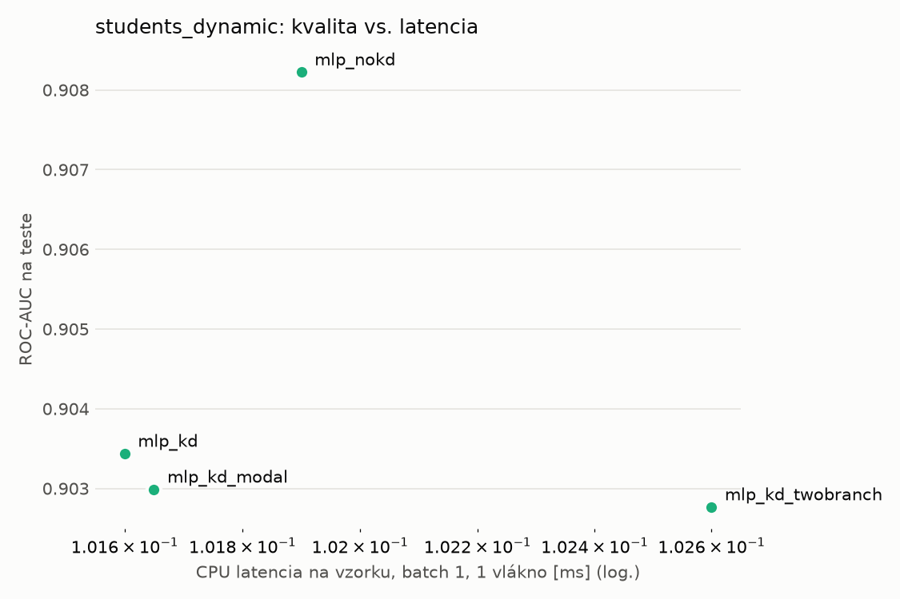
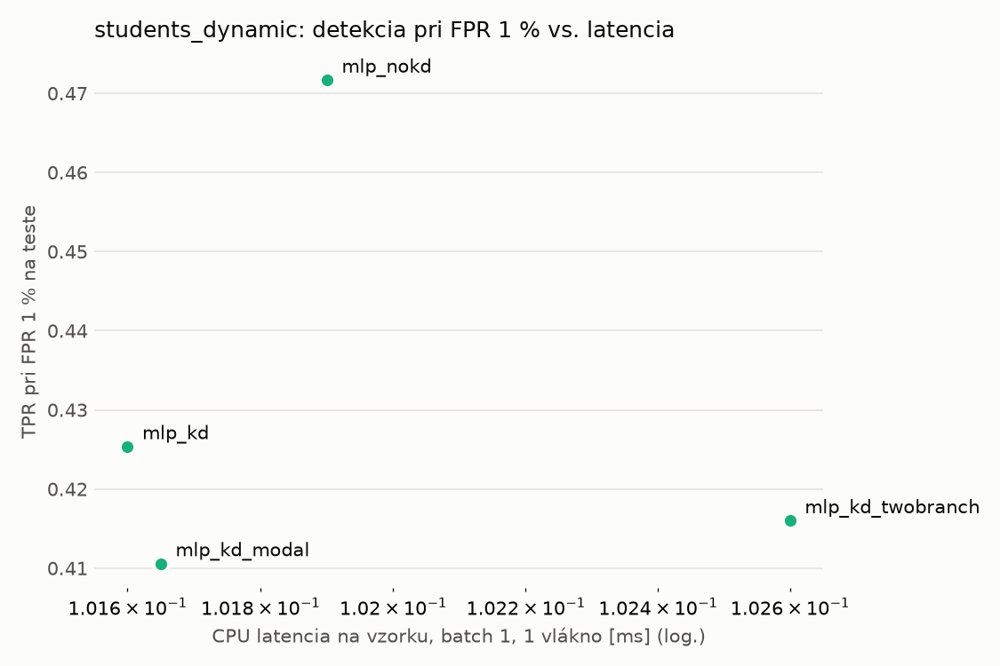
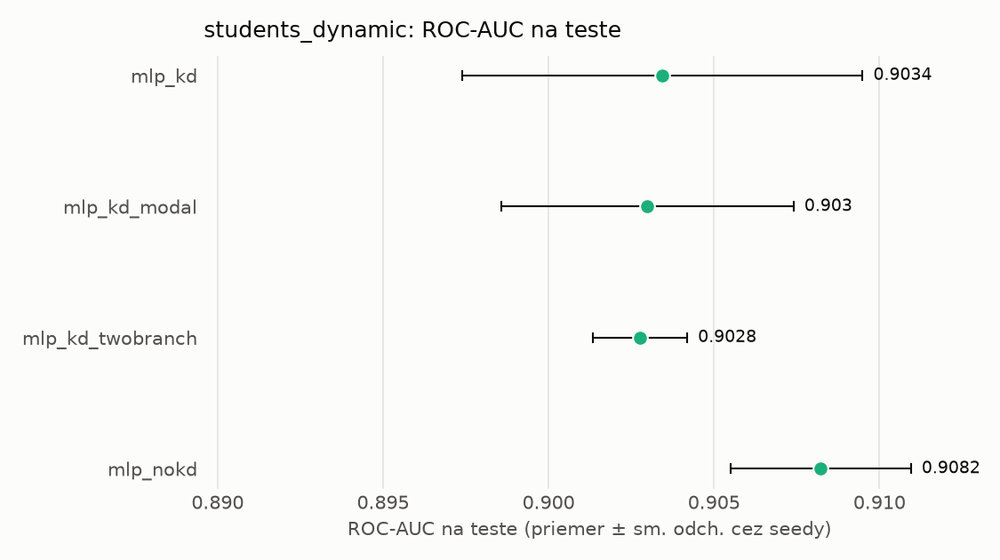
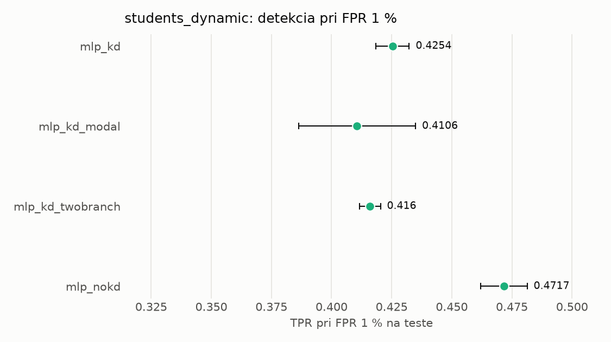

# Porovnanie modelov – students_dynamic

> Generované `src/evaluation/compare.py` (2026-11-04T08:00:39+01:00); použitý je posledný beh každého modelu.
> Metriky sú priemer cez seedy. \* = pri prahu určenom na validácii (FPR ≤ 1 %).
> CPU ms/vz. = medián latencie jednej vzorky na 1 vlákne vrátane transformácie vstupu (meranie hneď po tréningu,
> orientačné). Oficiálne merania spotreby sú v časti „Spotreba zdrojov pri inferencii“.

## Detekčná kvalita a orientačné časy
| model | ROC-AUC val | ROC-AUC test | TPR@FPR 1 % test | TPR@FPR 0,1 % test | F1 test* | FPR test* | gap train−val | CPU ms/vz. | CPU vz./s | GPU ms/vz. | parametre | MB | tréning s | ladenie min |
|---|---|---|---|---|---|---|---|---|---|---|---|---|---|---|
| [mlp_kd](../../students_dynamic/mlp_kd/20261104-075845/README.md) | 0.9955 | 0.9034 ± 0.0061 | 0.4254 | 0.2196 | 0.6237 | 0.0122 | 0.0010 | 0.102 | 97 092 | 0.452 | 64 129 | 0.31 | 7.9 | 0.0 |
| [mlp_kd_modal](../../students_dynamic/mlp_kd_modal/20261104-075936/README.md) | 0.9954 | 0.9030 ± 0.0044 | 0.4106 | 0.2629 | 0.6060 | 0.0114 | 0.0011 | 0.102 | 95 407 | 0.457 | 64 129 | 0.31 | 9.0 | 0.0 |
| [mlp_kd_twobranch](../../students_dynamic/mlp_kd_twobranch/20261104-080011/README.md) | 0.9953 | 0.9028 ± 0.0014 | 0.4160 | 0.3294 | 0.6325 | 0.0114 | 0.0008 | 0.103 | 142 338 | 0.291 | 64 129 | 0.31 | 6.6 | 0.0 |
| [mlp_nokd](../../students_dynamic/mlp_nokd/20261104-075916/README.md) | 0.9952 | 0.9082 ± 0.0027 | 0.4717 | 0.2811 | 0.6460 | 0.0111 | 0.0009 | 0.102 | 142 465 | 0.292 | 64 129 | 0.31 | 4.1 | 0.0 |

## Nízka prevalencia malvéru (test, prah z validácie)
| model | TPR | FPR | precision @ 1 % | falošné na 1 skutočný poplach @ 1 % | precision @ 0.1 % | falošné na 1 skutočný poplach @ 0.1 % |
|---|---|---|---|---|---|---|
| mlp_kd | 0.4578 | 0.0122 | 0.275 | 2.63 | 0.036 | 26.57 |
| mlp_kd_modal | 0.4392 | 0.0114 | 0.280 | 2.57 | 0.037 | 25.97 |
| mlp_kd_twobranch | 0.4673 | 0.0114 | 0.292 | 2.42 | 0.039 | 24.41 |
| mlp_nokd | 0.4817 | 0.0111 | 0.304 | 2.29 | 0.042 | 23.07 |

Prepočet: TPR a FPR nezávisia od podielu malvéru, preto sa dajú preniesť na nízku prevalenciu (v reálnej prevádzke je malvéru ~1 % alebo menej; v teste 54 %). „Falošné na 1 skutočný poplach“ = koľko neškodných súborov je označených na každý zachytený malvér.

## Spotreba zdrojov pri inferencii (benchmark, testovacia množina)
_Benchmark zatiaľ nebol spustený (`python -m src.evaluation.benchmark --approach students_dynamic`)._

## Grafy

