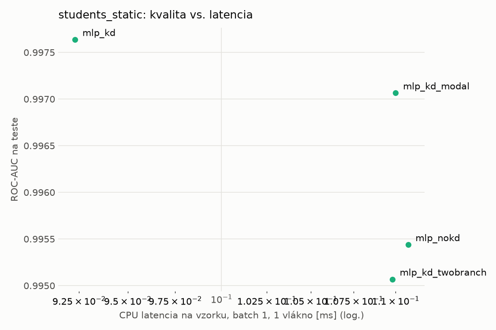
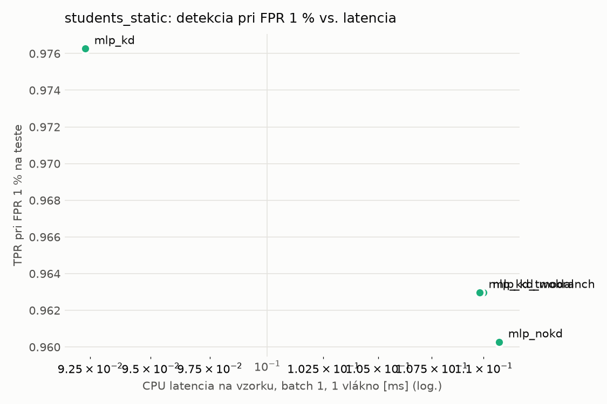
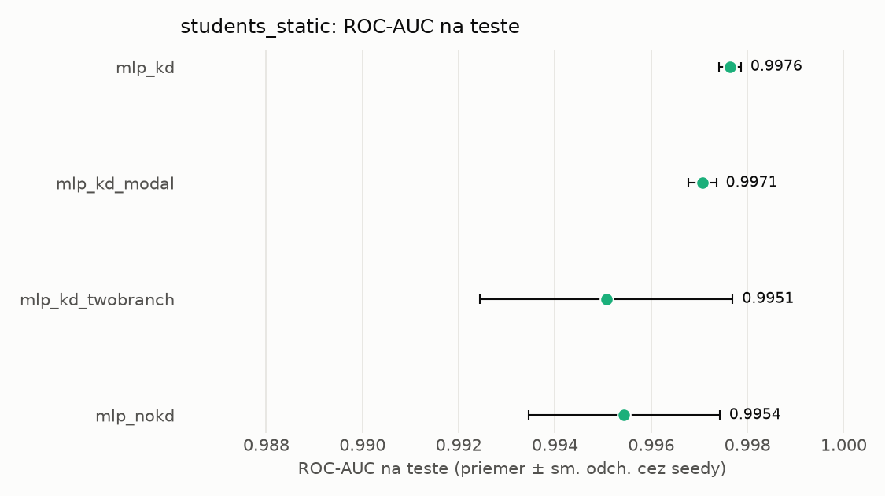
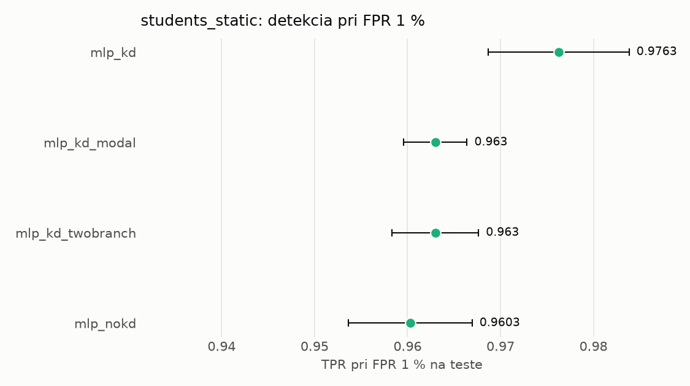

# Porovnanie modelov – students_static

> Generované `src/evaluation/compare.py` (2026-11-04T07:58:42+01:00); použitý je posledný beh každého modelu.
> Metriky sú priemer cez seedy. \* = pri prahu určenom na validácii (FPR ≤ 1 %).
> CPU ms/vz. = medián latencie jednej vzorky na 1 vlákne vrátane transformácie vstupu (meranie hneď po tréningu,
> orientačné). Oficiálne merania spotreby sú v časti „Spotreba zdrojov pri inferencii“.

## Detekčná kvalita a orientačné časy
| model | ROC-AUC val | ROC-AUC test | TPR@FPR 1 % test | TPR@FPR 0,1 % test | F1 test* | FPR test* | gap train−val | CPU ms/vz. | CPU vz./s | GPU ms/vz. | parametre | MB | tréning s | ladenie min |
|---|---|---|---|---|---|---|---|---|---|---|---|---|---|---|
| [mlp_kd](../../students_static/mlp_kd/20261104-075704/README.md) | 0.9988 | 0.9976 ± 0.0002 | 0.9763 | 0.5798 | 0.9734 | 0.0061 | 0.0010 | 0.092 | 61 462 | 0.452 | 74 337 | 0.36 | 6.3 | 0.0 |
| [mlp_kd_modal](../../students_static/mlp_kd_modal/20261104-075749/README.md) | 0.9987 | 0.9971 ± 0.0003 | 0.9630 | 0.6168 | 0.9685 | 0.0071 | 0.0010 | 0.110 | 110 160 | 0.312 | 74 337 | 0.36 | 5.6 | 0.0 |
| [mlp_kd_twobranch](../../students_static/mlp_kd_twobranch/20261104-075815/README.md) | 0.9988 | 0.9951 ± 0.0026 | 0.9630 | 0.5160 | 0.9717 | 0.0070 | 0.0010 | 0.110 | 109 158 | 0.271 | 74 337 | 0.36 | 5.5 | 0.0 |
| [mlp_nokd](../../students_static/mlp_nokd/20261104-075733/README.md) | 0.9987 | 0.9954 ± 0.0020 | 0.9603 | 0.6521 | 0.9681 | 0.0075 | 0.0011 | 0.111 | 110 222 | 0.271 | 74 337 | 0.36 | 2.4 | 0.0 |

## Nízka prevalencia malvéru (test, prah z validácie)
| model | TPR | FPR | precision @ 1 % | falošné na 1 skutočný poplach @ 1 % | precision @ 0.1 % | falošné na 1 skutočný poplach @ 0.1 % |
|---|---|---|---|---|---|---|
| mlp_kd | 0.9531 | 0.0061 | 0.613 | 0.63 | 0.135 | 6.38 |
| mlp_kd_modal | 0.9446 | 0.0071 | 0.575 | 0.74 | 0.118 | 7.46 |
| mlp_kd_twobranch | 0.9506 | 0.0070 | 0.578 | 0.73 | 0.120 | 7.37 |
| mlp_nokd | 0.9440 | 0.0075 | 0.559 | 0.79 | 0.112 | 7.95 |

Prepočet: TPR a FPR nezávisia od podielu malvéru, preto sa dajú preniesť na nízku prevalenciu (v reálnej prevádzke je malvéru ~1 % alebo menej; v teste 54 %). „Falošné na 1 skutočný poplach“ = koľko neškodných súborov je označených na každý zachytený malvér.

## Spotreba zdrojov pri inferencii (benchmark, testovacia množina)
_Benchmark zatiaľ nebol spustený (`python -m src.evaluation.benchmark --approach students_static`)._

## Grafy

