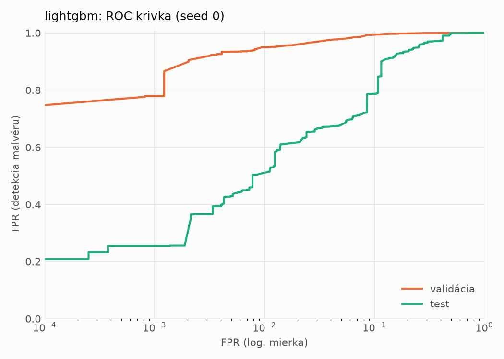
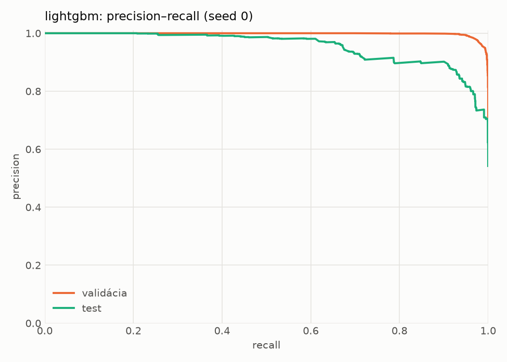
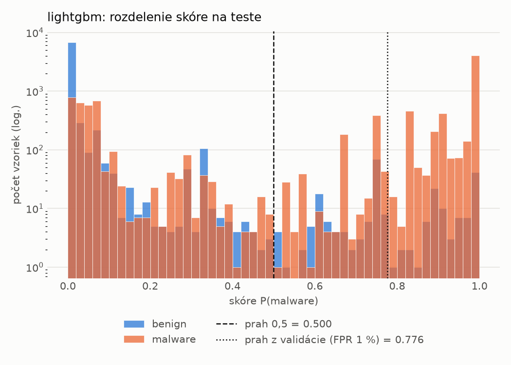
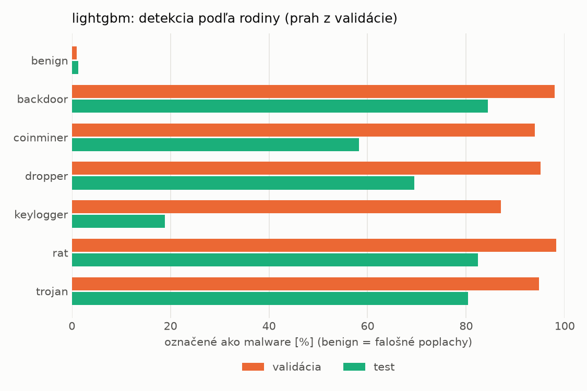
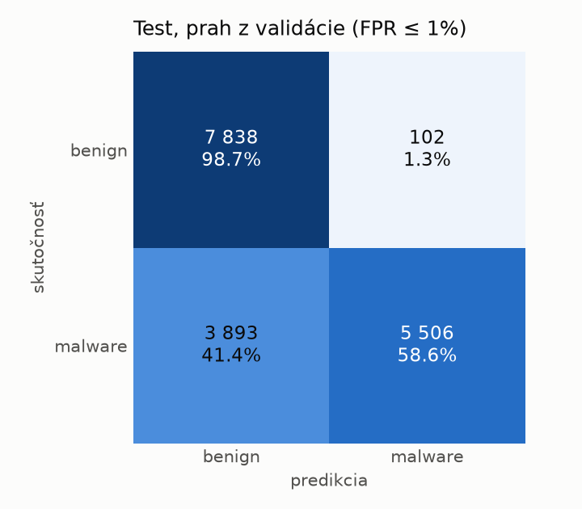
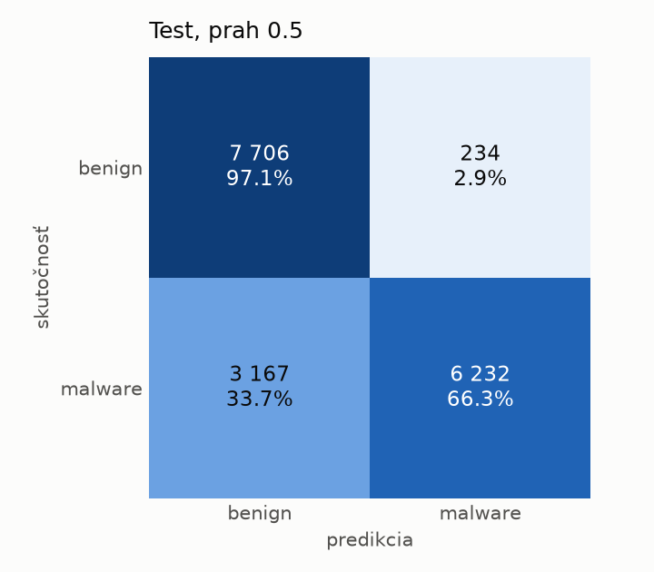
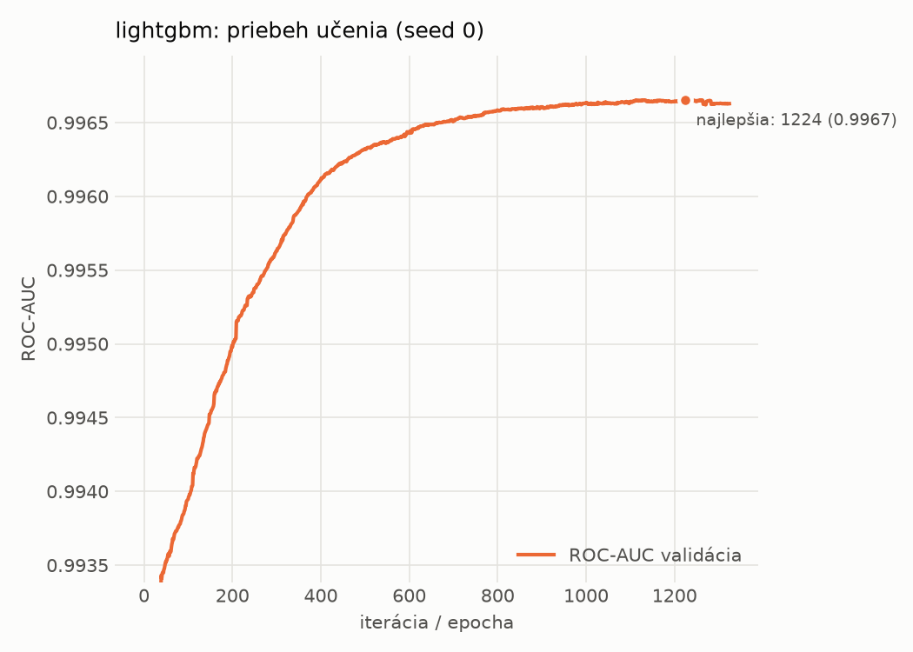

# dynamic/lightgbm – beh `20261104-060251`

> Automaticky generované (`src/training/run_tabular.py`). Konfigurácia: `config.yaml`, protokol: `protocol.yaml`.

- **Model:** `lightgbm` – LightGBM, gradient boosting stromov s early stopping na validácii (pôvodné hodnoty príznakov)
- **Ladenie:** bez ladenia – hyperparametre prevzaté z `runs_final/dynamic/lightgbm/20261102-003953`
- **Finálne modely:** seedy [0, 1, 2]; hodnoty sú priemer ± smerodajná odchýlka cez seedy
- **Najlepšie hyperparametre:** `{"num_boost_round": 5000, "early_stopping_rounds": 100, "learning_rate": 0.012600391102852807, "num_leaves": 261, "min_child_samples": 12, "feature_fraction": 0.7323605840883831, "bagging_fraction": 0.7241803281580393, "lambda_l1": 9.843384499248837e-06, "lambda_l2": 0.7301583949167907}`

## Detekčná kvalita (bez prahu)
| metrika | train (podvzorka) | validácia | test |
|---|---|---|---|
| ROC-AUC | 0.9980 ± 0.0000 | 0.9967 ± 0.0000 | 0.9476 ± 0.0001 |
| PR-AUC | 0.9986 ± 0.0000 | 0.9979 ± 0.0000 | 0.9552 ± 0.0000 |
| TPR pri FPR 1 % | 0.9521 ± 0.0001 | 0.9490 ± 0.0009 | 0.5268 ± 0.0309 |
| TPR pri FPR 0,1 % | 0.8609 ± 0.0020 | 0.7837 ± 0.0039 | 0.2514 ± 0.0077 |
| log loss | 0.0568 ± 0.0003 | 0.0729 ± 0.0001 | 0.6774 ± 0.0111 |
| Brier skóre | 0.0181 ± 0.0001 | 0.0217 ± 0.0000 | 0.1742 ± 0.0007 |

Rozdiel ROC-AUC train − validácia: **0.0013** (veľký rozdiel = preučenie).

## Pri prahu z validácie (FPR ≤ 1% na validácii)
| metrika | train (podvzorka) | validácia | test |
|---|---|---|---|
| accuracy | 0.9654 ± 0.0004 | 0.9646 ± 0.0006 | 0.7734 ± 0.0067 |
| balanced accuracy | 0.9708 ± 0.0003 | 0.9697 ± 0.0005 | 0.7900 ± 0.0062 |
| precision | 0.9962 ± 0.0000 | 0.9938 ± 0.0002 | 0.9820 ± 0.0004 |
| recall (TPR) | 0.9472 ± 0.0006 | 0.9490 ± 0.0009 | 0.5928 ± 0.0124 |
| FPR | 0.0057 ± 0.0000 | 0.0097 ± 0.0002 | 0.0128 ± 0.0000 |
| F1 | 0.9711 ± 0.0003 | 0.9709 ± 0.0005 | 0.7393 ± 0.0097 |
| MCC | 0.9298 ± 0.0007 | 0.9274 ± 0.0012 | 0.6158 ± 0.0099 |

## Pri pevnom prahu 0.5
| metrika | train (podvzorka) | validácia | test |
|---|---|---|---|
| accuracy | 0.9713 ± 0.0003 | 0.9685 ± 0.0002 | 0.8037 ± 0.0006 |
| balanced accuracy | 0.9734 ± 0.0003 | 0.9700 ± 0.0003 | 0.8167 ± 0.0006 |
| precision | 0.9887 ± 0.0003 | 0.9851 ± 0.0003 | 0.9639 ± 0.0002 |
| recall (TPR) | 0.9644 ± 0.0002 | 0.9639 ± 0.0002 | 0.6627 ± 0.0011 |
| FPR | 0.0177 ± 0.0004 | 0.0240 ± 0.0005 | 0.0293 ± 0.0001 |
| F1 | 0.9764 ± 0.0002 | 0.9744 ± 0.0002 | 0.7854 ± 0.0008 |
| MCC | 0.9404 ± 0.0005 | 0.9338 ± 0.0005 | 0.6526 ± 0.0010 |

## Výpočtové nároky (seed 0, testovacia množina)
| meranie | hodnota |
|---|---|
| tréning finálneho modelu | 23.2 s (priemer cez seedy) |
| ladenie spolu | 0 s |
| počet parametrov / uzlov | 631 524 |
| veľkosť modelu na disku | 35.83 MB |
| CPU latencia modelu (batch 1, 1 vlákno) | 0.296 ms (p95 0.570) |
| CPU priepustnosť (24 vlákien) | 58 125 vzoriek/s |

## Grafy
| | |
|---|---|
|  |  |
|  |  |
|  |  |
|  |  |

## Súbory
`metrics.json` (všetky metriky po seedoch vrátane rodín), `timing.json`, `hpo_trials.csv`,
`predictions/<časť>_seed<N>.parquet` (sha256, family, label, score), `model/seed_<N>/`, `log.txt`.
