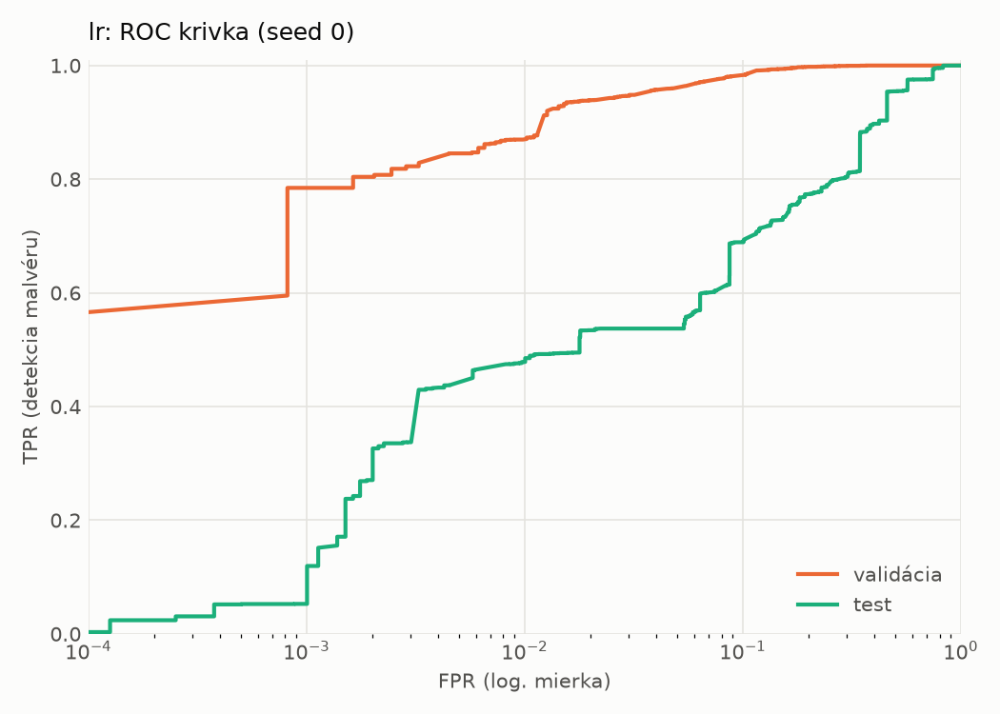
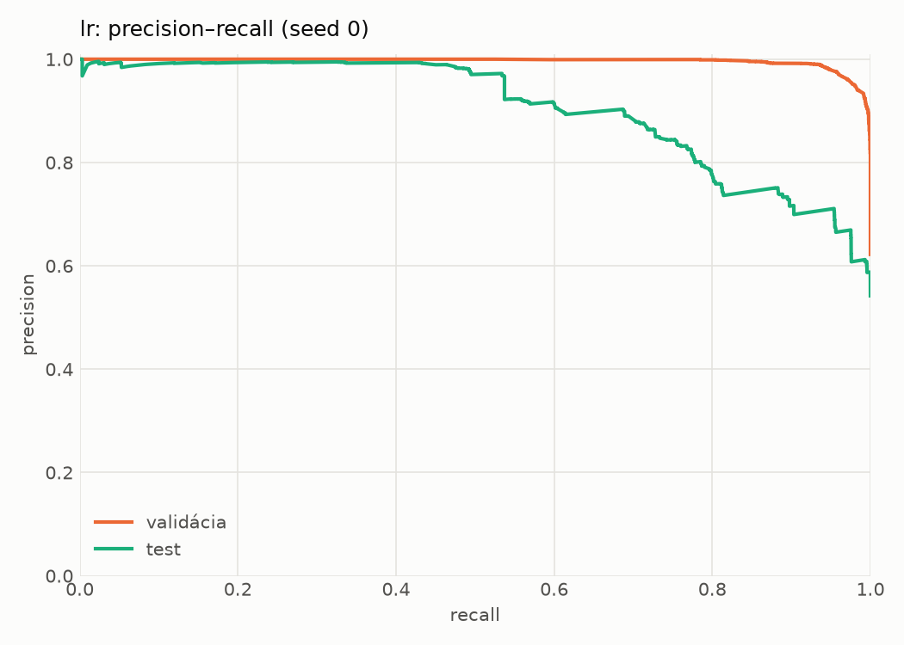
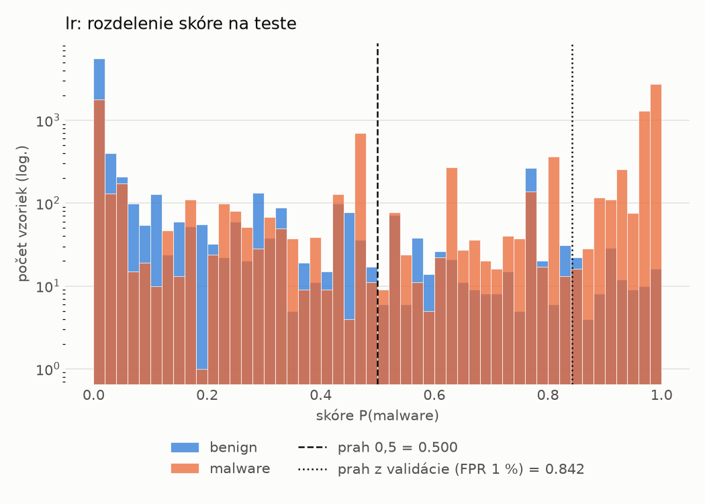
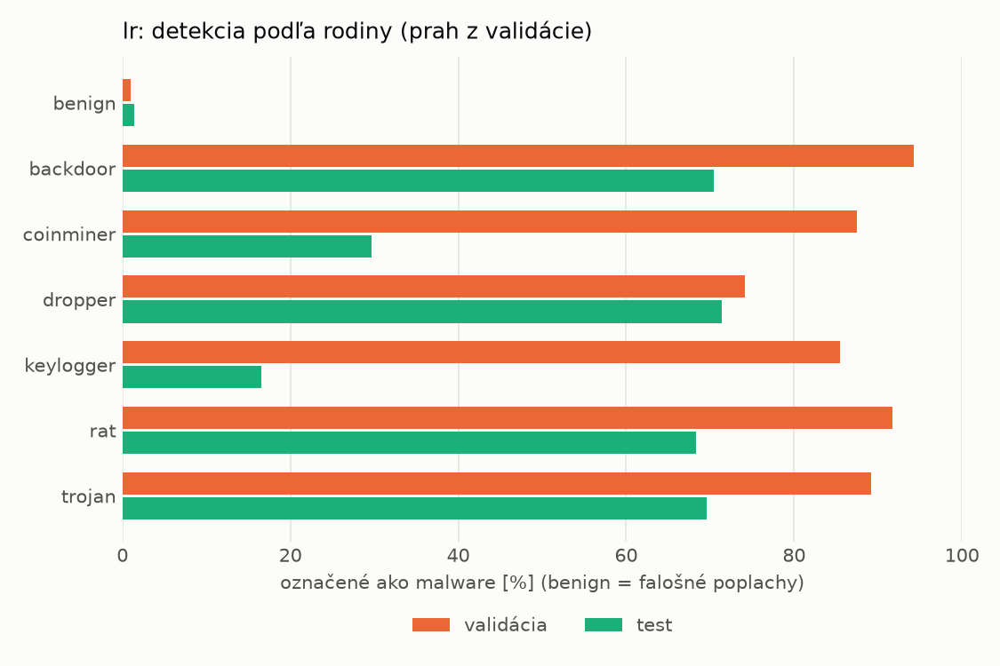
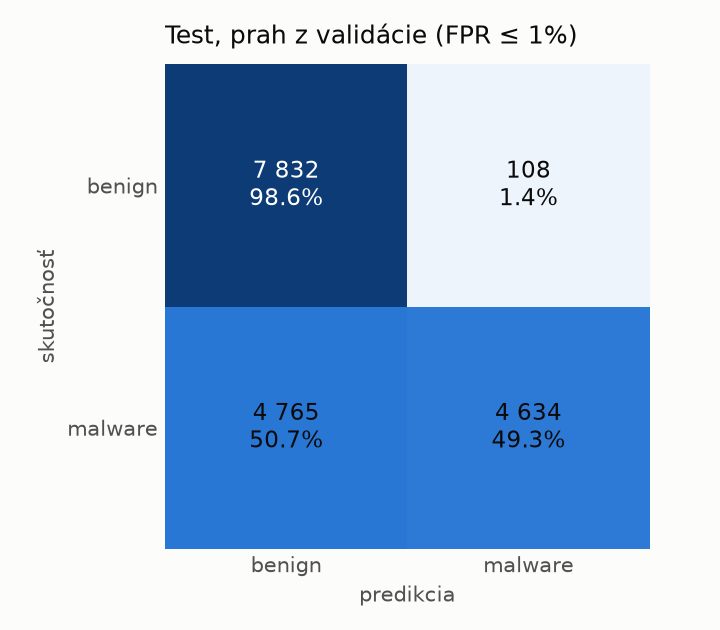
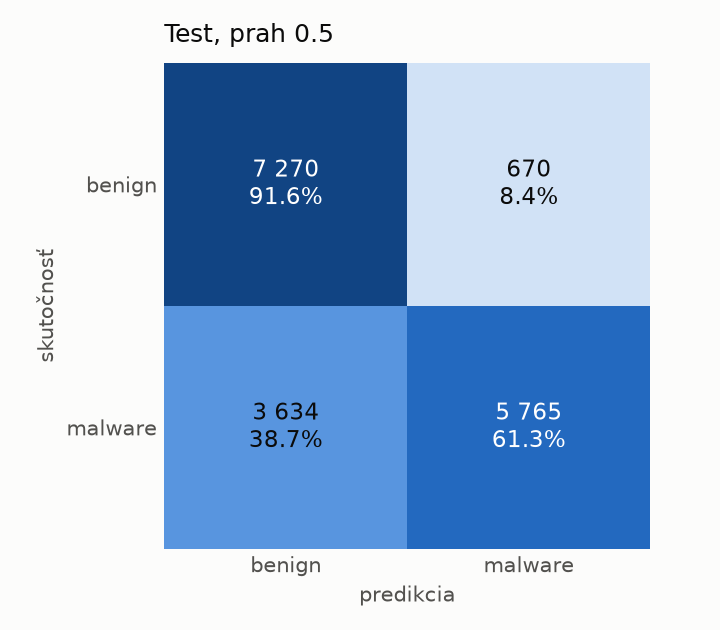

# dynamic/lr – beh `20261104-060047`

> Automaticky generované (`src/training/run_tabular.py`). Konfigurácia: `config.yaml`, protokol: `protocol.yaml`.

- **Model:** `logreg` – logistická regresia s L2 regularizáciou (vstup signed log1p + štandardizácia)
- **Ladenie:** bez ladenia – hyperparametre prevzaté z `runs_final/dynamic/lr/20261102-002602`
- **Finálne modely:** seedy [0, 1, 2]; hodnoty sú priemer ± smerodajná odchýlka cez seedy
- **Najlepšie hyperparametre:** `{"max_iter": 2000, "C": 0.04224422279858655}`

## Detekčná kvalita (bez prahu)
| metrika | train (podvzorka) | validácia | test |
|---|---|---|---|
| ROC-AUC | 0.9951 ± 0.0000 | 0.9938 ± 0.0000 | 0.8778 ± 0.0000 |
| PR-AUC | 0.9969 ± 0.0000 | 0.9961 ± 0.0000 | 0.9062 ± 0.0000 |
| TPR pri FPR 1 % | 0.9144 ± 0.0000 | 0.8697 ± 0.0000 | 0.4786 ± 0.0000 |
| TPR pri FPR 0,1 % | 0.8162 ± 0.0000 | 0.7847 ± 0.0000 | 0.0528 ± 0.0000 |
| log loss | 0.0903 ± 0.0000 | 0.0994 ± 0.0000 | 0.8638 ± 0.0000 |
| Brier skóre | 0.0279 ± 0.0000 | 0.0299 ± 0.0000 | 0.1887 ± 0.0000 |

Rozdiel ROC-AUC train − validácia: **0.0013** (veľký rozdiel = preučenie).

## Pri prahu z validácie (FPR ≤ 1% na validácii)
| metrika | train (podvzorka) | validácia | test |
|---|---|---|---|
| accuracy | 0.9140 ± 0.0000 | 0.9152 ± 0.0000 | 0.7190 ± 0.0000 |
| balanced accuracy | 0.9290 ± 0.0000 | 0.9299 ± 0.0000 | 0.7397 ± 0.0000 |
| precision | 0.9961 ± 0.0000 | 0.9932 ± 0.0000 | 0.9772 ± 0.0000 |
| recall (TPR) | 0.8635 ± 0.0000 | 0.8697 ± 0.0000 | 0.4930 ± 0.0000 |
| FPR | 0.0055 ± 0.0000 | 0.0098 ± 0.0000 | 0.0136 ± 0.0000 |
| F1 | 0.9251 ± 0.0000 | 0.9274 ± 0.0000 | 0.6554 ± 0.0000 |
| MCC | 0.8370 ± 0.0000 | 0.8372 ± 0.0000 | 0.5359 ± 0.0000 |

## Pri pevnom prahu 0.5
| metrika | train (podvzorka) | validácia | test |
|---|---|---|---|
| accuracy | 0.9564 ± 0.0000 | 0.9558 ± 0.0000 | 0.7518 ± 0.0000 |
| balanced accuracy | 0.9590 ± 0.0000 | 0.9582 ± 0.0000 | 0.7645 ± 0.0000 |
| precision | 0.9808 ± 0.0000 | 0.9800 ± 0.0000 | 0.8959 ± 0.0000 |
| recall (TPR) | 0.9476 ± 0.0000 | 0.9483 ± 0.0000 | 0.6134 ± 0.0000 |
| FPR | 0.0296 ± 0.0000 | 0.0319 ± 0.0000 | 0.0844 ± 0.0000 |
| F1 | 0.9639 ± 0.0000 | 0.9639 ± 0.0000 | 0.7282 ± 0.0000 |
| MCC | 0.9097 ± 0.0000 | 0.9077 ± 0.0000 | 0.5455 ± 0.0000 |

## Výpočtové nároky (seed 0, testovacia množina)
| meranie | hodnota |
|---|---|
| tréning finálneho modelu | 4.5 s (priemer cez seedy) |
| ladenie spolu | 0 s |
| počet parametrov / uzlov | 2 001 |
| veľkosť modelu na disku | 0.06 MB |
| transformácia vstupu – latencia (1 vlákno) | 0.023 ms |
| transformácia vstupu – priepustnosť | 56 229 vzoriek/s |
| CPU latencia modelu (batch 1, 1 vlákno) | 0.005 ms (p95 0.006) |
| CPU priepustnosť (24 vlákien) | 346 763 vzoriek/s |

## Grafy
| | |
|---|---|
|  |  |
|  |  |
|  |  |
|  |  |

## Súbory
`metrics.json` (všetky metriky po seedoch vrátane rodín), `timing.json`, `hpo_trials.csv`,
`predictions/<časť>_seed<N>.parquet` (sha256, family, label, score), `model/seed_<N>/`, `log.txt`.
