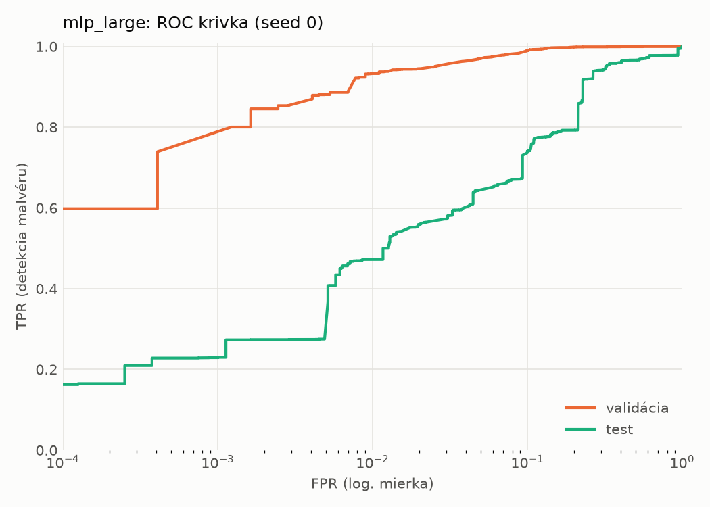
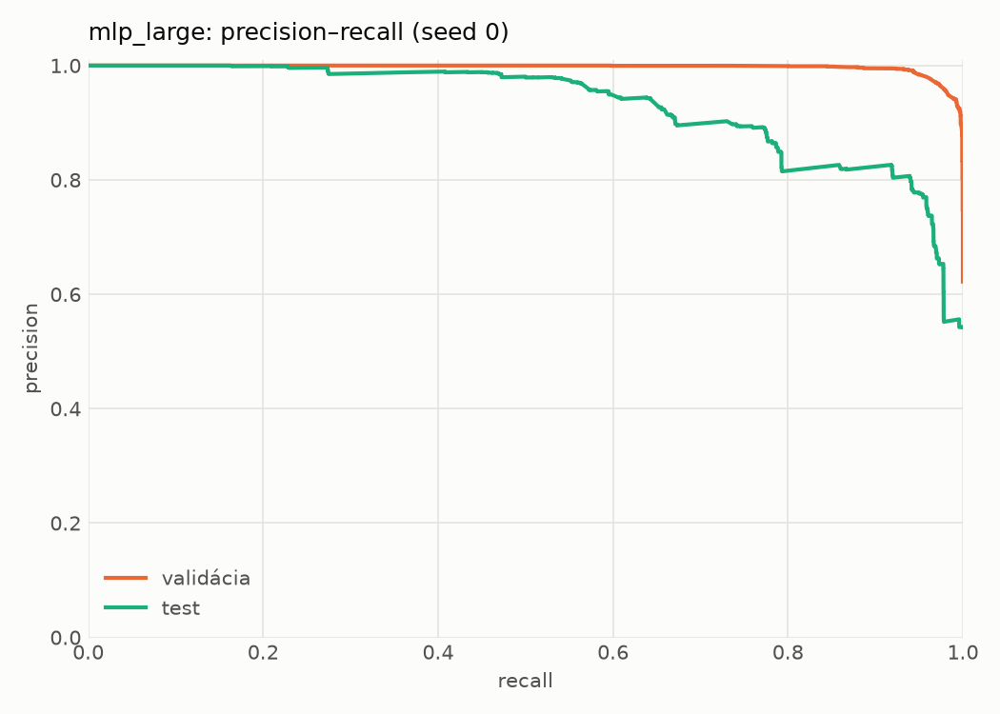
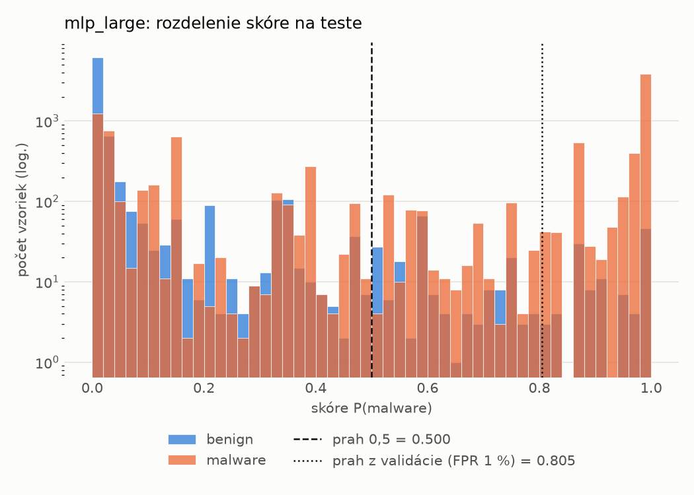
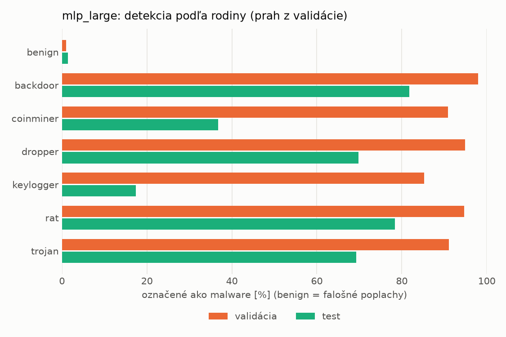
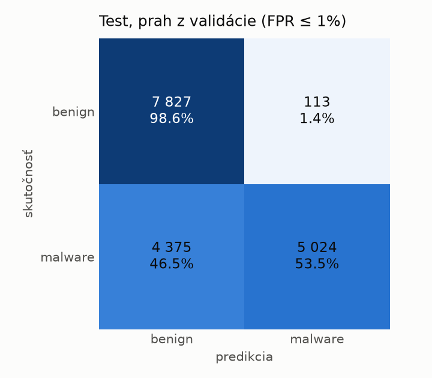
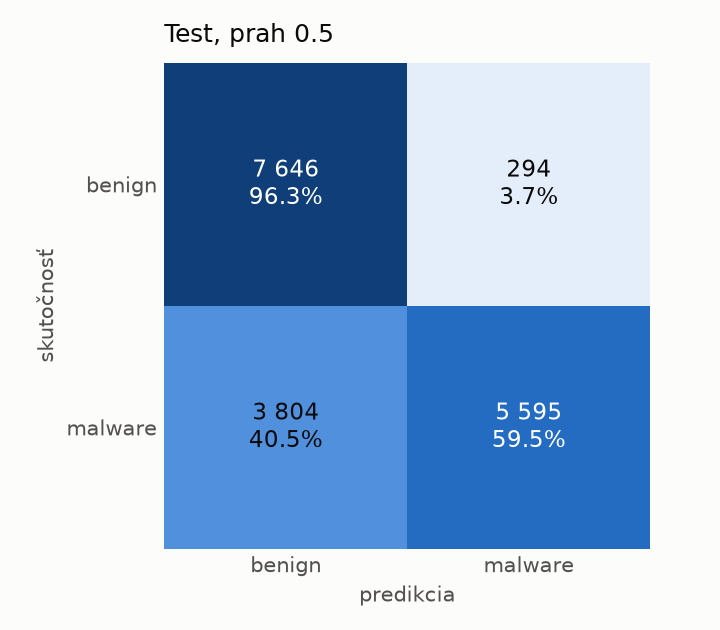
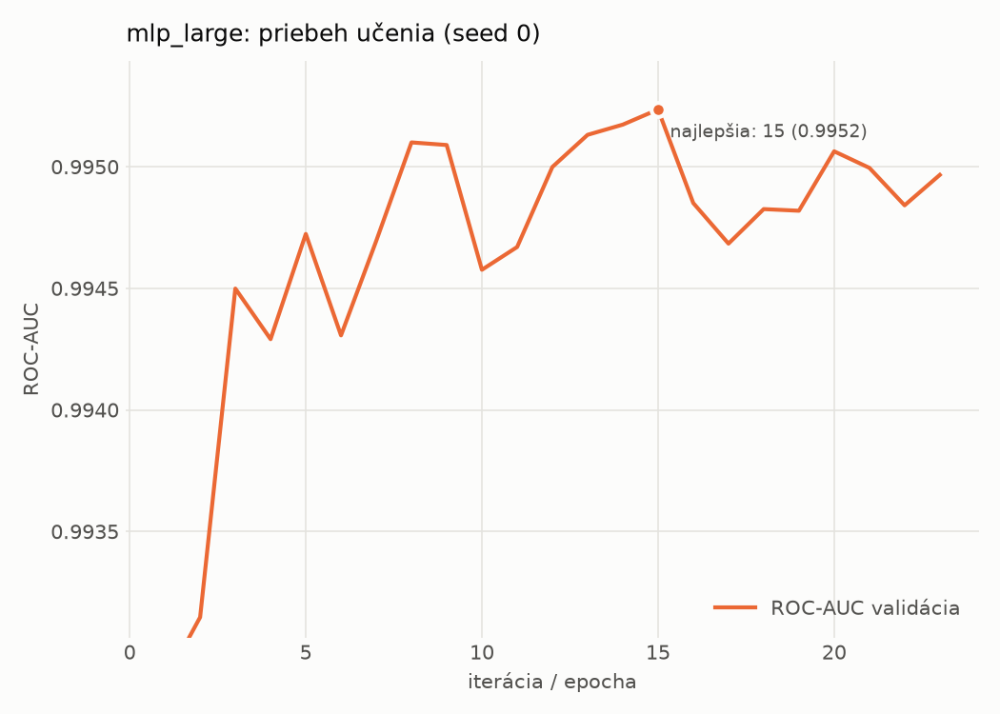

# dynamic/mlp_large – beh `20261104-060442`

> Automaticky generované (`src/training/run_tabular.py`). Konfigurácia: `config.yaml`, protokol: `protocol.yaml`.

- **Model:** `mlp` – veľká neurónová sieť (3–5 skrytých vrstiev, 512–2048 neurónov), kandidát na učiteľa
- **Ladenie:** bez ladenia – hyperparametre prevzaté z `runs_final/dynamic/mlp_large/20261102-005920`
- **Finálne modely:** seedy [0, 1, 2]; hodnoty sú priemer ± smerodajná odchýlka cez seedy
- **Najlepšie hyperparametre:** `{"max_epochs": 100, "patience": 8, "hidden_layers": 3, "hidden_width": 512, "width_decay": 0.5, "dropout": 0.3735687797102123, "lr": 0.00020669709962675654, "weight_decay": 1.4747439017290252e-05, "batch_size": 256}`

## Detekčná kvalita (bez prahu)
| metrika | train (podvzorka) | validácia | test |
|---|---|---|---|
| ROC-AUC | 0.9964 ± 0.0003 | 0.9952 ± 0.0001 | 0.9121 ± 0.0053 |
| PR-AUC | 0.9976 ± 0.0002 | 0.9970 ± 0.0001 | 0.9318 ± 0.0031 |
| TPR pri FPR 1 % | 0.9289 ± 0.0019 | 0.9282 ± 0.0040 | 0.4676 ± 0.0217 |
| TPR pri FPR 0,1 % | 0.8592 ± 0.0138 | 0.7644 ± 0.0350 | 0.2608 ± 0.0283 |
| log loss | 0.0748 ± 0.0024 | 0.0888 ± 0.0011 | 0.8501 ± 0.0195 |
| Brier skóre | 0.0240 ± 0.0008 | 0.0262 ± 0.0004 | 0.1952 ± 0.0013 |

Rozdiel ROC-AUC train − validácia: **0.0012** (veľký rozdiel = preučenie).

## Pri prahu z validácie (FPR ≤ 1% na validácii)
| metrika | train (podvzorka) | validácia | test |
|---|---|---|---|
| accuracy | 0.9503 ± 0.0019 | 0.9516 ± 0.0025 | 0.7377 ± 0.0049 |
| balanced accuracy | 0.9579 ± 0.0014 | 0.9592 ± 0.0020 | 0.7570 ± 0.0045 |
| precision | 0.9939 ± 0.0006 | 0.9936 ± 0.0000 | 0.9779 ± 0.0002 |
| recall (TPR) | 0.9248 ± 0.0038 | 0.9282 ± 0.0040 | 0.5280 ± 0.0093 |
| FPR | 0.0090 ± 0.0010 | 0.0098 ± 0.0000 | 0.0141 ± 0.0003 |
| F1 | 0.9581 ± 0.0017 | 0.9598 ± 0.0022 | 0.6857 ± 0.0078 |
| MCC | 0.9007 ± 0.0035 | 0.9026 ± 0.0047 | 0.5628 ± 0.0069 |

## Pri pevnom prahu 0.5
| metrika | train (podvzorka) | validácia | test |
|---|---|---|---|
| accuracy | 0.9609 ± 0.0014 | 0.9601 ± 0.0009 | 0.7614 ± 0.0021 |
| balanced accuracy | 0.9641 ± 0.0016 | 0.9632 ± 0.0009 | 0.7772 ± 0.0018 |
| precision | 0.9855 ± 0.0017 | 0.9846 ± 0.0006 | 0.9524 ± 0.0021 |
| recall (TPR) | 0.9504 ± 0.0013 | 0.9508 ± 0.0010 | 0.5892 ± 0.0053 |
| FPR | 0.0223 ± 0.0027 | 0.0244 ± 0.0010 | 0.0348 ± 0.0019 |
| F1 | 0.9677 ± 0.0012 | 0.9674 ± 0.0007 | 0.7280 ± 0.0035 |
| MCC | 0.9193 ± 0.0030 | 0.9171 ± 0.0019 | 0.5850 ± 0.0022 |

## Výpočtové nároky (seed 0, testovacia množina)
| meranie | hodnota |
|---|---|
| tréning finálneho modelu | 14.5 s (priemer cez seedy) |
| ladenie spolu | 0 s |
| počet parametrov / uzlov | 1 190 657 |
| veľkosť modelu na disku | 4.83 MB |
| transformácia vstupu – latencia (1 vlákno) | 0.034 ms |
| transformácia vstupu – priepustnosť | 45 419 vzoriek/s |
| CPU latencia modelu (batch 1, 1 vlákno) | 0.196 ms (p95 0.224) |
| CPU priepustnosť (24 vlákien) | 75 825 vzoriek/s |
| GPU latencia (batch 1) | 0.451 ms (p95 0.918) |
| GPU priepustnosť | 111 269 vzoriek/s |
| GPU špičková pamäť | 1234 MB |

## Grafy
| | |
|---|---|
|  |  |
|  |  |
|  |  |
|  |  |

## Súbory
`metrics.json` (všetky metriky po seedoch vrátane rodín), `timing.json`, `hpo_trials.csv`,
`predictions/<časť>_seed<N>.parquet` (sha256, family, label, score), `model/seed_<N>/`, `log.txt`.
