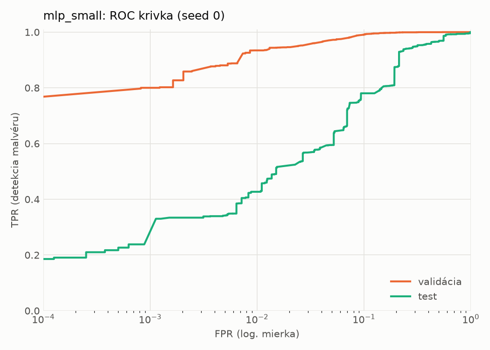
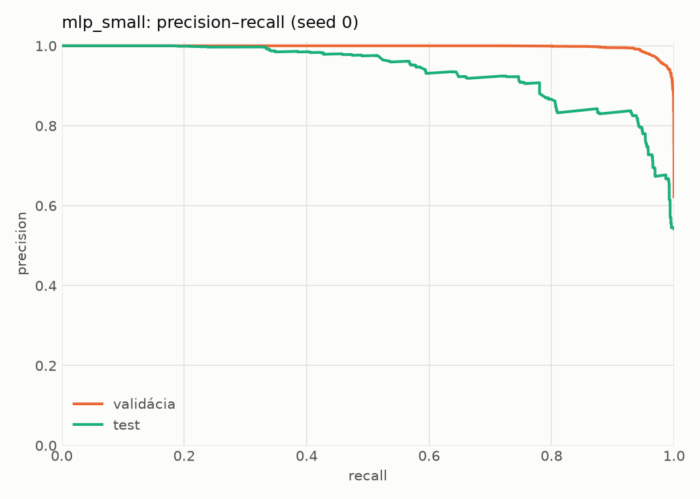
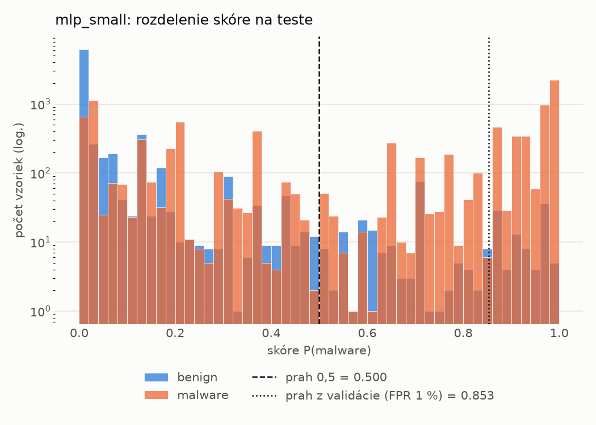
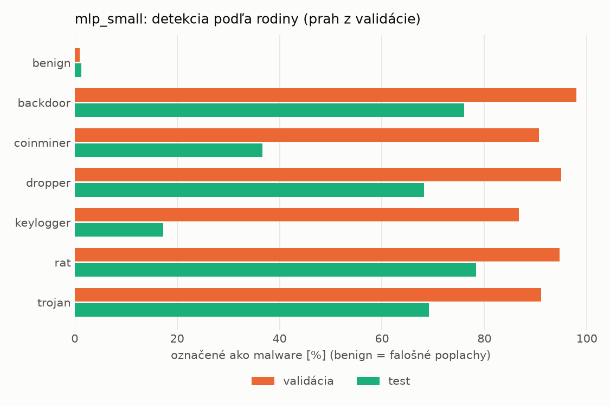
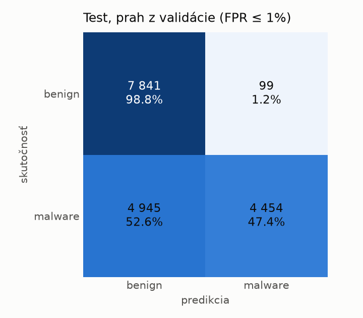
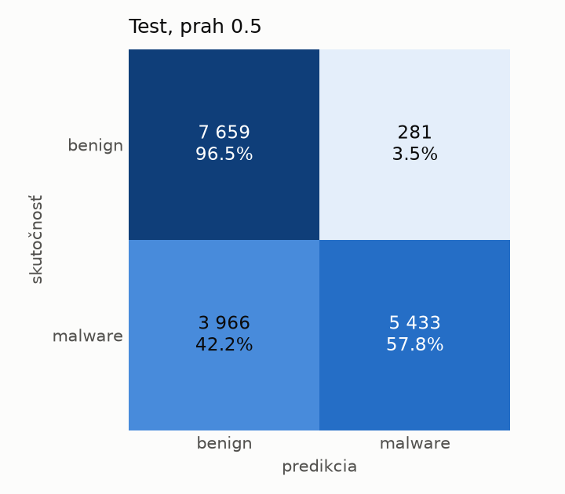
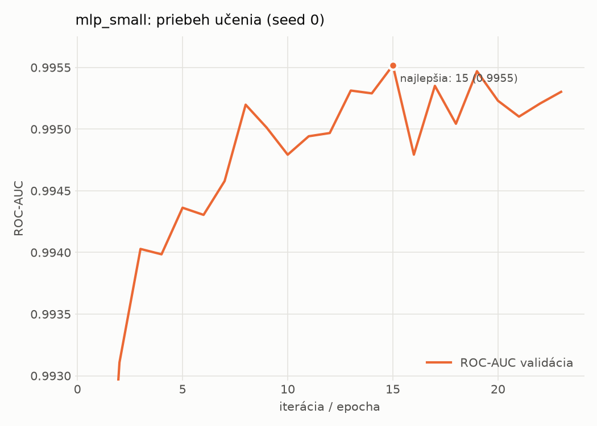

# dynamic/mlp_small – beh `20261104-060421`

> Automaticky generované (`src/training/run_tabular.py`). Konfigurácia: `config.yaml`, protokol: `protocol.yaml`.

- **Model:** `mlp` – malá neurónová sieť (1–2 skryté vrstvy), kandidát na ľahkého študenta
- **Ladenie:** bez ladenia – hyperparametre prevzaté z `runs_final/dynamic/mlp_small/20261102-005611`
- **Finálne modely:** seedy [0, 1, 2]; hodnoty sú priemer ± smerodajná odchýlka cez seedy
- **Najlepšie hyperparametre:** `{"width_decay": 0.5, "max_epochs": 100, "patience": 8, "hidden_layers": 2, "hidden_width": 256, "dropout": 0.194338644844741, "lr": 0.0002516607127550297, "weight_decay": 0.0020651425578959264, "batch_size": 1024}`

## Detekčná kvalita (bez prahu)
| metrika | train (podvzorka) | validácia | test |
|---|---|---|---|
| ROC-AUC | 0.9965 ± 0.0001 | 0.9954 ± 0.0001 | 0.9084 ± 0.0110 |
| PR-AUC | 0.9977 ± 0.0001 | 0.9972 ± 0.0000 | 0.9281 ± 0.0068 |
| TPR pri FPR 1 % | 0.9305 ± 0.0017 | 0.9289 ± 0.0047 | 0.4347 ± 0.0122 |
| TPR pri FPR 0,1 % | 0.8670 ± 0.0089 | 0.7747 ± 0.0377 | 0.2278 ± 0.0098 |
| log loss | 0.0741 ± 0.0016 | 0.0846 ± 0.0002 | 0.8038 ± 0.0754 |
| Brier skóre | 0.0235 ± 0.0004 | 0.0254 ± 0.0003 | 0.1927 ± 0.0048 |

Rozdiel ROC-AUC train − validácia: **0.0011** (veľký rozdiel = preučenie).

## Pri prahu z validácie (FPR ≤ 1% na validácii)
| metrika | train (podvzorka) | validácia | test |
|---|---|---|---|
| accuracy | 0.9505 ± 0.0023 | 0.9521 ± 0.0030 | 0.7068 ± 0.0058 |
| balanced accuracy | 0.9582 ± 0.0017 | 0.9597 ± 0.0024 | 0.7286 ± 0.0053 |
| precision | 0.9942 ± 0.0007 | 0.9938 ± 0.0002 | 0.9776 ± 0.0010 |
| recall (TPR) | 0.9250 ± 0.0043 | 0.9289 ± 0.0047 | 0.4699 ± 0.0104 |
| FPR | 0.0087 ± 0.0010 | 0.0096 ± 0.0002 | 0.0128 ± 0.0003 |
| F1 | 0.9583 ± 0.0020 | 0.9602 ± 0.0026 | 0.6347 ± 0.0097 |
| MCC | 0.9012 ± 0.0041 | 0.9036 ± 0.0057 | 0.5189 ± 0.0086 |

## Pri pevnom prahu 0.5
| metrika | train (podvzorka) | validácia | test |
|---|---|---|---|
| accuracy | 0.9637 ± 0.0013 | 0.9626 ± 0.0013 | 0.7621 ± 0.0185 |
| balanced accuracy | 0.9654 ± 0.0006 | 0.9642 ± 0.0011 | 0.7770 ± 0.0181 |
| precision | 0.9827 ± 0.0027 | 0.9820 ± 0.0025 | 0.9397 ± 0.0239 |
| recall (TPR) | 0.9579 ± 0.0048 | 0.9574 ± 0.0036 | 0.5997 ± 0.0262 |
| FPR | 0.0270 ± 0.0044 | 0.0289 ± 0.0041 | 0.0457 ± 0.0189 |
| F1 | 0.9701 ± 0.0012 | 0.9695 ± 0.0011 | 0.7319 ± 0.0231 |
| MCC | 0.9245 ± 0.0024 | 0.9215 ± 0.0025 | 0.5804 ± 0.0358 |

## Výpočtové nároky (seed 0, testovacia množina)
| meranie | hodnota |
|---|---|
| tréning finálneho modelu | 4.0 s (priemer cez seedy) |
| ladenie spolu | 0 s |
| počet parametrov / uzlov | 546 049 |
| veľkosť modelu na disku | 2.24 MB |
| transformácia vstupu – latencia (1 vlákno) | 0.034 ms |
| transformácia vstupu – priepustnosť | 46 797 vzoriek/s |
| CPU latencia modelu (batch 1, 1 vlákno) | 0.131 ms (p95 0.146) |
| CPU priepustnosť (24 vlákien) | 86 121 vzoriek/s |
| GPU latencia (batch 1) | 0.399 ms (p95 0.697) |
| GPU priepustnosť | 121 707 vzoriek/s |
| GPU špičková pamäť | 695 MB |

## Grafy
| | |
|---|---|
|  |  |
|  |  |
|  |  |
|  |  |

## Súbory
`metrics.json` (všetky metriky po seedoch vrátane rodín), `timing.json`, `hpo_trials.csv`,
`predictions/<časť>_seed<N>.parquet` (sha256, family, label, score), `model/seed_<N>/`, `log.txt`.
