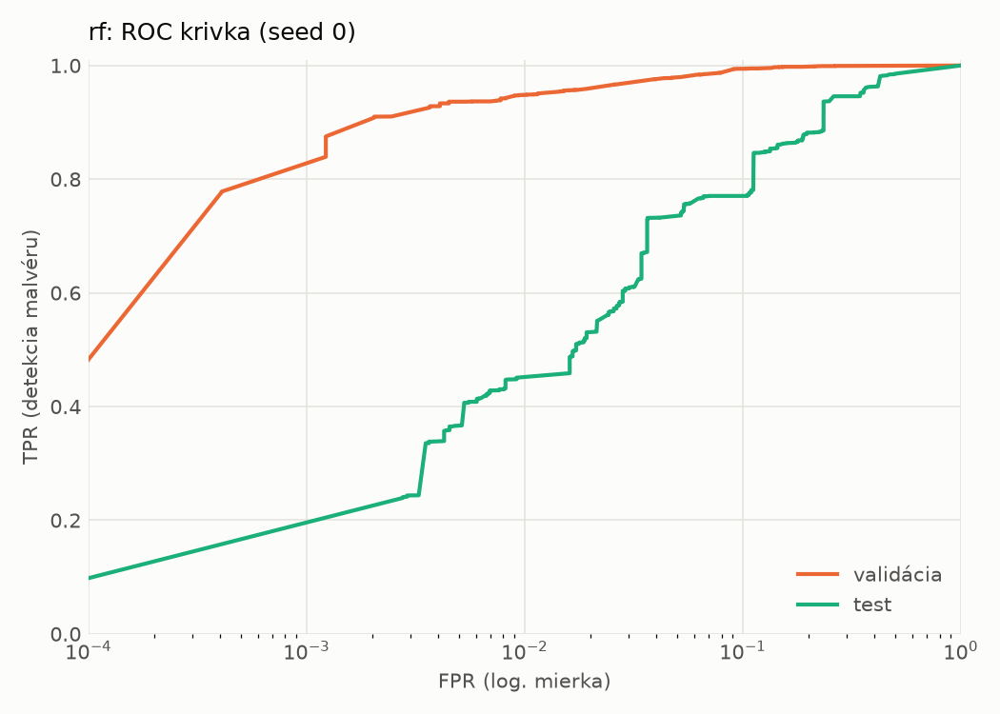
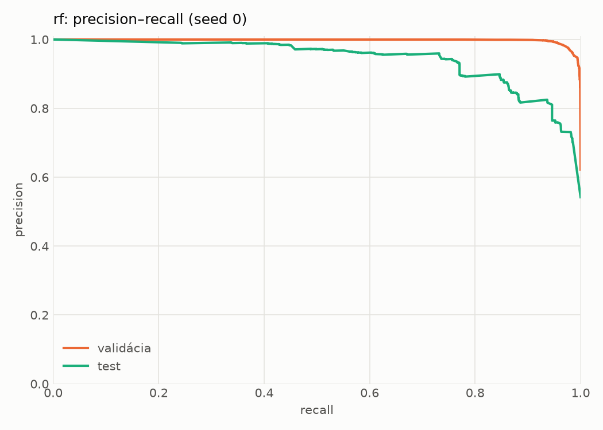
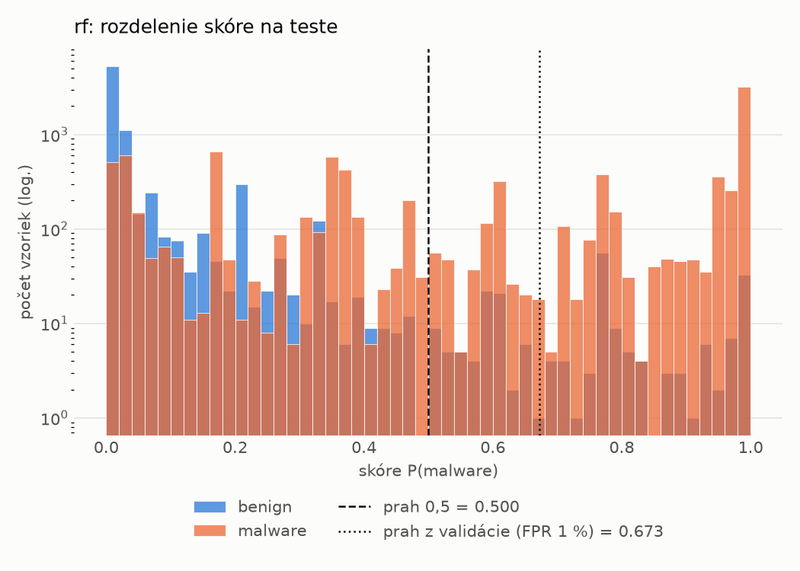
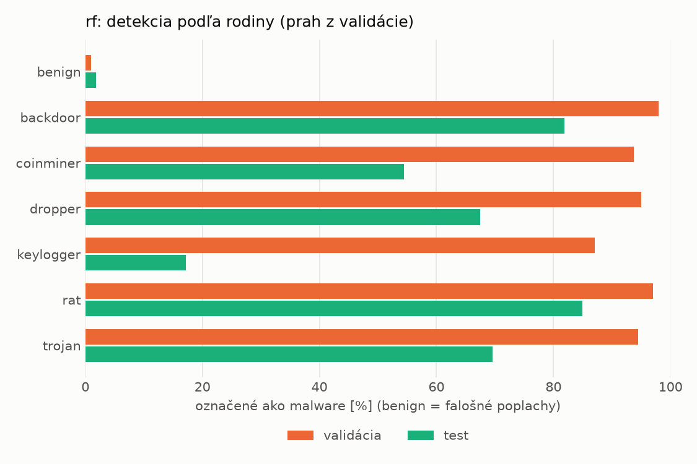
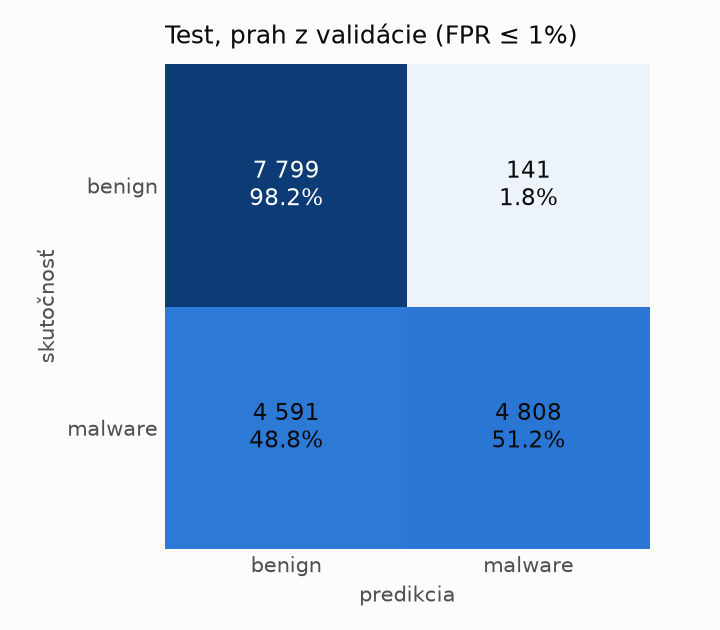
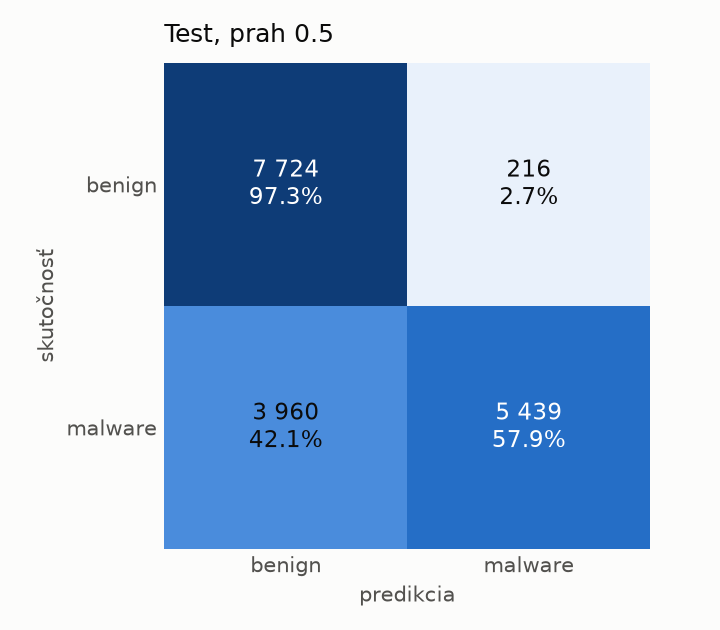

# dynamic/rf – beh `20261104-060107`

> Automaticky generované (`src/training/run_tabular.py`). Konfigurácia: `config.yaml`, protokol: `protocol.yaml`.

- **Model:** `random_forest` – Random Forest (pôvodné hodnoty príznakov)
- **Ladenie:** bez ladenia – hyperparametre prevzaté z `runs_final/dynamic/rf/20261102-003041`
- **Finálne modely:** seedy [0, 1, 2]; hodnoty sú priemer ± smerodajná odchýlka cez seedy
- **Najlepšie hyperparametre:** `{"n_estimators": 450, "max_depth": null, "min_samples_leaf": 1, "max_features": 0.05}`

## Detekčná kvalita (bez prahu)
| metrika | train (podvzorka) | validácia | test |
|---|---|---|---|
| ROC-AUC | 0.9980 ± 0.0000 | 0.9965 ± 0.0001 | 0.9335 ± 0.0029 |
| PR-AUC | 0.9987 ± 0.0000 | 0.9977 ± 0.0001 | 0.9430 ± 0.0017 |
| TPR pri FPR 1 % | 0.9514 ± 0.0002 | 0.9481 ± 0.0001 | 0.4597 ± 0.0077 |
| TPR pri FPR 0,1 % | 0.8736 ± 0.0002 | 0.8294 ± 0.0461 | 0.0000 ± 0.0000 |
| log loss | 0.0563 ± 0.0001 | 0.0762 ± 0.0011 | 0.6763 ± 0.0026 |
| Brier skóre | 0.0181 ± 0.0000 | 0.0214 ± 0.0000 | 0.1685 ± 0.0004 |

Rozdiel ROC-AUC train − validácia: **0.0016** (veľký rozdiel = preučenie).

## Pri prahu z validácie (FPR ≤ 1% na validácii)
| metrika | train (podvzorka) | validácia | test |
|---|---|---|---|
| accuracy | 0.9661 ± 0.0003 | 0.9642 ± 0.0001 | 0.7245 ± 0.0036 |
| balanced accuracy | 0.9714 ± 0.0003 | 0.9694 ± 0.0001 | 0.7446 ± 0.0033 |
| precision | 0.9962 ± 0.0000 | 0.9940 ± 0.0003 | 0.9720 ± 0.0005 |
| recall (TPR) | 0.9484 ± 0.0006 | 0.9481 ± 0.0001 | 0.5064 ± 0.0068 |
| FPR | 0.0057 ± 0.0000 | 0.0094 ± 0.0004 | 0.0173 ± 0.0004 |
| F1 | 0.9718 ± 0.0003 | 0.9705 ± 0.0001 | 0.6659 ± 0.0059 |
| MCC | 0.9312 ± 0.0007 | 0.9266 ± 0.0002 | 0.5413 ± 0.0051 |

## Pri pevnom prahu 0.5
| metrika | train (podvzorka) | validácia | test |
|---|---|---|---|
| accuracy | 0.9723 ± 0.0000 | 0.9694 ± 0.0002 | 0.7638 ± 0.0065 |
| balanced accuracy | 0.9739 ± 0.0000 | 0.9703 ± 0.0002 | 0.7800 ± 0.0060 |
| precision | 0.9877 ± 0.0000 | 0.9841 ± 0.0001 | 0.9627 ± 0.0009 |
| recall (TPR) | 0.9670 ± 0.0000 | 0.9664 ± 0.0001 | 0.5869 ± 0.0119 |
| FPR | 0.0192 ± 0.0000 | 0.0257 ± 0.0002 | 0.0269 ± 0.0003 |
| F1 | 0.9772 ± 0.0000 | 0.9752 ± 0.0001 | 0.7292 ± 0.0094 |
| MCC | 0.9422 ± 0.0000 | 0.9355 ± 0.0003 | 0.5932 ± 0.0098 |

## Výpočtové nároky (seed 0, testovacia množina)
| meranie | hodnota |
|---|---|
| tréning finálneho modelu | 31.2 s (priemer cez seedy) |
| ladenie spolu | 0 s |
| počet parametrov / uzlov | 933 280 |
| veľkosť modelu na disku | 75.08 MB |
| CPU latencia modelu (batch 1, 1 vlákno) | 13.078 ms (p95 13.446) |
| CPU priepustnosť (24 vlákien) | 85 466 vzoriek/s |

## Grafy
| | |
|---|---|
|  |  |
|  |  |
|  |  |
|  |  |

## Súbory
`metrics.json` (všetky metriky po seedoch vrátane rodín), `timing.json`, `hpo_trials.csv`,
`predictions/<časť>_seed<N>.parquet` (sha256, family, label, score), `model/seed_<N>/`, `log.txt`.
