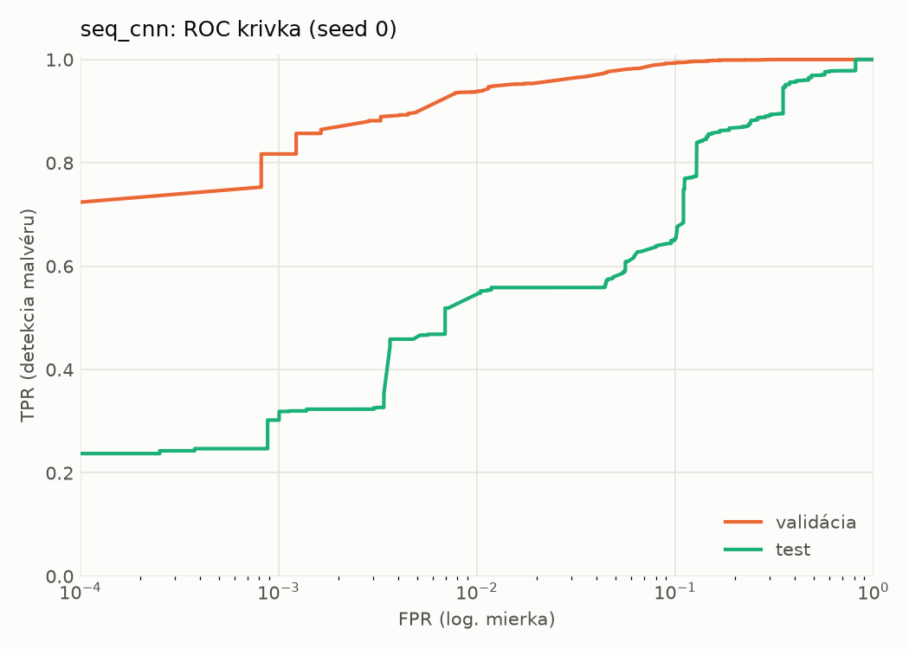
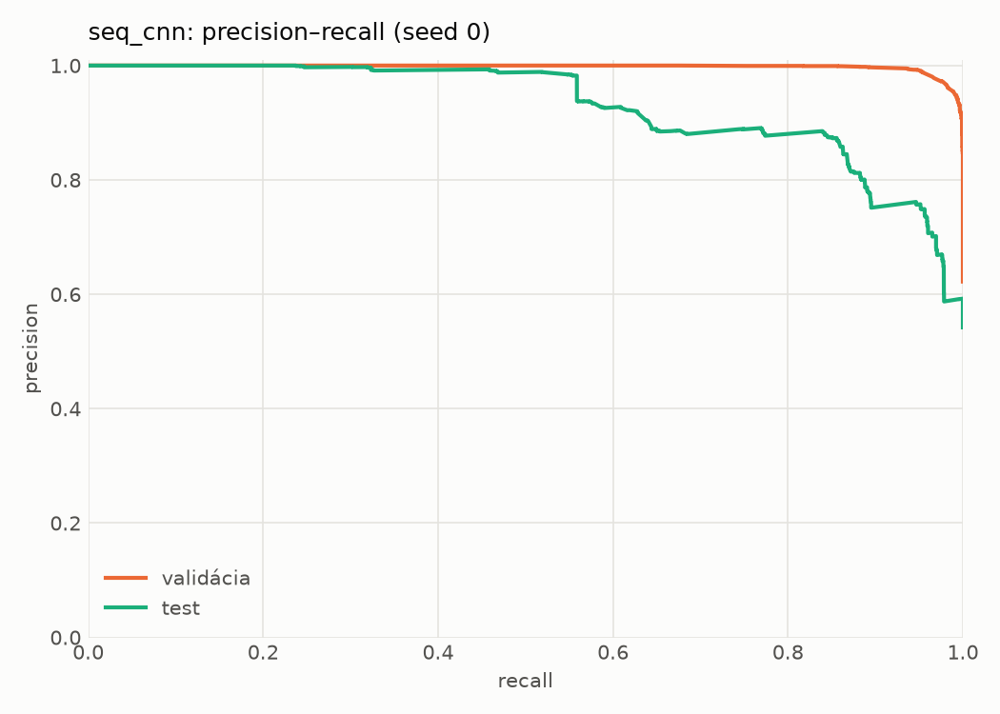
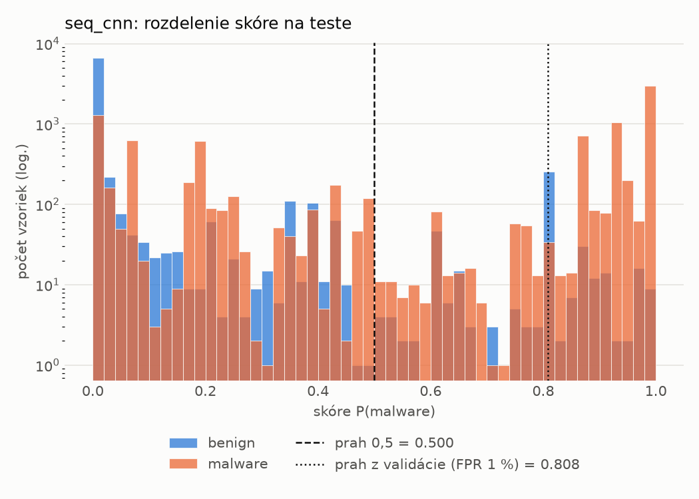
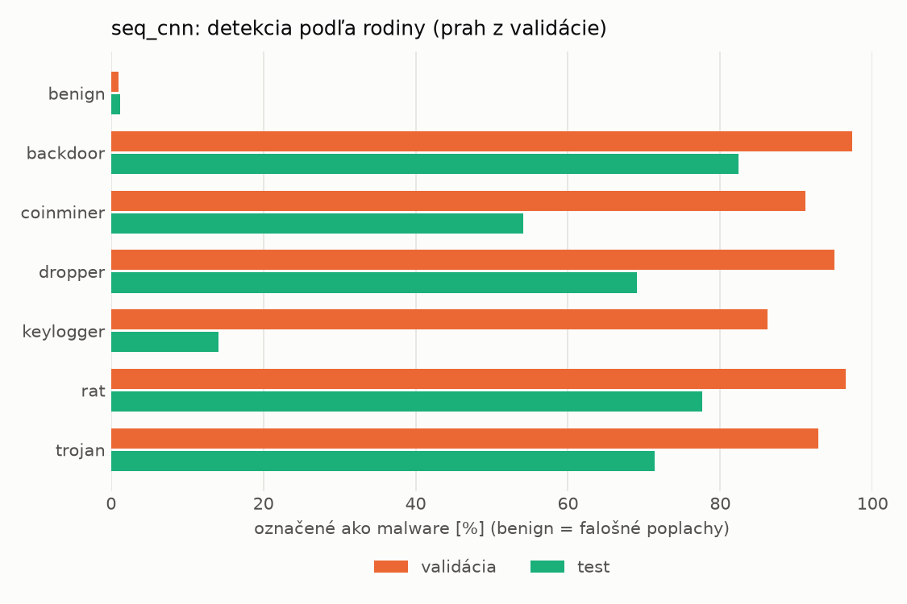
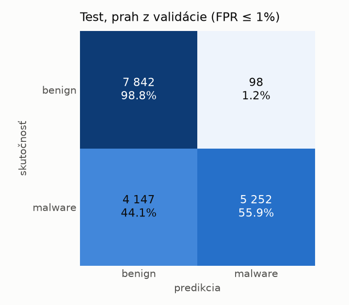
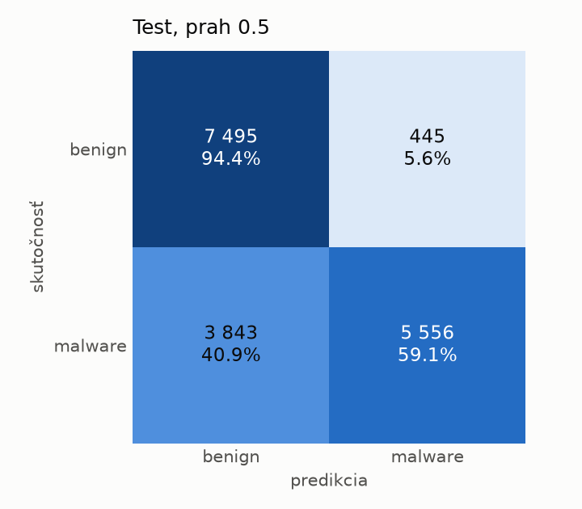
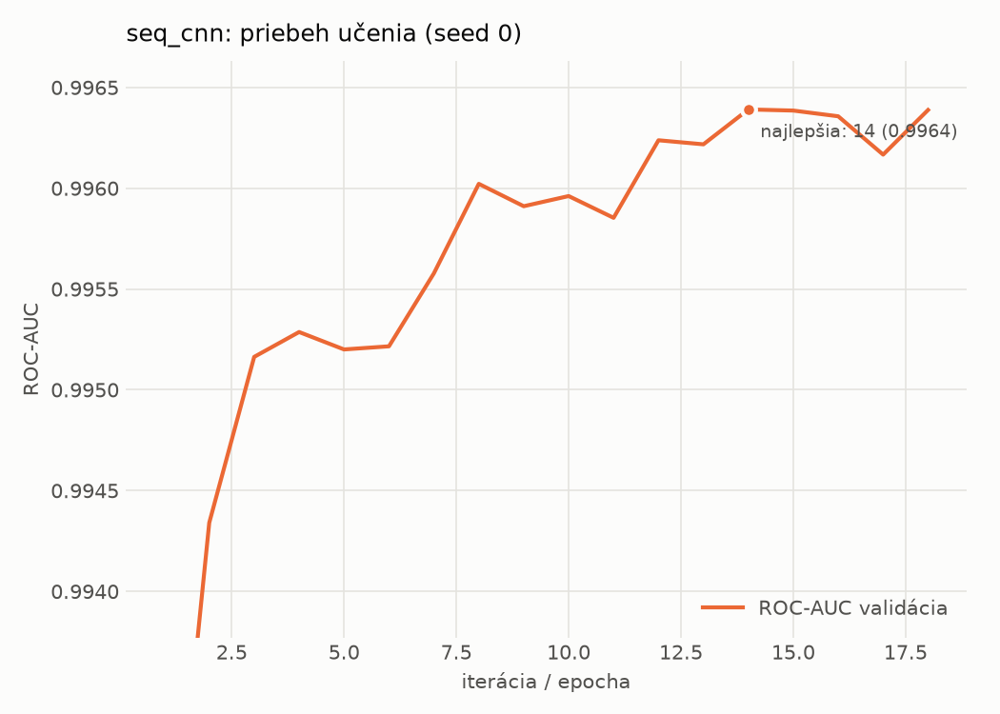

# dynamic_seq/seq_cnn – beh `20261104-060533`

> Automaticky generované (`src/training/run_tabular.py`). Konfigurácia: `config.yaml`, protokol: `protocol.yaml`.

- **Model:** `seq_cnn` – embedding API + paralelné 1D konvolúcie + maximum cez postupnosť
- **Ladenie:** bez ladenia – hyperparametre prevzaté z `runs_final/dynamic/seq_cnn/20261102-010741`
- **Finálne modely:** seedy [0, 1, 2]; hodnoty sú priemer ± smerodajná odchýlka cez seedy
- **Najlepšie hyperparametre:** `{"max_epochs": 30, "patience": 4, "emb_dim": 64, "channels": 128, "kernels": "2-4-8", "hidden": 64, "dropout": 0.19665662644598886, "lr": 0.0005755683530429188, "weight_decay": 0.0005400591881097476, "batch_size": 128}`

## Detekčná kvalita (bez prahu)
| metrika | train (podvzorka) | validácia | test |
|---|---|---|---|
| ROC-AUC | 0.9973 ± 0.0001 | 0.9964 ± 0.0001 | 0.9121 ± 0.0024 |
| PR-AUC | 0.9982 ± 0.0001 | 0.9977 ± 0.0000 | 0.9336 ± 0.0035 |
| TPR pri FPR 1 % | 0.9410 ± 0.0019 | 0.9402 ± 0.0031 | 0.5130 ± 0.0141 |
| TPR pri FPR 0,1 % | 0.8902 ± 0.0018 | 0.8104 ± 0.0128 | 0.2845 ± 0.0153 |
| log loss | 0.0644 ± 0.0020 | 0.0792 ± 0.0011 | 0.9046 ± 0.0237 |
| Brier skóre | 0.0209 ± 0.0006 | 0.0230 ± 0.0003 | 0.1720 ± 0.0177 |

Rozdiel ROC-AUC train − validácia: **0.0010** (veľký rozdiel = preučenie).

## Pri prahu z validácie (FPR ≤ 1% na validácii)
| metrika | train (podvzorka) | validácia | test |
|---|---|---|---|
| accuracy | 0.9583 ± 0.0012 | 0.9591 ± 0.0020 | 0.7572 ± 0.0056 |
| balanced accuracy | 0.9648 ± 0.0009 | 0.9652 ± 0.0016 | 0.7751 ± 0.0052 |
| precision | 0.9953 ± 0.0002 | 0.9938 ± 0.0002 | 0.9819 ± 0.0010 |
| recall (TPR) | 0.9365 ± 0.0020 | 0.9402 ± 0.0031 | 0.5625 ± 0.0099 |
| FPR | 0.0070 ± 0.0003 | 0.0097 ± 0.0002 | 0.0123 ± 0.0005 |
| F1 | 0.9650 ± 0.0010 | 0.9662 ± 0.0017 | 0.7152 ± 0.0082 |
| MCC | 0.9160 ± 0.0022 | 0.9168 ± 0.0039 | 0.5925 ± 0.0085 |

## Pri pevnom prahu 0.5
| metrika | train (podvzorka) | validácia | test |
|---|---|---|---|
| accuracy | 0.9662 ± 0.0021 | 0.9656 ± 0.0011 | 0.7874 ± 0.0312 |
| balanced accuracy | 0.9688 ± 0.0009 | 0.9680 ± 0.0002 | 0.8002 ± 0.0296 |
| precision | 0.9872 ± 0.0029 | 0.9863 ± 0.0032 | 0.9404 ± 0.0201 |
| recall (TPR) | 0.9574 ± 0.0063 | 0.9581 ± 0.0049 | 0.6486 ± 0.0499 |
| FPR | 0.0198 ± 0.0046 | 0.0220 ± 0.0053 | 0.0483 ± 0.0152 |
| F1 | 0.9721 ± 0.0019 | 0.9720 ± 0.0010 | 0.7672 ± 0.0404 |
| MCC | 0.9300 ± 0.0038 | 0.9282 ± 0.0018 | 0.6183 ± 0.0538 |

## Výpočtové nároky (seed 0, testovacia množina)
| meranie | hodnota |
|---|---|
| tréning finálneho modelu | 438.4 s (priemer cez seedy) |
| ladenie spolu | 0 s |
| počet parametrov / uzlov | 206 081 |
| veľkosť modelu na disku | 0.83 MB |
| CPU latencia modelu (batch 1, 1 vlákno) | 2.885 ms (p95 3.188) |
| CPU priepustnosť (24 vlákien) | 1 178 vzoriek/s |
| GPU latencia (batch 1) | 1.017 ms (p95 2.063) |
| GPU priepustnosť | 9 381 vzoriek/s |
| GPU špičková pamäť | 1869 MB |

## Grafy
| | |
|---|---|
|  |  |
|  |  |
|  |  |
|  |  |

## Súbory
`metrics.json` (všetky metriky po seedoch vrátane rodín), `timing.json`, `hpo_trials.csv`,
`predictions/<časť>_seed<N>.parquet` (sha256, family, label, score), `model/seed_<N>/`, `log.txt`.
