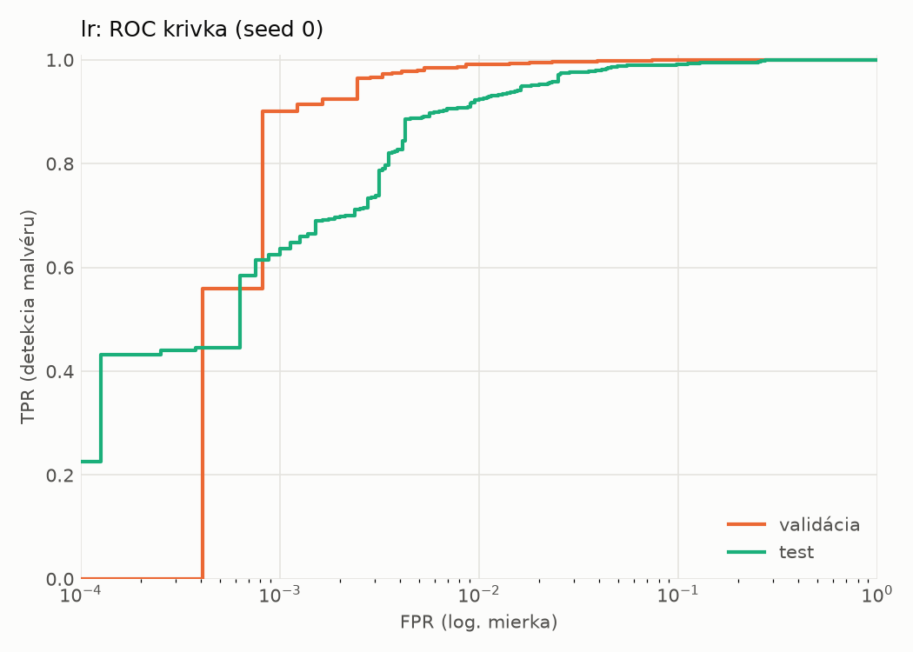
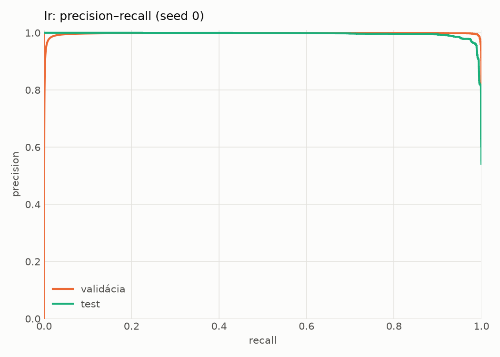
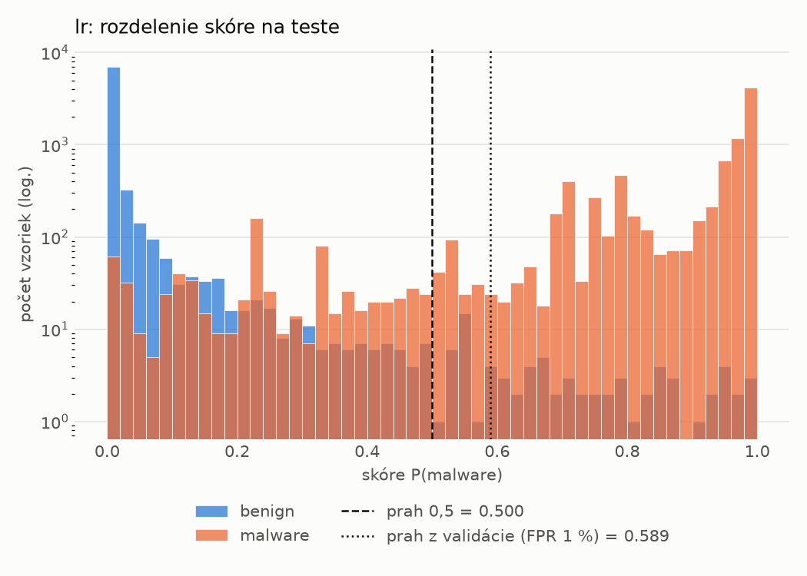
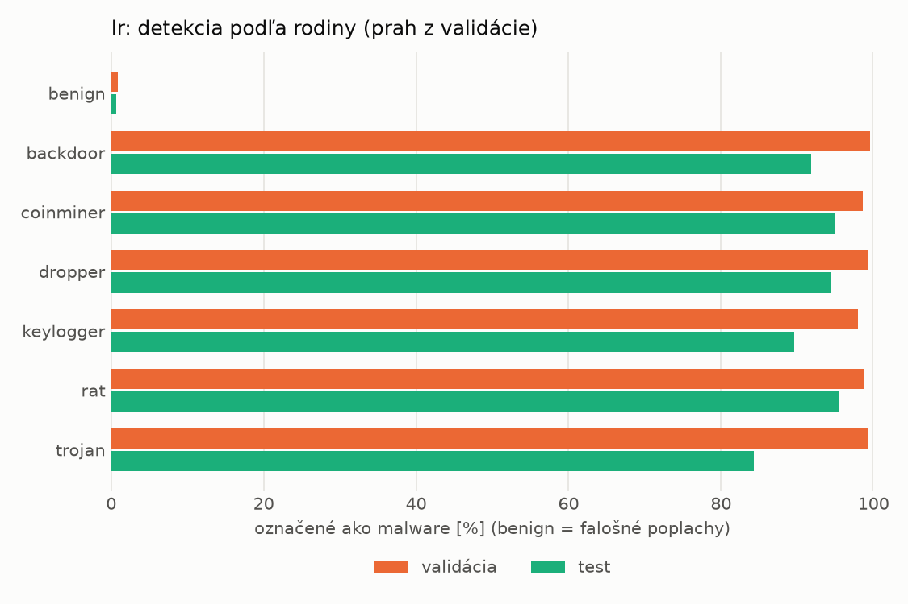
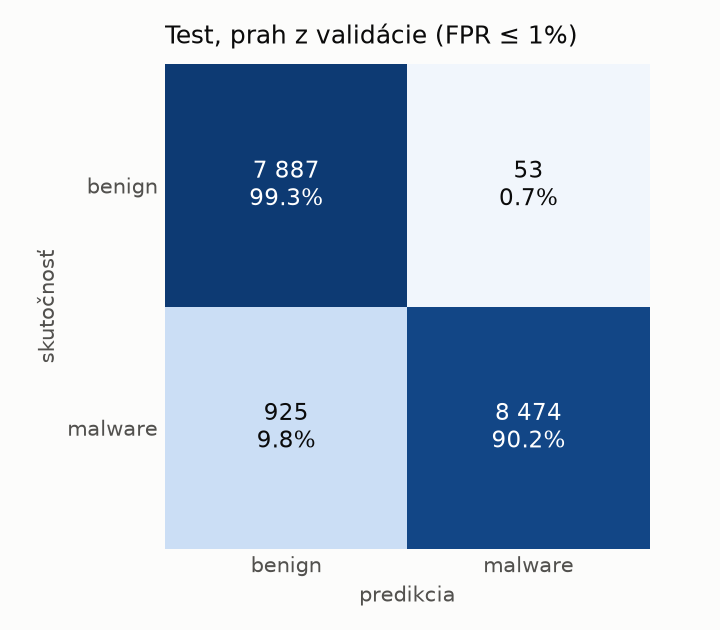
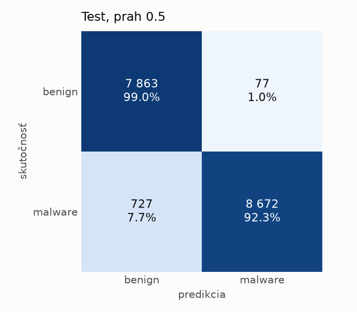

# hybrid/lr – beh `20261104-062934`

> Automaticky generované (`src/training/run_tabular.py`). Konfigurácia: `config.yaml`, protokol: `protocol.yaml`.

- **Model:** `logreg` – logistická regresia s L2 regularizáciou (vstup signed log1p + štandardizácia)
- **Ladenie:** bez ladenia – hyperparametre prevzaté z `runs_final/hybrid/lr/20261102-044357`
- **Finálne modely:** seedy [0, 1, 2]; hodnoty sú priemer ± smerodajná odchýlka cez seedy
- **Najlepšie hyperparametre:** `{"max_iter": 2000, "C": 0.0028355883180749405}`

## Detekčná kvalita (bez prahu)
| metrika | train (podvzorka) | validácia | test |
|---|---|---|---|
| ROC-AUC | 0.9997 ± 0.0000 | 0.9986 ± 0.0000 | 0.9947 ± 0.0000 |
| PR-AUC | 0.9998 ± 0.0000 | 0.9975 ± 0.0000 | 0.9957 ± 0.0000 |
| TPR pri FPR 1 % | 0.9963 ± 0.0000 | 0.9908 ± 0.0000 | 0.9234 ± 0.0000 |
| TPR pri FPR 0,1 % | 0.9327 ± 0.0000 | 0.9003 ± 0.0000 | 0.6237 ± 0.0000 |
| log loss | 0.0250 ± 0.0000 | 0.0360 ± 0.0000 | 0.1413 ± 0.0000 |
| Brier skóre | 0.0057 ± 0.0000 | 0.0081 ± 0.0000 | 0.0388 ± 0.0000 |

Rozdiel ROC-AUC train − validácia: **0.0011** (veľký rozdiel = preučenie).

## Pri prahu z validácie (FPR ≤ 1% na validácii)
| metrika | train (podvzorka) | validácia | test |
|---|---|---|---|
| accuracy | 0.9935 ± 0.0000 | 0.9909 ± 0.0000 | 0.9436 ± 0.0000 |
| balanced accuracy | 0.9934 ± 0.0000 | 0.9909 ± 0.0000 | 0.9475 ± 0.0000 |
| precision | 0.9954 ± 0.0000 | 0.9945 ± 0.0000 | 0.9938 ± 0.0000 |
| recall (TPR) | 0.9940 ± 0.0000 | 0.9908 ± 0.0000 | 0.9016 ± 0.0000 |
| FPR | 0.0073 ± 0.0000 | 0.0090 ± 0.0000 | 0.0067 ± 0.0000 |
| F1 | 0.9947 ± 0.0000 | 0.9927 ± 0.0000 | 0.9454 ± 0.0000 |
| MCC | 0.9863 ± 0.0000 | 0.9806 ± 0.0000 | 0.8919 ± 0.0000 |

## Pri pevnom prahu 0.5
| metrika | train (podvzorka) | validácia | test |
|---|---|---|---|
| accuracy | 0.9937 ± 0.0000 | 0.9901 ± 0.0000 | 0.9536 ± 0.0000 |
| balanced accuracy | 0.9931 ± 0.0000 | 0.9895 ± 0.0000 | 0.9565 ± 0.0000 |
| precision | 0.9942 ± 0.0000 | 0.9920 ± 0.0000 | 0.9912 ± 0.0000 |
| recall (TPR) | 0.9956 ± 0.0000 | 0.9920 ± 0.0000 | 0.9227 ± 0.0000 |
| FPR | 0.0093 ± 0.0000 | 0.0131 ± 0.0000 | 0.0097 ± 0.0000 |
| F1 | 0.9949 ± 0.0000 | 0.9920 ± 0.0000 | 0.9557 ± 0.0000 |
| MCC | 0.9867 ± 0.0000 | 0.9789 ± 0.0000 | 0.9098 ± 0.0000 |

## Výpočtové nároky (seed 0, testovacia množina)
| meranie | hodnota |
|---|---|
| tréning finálneho modelu | 4.9 s (priemer cez seedy) |
| ladenie spolu | 0 s |
| počet parametrov / uzlov | 4 320 |
| veľkosť modelu na disku | 0.13 MB |
| transformácia vstupu – latencia (1 vlákno) | 0.036 ms |
| transformácia vstupu – priepustnosť | 24 219 vzoriek/s |
| CPU latencia modelu (batch 1, 1 vlákno) | 0.007 ms (p95 0.008) |
| CPU priepustnosť (24 vlákien) | 164 417 vzoriek/s |

## Grafy
| | |
|---|---|
|  |  |
|  |  |
|  |  |
|  |  |

## Súbory
`metrics.json` (všetky metriky po seedoch vrátane rodín), `timing.json`, `hpo_trials.csv`,
`predictions/<časť>_seed<N>.parquet` (sha256, family, label, score), `model/seed_<N>/`, `log.txt`.
