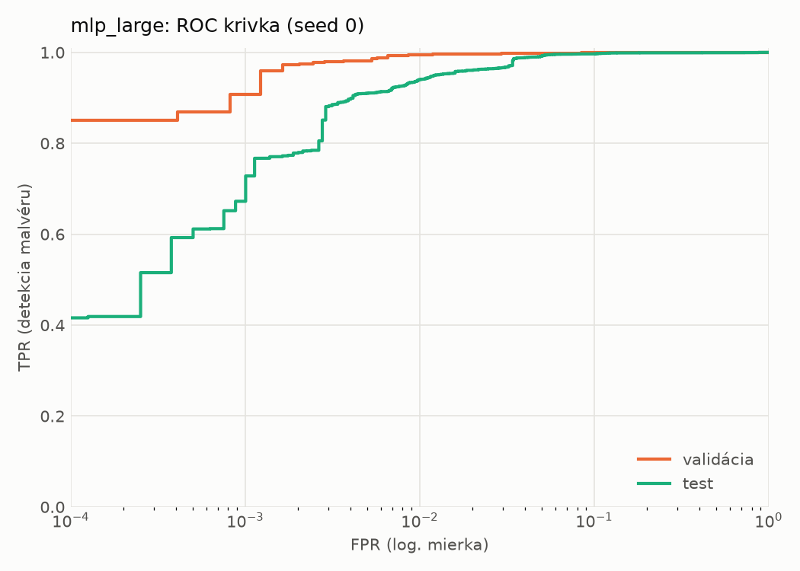
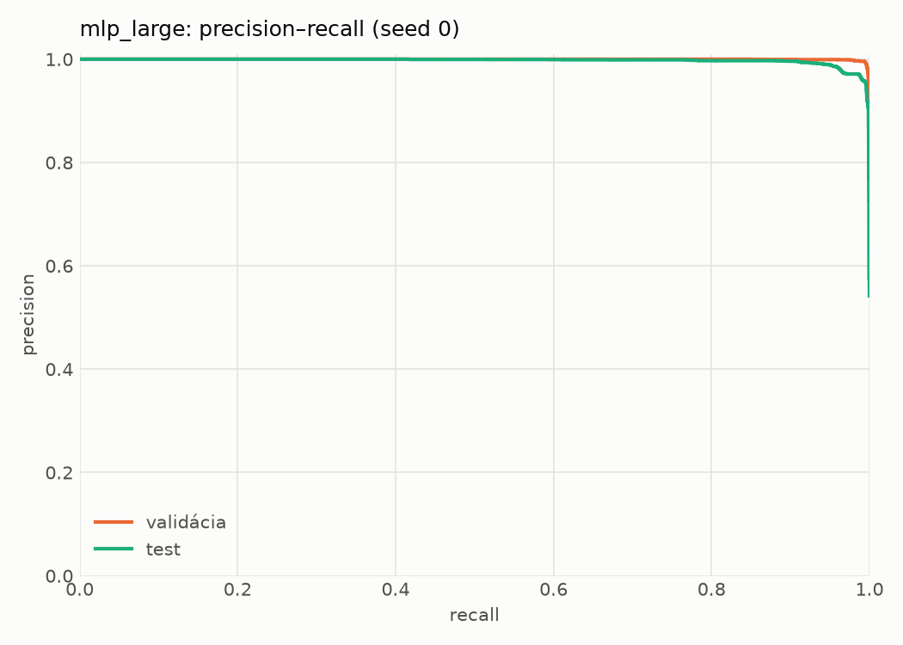
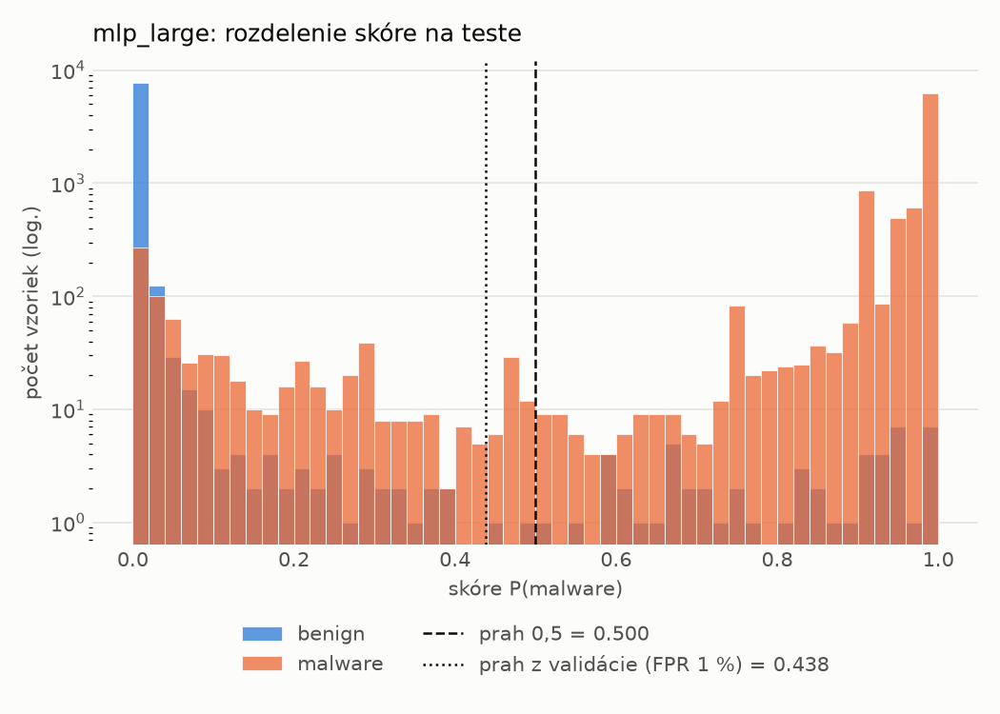
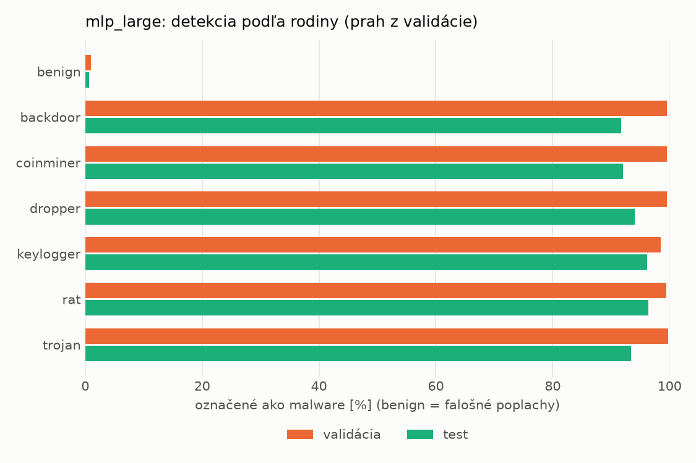
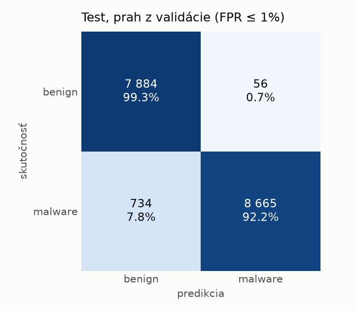
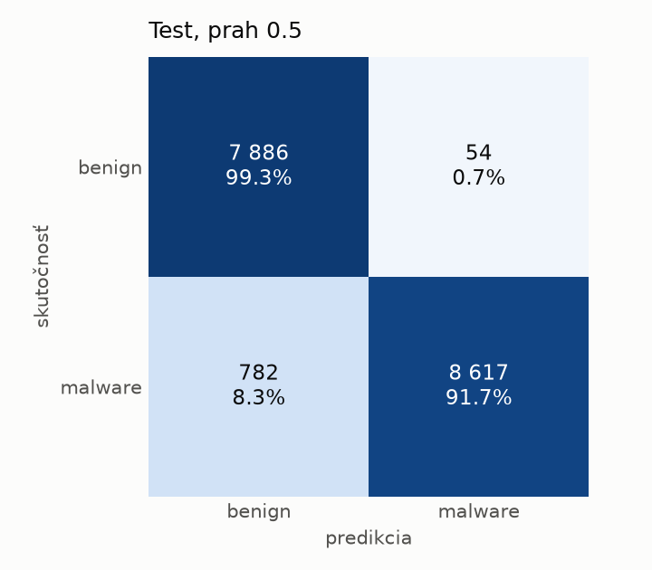
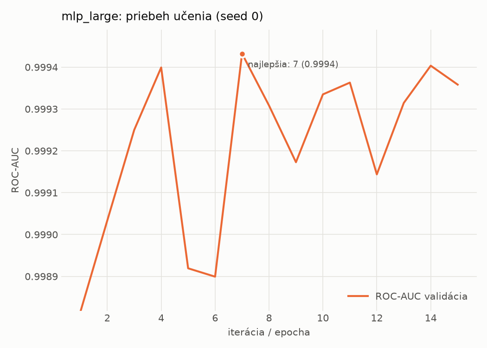

# hybrid/mlp_large – beh `20261104-063750`

> Automaticky generované (`src/training/run_tabular.py`). Konfigurácia: `config.yaml`, protokol: `protocol.yaml`.

- **Model:** `mlp` – veľká neurónová sieť (3–5 skrytých vrstiev, 512–2048 neurónov), kandidát na učiteľa
- **Ladenie:** bez ladenia – hyperparametre prevzaté z `runs_final/hybrid/mlp_large/20261102-064138`
- **Finálne modely:** seedy [0, 1, 2]; hodnoty sú priemer ± smerodajná odchýlka cez seedy
- **Najlepšie hyperparametre:** `{"max_epochs": 100, "patience": 8, "hidden_layers": 4, "hidden_width": 512, "width_decay": 0.5, "dropout": 0.1951820260605614, "lr": 0.000176468680848935, "weight_decay": 1.209699321025492e-05, "batch_size": 512}`

## Detekčná kvalita (bez prahu)
| metrika | train (podvzorka) | validácia | test |
|---|---|---|---|
| ROC-AUC | 0.9999 ± 0.0001 | 0.9993 ± 0.0001 | 0.9963 ± 0.0009 |
| PR-AUC | 0.9999 ± 0.0000 | 0.9996 ± 0.0001 | 0.9971 ± 0.0006 |
| TPR pri FPR 1 % | 0.9967 ± 0.0026 | 0.9931 ± 0.0023 | 0.9450 ± 0.0126 |
| TPR pri FPR 0,1 % | 0.9791 ± 0.0120 | 0.9320 ± 0.0223 | 0.7263 ± 0.0475 |
| log loss | 0.0401 ± 0.0225 | 0.0488 ± 0.0194 | 0.1588 ± 0.0146 |
| Brier skóre | 0.0054 ± 0.0026 | 0.0076 ± 0.0020 | 0.0401 ± 0.0041 |

Rozdiel ROC-AUC train − validácia: **0.0006** (veľký rozdiel = preučenie).

## Pri prahu z validácie (FPR ≤ 1% na validácii)
| metrika | train (podvzorka) | validácia | test |
|---|---|---|---|
| accuracy | 0.9946 ± 0.0017 | 0.9924 ± 0.0018 | 0.9550 ± 0.0050 |
| balanced accuracy | 0.9942 ± 0.0016 | 0.9922 ± 0.0016 | 0.9580 ± 0.0046 |
| precision | 0.9952 ± 0.0008 | 0.9947 ± 0.0009 | 0.9945 ± 0.0009 |
| recall (TPR) | 0.9959 ± 0.0020 | 0.9931 ± 0.0023 | 0.9220 ± 0.0088 |
| FPR | 0.0076 ± 0.0013 | 0.0087 ± 0.0016 | 0.0060 ± 0.0010 |
| F1 | 0.9956 ± 0.0014 | 0.9939 ± 0.0014 | 0.9569 ± 0.0050 |
| MCC | 0.9885 ± 0.0035 | 0.9839 ± 0.0037 | 0.9128 ± 0.0093 |

## Pri pevnom prahu 0.5
| metrika | train (podvzorka) | validácia | test |
|---|---|---|---|
| accuracy | 0.9946 ± 0.0017 | 0.9924 ± 0.0020 | 0.9546 ± 0.0048 |
| balanced accuracy | 0.9942 ± 0.0016 | 0.9922 ± 0.0019 | 0.9577 ± 0.0045 |
| precision | 0.9952 ± 0.0008 | 0.9947 ± 0.0011 | 0.9944 ± 0.0008 |
| recall (TPR) | 0.9959 ± 0.0020 | 0.9930 ± 0.0022 | 0.9214 ± 0.0082 |
| FPR | 0.0076 ± 0.0013 | 0.0087 ± 0.0018 | 0.0061 ± 0.0008 |
| F1 | 0.9956 ± 0.0014 | 0.9939 ± 0.0016 | 0.9565 ± 0.0048 |
| MCC | 0.9885 ± 0.0035 | 0.9838 ± 0.0042 | 0.9121 ± 0.0091 |

## Výpočtové nároky (seed 0, testovacia množina)
| meranie | hodnota |
|---|---|
| tréning finálneho modelu | 4.6 s (priemer cez seedy) |
| ladenie spolu | 0 s |
| počet parametrov / uzlov | 2 386 305 |
| veľkosť modelu na disku | 9.67 MB |
| transformácia vstupu – latencia (1 vlákno) | 0.063 ms |
| transformácia vstupu – priepustnosť | 22 306 vzoriek/s |
| CPU latencia modelu (batch 1, 1 vlákno) | 0.288 ms (p95 0.320) |
| CPU priepustnosť (24 vlákien) | 28 991 vzoriek/s |
| GPU latencia (batch 1) | 0.624 ms (p95 0.787) |
| GPU priepustnosť | 31 929 vzoriek/s |
| GPU špičková pamäť | 2603 MB |

## Grafy
| | |
|---|---|
|  |  |
|  |  |
|  |  |
|  |  |

## Súbory
`metrics.json` (všetky metriky po seedoch vrátane rodín), `timing.json`, `hpo_trials.csv`,
`predictions/<časť>_seed<N>.parquet` (sha256, family, label, score), `model/seed_<N>/`, `log.txt`.
