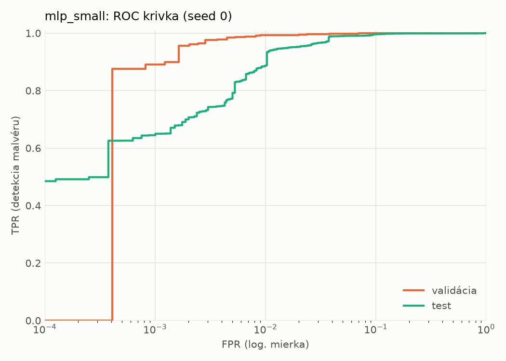
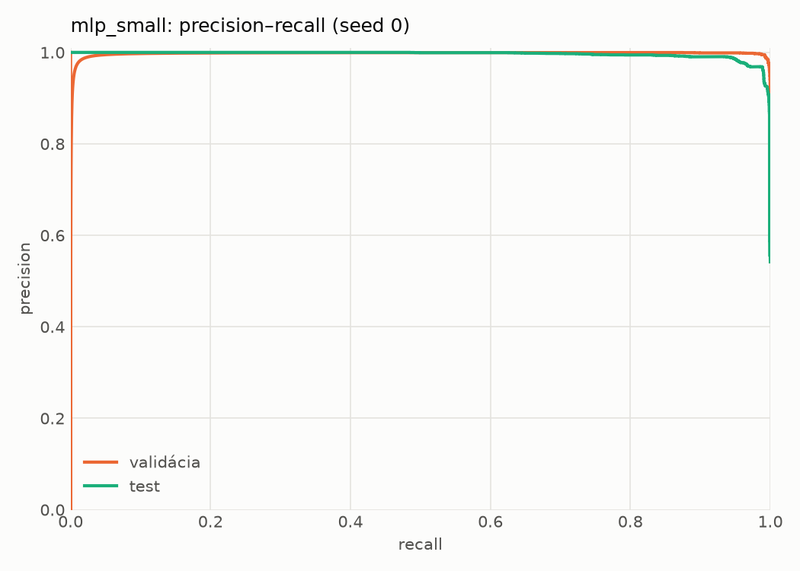
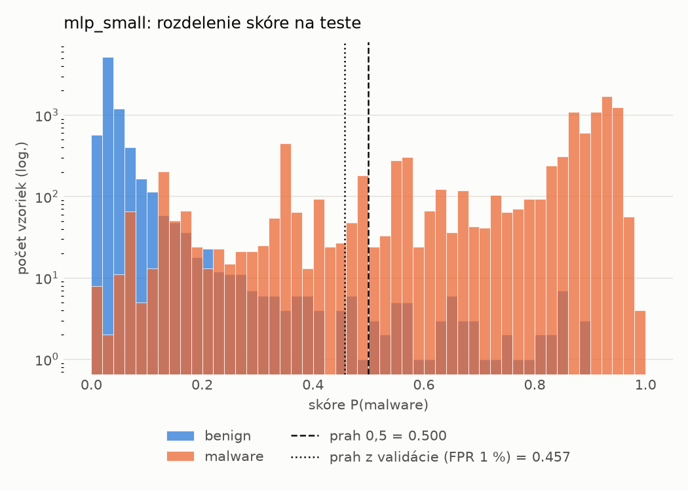
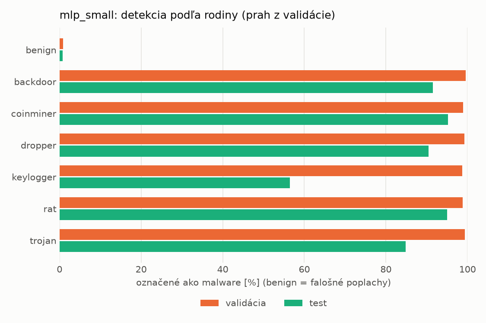
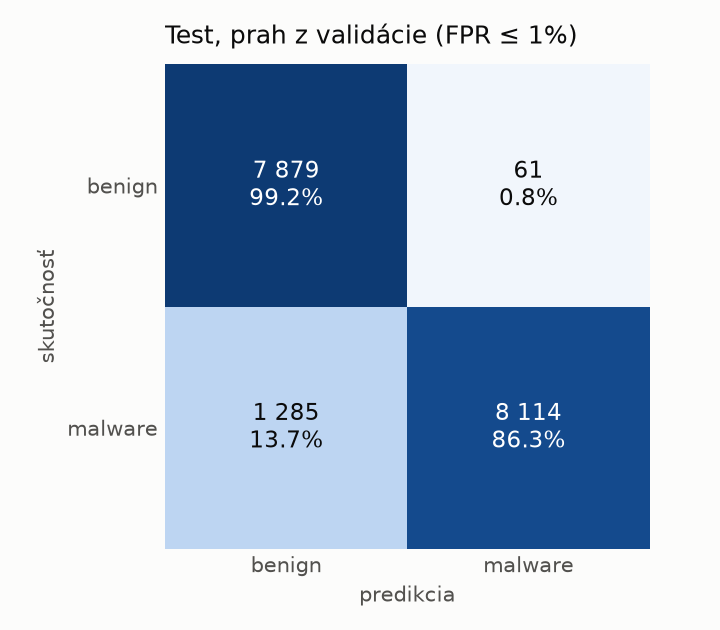
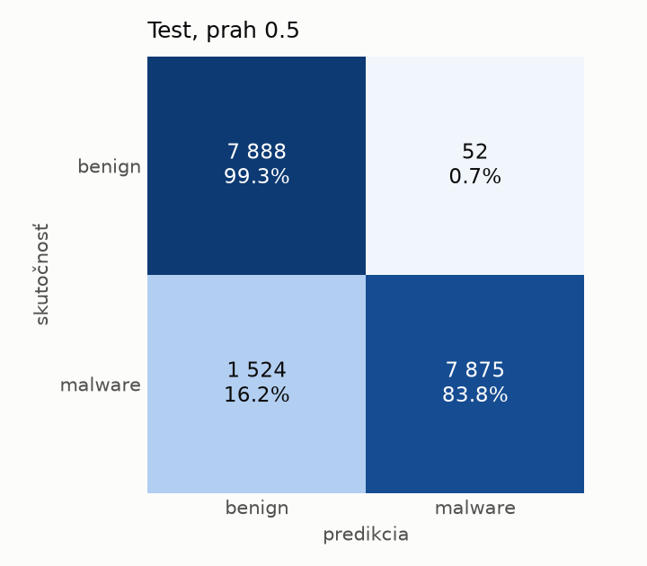
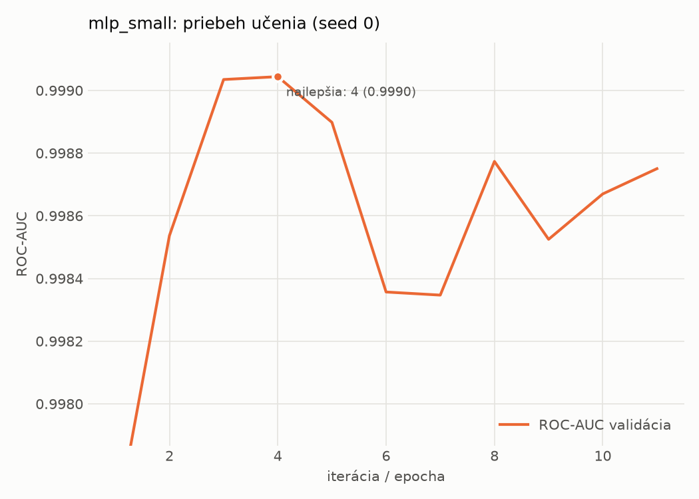

# hybrid/mlp_small – beh `20261104-063721`

> Automaticky generované (`src/training/run_tabular.py`). Konfigurácia: `config.yaml`, protokol: `protocol.yaml`.

- **Model:** `mlp` – malá neurónová sieť (1–2 skryté vrstvy), kandidát na ľahkého študenta
- **Ladenie:** bez ladenia – hyperparametre prevzaté z `runs_final/hybrid/mlp_small/20261102-063854`
- **Finálne modely:** seedy [0, 1, 2]; hodnoty sú priemer ± smerodajná odchýlka cez seedy
- **Najlepšie hyperparametre:** `{"width_decay": 0.5, "max_epochs": 100, "patience": 8, "hidden_layers": 2, "hidden_width": 32, "dropout": 0.16874195706419903, "lr": 0.0006143857735366936, "weight_decay": 0.007079811471617702, "batch_size": 512}`

## Detekčná kvalita (bez prahu)
| metrika | train (podvzorka) | validácia | test |
|---|---|---|---|
| ROC-AUC | 0.9997 ± 0.0001 | 0.9989 ± 0.0002 | 0.9937 ± 0.0019 |
| PR-AUC | 0.9998 ± 0.0001 | 0.9976 ± 0.0001 | 0.9948 ± 0.0014 |
| TPR pri FPR 1 % | 0.9911 ± 0.0081 | 0.9898 ± 0.0059 | 0.8666 ± 0.0209 |
| TPR pri FPR 0,1 % | 0.9686 ± 0.0117 | 0.9025 ± 0.0099 | 0.6504 ± 0.0435 |
| log loss | 0.0795 ± 0.0421 | 0.0839 ± 0.0404 | 0.2334 ± 0.0318 |
| Brier skóre | 0.0117 ± 0.0070 | 0.0129 ± 0.0066 | 0.0678 ± 0.0065 |

Rozdiel ROC-AUC train − validácia: **0.0009** (veľký rozdiel = preučenie).

## Pri prahu z validácie (FPR ≤ 1% na validácii)
| metrika | train (podvzorka) | validácia | test |
|---|---|---|---|
| accuracy | 0.9910 ± 0.0048 | 0.9900 ± 0.0037 | 0.9105 ± 0.0217 |
| balanced accuracy | 0.9912 ± 0.0036 | 0.9901 ± 0.0030 | 0.9169 ± 0.0197 |
| precision | 0.9950 ± 0.0012 | 0.9942 ± 0.0003 | 0.9933 ± 0.0028 |
| recall (TPR) | 0.9904 ± 0.0091 | 0.9898 ± 0.0059 | 0.8406 ± 0.0425 |
| FPR | 0.0080 ± 0.0019 | 0.0096 ± 0.0005 | 0.0068 ± 0.0031 |
| F1 | 0.9927 ± 0.0040 | 0.9920 ± 0.0030 | 0.9101 ± 0.0242 |
| MCC | 0.9812 ± 0.0100 | 0.9789 ± 0.0078 | 0.8342 ± 0.0356 |

## Pri pevnom prahu 0.5
| metrika | train (podvzorka) | validácia | test |
|---|---|---|---|
| accuracy | 0.9920 ± 0.0017 | 0.9907 ± 0.0018 | 0.9074 ± 0.0101 |
| balanced accuracy | 0.9916 ± 0.0021 | 0.9904 ± 0.0024 | 0.9141 ± 0.0093 |
| precision | 0.9936 ± 0.0024 | 0.9933 ± 0.0028 | 0.9936 ± 0.0002 |
| recall (TPR) | 0.9933 ± 0.0004 | 0.9918 ± 0.0005 | 0.8346 ± 0.0186 |
| FPR | 0.0102 ± 0.0039 | 0.0111 ± 0.0047 | 0.0064 ± 0.0001 |
| F1 | 0.9935 ± 0.0014 | 0.9925 ± 0.0015 | 0.9071 ± 0.0111 |
| MCC | 0.9830 ± 0.0037 | 0.9803 ± 0.0039 | 0.8287 ± 0.0171 |

## Výpočtové nároky (seed 0, testovacia množina)
| meranie | hodnota |
|---|---|
| tréning finálneho modelu | 3.6 s (priemer cez seedy) |
| ladenie spolu | 0 s |
| počet parametrov / uzlov | 138 881 |
| veľkosť modelu na disku | 0.67 MB |
| transformácia vstupu – latencia (1 vlákno) | 0.061 ms |
| transformácia vstupu – priepustnosť | 21 720 vzoriek/s |
| CPU latencia modelu (batch 1, 1 vlákno) | 0.102 ms (p95 0.116) |
| CPU priepustnosť (24 vlákien) | 46 387 vzoriek/s |
| GPU latencia (batch 1) | 0.423 ms (p95 0.484) |
| GPU priepustnosť | 30 332 vzoriek/s |
| GPU špičková pamäť | 1437 MB |

## Grafy
| | |
|---|---|
|  |  |
|  |  |
|  |  |
|  |  |

## Súbory
`metrics.json` (všetky metriky po seedoch vrátane rodín), `timing.json`, `hpo_trials.csv`,
`predictions/<časť>_seed<N>.parquet` (sha256, family, label, score), `model/seed_<N>/`, `log.txt`.
