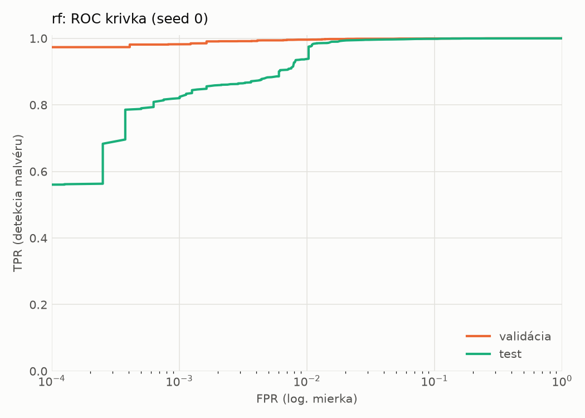
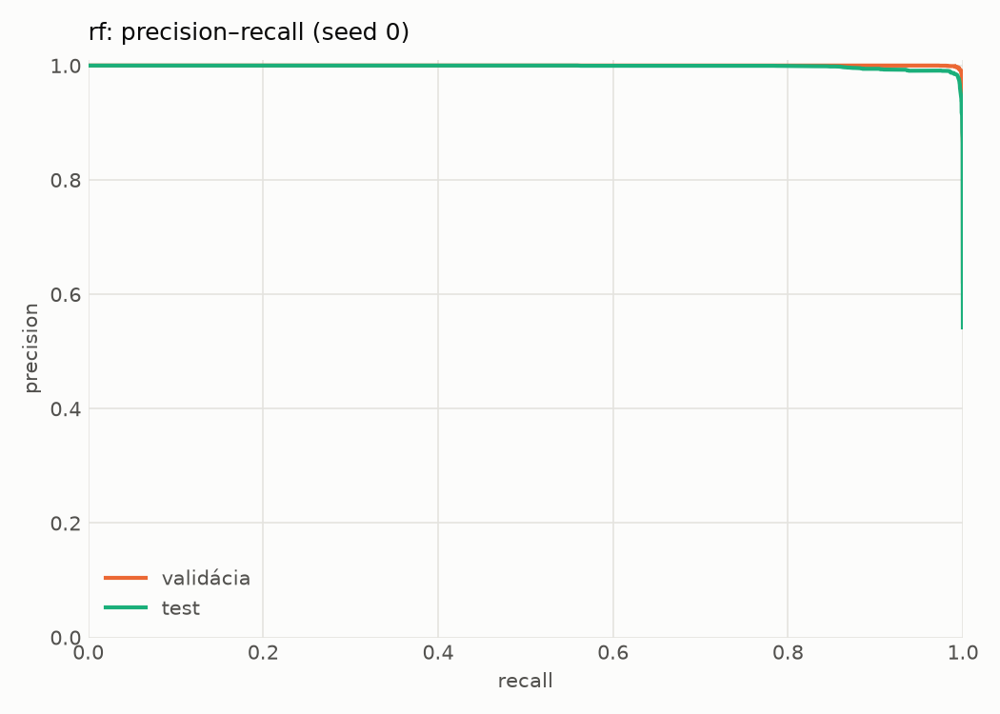
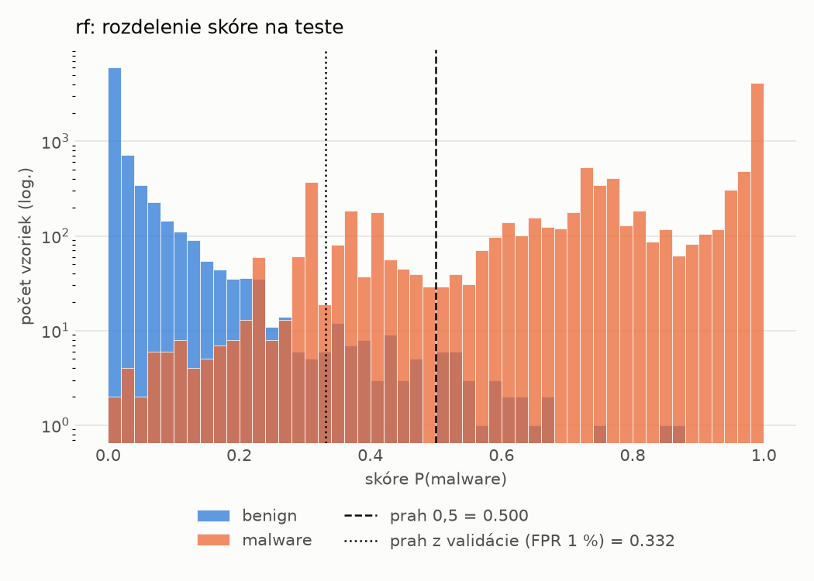
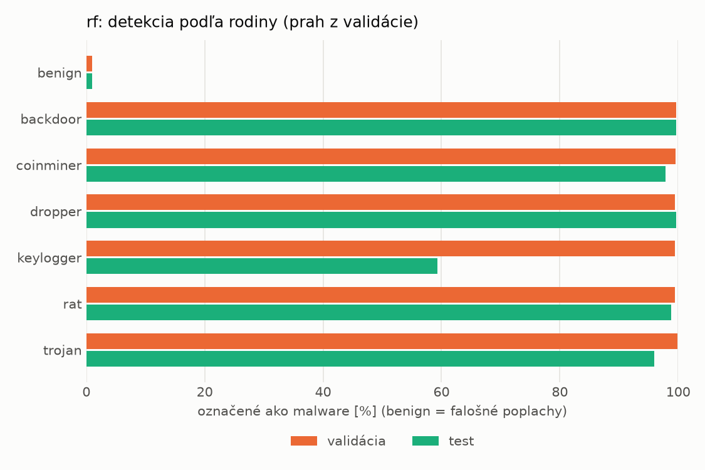
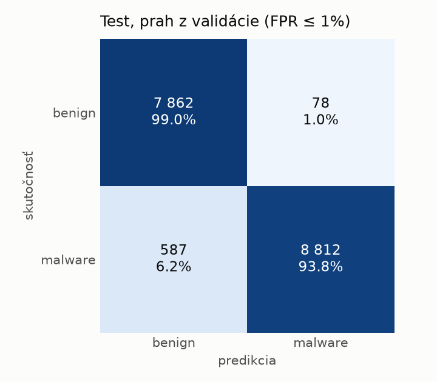
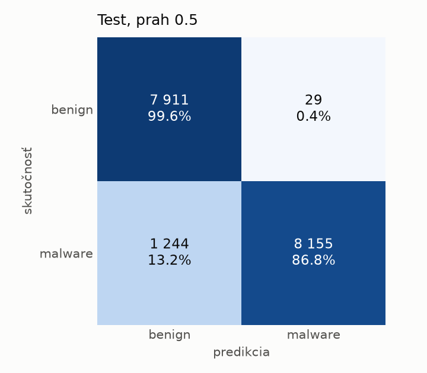

# hybrid/rf – beh `20261104-063004`

> Automaticky generované (`src/training/run_tabular.py`). Konfigurácia: `config.yaml`, protokol: `protocol.yaml`.

- **Model:** `random_forest` – Random Forest (pôvodné hodnoty príznakov)
- **Ladenie:** bez ladenia – hyperparametre prevzaté z `runs_final/hybrid/rf/20261102-044751`
- **Finálne modely:** seedy [0, 1, 2]; hodnoty sú priemer ± smerodajná odchýlka cez seedy
- **Najlepšie hyperparametre:** `{"n_estimators": 250, "max_depth": null, "min_samples_leaf": 1, "max_features": 0.05}`

## Detekčná kvalita (bez prahu)
| metrika | train (podvzorka) | validácia | test |
|---|---|---|---|
| ROC-AUC | 1.0000 ± 0.0000 | 0.9998 ± 0.0000 | 0.9983 ± 0.0002 |
| PR-AUC | 1.0000 ± 0.0000 | 0.9999 ± 0.0000 | 0.9985 ± 0.0001 |
| TPR pri FPR 1 % | 1.0000 ± 0.0000 | 0.9960 ± 0.0000 | 0.9537 ± 0.0253 |
| TPR pri FPR 0,1 % | 1.0000 ± 0.0000 | 0.9843 ± 0.0019 | 0.8103 ± 0.0078 |
| log loss | 0.0064 ± 0.0001 | 0.0219 ± 0.0001 | 0.1534 ± 0.0042 |
| Brier skóre | 0.0008 ± 0.0000 | 0.0052 ± 0.0000 | 0.0476 ± 0.0017 |

Rozdiel ROC-AUC train − validácia: **0.0002** (veľký rozdiel = preučenie).

## Pri prahu z validácie (FPR ≤ 1% na validácii)
| metrika | train (podvzorka) | validácia | test |
|---|---|---|---|
| accuracy | 1.0000 ± 0.0000 | 0.9939 ± 0.0001 | 0.9686 ± 0.0141 |
| balanced accuracy | 1.0000 ± 0.0000 | 0.9932 ± 0.0001 | 0.9704 ± 0.0130 |
| precision | 1.0000 ± 0.0000 | 0.9941 ± 0.0001 | 0.9923 ± 0.0009 |
| recall (TPR) | 1.0000 ± 0.0000 | 0.9960 ± 0.0000 | 0.9495 ± 0.0257 |
| FPR | 0.0000 ± 0.0000 | 0.0097 ± 0.0002 | 0.0087 ± 0.0009 |
| F1 | 1.0000 ± 0.0000 | 0.9951 ± 0.0001 | 0.9703 ± 0.0136 |
| MCC | 1.0000 ± 0.0000 | 0.9869 ± 0.0002 | 0.9384 ± 0.0272 |

## Pri pevnom prahu 0.5
| metrika | train (podvzorka) | validácia | test |
|---|---|---|---|
| accuracy | 1.0000 ± 0.0000 | 0.9942 ± 0.0001 | 0.9269 ± 0.0009 |
| balanced accuracy | 1.0000 ± 0.0000 | 0.9946 ± 0.0001 | 0.9323 ± 0.0008 |
| precision | 1.0000 ± 0.0000 | 0.9975 ± 0.0000 | 0.9968 ± 0.0004 |
| recall (TPR) | 1.0000 ± 0.0000 | 0.9932 ± 0.0001 | 0.8679 ± 0.0014 |
| FPR | 0.0000 ± 0.0000 | 0.0041 ± 0.0000 | 0.0033 ± 0.0004 |
| F1 | 1.0000 ± 0.0000 | 0.9953 ± 0.0001 | 0.9279 ± 0.0009 |
| MCC | 1.0000 ± 0.0000 | 0.9877 ± 0.0002 | 0.8629 ± 0.0016 |

## Výpočtové nároky (seed 0, testovacia množina)
| meranie | hodnota |
|---|---|
| tréning finálneho modelu | 124.7 s (priemer cez seedy) |
| ladenie spolu | 0 s |
| počet parametrov / uzlov | 264 578 |
| veľkosť modelu na disku | 21.50 MB |
| CPU latencia modelu (batch 1, 1 vlákno) | 7.174 ms (p95 7.362) |
| CPU priepustnosť (24 vlákien) | 97 379 vzoriek/s |

## Grafy
| | |
|---|---|
|  |  |
|  |  |
|  |  |
|  |  |

## Súbory
`metrics.json` (všetky metriky po seedoch vrátane rodín), `timing.json`, `hpo_trials.csv`,
`predictions/<časť>_seed<N>.parquet` (sha256, family, label, score), `model/seed_<N>/`, `log.txt`.
