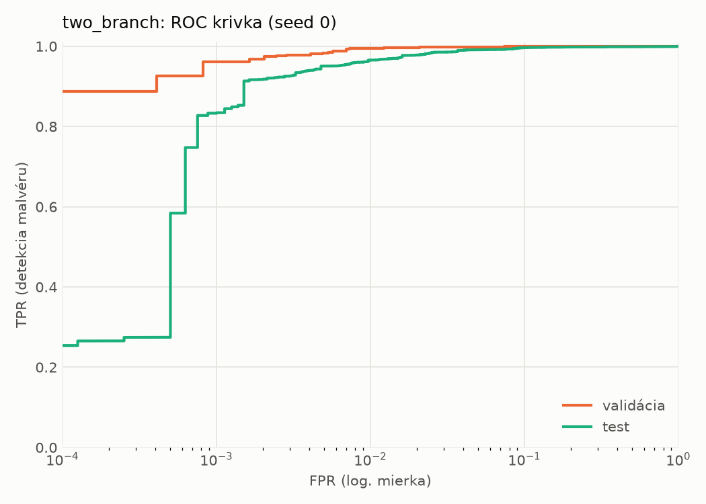
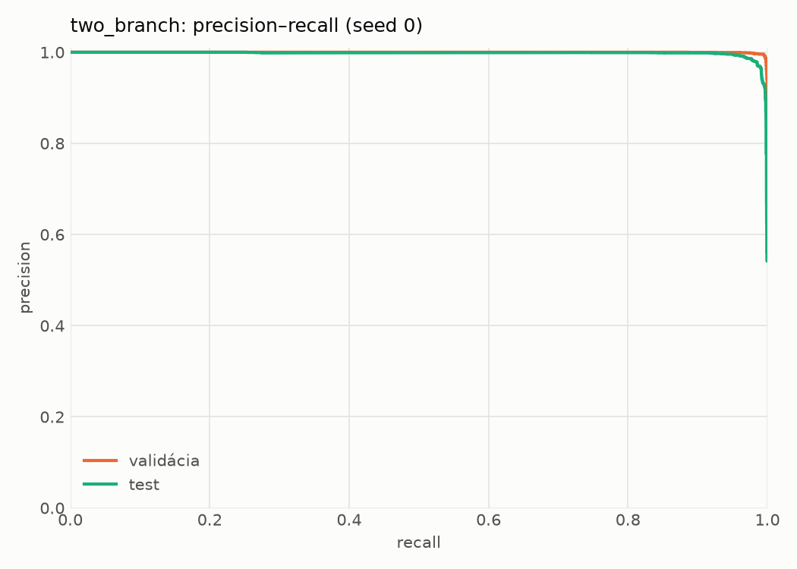
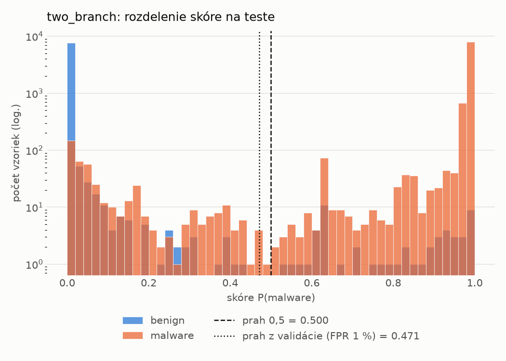
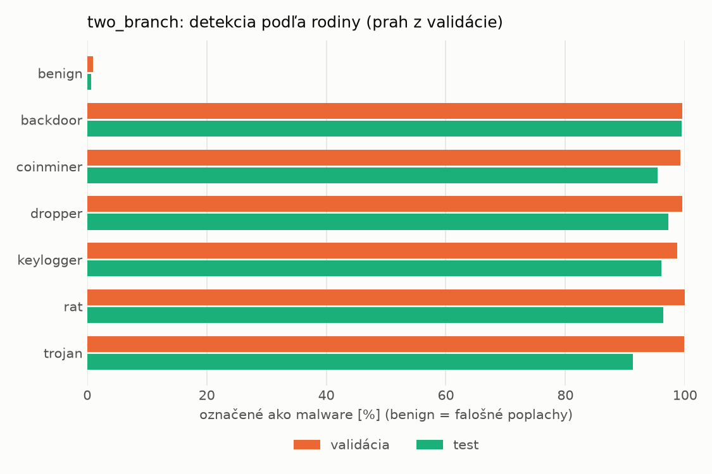
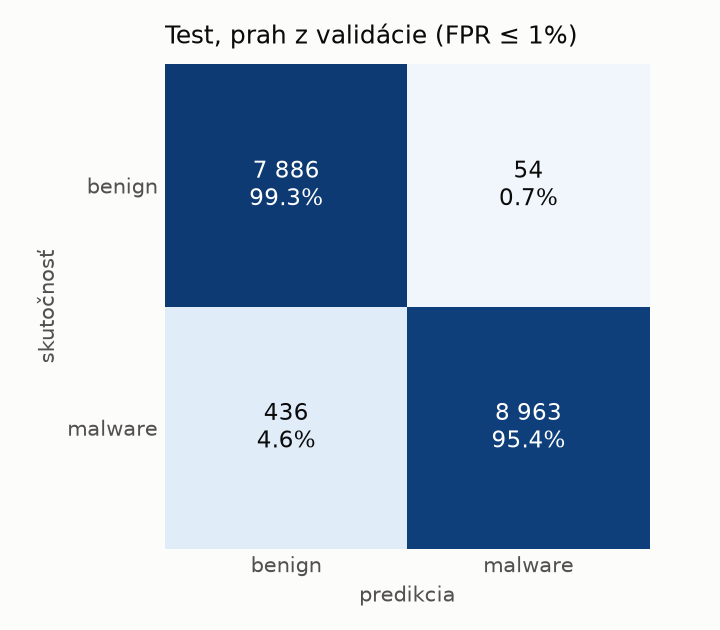
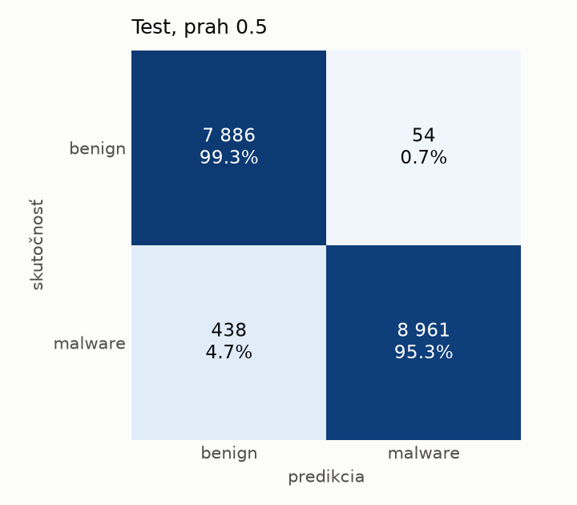
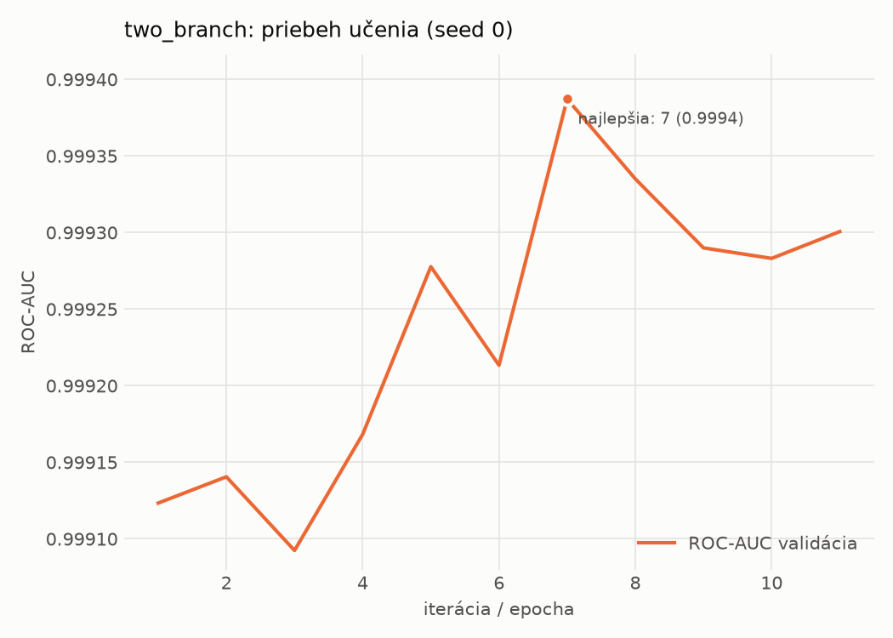

# hybrid_seq/two_branch – beh `20261104-063823`

> Automaticky generované (`src/training/run_tabular.py`). Konfigurácia: `config.yaml`, protokol: `protocol.yaml`.

- **Model:** `two_branch` – statická MLP vetva + sekvenčná CNN vetva nad API volaniami, spojené v spoločnej hlave
- **Ladenie:** bez ladenia – hyperparametre prevzaté z `runs_final/hybrid/two_branch/20261102-170657`
- **Finálne modely:** seedy [0, 1, 2]; hodnoty sú priemer ± smerodajná odchýlka cez seedy
- **Najlepšie hyperparametre:** `{"n_static": 2381, "width_decay": 0.5, "max_epochs": 30, "patience": 4, "static_layers": 3, "static_width": 256, "emb_dim": 64, "channels": 256, "kernels": "2-4-8", "hidden": 512, "dropout": 0.32477392485404594, "lr": 0.0006728393356648638, "weight_decay": 0.0003230215070317658, "batch_size": 256}`

## Detekčná kvalita (bez prahu)
| metrika | train (podvzorka) | validácia | test |
|---|---|---|---|
| ROC-AUC | 0.9999 ± 0.0000 | 0.9994 ± 0.0000 | 0.9970 ± 0.0004 |
| PR-AUC | 1.0000 ± 0.0000 | 0.9997 ± 0.0000 | 0.9975 ± 0.0005 |
| TPR pri FPR 1 % | 0.9986 ± 0.0007 | 0.9944 ± 0.0006 | 0.9677 ± 0.0022 |
| TPR pri FPR 0,1 % | 0.9862 ± 0.0022 | 0.9543 ± 0.0065 | 0.7402 ± 0.1453 |
| log loss | 0.0109 ± 0.0014 | 0.0278 ± 0.0015 | 0.1010 ± 0.0122 |
| Brier skóre | 0.0033 ± 0.0003 | 0.0062 ± 0.0003 | 0.0222 ± 0.0021 |

Rozdiel ROC-AUC train − validácia: **0.0005** (veľký rozdiel = preučenie).

## Pri prahu z validácie (FPR ≤ 1% na validácii)
| metrika | train (podvzorka) | validácia | test |
|---|---|---|---|
| accuracy | 0.9956 ± 0.0002 | 0.9930 ± 0.0002 | 0.9739 ± 0.0022 |
| balanced accuracy | 0.9951 ± 0.0002 | 0.9925 ± 0.0001 | 0.9754 ± 0.0020 |
| precision | 0.9955 ± 0.0003 | 0.9943 ± 0.0002 | 0.9936 ± 0.0010 |
| recall (TPR) | 0.9975 ± 0.0002 | 0.9944 ± 0.0006 | 0.9581 ± 0.0049 |
| FPR | 0.0073 ± 0.0005 | 0.0094 ± 0.0004 | 0.0073 ± 0.0012 |
| F1 | 0.9965 ± 0.0002 | 0.9944 ± 0.0002 | 0.9755 ± 0.0022 |
| MCC | 0.9908 ± 0.0004 | 0.9851 ± 0.0005 | 0.9484 ± 0.0042 |

## Pri pevnom prahu 0.5
| metrika | train (podvzorka) | validácia | test |
|---|---|---|---|
| accuracy | 0.9956 ± 0.0003 | 0.9929 ± 0.0004 | 0.9737 ± 0.0028 |
| balanced accuracy | 0.9951 ± 0.0003 | 0.9926 ± 0.0005 | 0.9752 ± 0.0026 |
| precision | 0.9955 ± 0.0002 | 0.9945 ± 0.0005 | 0.9938 ± 0.0002 |
| recall (TPR) | 0.9973 ± 0.0004 | 0.9941 ± 0.0004 | 0.9575 ± 0.0054 |
| FPR | 0.0072 ± 0.0004 | 0.0090 ± 0.0008 | 0.0071 ± 0.0003 |
| F1 | 0.9964 ± 0.0003 | 0.9943 ± 0.0004 | 0.9753 ± 0.0027 |
| MCC | 0.9907 ± 0.0007 | 0.9850 ± 0.0010 | 0.9480 ± 0.0054 |

## Výpočtové nároky (seed 0, testovacia množina)
| meranie | hodnota |
|---|---|
| tréning finálneho modelu | 368.3 s (priemer cez seedy) |
| ladenie spolu | 0 s |
| počet parametrov / uzlov | 1 753 666 |
| veľkosť modelu na disku | 7.09 MB |
| CPU latencia modelu (batch 1, 1 vlákno) | 5.227 ms (p95 5.372) |
| CPU priepustnosť (24 vlákien) | 659 vzoriek/s |
| GPU latencia (batch 1) | 1.170 ms (p95 2.971) |
| GPU priepustnosť | 4 441 vzoriek/s |
| GPU špičková pamäť | 3710 MB |

## Grafy
| | |
|---|---|
|  |  |
|  |  |
|  |  |
|  |  |

## Súbory
`metrics.json` (všetky metriky po seedoch vrátane rodín), `timing.json`, `hpo_trials.csv`,
`predictions/<časť>_seed<N>.parquet` (sha256, family, label, score), `model/seed_<N>/`, `log.txt`.
