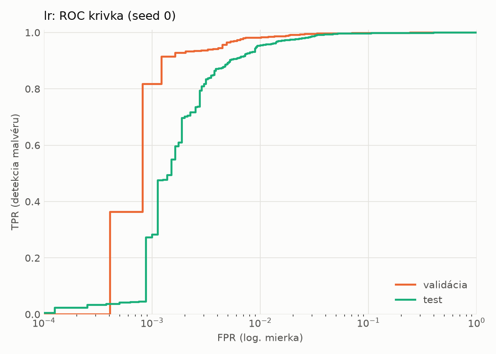
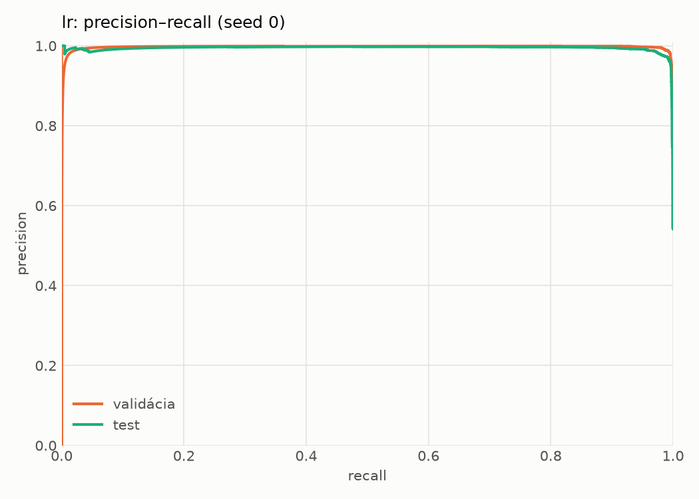
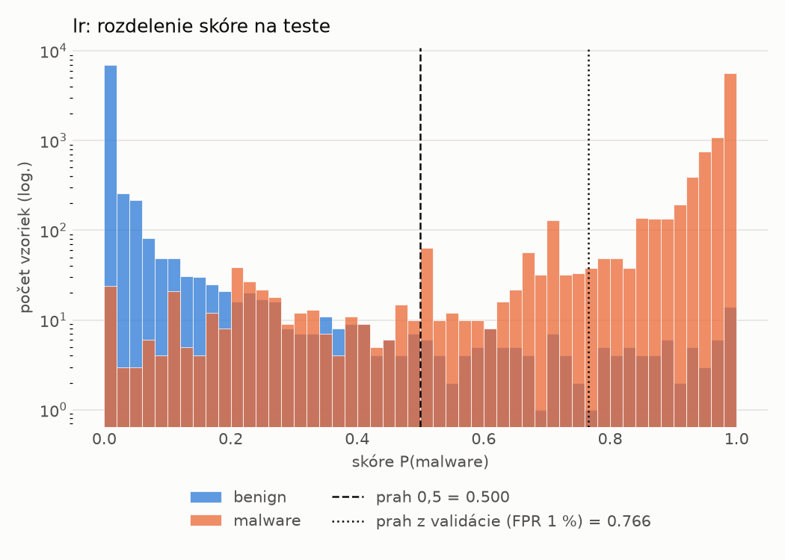
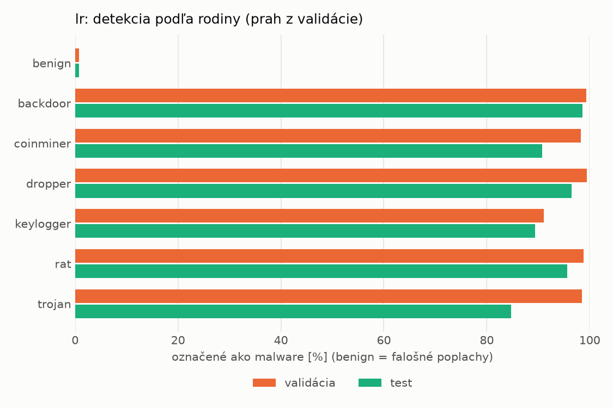
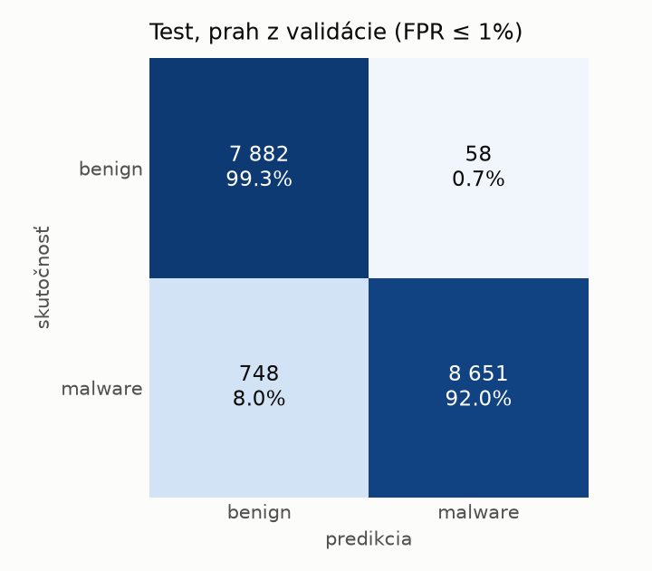
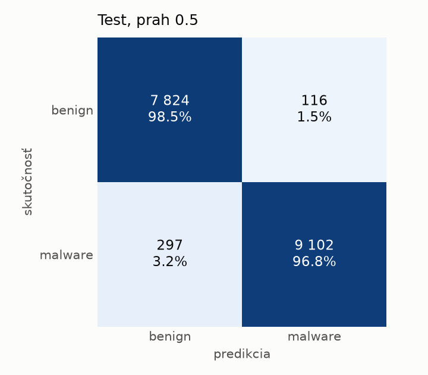

# static/lr – beh `20261104-055029`

> Automaticky generované (`src/training/run_tabular.py`). Konfigurácia: `config.yaml`, protokol: `protocol.yaml`.

- **Model:** `logreg` – logistická regresia s L2 regularizáciou (vstup signed log1p + štandardizácia)
- **Ladenie:** bez ladenia – hyperparametre prevzaté z `runs_final/static/lr/20261101-213555`
- **Finálne modely:** seedy [0, 1, 2]; hodnoty sú priemer ± smerodajná odchýlka cez seedy
- **Najlepšie hyperparametre:** `{"max_iter": 2000, "C": 0.00515917154582608}`

## Detekčná kvalita (bez prahu)
| metrika | train (podvzorka) | validácia | test |
|---|---|---|---|
| ROC-AUC | 0.9996 ± 0.0000 | 0.9980 ± 0.0000 | 0.9959 ± 0.0000 |
| PR-AUC | 0.9997 ± 0.0000 | 0.9971 ± 0.0000 | 0.9946 ± 0.0000 |
| TPR pri FPR 1 % | 0.9889 ± 0.0000 | 0.9818 ± 0.0000 | 0.9535 ± 0.0000 |
| TPR pri FPR 0,1 % | 0.9127 ± 0.0000 | 0.8168 ± 0.0000 | 0.2730 ± 0.0000 |
| log loss | 0.0311 ± 0.0000 | 0.0459 ± 0.0000 | 0.0808 ± 0.0000 |
| Brier skóre | 0.0074 ± 0.0000 | 0.0105 ± 0.0000 | 0.0197 ± 0.0000 |

Rozdiel ROC-AUC train − validácia: **0.0015** (veľký rozdiel = preučenie).

## Pri prahu z validácie (FPR ≤ 1% na validácii)
| metrika | train (podvzorka) | validácia | test |
|---|---|---|---|
| accuracy | 0.9857 ± 0.0000 | 0.9858 ± 0.0000 | 0.9535 ± 0.0000 |
| balanced accuracy | 0.9874 ± 0.0000 | 0.9870 ± 0.0000 | 0.9566 ± 0.0000 |
| precision | 0.9965 ± 0.0000 | 0.9952 ± 0.0000 | 0.9933 ± 0.0000 |
| recall (TPR) | 0.9802 ± 0.0000 | 0.9818 ± 0.0000 | 0.9204 ± 0.0000 |
| FPR | 0.0055 ± 0.0000 | 0.0078 ± 0.0000 | 0.0073 ± 0.0000 |
| F1 | 0.9883 ± 0.0000 | 0.9885 ± 0.0000 | 0.9555 ± 0.0000 |
| MCC | 0.9702 ± 0.0000 | 0.9700 ± 0.0000 | 0.9099 ± 0.0000 |

## Pri pevnom prahu 0.5
| metrika | train (podvzorka) | validácia | test |
|---|---|---|---|
| accuracy | 0.9915 ± 0.0000 | 0.9876 ± 0.0000 | 0.9762 ± 0.0000 |
| balanced accuracy | 0.9905 ± 0.0000 | 0.9864 ± 0.0000 | 0.9769 ± 0.0000 |
| precision | 0.9912 ± 0.0000 | 0.9886 ± 0.0000 | 0.9874 ± 0.0000 |
| recall (TPR) | 0.9950 ± 0.0000 | 0.9915 ± 0.0000 | 0.9684 ± 0.0000 |
| FPR | 0.0140 ± 0.0000 | 0.0188 ± 0.0000 | 0.0146 ± 0.0000 |
| F1 | 0.9931 ± 0.0000 | 0.9901 ± 0.0000 | 0.9778 ± 0.0000 |
| MCC | 0.9820 ± 0.0000 | 0.9737 ± 0.0000 | 0.9523 ± 0.0000 |

## Výpočtové nároky (seed 0, testovacia množina)
| meranie | hodnota |
|---|---|
| tréning finálneho modelu | 2.0 s (priemer cez seedy) |
| ladenie spolu | 0 s |
| počet parametrov / uzlov | 2 320 |
| veľkosť modelu na disku | 0.07 MB |
| transformácia vstupu – latencia (1 vlákno) | 0.022 ms |
| transformácia vstupu – priepustnosť | 43 465 vzoriek/s |
| CPU latencia modelu (batch 1, 1 vlákno) | 0.006 ms (p95 0.006) |
| CPU priepustnosť (24 vlákien) | 291 444 vzoriek/s |

## Grafy
| | |
|---|---|
|  |  |
|  |  |
|  |  |
|  |  |

## Súbory
`metrics.json` (všetky metriky po seedoch vrátane rodín), `timing.json`, `hpo_trials.csv`,
`predictions/<časť>_seed<N>.parquet` (sha256, family, label, score), `model/seed_<N>/`, `log.txt`.
