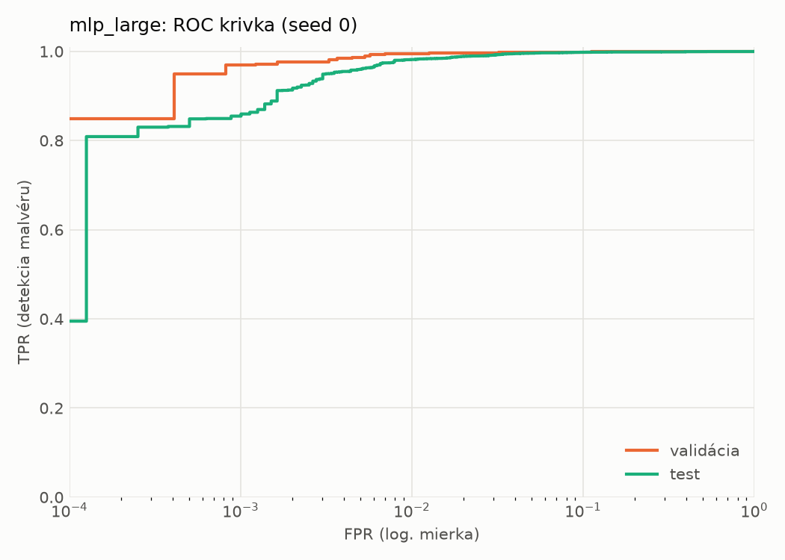
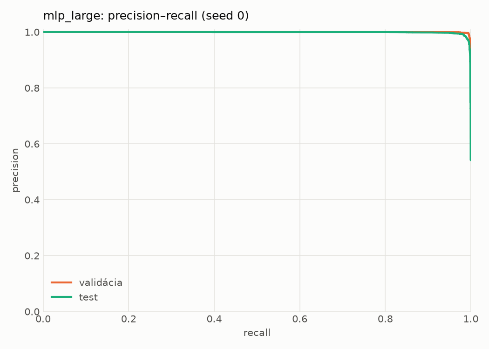
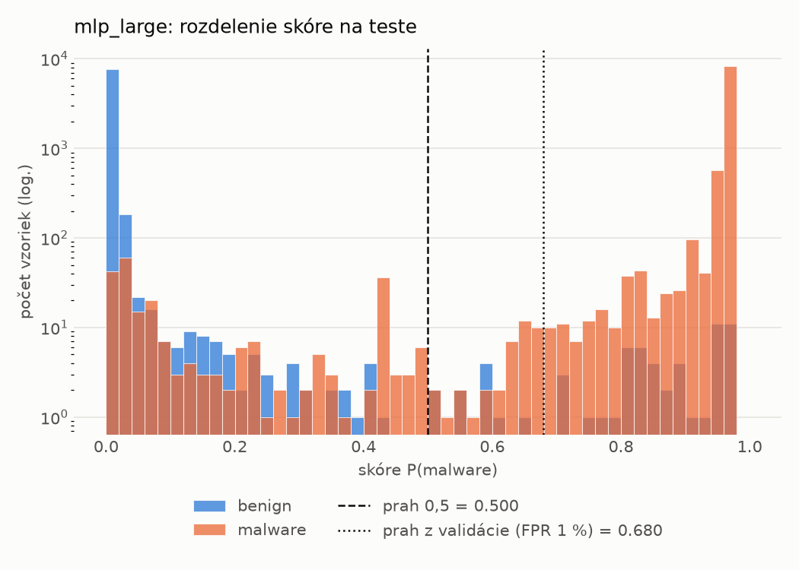
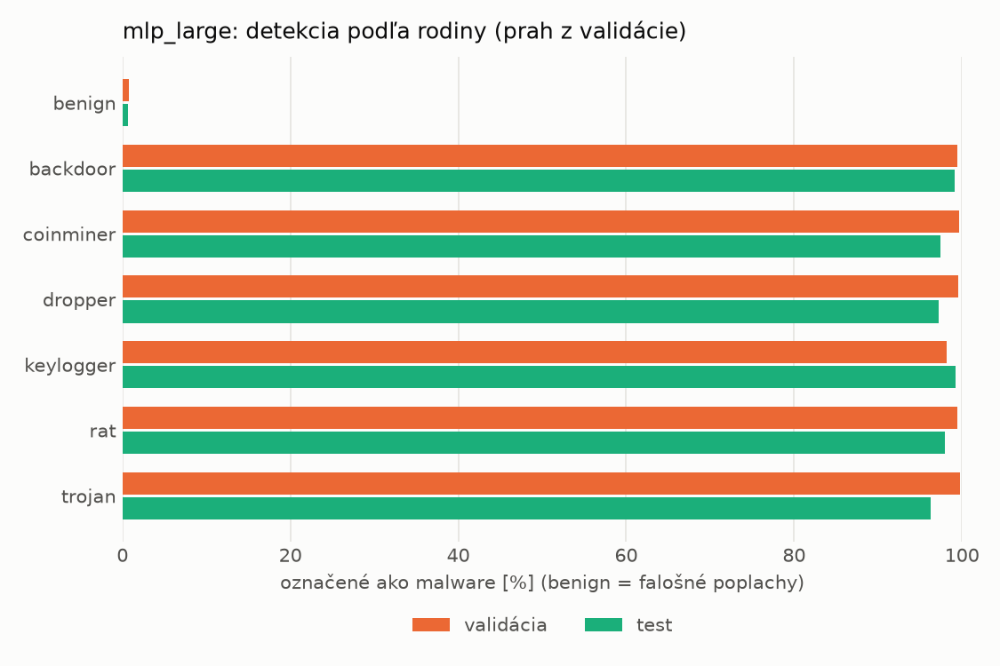
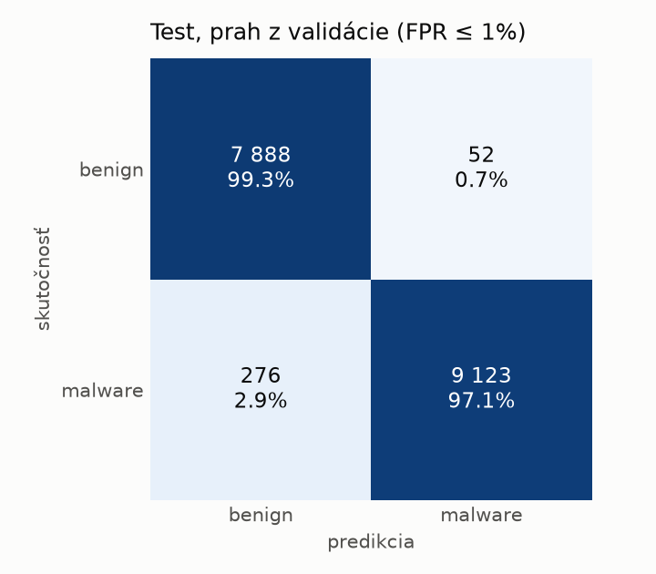
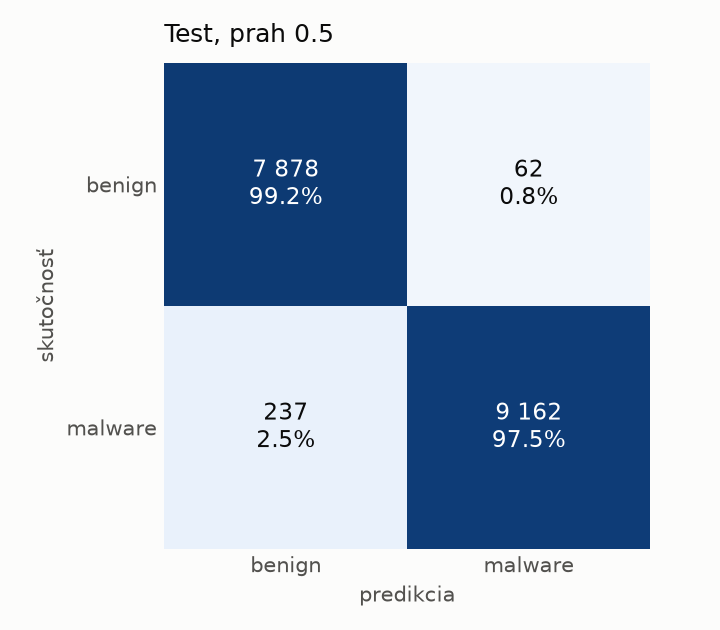
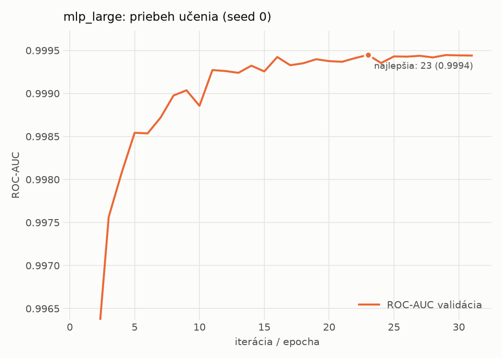

# static/mlp_large – beh `20261104-060015`

> Automaticky generované (`src/training/run_tabular.py`). Konfigurácia: `config.yaml`, protokol: `protocol.yaml`.

- **Model:** `mlp` – veľká neurónová sieť (3–5 skrytých vrstiev, 512–2048 neurónov), kandidát na učiteľa
- **Ladenie:** bez ladenia – hyperparametre prevzaté z `runs_final/static/mlp_large/20261101-235239`
- **Finálne modely:** seedy [0, 1, 2]; hodnoty sú priemer ± smerodajná odchýlka cez seedy
- **Najlepšie hyperparametre:** `{"max_epochs": 100, "patience": 8, "hidden_layers": 5, "hidden_width": 512, "width_decay": 0.5, "dropout": 0.4556986332296347, "lr": 0.00015070674125138616, "weight_decay": 0.0036646034219705954, "batch_size": 1024}`

## Detekčná kvalita (bez prahu)
| metrika | train (podvzorka) | validácia | test |
|---|---|---|---|
| ROC-AUC | 0.9999 ± 0.0000 | 0.9995 ± 0.0001 | 0.9982 ± 0.0002 |
| PR-AUC | 1.0000 ± 0.0000 | 0.9997 ± 0.0000 | 0.9987 ± 0.0001 |
| TPR pri FPR 1 % | 0.9988 ± 0.0002 | 0.9939 ± 0.0010 | 0.9801 ± 0.0053 |
| TPR pri FPR 0,1 % | 0.9873 ± 0.0028 | 0.9720 ± 0.0043 | 0.8711 ± 0.0317 |
| log loss | 0.0390 ± 0.0143 | 0.0510 ± 0.0129 | 0.0819 ± 0.0098 |
| Brier skóre | 0.0041 ± 0.0013 | 0.0073 ± 0.0013 | 0.0172 ± 0.0024 |

Rozdiel ROC-AUC train − validácia: **0.0004** (veľký rozdiel = preučenie).

## Pri prahu z validácie (FPR ≤ 1% na validácii)
| metrika | train (podvzorka) | validácia | test |
|---|---|---|---|
| accuracy | 0.9961 ± 0.0005 | 0.9930 ± 0.0009 | 0.9792 ± 0.0020 |
| balanced accuracy | 0.9957 ± 0.0005 | 0.9927 ± 0.0009 | 0.9804 ± 0.0018 |
| precision | 0.9962 ± 0.0002 | 0.9948 ± 0.0007 | 0.9946 ± 0.0007 |
| recall (TPR) | 0.9975 ± 0.0007 | 0.9939 ± 0.0010 | 0.9669 ± 0.0043 |
| FPR | 0.0061 ± 0.0003 | 0.0086 ± 0.0011 | 0.0062 ± 0.0009 |
| F1 | 0.9968 ± 0.0004 | 0.9944 ± 0.0007 | 0.9806 ± 0.0019 |
| MCC | 0.9918 ± 0.0011 | 0.9851 ± 0.0018 | 0.9587 ± 0.0038 |

## Pri pevnom prahu 0.5
| metrika | train (podvzorka) | validácia | test |
|---|---|---|---|
| accuracy | 0.9960 ± 0.0003 | 0.9926 ± 0.0009 | 0.9796 ± 0.0027 |
| balanced accuracy | 0.9956 ± 0.0003 | 0.9922 ± 0.0009 | 0.9807 ± 0.0024 |
| precision | 0.9960 ± 0.0002 | 0.9942 ± 0.0009 | 0.9944 ± 0.0010 |
| recall (TPR) | 0.9976 ± 0.0003 | 0.9939 ± 0.0010 | 0.9679 ± 0.0061 |
| FPR | 0.0064 ± 0.0004 | 0.0096 ± 0.0016 | 0.0064 ± 0.0012 |
| F1 | 0.9968 ± 0.0002 | 0.9940 ± 0.0007 | 0.9810 ± 0.0026 |
| MCC | 0.9916 ± 0.0006 | 0.9842 ± 0.0018 | 0.9595 ± 0.0053 |

## Výpočtové nároky (seed 0, testovacia množina)
| meranie | hodnota |
|---|---|
| tréning finálneho modelu | 5.7 s (priemer cez seedy) |
| ladenie spolu | 0 s |
| počet parametrov / uzlov | 1 364 417 |
| veľkosť modelu na disku | 5.53 MB |
| transformácia vstupu – latencia (1 vlákno) | 0.041 ms |
| transformácia vstupu – priepustnosť | 39 582 vzoriek/s |
| CPU latencia modelu (batch 1, 1 vlákno) | 0.258 ms (p95 0.288) |
| CPU priepustnosť (24 vlákien) | 82 714 vzoriek/s |
| GPU latencia (batch 1) | 0.615 ms (p95 1.293) |
| GPU priepustnosť | 82 914 vzoriek/s |
| GPU špičková pamäť | 1423 MB |

## Grafy
| | |
|---|---|
|  |  |
|  |  |
|  |  |
|  |  |

## Súbory
`metrics.json` (všetky metriky po seedoch vrátane rodín), `timing.json`, `hpo_trials.csv`,
`predictions/<časť>_seed<N>.parquet` (sha256, family, label, score), `model/seed_<N>/`, `log.txt`.
