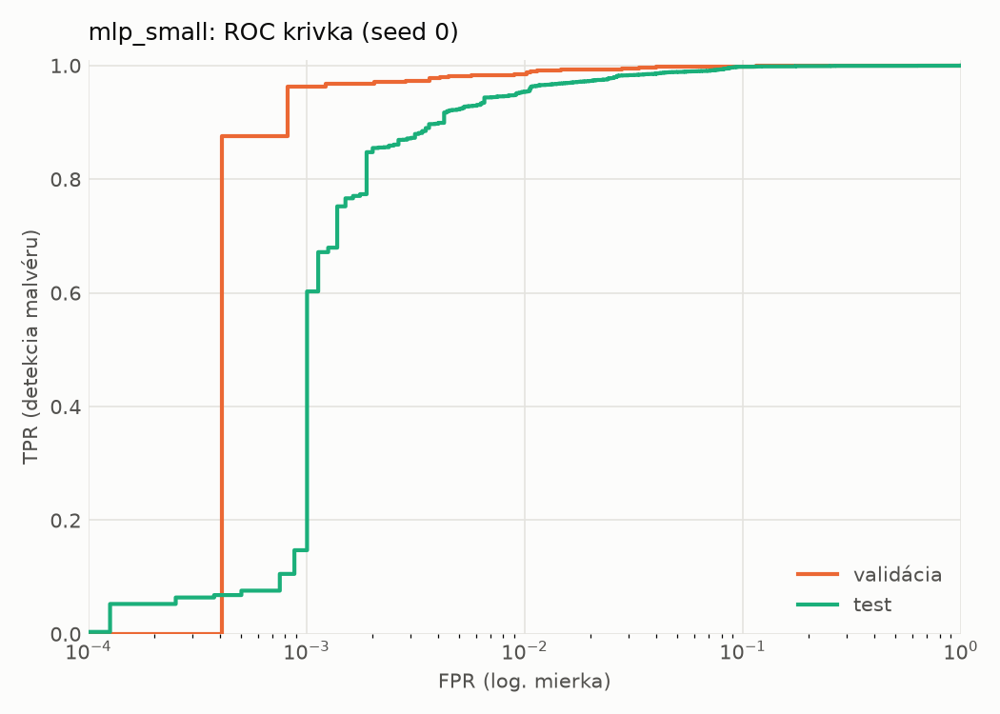
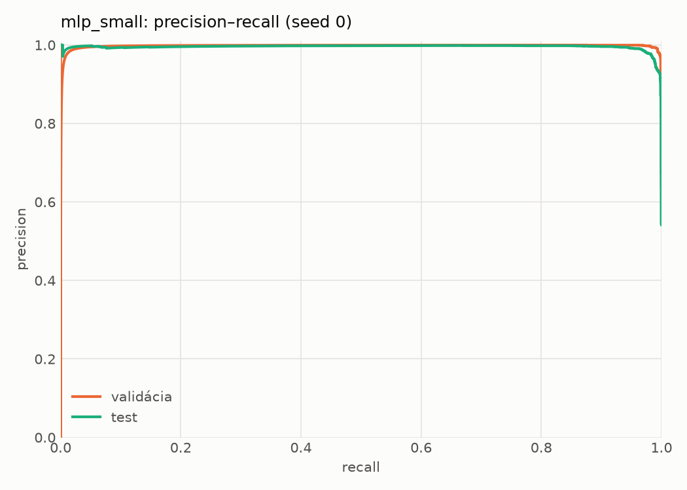
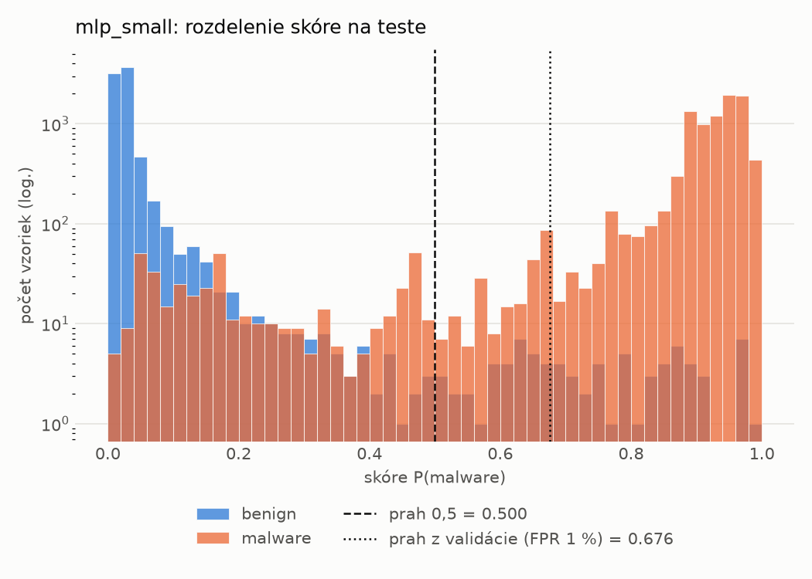
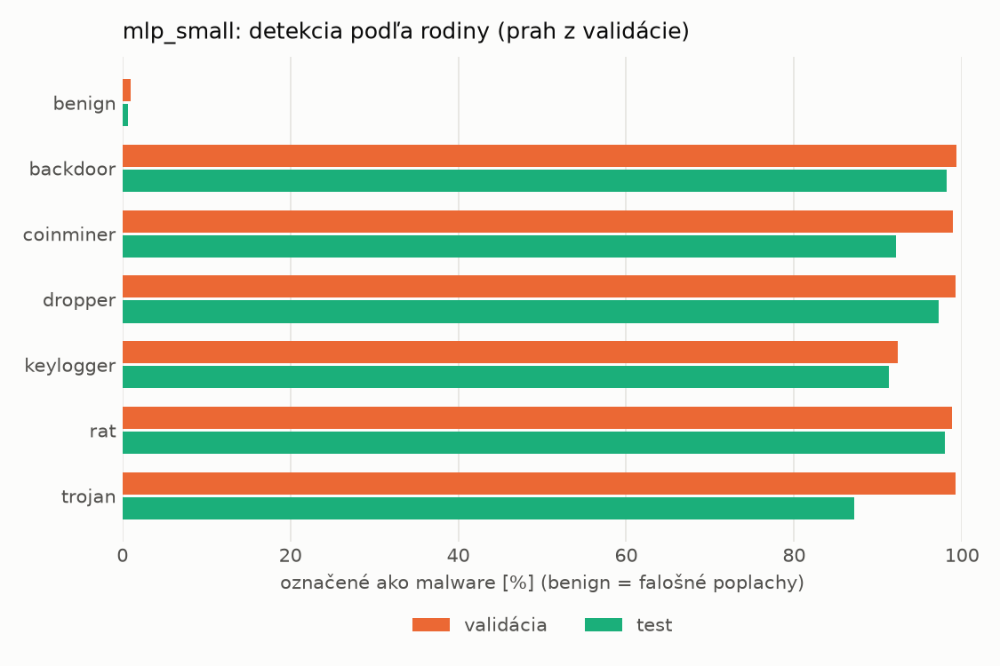
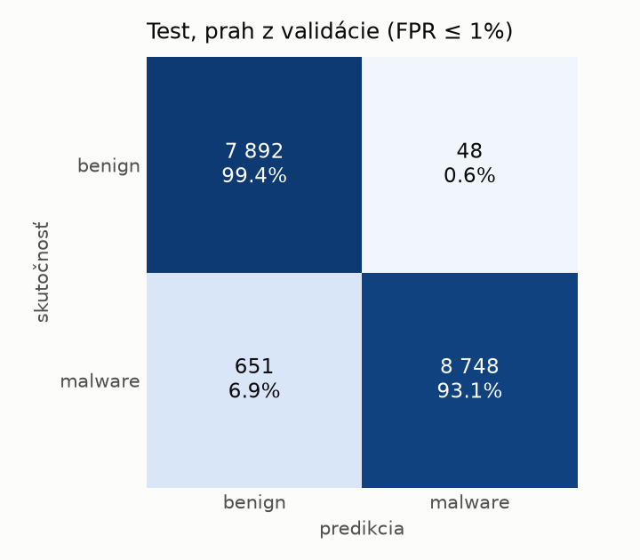
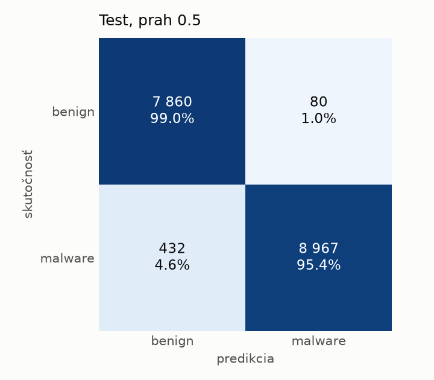
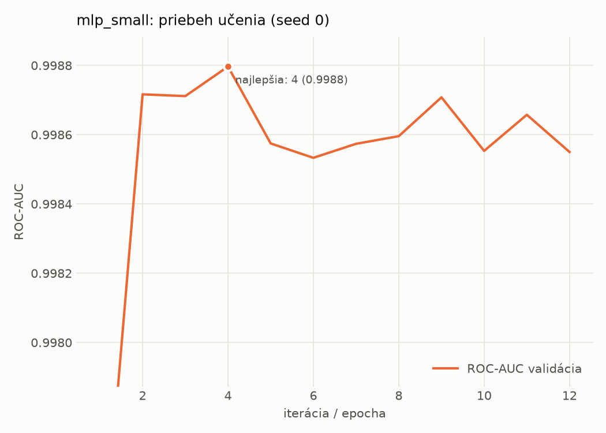

# static/mlp_small – beh `20261104-055954`

> Automaticky generované (`src/training/run_tabular.py`). Konfigurácia: `config.yaml`, protokol: `protocol.yaml`.

- **Model:** `mlp` – malá neurónová sieť (1–2 skryté vrstvy), kandidát na ľahkého študenta
- **Ladenie:** bez ladenia – hyperparametre prevzaté z `runs_final/static/mlp_small/20261101-235005`
- **Finálne modely:** seedy [0, 1, 2]; hodnoty sú priemer ± smerodajná odchýlka cez seedy
- **Najlepšie hyperparametre:** `{"width_decay": 0.5, "max_epochs": 100, "patience": 8, "hidden_layers": 2, "hidden_width": 32, "dropout": 0.15212112147976886, "lr": 0.0005958389350068958, "weight_decay": 5.34293726127978e-05, "batch_size": 512}`

## Detekčná kvalita (bez prahu)
| metrika | train (podvzorka) | validácia | test |
|---|---|---|---|
| ROC-AUC | 0.9998 ± 0.0001 | 0.9989 ± 0.0002 | 0.9967 ± 0.0003 |
| PR-AUC | 0.9999 ± 0.0001 | 0.9983 ± 0.0011 | 0.9955 ± 0.0008 |
| TPR pri FPR 1 % | 0.9952 ± 0.0032 | 0.9869 ± 0.0050 | 0.9605 ± 0.0064 |
| TPR pri FPR 0,1 % | 0.9779 ± 0.0073 | 0.9437 ± 0.0329 | 0.3992 ± 0.3068 |
| log loss | 0.0593 ± 0.0346 | 0.0693 ± 0.0329 | 0.1068 ± 0.0287 |
| Brier skóre | 0.0083 ± 0.0049 | 0.0112 ± 0.0044 | 0.0241 ± 0.0047 |

Rozdiel ROC-AUC train − validácia: **0.0009** (veľký rozdiel = preučenie).

## Pri prahu z validácie (FPR ≤ 1% na validácii)
| metrika | train (podvzorka) | validácia | test |
|---|---|---|---|
| accuracy | 0.9909 ± 0.0033 | 0.9881 ± 0.0031 | 0.9650 ± 0.0073 |
| balanced accuracy | 0.9916 ± 0.0025 | 0.9885 ± 0.0025 | 0.9672 ± 0.0066 |
| precision | 0.9965 ± 0.0006 | 0.9940 ± 0.0000 | 0.9938 ± 0.0013 |
| recall (TPR) | 0.9888 ± 0.0058 | 0.9869 ± 0.0050 | 0.9413 ± 0.0149 |
| FPR | 0.0056 ± 0.0010 | 0.0098 ± 0.0000 | 0.0069 ± 0.0016 |
| F1 | 0.9926 ± 0.0027 | 0.9904 ± 0.0025 | 0.9668 ± 0.0072 |
| MCC | 0.9810 ± 0.0068 | 0.9749 ± 0.0066 | 0.9315 ± 0.0138 |

## Pri pevnom prahu 0.5
| metrika | train (podvzorka) | validácia | test |
|---|---|---|---|
| accuracy | 0.9935 ± 0.0014 | 0.9899 ± 0.0011 | 0.9736 ± 0.0029 |
| balanced accuracy | 0.9930 ± 0.0015 | 0.9893 ± 0.0012 | 0.9749 ± 0.0027 |
| precision | 0.9943 ± 0.0012 | 0.9921 ± 0.0010 | 0.9915 ± 0.0004 |
| recall (TPR) | 0.9952 ± 0.0011 | 0.9916 ± 0.0010 | 0.9596 ± 0.0050 |
| FPR | 0.0092 ± 0.0019 | 0.0130 ± 0.0017 | 0.0097 ± 0.0004 |
| F1 | 0.9947 ± 0.0011 | 0.9919 ± 0.0009 | 0.9753 ± 0.0027 |
| MCC | 0.9863 ± 0.0030 | 0.9785 ± 0.0024 | 0.9476 ± 0.0056 |

## Výpočtové nároky (seed 0, testovacia množina)
| meranie | hodnota |
|---|---|
| tréning finálneho modelu | 3.8 s (priemer cez seedy) |
| ladenie spolu | 0 s |
| počet parametrov / uzlov | 74 881 |
| veľkosť modelu na disku | 0.36 MB |
| transformácia vstupu – latencia (1 vlákno) | 0.041 ms |
| transformácia vstupu – priepustnosť | 38 468 vzoriek/s |
| CPU latencia modelu (batch 1, 1 vlákno) | 0.096 ms (p95 0.124) |
| CPU priepustnosť (24 vlákien) | 109 467 vzoriek/s |
| GPU latencia (batch 1) | 0.388 ms (p95 0.430) |
| GPU priepustnosť | 75 545 vzoriek/s |
| GPU špičková pamäť | 782 MB |

## Grafy
| | |
|---|---|
|  |  |
|  |  |
|  |  |
|  |  |

## Súbory
`metrics.json` (všetky metriky po seedoch vrátane rodín), `timing.json`, `hpo_trials.csv`,
`predictions/<časť>_seed<N>.parquet` (sha256, family, label, score), `model/seed_<N>/`, `log.txt`.
