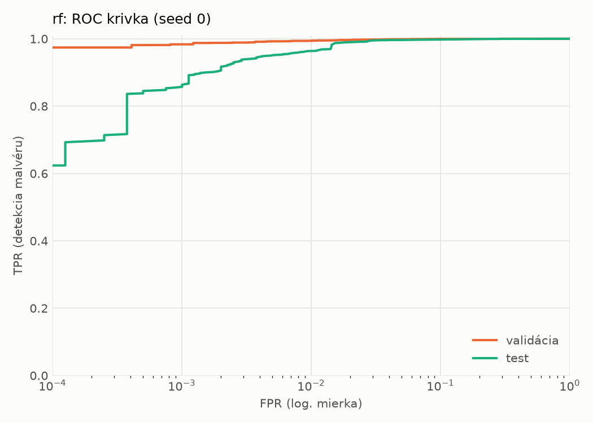
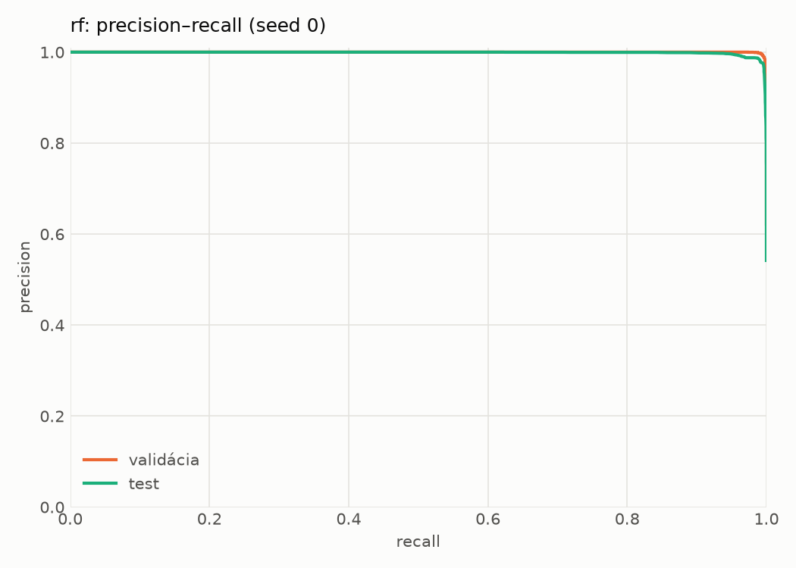
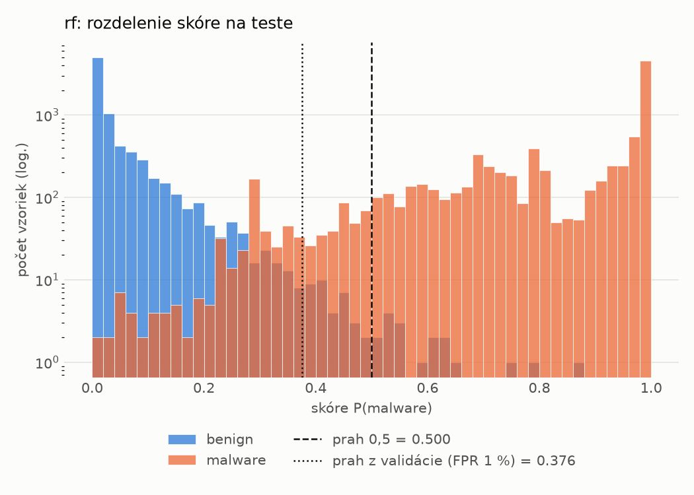
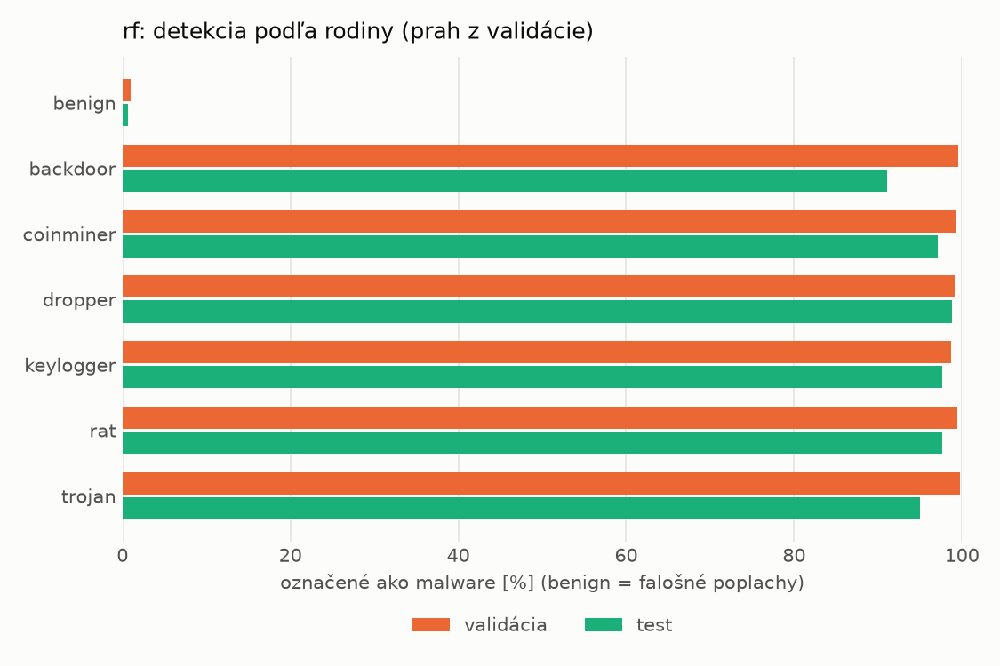
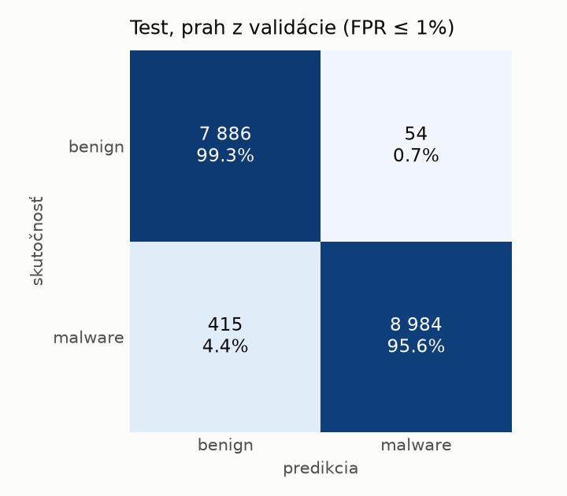
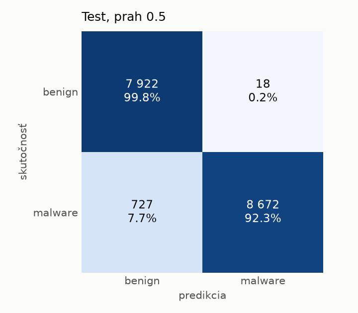

# static/rf – beh `20261104-055043`

> Automaticky generované (`src/training/run_tabular.py`). Konfigurácia: `config.yaml`, protokol: `protocol.yaml`.

- **Model:** `random_forest` – Random Forest (pôvodné hodnoty príznakov)
- **Ladenie:** bez ladenia – hyperparametre prevzaté z `runs_final/static/rf/20261101-213728`
- **Finálne modely:** seedy [0, 1, 2]; hodnoty sú priemer ± smerodajná odchýlka cez seedy
- **Najlepšie hyperparametre:** `{"n_estimators": 250, "max_depth": null, "min_samples_leaf": 1, "max_features": "sqrt"}`

## Detekčná kvalita (bez prahu)
| metrika | train (podvzorka) | validácia | test |
|---|---|---|---|
| ROC-AUC | 1.0000 ± 0.0000 | 0.9997 ± 0.0000 | 0.9986 ± 0.0000 |
| PR-AUC | 1.0000 ± 0.0000 | 0.9998 ± 0.0000 | 0.9988 ± 0.0000 |
| TPR pri FPR 1 % | 1.0000 ± 0.0000 | 0.9944 ± 0.0004 | 0.9639 ± 0.0015 |
| TPR pri FPR 0,1 % | 1.0000 ± 0.0000 | 0.9822 ± 0.0017 | 0.8538 ± 0.0023 |
| log loss | 0.0085 ± 0.0001 | 0.0280 ± 0.0001 | 0.1316 ± 0.0011 |
| Brier skóre | 0.0010 ± 0.0000 | 0.0066 ± 0.0001 | 0.0380 ± 0.0003 |

Rozdiel ROC-AUC train − validácia: **0.0003** (veľký rozdiel = preučenie).

## Pri prahu z validácie (FPR ≤ 1% na validácii)
| metrika | train (podvzorka) | validácia | test |
|---|---|---|---|
| accuracy | 1.0000 ± 0.0000 | 0.9929 ± 0.0003 | 0.9734 ± 0.0020 |
| balanced accuracy | 1.0000 ± 0.0000 | 0.9924 ± 0.0003 | 0.9749 ± 0.0018 |
| precision | 1.0000 ± 0.0000 | 0.9942 ± 0.0003 | 0.9937 ± 0.0010 |
| recall (TPR) | 1.0000 ± 0.0000 | 0.9944 ± 0.0004 | 0.9570 ± 0.0048 |
| FPR | 0.0000 ± 0.0000 | 0.0096 ± 0.0005 | 0.0072 ± 0.0012 |
| F1 | 1.0000 ± 0.0000 | 0.9943 ± 0.0003 | 0.9750 ± 0.0020 |
| MCC | 1.0000 ± 0.0000 | 0.9850 ± 0.0007 | 0.9474 ± 0.0038 |

## Pri pevnom prahu 0.5
| metrika | train (podvzorka) | validácia | test |
|---|---|---|---|
| accuracy | 1.0000 ± 0.0000 | 0.9933 ± 0.0002 | 0.9570 ± 0.0014 |
| balanced accuracy | 1.0000 ± 0.0000 | 0.9938 ± 0.0001 | 0.9602 ± 0.0013 |
| precision | 1.0000 ± 0.0000 | 0.9973 ± 0.0001 | 0.9979 ± 0.0002 |
| recall (TPR) | 1.0000 ± 0.0000 | 0.9920 ± 0.0003 | 0.9226 ± 0.0023 |
| FPR | 0.0000 ± 0.0000 | 0.0044 ± 0.0002 | 0.0023 ± 0.0003 |
| F1 | 1.0000 ± 0.0000 | 0.9946 ± 0.0001 | 0.9588 ± 0.0013 |
| MCC | 1.0000 ± 0.0000 | 0.9859 ± 0.0003 | 0.9171 ± 0.0025 |

## Výpočtové nároky (seed 0, testovacia množina)
| meranie | hodnota |
|---|---|
| tréning finálneho modelu | 22.4 s (priemer cez seedy) |
| ladenie spolu | 0 s |
| počet parametrov / uzlov | 366 998 |
| veľkosť modelu na disku | 29.69 MB |
| CPU latencia modelu (batch 1, 1 vlákno) | 7.204 ms (p95 7.430) |
| CPU priepustnosť (24 vlákien) | 133 584 vzoriek/s |

## Grafy
| | |
|---|---|
|  |  |
|  |  |
|  |  |
|  |  |

## Súbory
`metrics.json` (všetky metriky po seedoch vrátane rodín), `timing.json`, `hpo_trials.csv`,
`predictions/<časť>_seed<N>.parquet` (sha256, family, label, score), `model/seed_<N>/`, `log.txt`.
