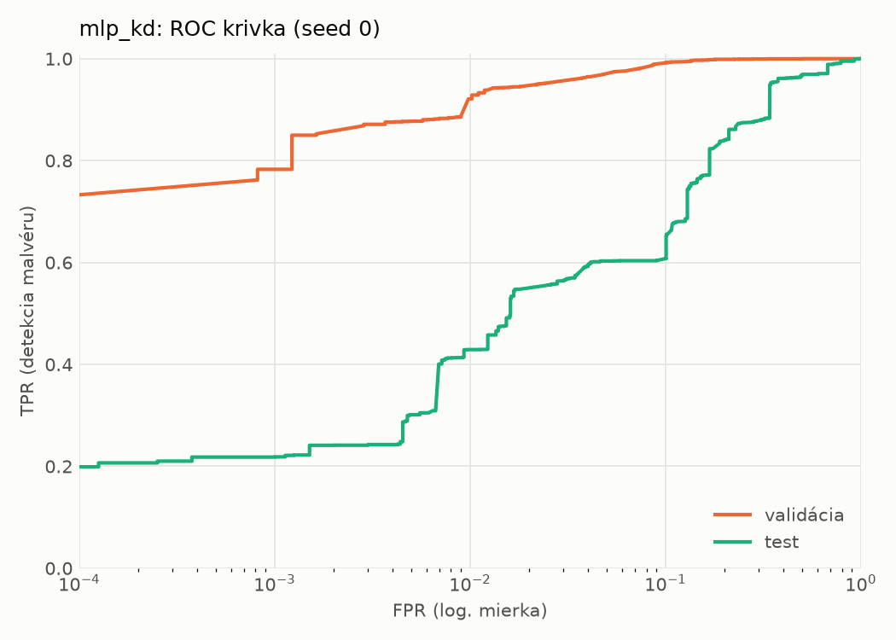
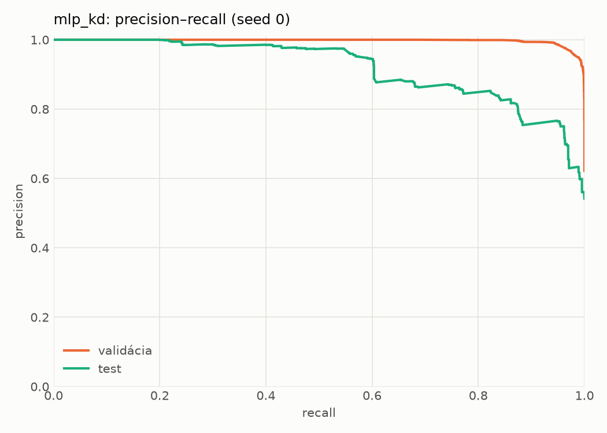
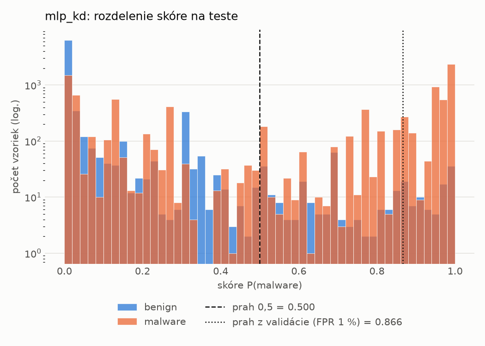
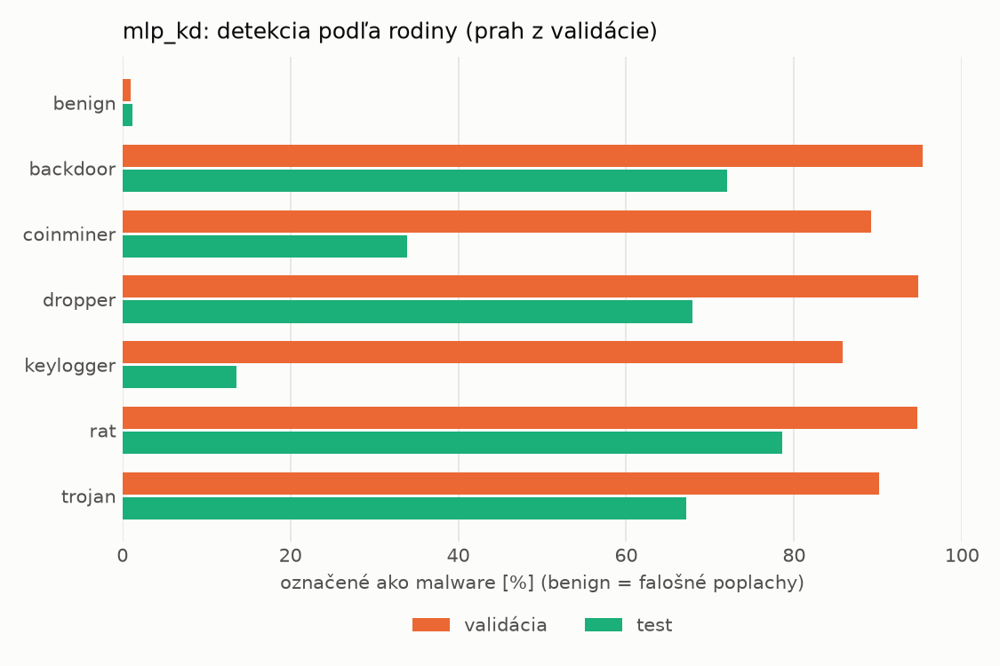
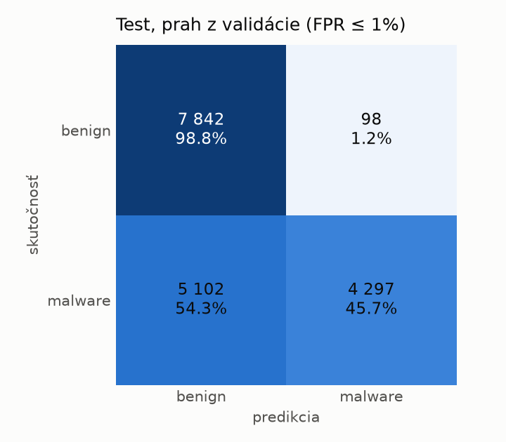
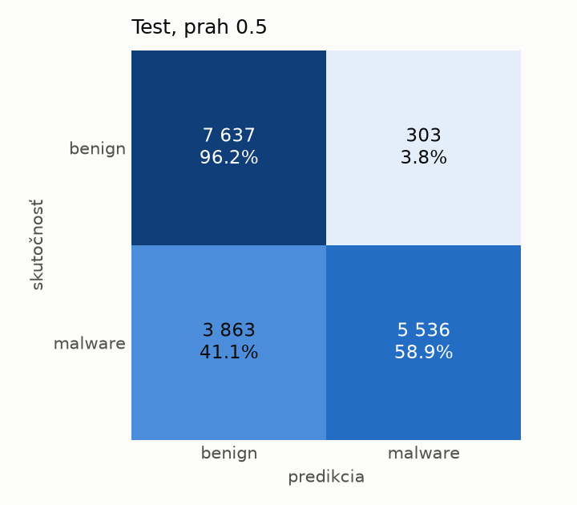
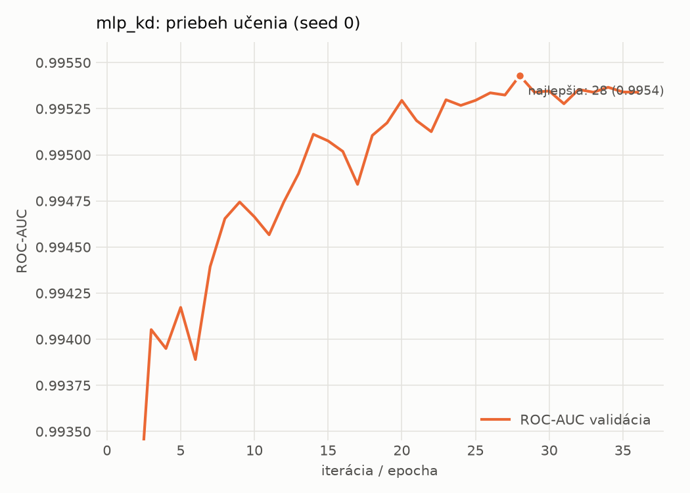

# dynamic/mlp_kd – beh `20261104-075845`

> Automaticky generované (`src/training/run_tabular.py`). Konfigurácia: `config.yaml`, protokol: `protocol.yaml`.

- **Model:** `mlp` – študent – malé MLP učené destiláciou z hybridného učiteľa
- **Ladenie:** bez ladenia – hyperparametre prevzaté z `runs_final/students_dynamic/mlp_kd/20261102-212132`
- **Finálne modely:** seedy [0, 1, 2]; hodnoty sú priemer ± smerodajná odchýlka cez seedy
- **Najlepšie hyperparametre:** `{"hidden_layers": 1, "max_epochs": 100, "patience": 8, "hidden_width": 32, "dropout": 0.14978534481914754, "lr": 0.0015794492400712224, "weight_decay": 1.2553588001973222e-06, "batch_size": 512, "kd_alpha": 0.7118939371172979, "kd_temperature": 1.298431487079528}`

## Detekčná kvalita (bez prahu)
| metrika | train (podvzorka) | validácia | test |
|---|---|---|---|
| ROC-AUC | 0.9965 ± 0.0001 | 0.9955 ± 0.0001 | 0.9034 ± 0.0061 |
| PR-AUC | 0.9977 ± 0.0001 | 0.9972 ± 0.0000 | 0.9221 ± 0.0049 |
| TPR pri FPR 1 % | 0.9326 ± 0.0008 | 0.9233 ± 0.0019 | 0.4254 ± 0.0069 |
| TPR pri FPR 0,1 % | 0.8681 ± 0.0017 | 0.7921 ± 0.0081 | 0.2196 ± 0.0025 |
| log loss | 0.0739 ± 0.0010 | 0.0860 ± 0.0006 | 0.9433 ± 0.0773 |
| Brier skóre | 0.0237 ± 0.0003 | 0.0256 ± 0.0002 | 0.2062 ± 0.0119 |

Rozdiel ROC-AUC train − validácia: **0.0010** (veľký rozdiel = preučenie).

## Pri prahu z validácie (FPR ≤ 1% na validácii)
| metrika | train (podvzorka) | validácia | test |
|---|---|---|---|
| accuracy | 0.9483 ± 0.0001 | 0.9486 ± 0.0012 | 0.7005 ± 0.0047 |
| balanced accuracy | 0.9566 ± 0.0001 | 0.9568 ± 0.0010 | 0.7228 ± 0.0043 |
| precision | 0.9951 ± 0.0004 | 0.9936 ± 0.0000 | 0.9780 ± 0.0003 |
| recall (TPR) | 0.9205 ± 0.0003 | 0.9233 ± 0.0019 | 0.4578 ± 0.0087 |
| FPR | 0.0072 ± 0.0005 | 0.0098 ± 0.0000 | 0.0122 ± 0.0002 |
| F1 | 0.9563 ± 0.0000 | 0.9572 ± 0.0010 | 0.6237 ± 0.0081 |
| MCC | 0.8974 ± 0.0002 | 0.8968 ± 0.0022 | 0.5102 ± 0.0067 |

## Pri pevnom prahu 0.5
| metrika | train (podvzorka) | validácia | test |
|---|---|---|---|
| accuracy | 0.9642 ± 0.0008 | 0.9627 ± 0.0006 | 0.7571 ± 0.0219 |
| balanced accuracy | 0.9650 ± 0.0018 | 0.9633 ± 0.0012 | 0.7732 ± 0.0201 |
| precision | 0.9798 ± 0.0037 | 0.9787 ± 0.0023 | 0.9503 ± 0.0025 |
| recall (TPR) | 0.9616 ± 0.0024 | 0.9610 ± 0.0015 | 0.5824 ± 0.0417 |
| FPR | 0.0316 ± 0.0060 | 0.0345 ± 0.0039 | 0.0360 ± 0.0023 |
| F1 | 0.9706 ± 0.0006 | 0.9698 ± 0.0004 | 0.7216 ± 0.0327 |
| MCC | 0.9251 ± 0.0020 | 0.9214 ± 0.0014 | 0.5781 ± 0.0324 |

## Výpočtové nároky (seed 0, testovacia množina)
| meranie | hodnota |
|---|---|
| tréning finálneho modelu | 7.9 s (priemer cez seedy) |
| ladenie spolu | 0 s |
| počet parametrov / uzlov | 64 129 |
| veľkosť modelu na disku | 0.31 MB |
| transformácia vstupu – latencia (1 vlákno) | 0.034 ms |
| transformácia vstupu – priepustnosť | 51 302 vzoriek/s |
| CPU latencia modelu (batch 1, 1 vlákno) | 0.067 ms (p95 0.077) |
| CPU priepustnosť (24 vlákien) | 97 092 vzoriek/s |
| GPU latencia (batch 1) | 0.452 ms (p95 0.475) |
| GPU priepustnosť | 104 805 vzoriek/s |
| GPU špičková pamäť | 676 MB |

## Grafy
| | |
|---|---|
|  |  |
|  |  |
|  |  |
|  |  |

## Súbory
`metrics.json` (všetky metriky po seedoch vrátane rodín), `timing.json`, `hpo_trials.csv`,
`predictions/<časť>_seed<N>.parquet` (sha256, family, label, score), `model/seed_<N>/`, `log.txt`.
