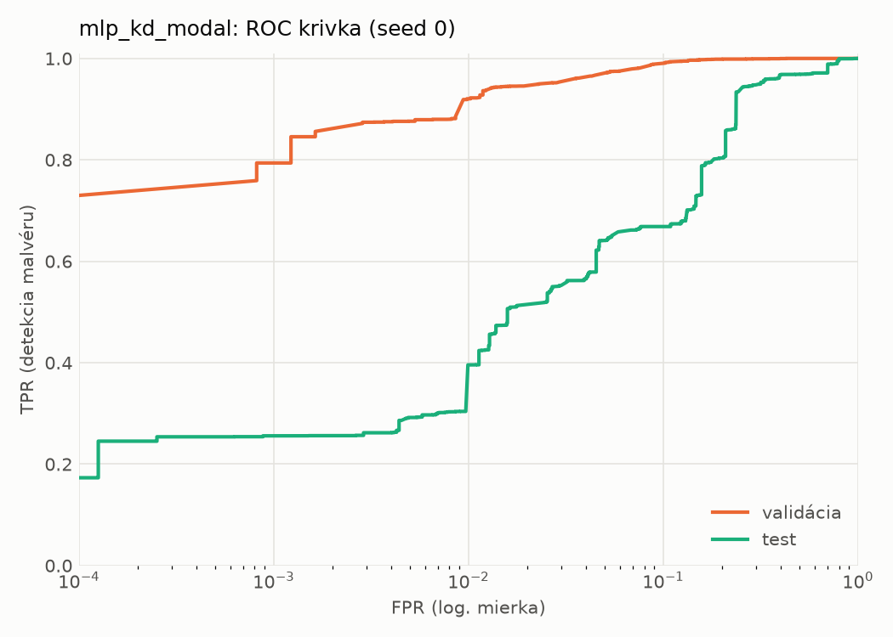
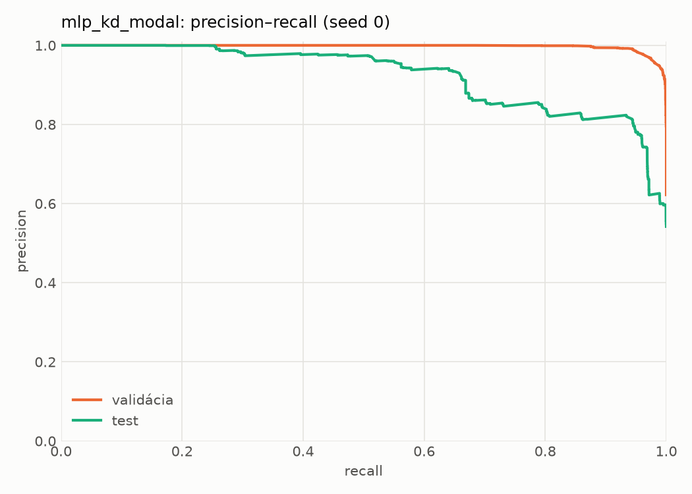
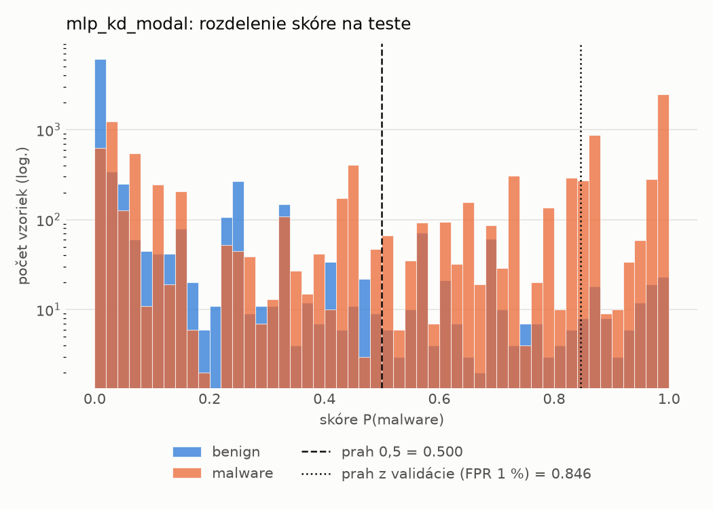
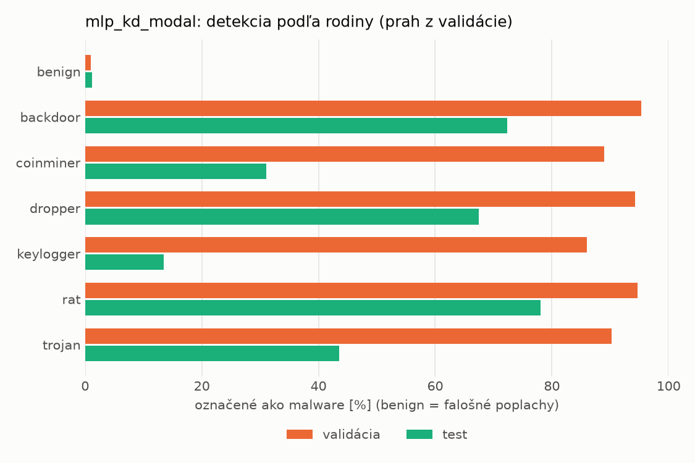
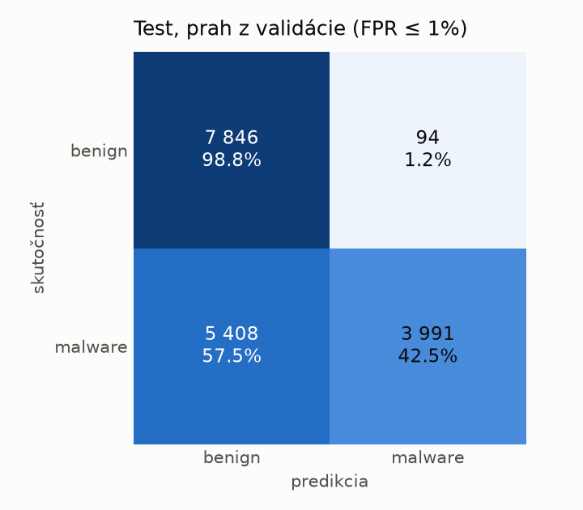
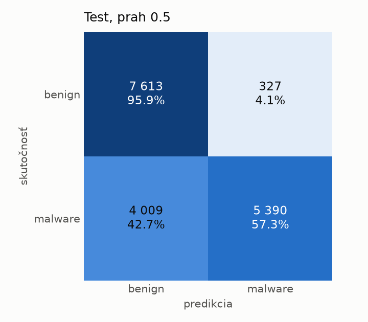
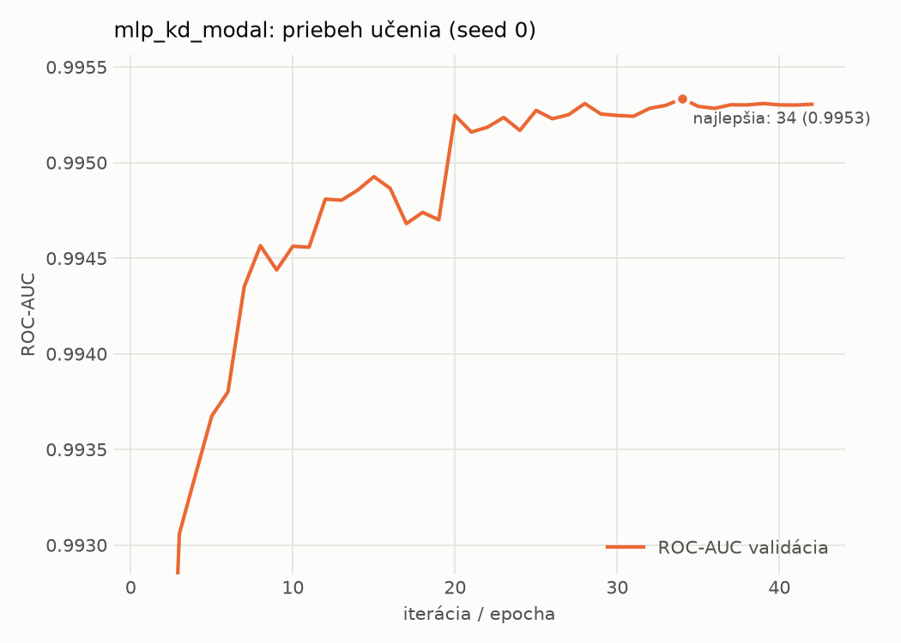

# dynamic/mlp_kd_modal – beh `20261104-075936`

> Automaticky generované (`src/training/run_tabular.py`). Konfigurácia: `config.yaml`, protokol: `protocol.yaml`.

- **Model:** `mlp` – študent – malé MLP učené destiláciou z učiteľa rovnakej modality (variant A)
- **Ladenie:** bez ladenia – hyperparametre prevzaté z `runs_final/students_dynamic/mlp_kd_modal/20261102-212954`
- **Finálne modely:** seedy [0, 1, 2]; hodnoty sú priemer ± smerodajná odchýlka cez seedy
- **Najlepšie hyperparametre:** `{"hidden_layers": 1, "max_epochs": 100, "patience": 8, "hidden_width": 32, "dropout": 0.14040860994340293, "lr": 0.00037778352941027736, "weight_decay": 1.149514965975221e-06, "batch_size": 512, "kd_alpha": 0.8818461482523741, "kd_temperature": 1.583698009756735}`

## Detekčná kvalita (bez prahu)
| metrika | train (podvzorka) | validácia | test |
|---|---|---|---|
| ROC-AUC | 0.9965 ± 0.0000 | 0.9954 ± 0.0000 | 0.9030 ± 0.0044 |
| PR-AUC | 0.9977 ± 0.0000 | 0.9971 ± 0.0000 | 0.9220 ± 0.0021 |
| TPR pri FPR 1 % | 0.9312 ± 0.0016 | 0.9212 ± 0.0007 | 0.4106 ± 0.0243 |
| TPR pri FPR 0,1 % | 0.8621 ± 0.0090 | 0.7825 ± 0.0099 | 0.2629 ± 0.0112 |
| log loss | 0.0746 ± 0.0005 | 0.0855 ± 0.0002 | 0.8250 ± 0.0272 |
| Brier skóre | 0.0236 ± 0.0001 | 0.0258 ± 0.0000 | 0.2035 ± 0.0008 |

Rozdiel ROC-AUC train − validácia: **0.0011** (veľký rozdiel = preučenie).

## Pri prahu z validácie (FPR ≤ 1% na validácii)
| metrika | train (podvzorka) | validácia | test |
|---|---|---|---|
| accuracy | 0.9478 ± 0.0007 | 0.9473 ± 0.0005 | 0.6908 ± 0.0131 |
| balanced accuracy | 0.9563 ± 0.0006 | 0.9557 ± 0.0004 | 0.7139 ± 0.0121 |
| precision | 0.9954 ± 0.0001 | 0.9937 ± 0.0002 | 0.9785 ± 0.0014 |
| recall (TPR) | 0.9194 ± 0.0010 | 0.9212 ± 0.0007 | 0.4392 ± 0.0242 |
| FPR | 0.0068 ± 0.0001 | 0.0097 ± 0.0002 | 0.0114 ± 0.0004 |
| F1 | 0.9559 ± 0.0006 | 0.9560 ± 0.0004 | 0.6060 ± 0.0231 |
| MCC | 0.8965 ± 0.0013 | 0.8945 ± 0.0009 | 0.4967 ± 0.0190 |

## Pri pevnom prahu 0.5
| metrika | train (podvzorka) | validácia | test |
|---|---|---|---|
| accuracy | 0.9641 ± 0.0004 | 0.9624 ± 0.0003 | 0.7593 ± 0.0084 |
| balanced accuracy | 0.9650 ± 0.0002 | 0.9630 ± 0.0007 | 0.7751 ± 0.0081 |
| precision | 0.9804 ± 0.0006 | 0.9786 ± 0.0013 | 0.9492 ± 0.0060 |
| recall (TPR) | 0.9608 ± 0.0013 | 0.9605 ± 0.0009 | 0.5874 ± 0.0124 |
| FPR | 0.0307 ± 0.0010 | 0.0345 ± 0.0023 | 0.0372 ± 0.0039 |
| F1 | 0.9705 ± 0.0004 | 0.9695 ± 0.0002 | 0.7257 ± 0.0112 |
| MCC | 0.9249 ± 0.0007 | 0.9207 ± 0.0008 | 0.5806 ± 0.0149 |

## Výpočtové nároky (seed 0, testovacia množina)
| meranie | hodnota |
|---|---|
| tréning finálneho modelu | 9.0 s (priemer cez seedy) |
| ladenie spolu | 0 s |
| počet parametrov / uzlov | 64 129 |
| veľkosť modelu na disku | 0.31 MB |
| transformácia vstupu – latencia (1 vlákno) | 0.034 ms |
| transformácia vstupu – priepustnosť | 45 527 vzoriek/s |
| CPU latencia modelu (batch 1, 1 vlákno) | 0.068 ms (p95 0.078) |
| CPU priepustnosť (24 vlákien) | 95 407 vzoriek/s |
| GPU latencia (batch 1) | 0.457 ms (p95 0.494) |
| GPU priepustnosť | 98 188 vzoriek/s |
| GPU špičková pamäť | 676 MB |

## Grafy
| | |
|---|---|
|  |  |
|  |  |
|  |  |
|  |  |

## Súbory
`metrics.json` (všetky metriky po seedoch vrátane rodín), `timing.json`, `hpo_trials.csv`,
`predictions/<časť>_seed<N>.parquet` (sha256, family, label, score), `model/seed_<N>/`, `log.txt`.
