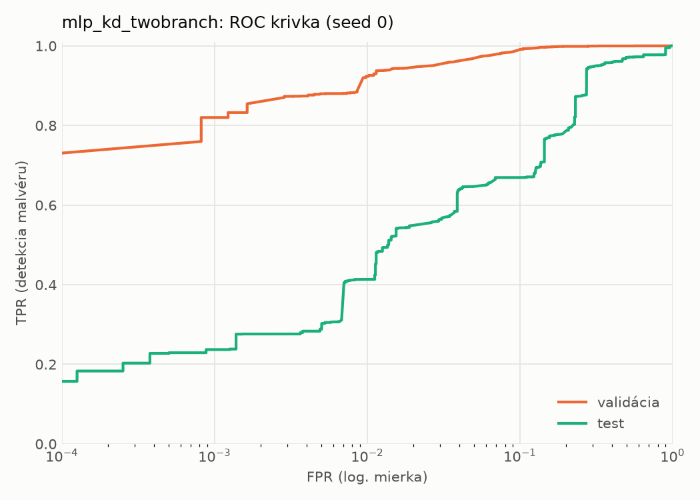
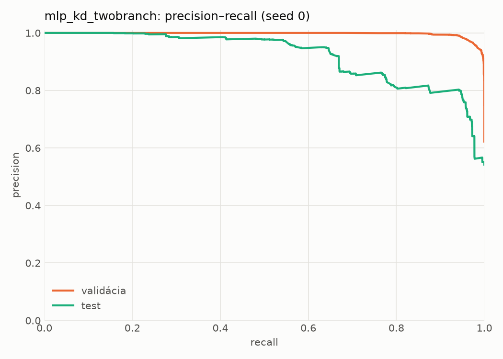
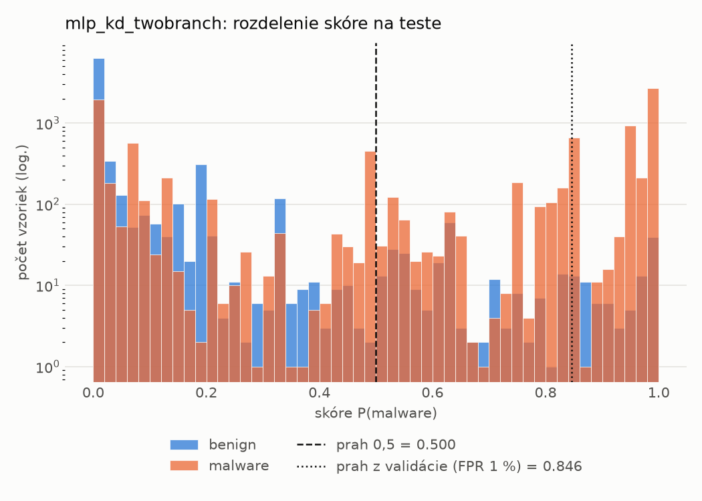
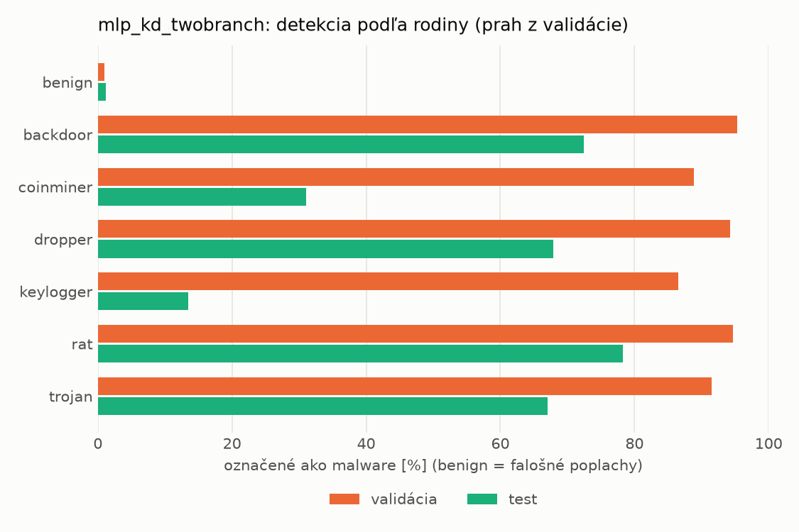
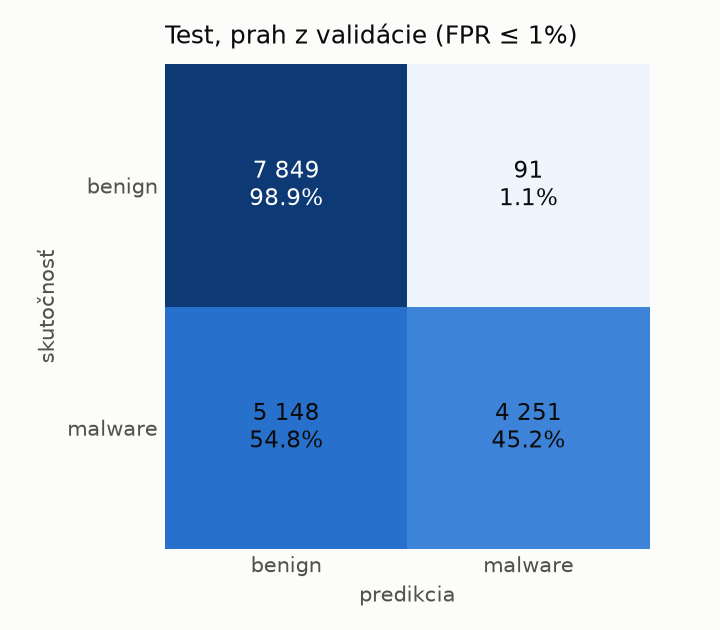
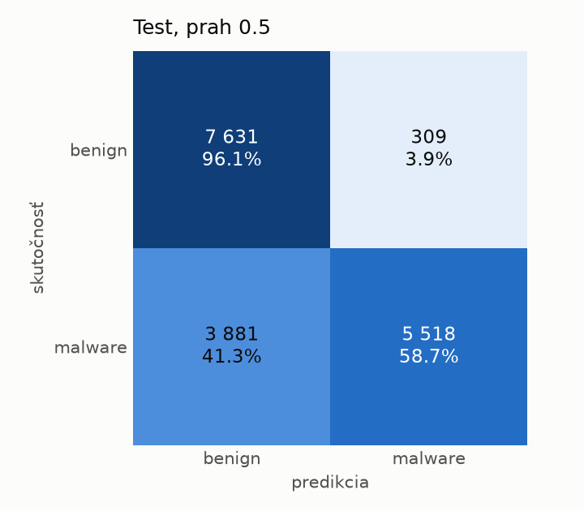
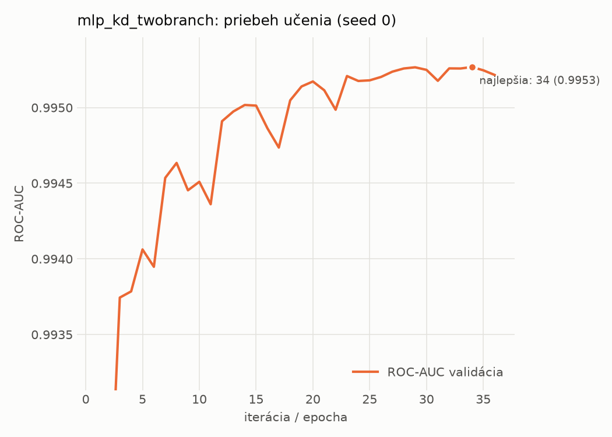

# dynamic/mlp_kd_twobranch – beh `20261104-080011`

> Automaticky generované (`src/training/run_tabular.py`). Konfigurácia: `config.yaml`, protokol: `protocol.yaml`.

- **Model:** `mlp` – študent – malé MLP učené destiláciou z dvojvetvovej siete (V2)
- **Ladenie:** bez ladenia – hyperparametre prevzaté z `runs_v2/full/students_dynamic/mlp_kd_twobranch/20261103-210509`
- **Finálne modely:** seedy [0, 1, 2]; hodnoty sú priemer ± smerodajná odchýlka cez seedy
- **Najlepšie hyperparametre:** `{"hidden_layers": 1, "max_epochs": 100, "patience": 8, "hidden_width": 32, "dropout": 0.20072105080128874, "lr": 0.0007693195243892695, "weight_decay": 5.480532660403751e-05, "batch_size": 512, "kd_alpha": 0.8408369066096718, "kd_temperature": 1.578549465607724}`

## Detekčná kvalita (bez prahu)
| metrika | train (podvzorka) | validácia | test |
|---|---|---|---|
| ROC-AUC | 0.9961 ± 0.0002 | 0.9953 ± 0.0000 | 0.9028 ± 0.0014 |
| PR-AUC | 0.9974 ± 0.0002 | 0.9971 ± 0.0000 | 0.9245 ± 0.0016 |
| TPR pri FPR 1 % | 0.9304 ± 0.0023 | 0.9221 ± 0.0019 | 0.4160 ± 0.0043 |
| TPR pri FPR 0,1 % | 0.8571 ± 0.0099 | 0.8124 ± 0.0076 | 0.3294 ± 0.0802 |
| log loss | 0.0771 ± 0.0014 | 0.0879 ± 0.0012 | 0.9013 ± 0.0277 |
| Brier skóre | 0.0246 ± 0.0004 | 0.0264 ± 0.0003 | 0.1966 ± 0.0051 |

Rozdiel ROC-AUC train − validácia: **0.0008** (veľký rozdiel = preučenie).

## Pri prahu z validácie (FPR ≤ 1% na validácii)
| metrika | train (podvzorka) | validácia | test |
|---|---|---|---|
| accuracy | 0.9471 ± 0.0017 | 0.9479 ± 0.0011 | 0.7060 ± 0.0151 |
| balanced accuracy | 0.9556 ± 0.0014 | 0.9562 ± 0.0008 | 0.7280 ± 0.0138 |
| precision | 0.9948 ± 0.0003 | 0.9937 ± 0.0001 | 0.9798 ± 0.0006 |
| recall (TPR) | 0.9188 ± 0.0025 | 0.9221 ± 0.0019 | 0.4673 ± 0.0283 |
| FPR | 0.0077 ± 0.0004 | 0.0097 ± 0.0002 | 0.0114 ± 0.0007 |
| F1 | 0.9553 ± 0.0015 | 0.9565 ± 0.0009 | 0.6325 ± 0.0257 |
| MCC | 0.8951 ± 0.0032 | 0.8955 ± 0.0020 | 0.5188 ± 0.0213 |

## Pri pevnom prahu 0.5
| metrika | train (podvzorka) | validácia | test |
|---|---|---|---|
| accuracy | 0.9624 ± 0.0004 | 0.9614 ± 0.0009 | 0.7670 ± 0.0079 |
| balanced accuracy | 0.9630 ± 0.0006 | 0.9619 ± 0.0009 | 0.7822 ± 0.0073 |
| precision | 0.9780 ± 0.0008 | 0.9777 ± 0.0008 | 0.9496 ± 0.0031 |
| recall (TPR) | 0.9605 ± 0.0002 | 0.9599 ± 0.0008 | 0.6022 ± 0.0134 |
| FPR | 0.0345 ± 0.0013 | 0.0360 ± 0.0012 | 0.0378 ± 0.0018 |
| F1 | 0.9692 ± 0.0003 | 0.9687 ± 0.0007 | 0.7370 ± 0.0109 |
| MCC | 0.9213 ± 0.0009 | 0.9187 ± 0.0018 | 0.5920 ± 0.0127 |

## Výpočtové nároky (seed 0, testovacia množina)
| meranie | hodnota |
|---|---|
| tréning finálneho modelu | 6.6 s (priemer cez seedy) |
| ladenie spolu | 0 s |
| počet parametrov / uzlov | 64 129 |
| veľkosť modelu na disku | 0.31 MB |
| transformácia vstupu – latencia (1 vlákno) | 0.034 ms |
| transformácia vstupu – priepustnosť | 48 175 vzoriek/s |
| CPU latencia modelu (batch 1, 1 vlákno) | 0.068 ms (p95 0.077) |
| CPU priepustnosť (24 vlákien) | 142 338 vzoriek/s |
| GPU latencia (batch 1) | 0.291 ms (p95 0.316) |
| GPU priepustnosť | 102 813 vzoriek/s |
| GPU špičková pamäť | 1194 MB |

## Grafy
| | |
|---|---|
|  |  |
|  |  |
|  |  |
|  |  |

## Súbory
`metrics.json` (všetky metriky po seedoch vrátane rodín), `timing.json`, `hpo_trials.csv`,
`predictions/<časť>_seed<N>.parquet` (sha256, family, label, score), `model/seed_<N>/`, `log.txt`.
