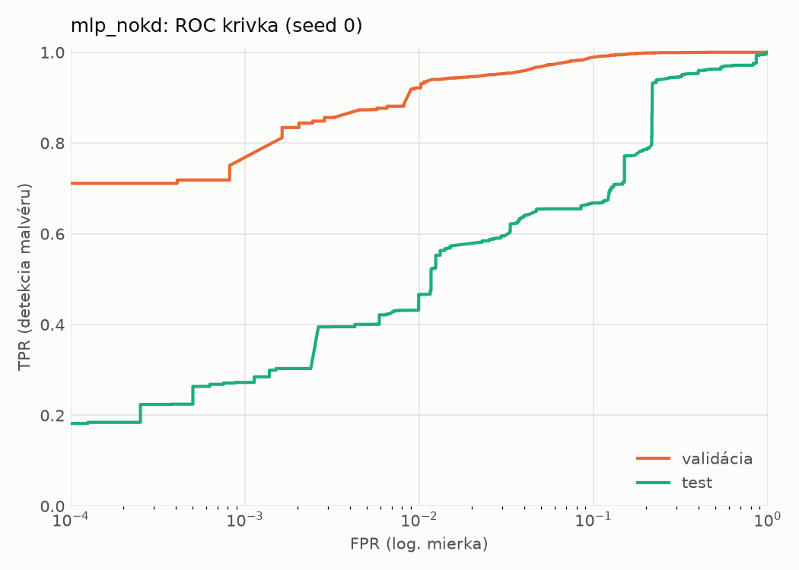
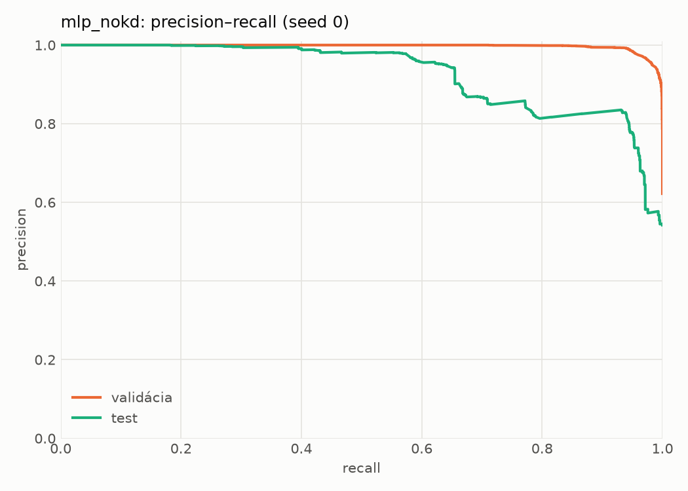
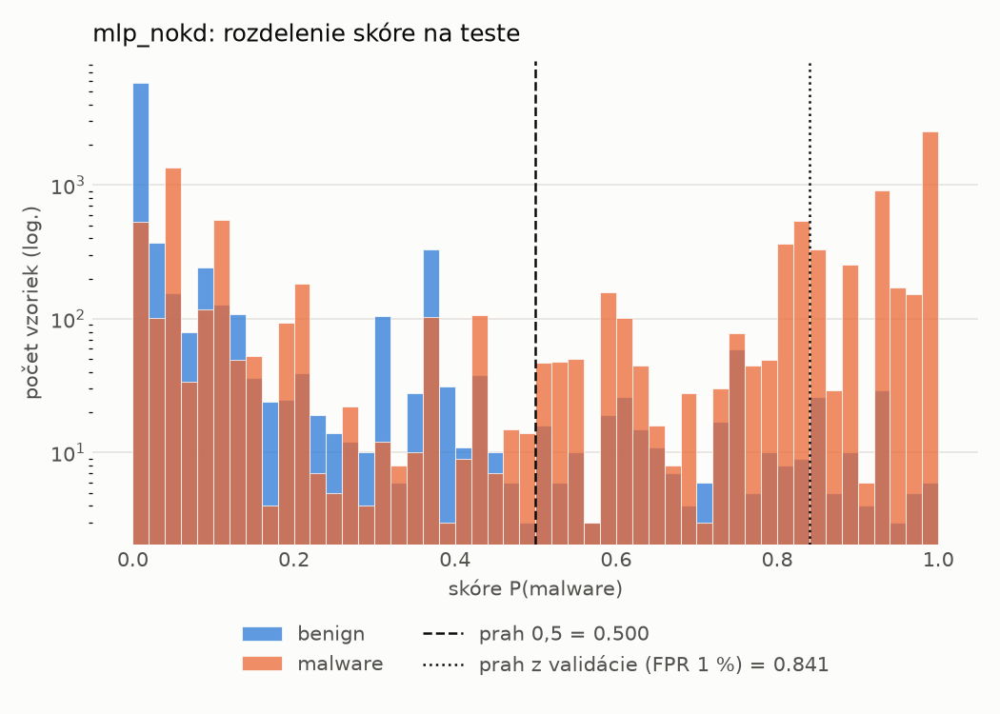
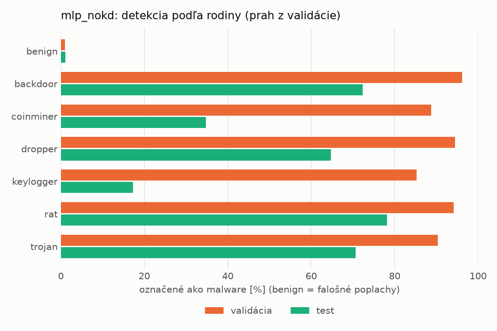
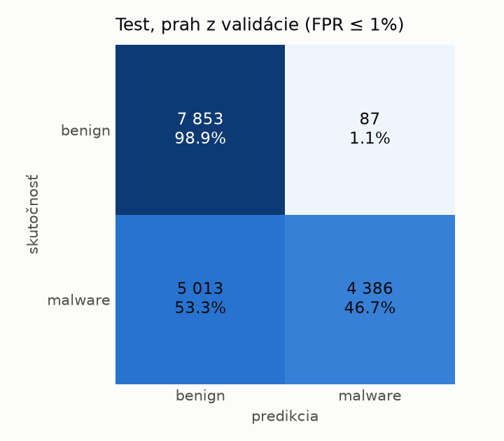
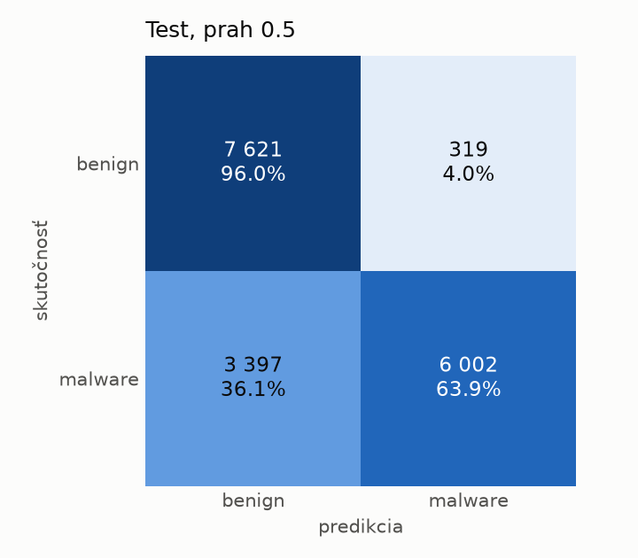
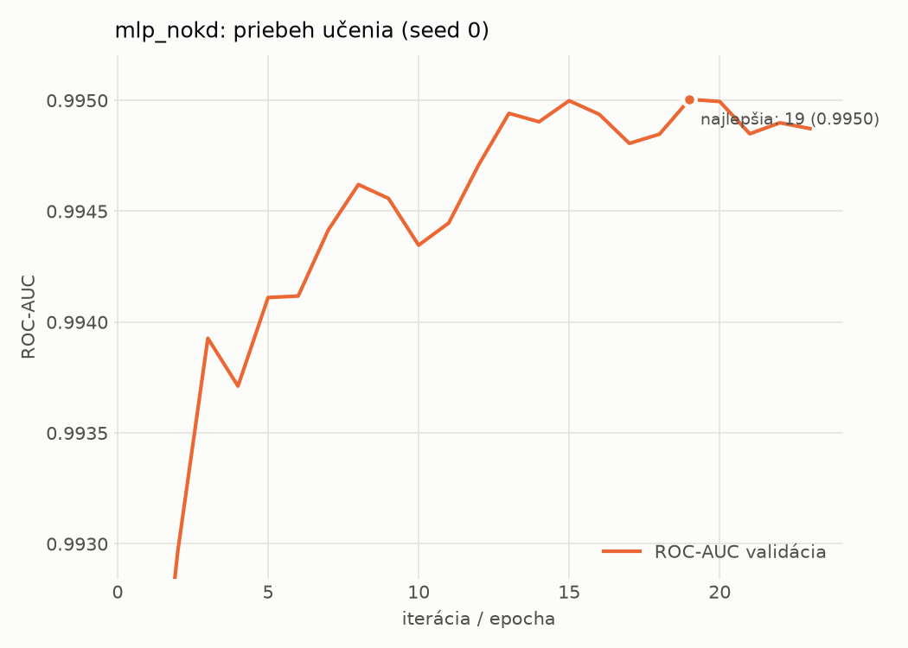

# dynamic/mlp_nokd – beh `20261104-075916`

> Automaticky generované (`src/training/run_tabular.py`). Konfigurácia: `config.yaml`, protokol: `protocol.yaml`.

- **Model:** `mlp` – kontrola – rovnaké malé MLP bez destilácie (iba skutočné označenia)
- **Ladenie:** bez ladenia – hyperparametre prevzaté z `runs_final/students_dynamic/mlp_nokd/20261102-212647`
- **Finálne modely:** seedy [0, 1, 2]; hodnoty sú priemer ± smerodajná odchýlka cez seedy
- **Najlepšie hyperparametre:** `{"hidden_layers": 1, "max_epochs": 100, "patience": 8, "hidden_width": 32, "dropout": 0.27854460554056926, "lr": 0.002048574130711367, "weight_decay": 5.911733622585913e-06, "batch_size": 512}`

## Detekčná kvalita (bez prahu)
| metrika | train (podvzorka) | validácia | test |
|---|---|---|---|
| ROC-AUC | 0.9962 ± 0.0003 | 0.9952 ± 0.0002 | 0.9082 ± 0.0027 |
| PR-AUC | 0.9975 ± 0.0002 | 0.9970 ± 0.0001 | 0.9288 ± 0.0011 |
| TPR pri FPR 1 % | 0.9290 ± 0.0007 | 0.9115 ± 0.0201 | 0.4717 ± 0.0096 |
| TPR pri FPR 0,1 % | 0.8564 ± 0.0132 | 0.7811 ± 0.0270 | 0.2811 ± 0.0113 |
| log loss | 0.0776 ± 0.0019 | 0.0887 ± 0.0007 | 0.8079 ± 0.0556 |
| Brier skóre | 0.0248 ± 0.0006 | 0.0264 ± 0.0003 | 0.1869 ± 0.0033 |

Rozdiel ROC-AUC train − validácia: **0.0009** (veľký rozdiel = preučenie).

## Pri prahu z validácie (FPR ≤ 1% na validácii)
| metrika | train (podvzorka) | validácia | test |
|---|---|---|---|
| accuracy | 0.9408 ± 0.0112 | 0.9414 ± 0.0123 | 0.7139 ± 0.0075 |
| balanced accuracy | 0.9506 ± 0.0086 | 0.9511 ± 0.0097 | 0.7353 ± 0.0069 |
| precision | 0.9955 ± 0.0018 | 0.9939 ± 0.0003 | 0.9809 ± 0.0011 |
| recall (TPR) | 0.9078 ± 0.0200 | 0.9115 ± 0.0201 | 0.4817 ± 0.0142 |
| FPR | 0.0066 ± 0.0028 | 0.0093 ± 0.0006 | 0.0111 ± 0.0008 |
| F1 | 0.9495 ± 0.0102 | 0.9508 ± 0.0109 | 0.6460 ± 0.0128 |
| MCC | 0.8839 ± 0.0196 | 0.8840 ± 0.0221 | 0.5305 ± 0.0105 |

## Pri pevnom prahu 0.5
| metrika | train (podvzorka) | validácia | test |
|---|---|---|---|
| accuracy | 0.9612 ± 0.0017 | 0.9608 ± 0.0015 | 0.7790 ± 0.0080 |
| balanced accuracy | 0.9627 ± 0.0019 | 0.9622 ± 0.0012 | 0.7933 ± 0.0072 |
| precision | 0.9803 ± 0.0025 | 0.9800 ± 0.0015 | 0.9522 ± 0.0024 |
| recall (TPR) | 0.9562 ± 0.0024 | 0.9566 ± 0.0030 | 0.6237 ± 0.0165 |
| FPR | 0.0307 ± 0.0039 | 0.0322 ± 0.0025 | 0.0371 ± 0.0027 |
| F1 | 0.9681 ± 0.0014 | 0.9681 ± 0.0013 | 0.7536 ± 0.0116 |
| MCC | 0.9192 ± 0.0035 | 0.9177 ± 0.0030 | 0.6108 ± 0.0113 |

## Výpočtové nároky (seed 0, testovacia množina)
| meranie | hodnota |
|---|---|
| tréning finálneho modelu | 4.1 s (priemer cez seedy) |
| ladenie spolu | 0 s |
| počet parametrov / uzlov | 64 129 |
| veľkosť modelu na disku | 0.31 MB |
| transformácia vstupu – latencia (1 vlákno) | 0.034 ms |
| transformácia vstupu – priepustnosť | 46 246 vzoriek/s |
| CPU latencia modelu (batch 1, 1 vlákno) | 0.068 ms (p95 0.077) |
| CPU priepustnosť (24 vlákien) | 142 465 vzoriek/s |
| GPU latencia (batch 1) | 0.292 ms (p95 0.328) |
| GPU priepustnosť | 101 320 vzoriek/s |
| GPU špičková pamäť | 1194 MB |

## Grafy
| | |
|---|---|
|  |  |
|  |  |
|  |  |
|  |  |

## Súbory
`metrics.json` (všetky metriky po seedoch vrátane rodín), `timing.json`, `hpo_trials.csv`,
`predictions/<časť>_seed<N>.parquet` (sha256, family, label, score), `model/seed_<N>/`, `log.txt`.
