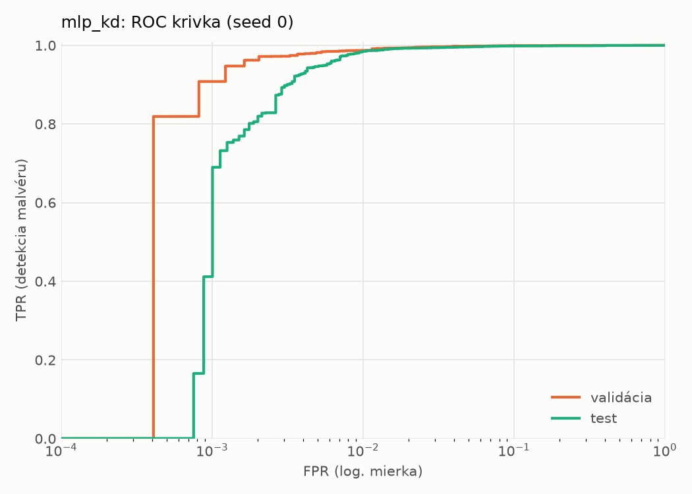
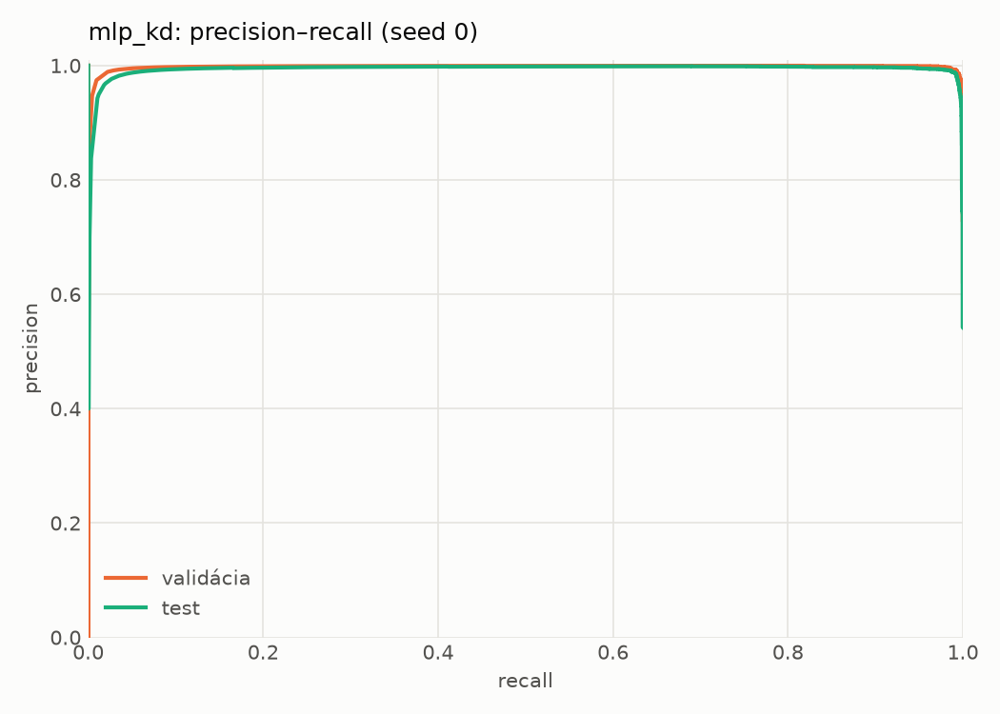
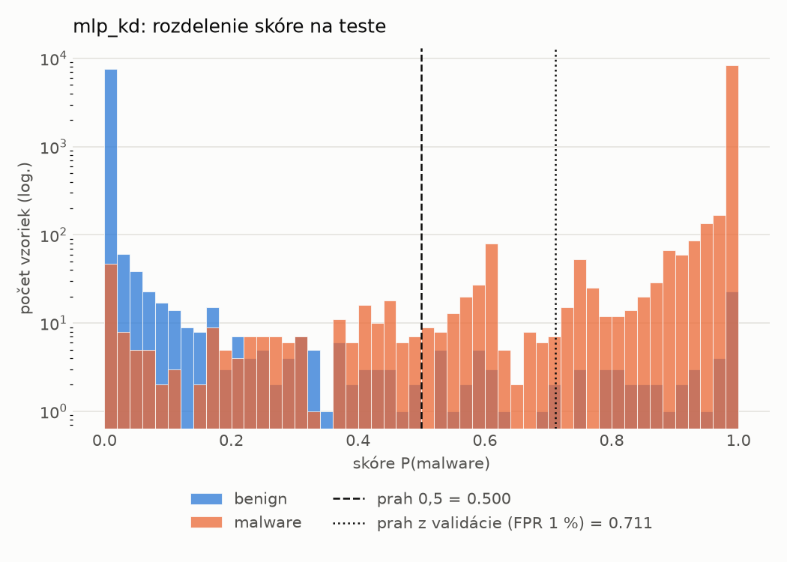
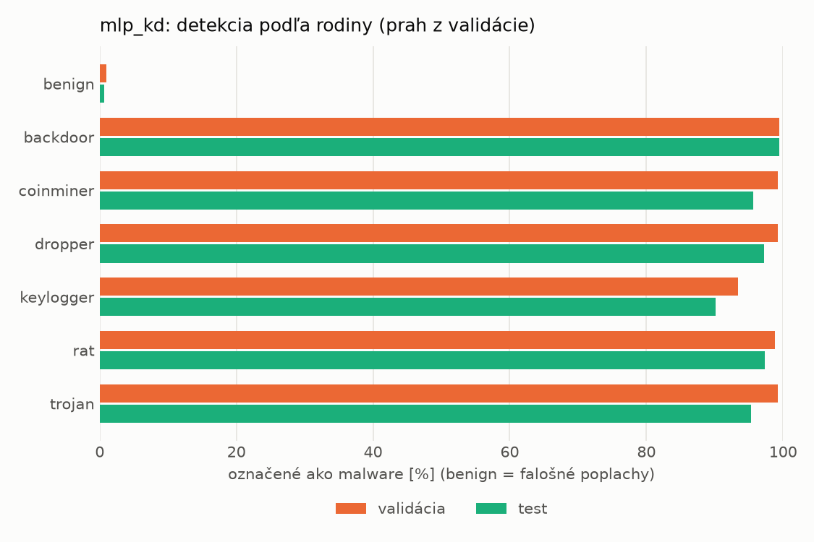
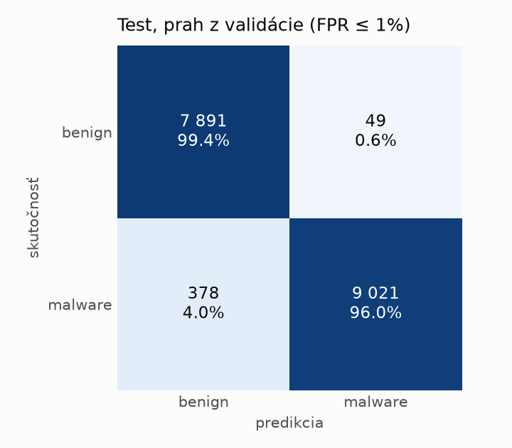
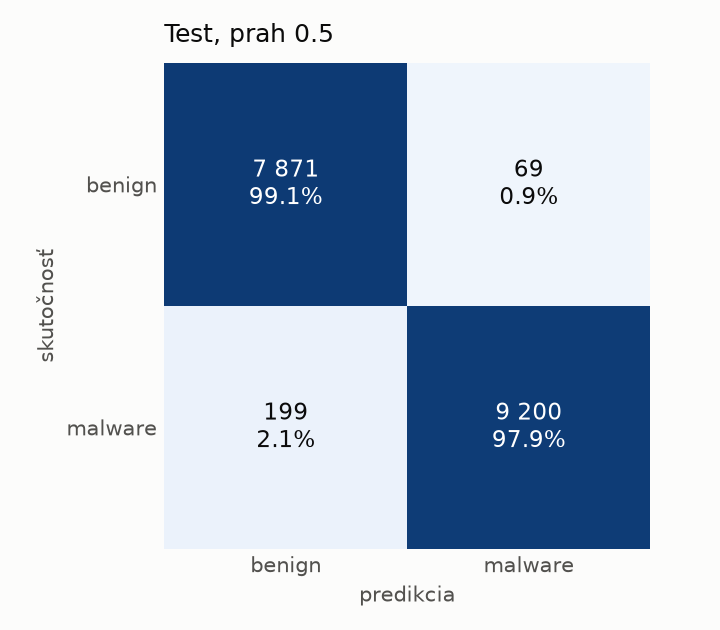
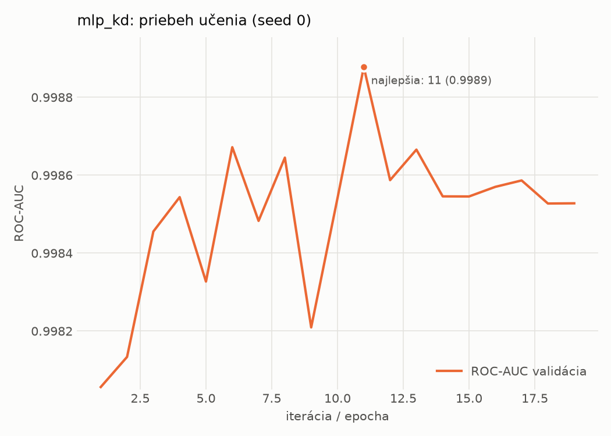

# static/mlp_kd – beh `20261104-075704`

> Automaticky generované (`src/training/run_tabular.py`). Konfigurácia: `config.yaml`, protokol: `protocol.yaml`.

- **Model:** `mlp` – študent – malé MLP učené destiláciou z hybridného učiteľa
- **Ladenie:** bez ladenia – hyperparametre prevzaté z `runs_final/students_static/mlp_kd/20261102-211333`
- **Finálne modely:** seedy [0, 1, 2]; hodnoty sú priemer ± smerodajná odchýlka cez seedy
- **Najlepšie hyperparametre:** `{"hidden_layers": 1, "max_epochs": 100, "patience": 8, "hidden_width": 32, "dropout": 0.0997633477545663, "lr": 0.0015427581570995174, "weight_decay": 0.00017559733451057006, "batch_size": 256, "kd_alpha": 0.604033962068706, "kd_temperature": 6.472658522077935}`

## Detekčná kvalita (bez prahu)
| metrika | train (podvzorka) | validácia | test |
|---|---|---|---|
| ROC-AUC | 0.9998 ± 0.0001 | 0.9988 ± 0.0001 | 0.9976 ± 0.0002 |
| PR-AUC | 0.9999 ± 0.0000 | 0.9979 ± 0.0001 | 0.9956 ± 0.0015 |
| TPR pri FPR 1 % | 0.9936 ± 0.0035 | 0.9859 ± 0.0010 | 0.9763 ± 0.0076 |
| TPR pri FPR 0,1 % | 0.9687 ± 0.0061 | 0.8813 ± 0.0251 | 0.5798 ± 0.1863 |
| log loss | 0.0193 ± 0.0025 | 0.0377 ± 0.0017 | 0.0594 ± 0.0051 |
| Brier skóre | 0.0056 ± 0.0007 | 0.0088 ± 0.0005 | 0.0138 ± 0.0017 |

Rozdiel ROC-AUC train − validácia: **0.0010** (veľký rozdiel = preučenie).

## Pri prahu z validácie (FPR ≤ 1% na validácii)
| metrika | train (podvzorka) | validácia | test |
|---|---|---|---|
| accuracy | 0.9900 ± 0.0009 | 0.9875 ± 0.0006 | 0.9718 ± 0.0031 |
| balanced accuracy | 0.9910 ± 0.0008 | 0.9880 ± 0.0005 | 0.9735 ± 0.0029 |
| precision | 0.9973 ± 0.0005 | 0.9940 ± 0.0000 | 0.9946 ± 0.0001 |
| recall (TPR) | 0.9864 ± 0.0013 | 0.9859 ± 0.0010 | 0.9531 ± 0.0058 |
| FPR | 0.0043 ± 0.0007 | 0.0098 ± 0.0000 | 0.0061 ± 0.0001 |
| F1 | 0.9918 ± 0.0007 | 0.9899 ± 0.0005 | 0.9734 ± 0.0030 |
| MCC | 0.9790 ± 0.0019 | 0.9736 ± 0.0013 | 0.9444 ± 0.0059 |

## Pri pevnom prahu 0.5
| metrika | train (podvzorka) | validácia | test |
|---|---|---|---|
| accuracy | 0.9922 ± 0.0015 | 0.9888 ± 0.0014 | 0.9816 ± 0.0057 |
| balanced accuracy | 0.9917 ± 0.0012 | 0.9880 ± 0.0013 | 0.9822 ± 0.0052 |
| precision | 0.9936 ± 0.0018 | 0.9908 ± 0.0014 | 0.9913 ± 0.0013 |
| recall (TPR) | 0.9937 ± 0.0031 | 0.9912 ± 0.0023 | 0.9746 ± 0.0108 |
| FPR | 0.0102 ± 0.0029 | 0.0152 ± 0.0023 | 0.0102 ± 0.0016 |
| F1 | 0.9937 ± 0.0012 | 0.9910 ± 0.0011 | 0.9828 ± 0.0054 |
| MCC | 0.9835 ± 0.0030 | 0.9762 ± 0.0030 | 0.9632 ± 0.0112 |

## Výpočtové nároky (seed 0, testovacia množina)
| meranie | hodnota |
|---|---|
| tréning finálneho modelu | 6.3 s (priemer cez seedy) |
| ladenie spolu | 0 s |
| počet parametrov / uzlov | 74 337 |
| veľkosť modelu na disku | 0.36 MB |
| transformácia vstupu – latencia (1 vlákno) | 0.026 ms |
| transformácia vstupu – priepustnosť | 39 355 vzoriek/s |
| CPU latencia modelu (batch 1, 1 vlákno) | 0.066 ms (p95 0.074) |
| CPU priepustnosť (24 vlákien) | 61 462 vzoriek/s |
| GPU latencia (batch 1) | 0.452 ms (p95 0.473) |
| GPU priepustnosť | 64 380 vzoriek/s |
| GPU špičková pamäť | 782 MB |

## Grafy
| | |
|---|---|
|  |  |
|  |  |
|  |  |
|  |  |

## Súbory
`metrics.json` (všetky metriky po seedoch vrátane rodín), `timing.json`, `hpo_trials.csv`,
`predictions/<časť>_seed<N>.parquet` (sha256, family, label, score), `model/seed_<N>/`, `log.txt`.
