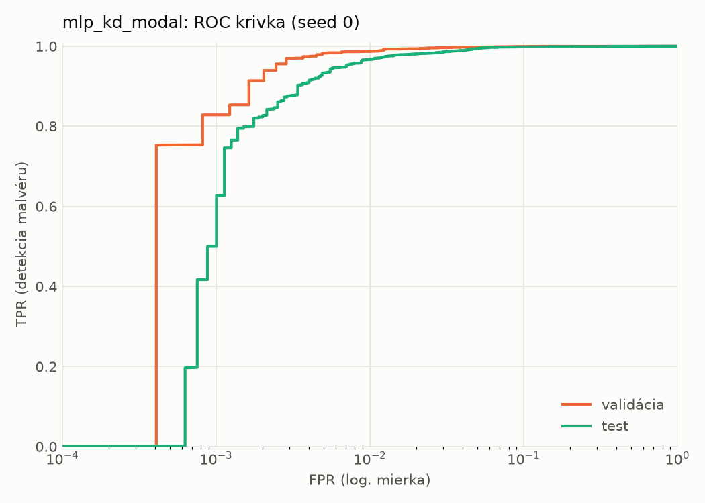
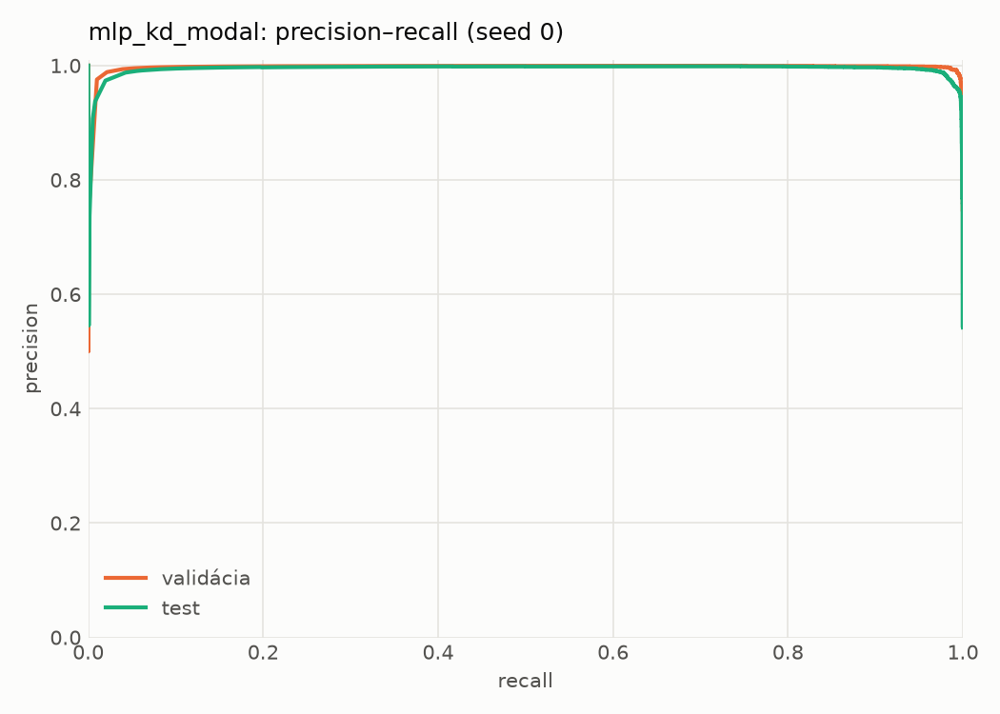
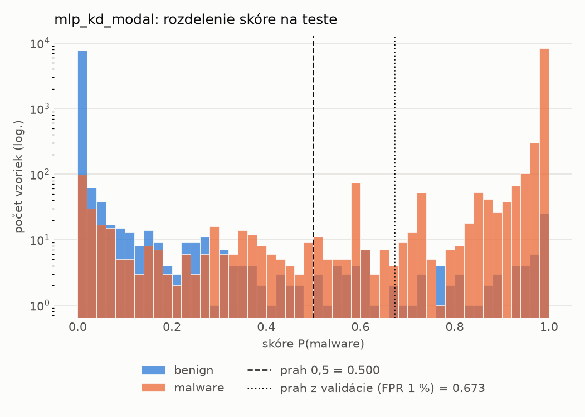
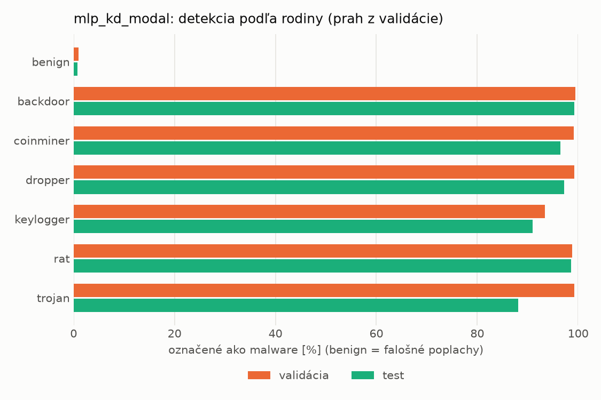
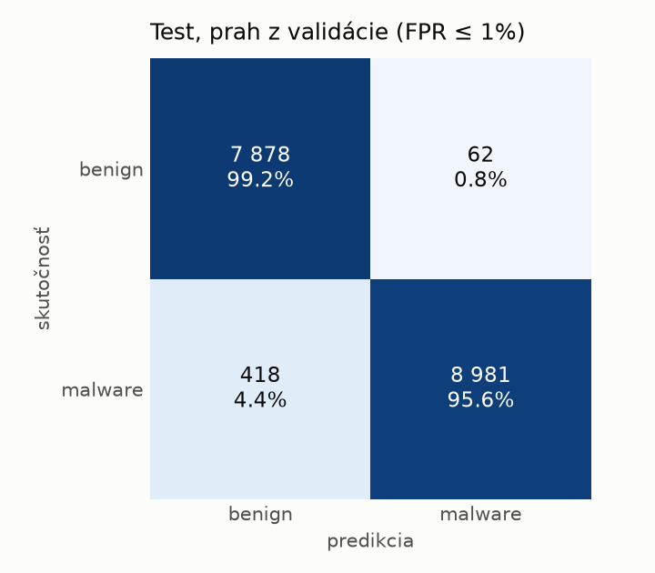
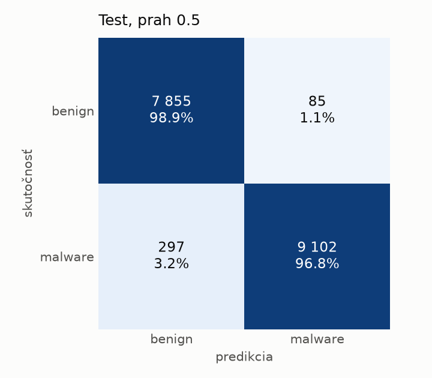
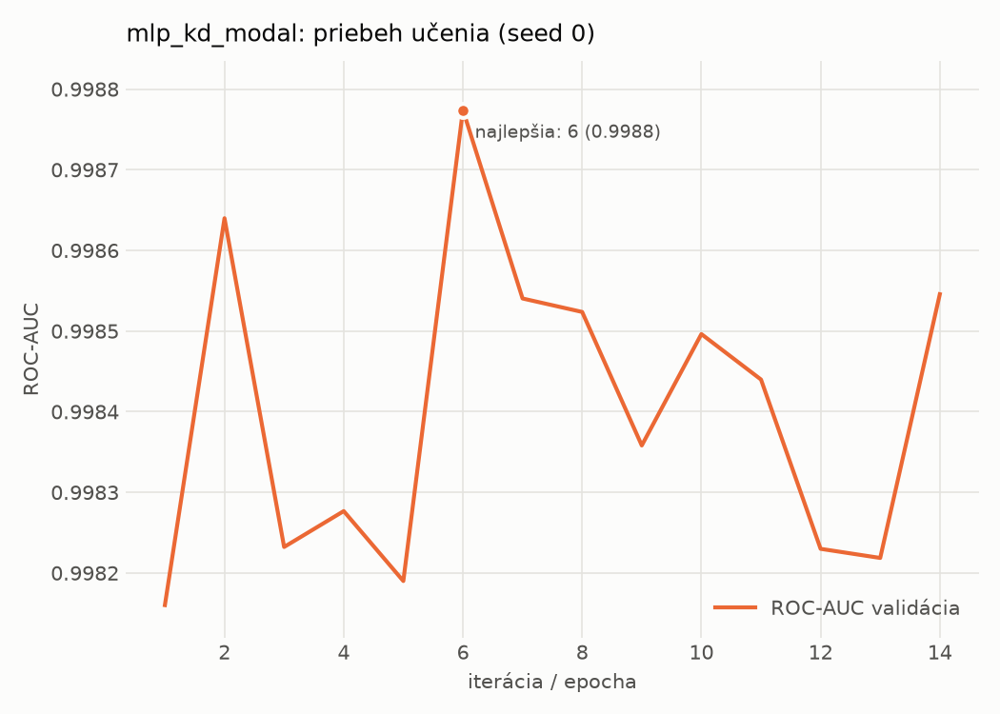

# static/mlp_kd_modal – beh `20261104-075749`

> Automaticky generované (`src/training/run_tabular.py`). Konfigurácia: `config.yaml`, protokol: `protocol.yaml`.

- **Model:** `mlp` – študent – malé MLP učené destiláciou z učiteľa rovnakej modality (variant A)
- **Ladenie:** bez ladenia – hyperparametre prevzaté z `runs_final/students_static/mlp_kd_modal/20261102-211832`
- **Finálne modely:** seedy [0, 1, 2]; hodnoty sú priemer ± smerodajná odchýlka cez seedy
- **Najlepšie hyperparametre:** `{"hidden_layers": 1, "max_epochs": 100, "patience": 8, "hidden_width": 32, "dropout": 0.15602040635334324, "lr": 0.00105640764164036, "weight_decay": 3.5856126103453987e-06, "batch_size": 256, "kd_alpha": 0.815861880342119, "kd_temperature": 5.185299851677596}`

## Detekčná kvalita (bez prahu)
| metrika | train (podvzorka) | validácia | test |
|---|---|---|---|
| ROC-AUC | 0.9997 ± 0.0002 | 0.9987 ± 0.0001 | 0.9971 ± 0.0003 |
| PR-AUC | 0.9998 ± 0.0001 | 0.9979 ± 0.0003 | 0.9960 ± 0.0009 |
| TPR pri FPR 1 % | 0.9896 ± 0.0053 | 0.9827 ± 0.0047 | 0.9630 ± 0.0034 |
| TPR pri FPR 0,1 % | 0.9645 ± 0.0147 | 0.8789 ± 0.0442 | 0.6168 ± 0.1017 |
| log loss | 0.0219 ± 0.0052 | 0.0401 ± 0.0030 | 0.0748 ± 0.0067 |
| Brier skóre | 0.0066 ± 0.0015 | 0.0095 ± 0.0012 | 0.0175 ± 0.0013 |

Rozdiel ROC-AUC train − validácia: **0.0010** (veľký rozdiel = preučenie).

## Pri prahu z validácie (FPR ≤ 1% na validácii)
| metrika | train (podvzorka) | validácia | test |
|---|---|---|---|
| accuracy | 0.9875 ± 0.0038 | 0.9855 ± 0.0029 | 0.9667 ± 0.0079 |
| balanced accuracy | 0.9890 ± 0.0033 | 0.9864 ± 0.0023 | 0.9688 ± 0.0073 |
| precision | 0.9969 ± 0.0007 | 0.9940 ± 0.0000 | 0.9937 ± 0.0005 |
| recall (TPR) | 0.9828 ± 0.0056 | 0.9827 ± 0.0047 | 0.9446 ± 0.0151 |
| FPR | 0.0048 ± 0.0011 | 0.0098 ± 0.0000 | 0.0071 ± 0.0007 |
| F1 | 0.9898 ± 0.0031 | 0.9883 ± 0.0024 | 0.9685 ± 0.0078 |
| MCC | 0.9740 ± 0.0078 | 0.9694 ± 0.0060 | 0.9347 ± 0.0149 |

## Pri pevnom prahu 0.5
| metrika | train (podvzorka) | validácia | test |
|---|---|---|---|
| accuracy | 0.9914 ± 0.0021 | 0.9892 ± 0.0013 | 0.9783 ± 0.0006 |
| balanced accuracy | 0.9904 ± 0.0024 | 0.9883 ± 0.0014 | 0.9791 ± 0.0006 |
| precision | 0.9914 ± 0.0023 | 0.9907 ± 0.0014 | 0.9897 ± 0.0012 |
| recall (TPR) | 0.9946 ± 0.0011 | 0.9919 ± 0.0008 | 0.9701 ± 0.0015 |
| FPR | 0.0138 ± 0.0036 | 0.0153 ± 0.0023 | 0.0120 ± 0.0014 |
| F1 | 0.9930 ± 0.0017 | 0.9913 ± 0.0010 | 0.9798 ± 0.0006 |
| MCC | 0.9818 ± 0.0044 | 0.9770 ± 0.0027 | 0.9566 ± 0.0012 |

## Výpočtové nároky (seed 0, testovacia množina)
| meranie | hodnota |
|---|---|
| tréning finálneho modelu | 5.6 s (priemer cez seedy) |
| ladenie spolu | 0 s |
| počet parametrov / uzlov | 74 337 |
| veľkosť modelu na disku | 0.36 MB |
| transformácia vstupu – latencia (1 vlákno) | 0.041 ms |
| transformácia vstupu – priepustnosť | 38 891 vzoriek/s |
| CPU latencia modelu (batch 1, 1 vlákno) | 0.068 ms (p95 0.077) |
| CPU priepustnosť (24 vlákien) | 110 160 vzoriek/s |
| GPU latencia (batch 1) | 0.312 ms (p95 0.484) |
| GPU priepustnosť | 80 845 vzoriek/s |
| GPU špičková pamäť | 782 MB |

## Grafy
| | |
|---|---|
|  |  |
|  |  |
|  |  |
|  |  |

## Súbory
`metrics.json` (všetky metriky po seedoch vrátane rodín), `timing.json`, `hpo_trials.csv`,
`predictions/<časť>_seed<N>.parquet` (sha256, family, label, score), `model/seed_<N>/`, `log.txt`.
