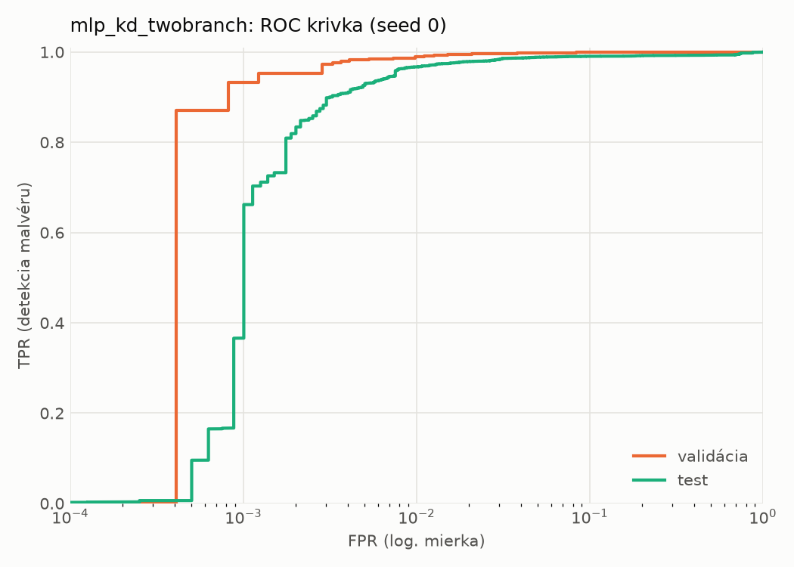
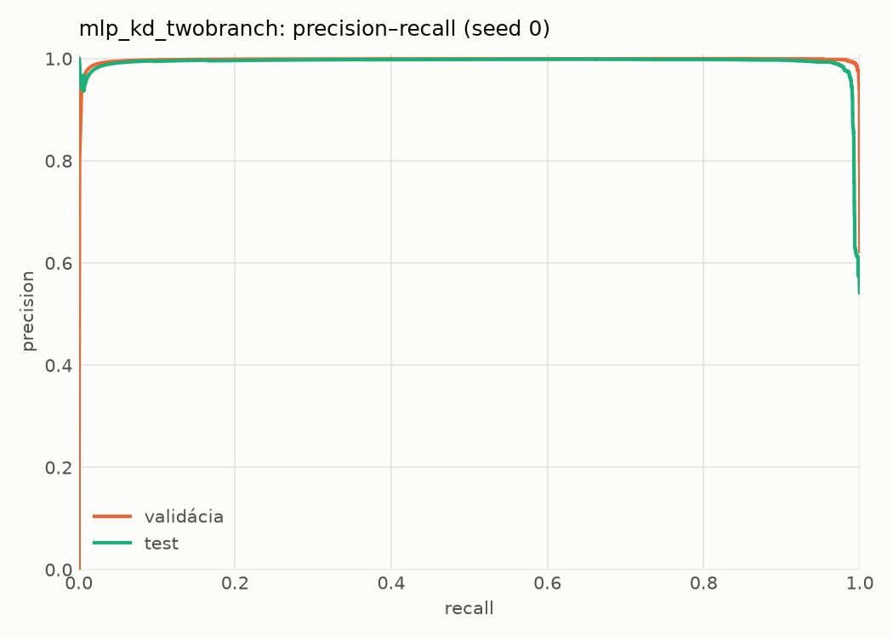
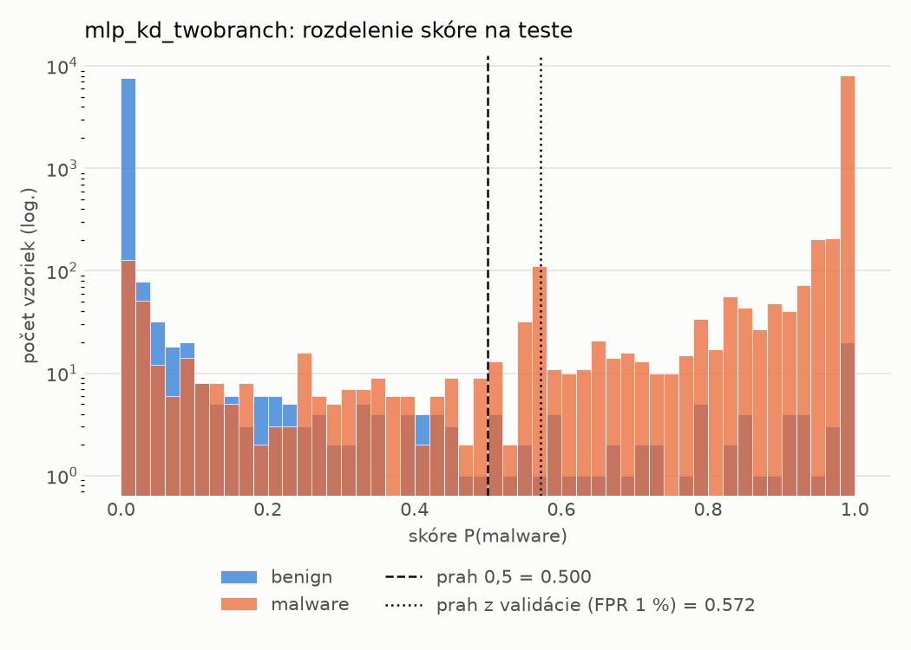
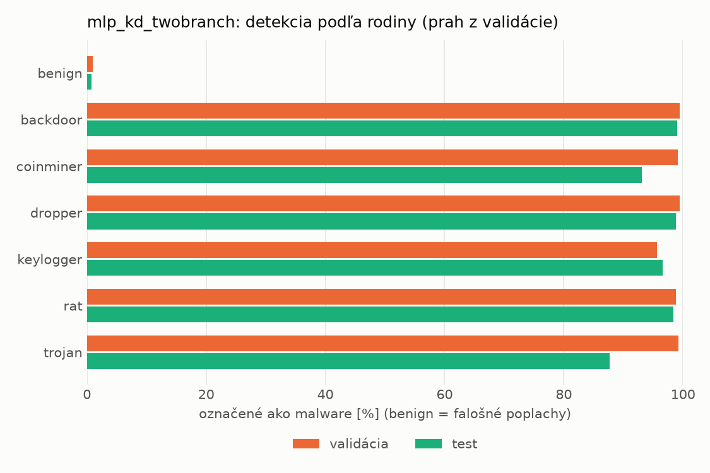
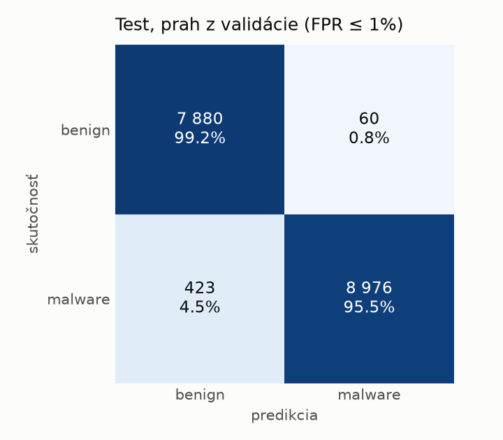
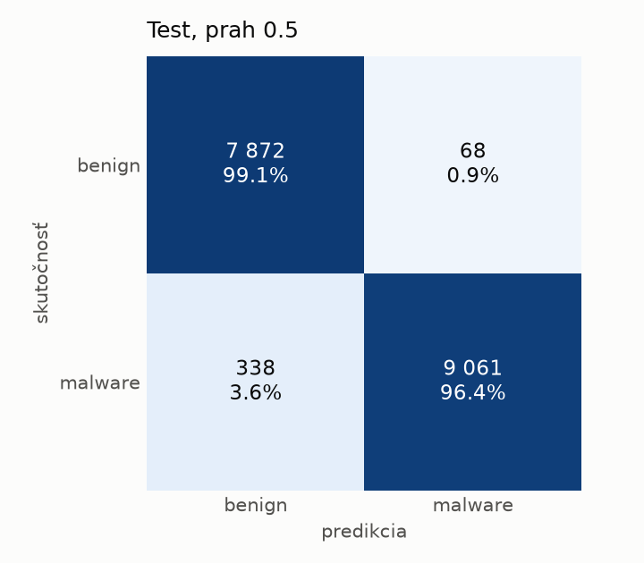
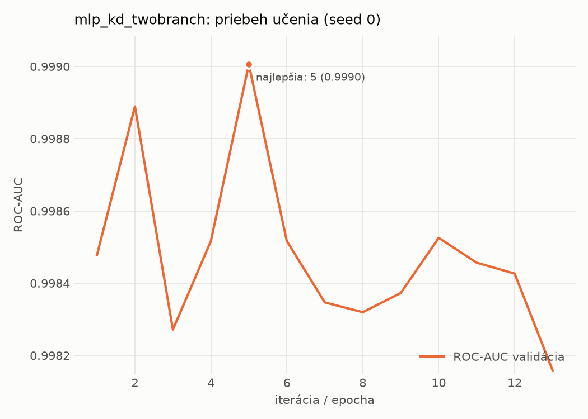

# static/mlp_kd_twobranch – beh `20261104-075815`

> Automaticky generované (`src/training/run_tabular.py`). Konfigurácia: `config.yaml`, protokol: `protocol.yaml`.

- **Model:** `mlp` – študent – malé MLP učené destiláciou z dvojvetvovej siete (V2)
- **Ladenie:** bez ladenia – hyperparametre prevzaté z `runs_v2/full/students_static/mlp_kd_twobranch/20261103-210128`
- **Finálne modely:** seedy [0, 1, 2]; hodnoty sú priemer ± smerodajná odchýlka cez seedy
- **Najlepšie hyperparametre:** `{"hidden_layers": 1, "max_epochs": 100, "patience": 8, "hidden_width": 32, "dropout": 0.11907530604839062, "lr": 0.0013122016832935236, "weight_decay": 1.6321051677063922e-05, "batch_size": 256, "kd_alpha": 0.8749635763069835, "kd_temperature": 3.9893325789148495}`

## Detekčná kvalita (bez prahu)
| metrika | train (podvzorka) | validácia | test |
|---|---|---|---|
| ROC-AUC | 0.9999 ± 0.0001 | 0.9988 ± 0.0002 | 0.9951 ± 0.0026 |
| PR-AUC | 0.9999 ± 0.0000 | 0.9979 ± 0.0000 | 0.9947 ± 0.0019 |
| TPR pri FPR 1 % | 0.9965 ± 0.0008 | 0.9880 ± 0.0013 | 0.9630 ± 0.0047 |
| TPR pri FPR 0,1 % | 0.9818 ± 0.0027 | 0.9302 ± 0.0049 | 0.5160 ± 0.1395 |
| log loss | 0.0149 ± 0.0014 | 0.0347 ± 0.0028 | 0.1042 ± 0.0205 |
| Brier skóre | 0.0045 ± 0.0003 | 0.0080 ± 0.0006 | 0.0210 ± 0.0006 |

Rozdiel ROC-AUC train − validácia: **0.0010** (veľký rozdiel = preučenie).

## Pri prahu z validácie (FPR ≤ 1% na validácii)
| metrika | train (podvzorka) | validácia | test |
|---|---|---|---|
| accuracy | 0.9921 ± 0.0009 | 0.9888 ± 0.0008 | 0.9700 ± 0.0020 |
| balanced accuracy | 0.9929 ± 0.0006 | 0.9891 ± 0.0006 | 0.9718 ± 0.0018 |
| precision | 0.9978 ± 0.0008 | 0.9940 ± 0.0000 | 0.9938 ± 0.0005 |
| recall (TPR) | 0.9894 ± 0.0022 | 0.9880 ± 0.0013 | 0.9506 ± 0.0042 |
| FPR | 0.0035 ± 0.0012 | 0.0098 ± 0.0000 | 0.0070 ± 0.0006 |
| F1 | 0.9935 ± 0.0008 | 0.9910 ± 0.0006 | 0.9717 ± 0.0019 |
| MCC | 0.9834 ± 0.0019 | 0.9763 ± 0.0016 | 0.9409 ± 0.0037 |

## Pri pevnom prahu 0.5
| metrika | train (podvzorka) | validácia | test |
|---|---|---|---|
| accuracy | 0.9942 ± 0.0006 | 0.9903 ± 0.0005 | 0.9761 ± 0.0008 |
| balanced accuracy | 0.9938 ± 0.0008 | 0.9897 ± 0.0007 | 0.9772 ± 0.0007 |
| precision | 0.9950 ± 0.0010 | 0.9922 ± 0.0010 | 0.9916 ± 0.0015 |
| recall (TPR) | 0.9955 ± 0.0005 | 0.9922 ± 0.0006 | 0.9640 ± 0.0026 |
| FPR | 0.0080 ± 0.0017 | 0.0128 ± 0.0017 | 0.0097 ± 0.0018 |
| F1 | 0.9953 ± 0.0005 | 0.9922 ± 0.0004 | 0.9776 ± 0.0008 |
| MCC | 0.9877 ± 0.0013 | 0.9794 ± 0.0010 | 0.9524 ± 0.0016 |

## Výpočtové nároky (seed 0, testovacia množina)
| meranie | hodnota |
|---|---|
| tréning finálneho modelu | 5.5 s (priemer cez seedy) |
| ladenie spolu | 0 s |
| počet parametrov / uzlov | 74 337 |
| veľkosť modelu na disku | 0.36 MB |
| transformácia vstupu – latencia (1 vlákno) | 0.042 ms |
| transformácia vstupu – priepustnosť | 39 381 vzoriek/s |
| CPU latencia modelu (batch 1, 1 vlákno) | 0.068 ms (p95 0.078) |
| CPU priepustnosť (24 vlákien) | 109 158 vzoriek/s |
| GPU latencia (batch 1) | 0.271 ms (p95 0.308) |
| GPU priepustnosť | 80 828 vzoriek/s |
| GPU špičková pamäť | 1381 MB |

## Grafy
| | |
|---|---|
|  |  |
|  |  |
|  |  |
|  |  |

## Súbory
`metrics.json` (všetky metriky po seedoch vrátane rodín), `timing.json`, `hpo_trials.csv`,
`predictions/<časť>_seed<N>.parquet` (sha256, family, label, score), `model/seed_<N>/`, `log.txt`.
