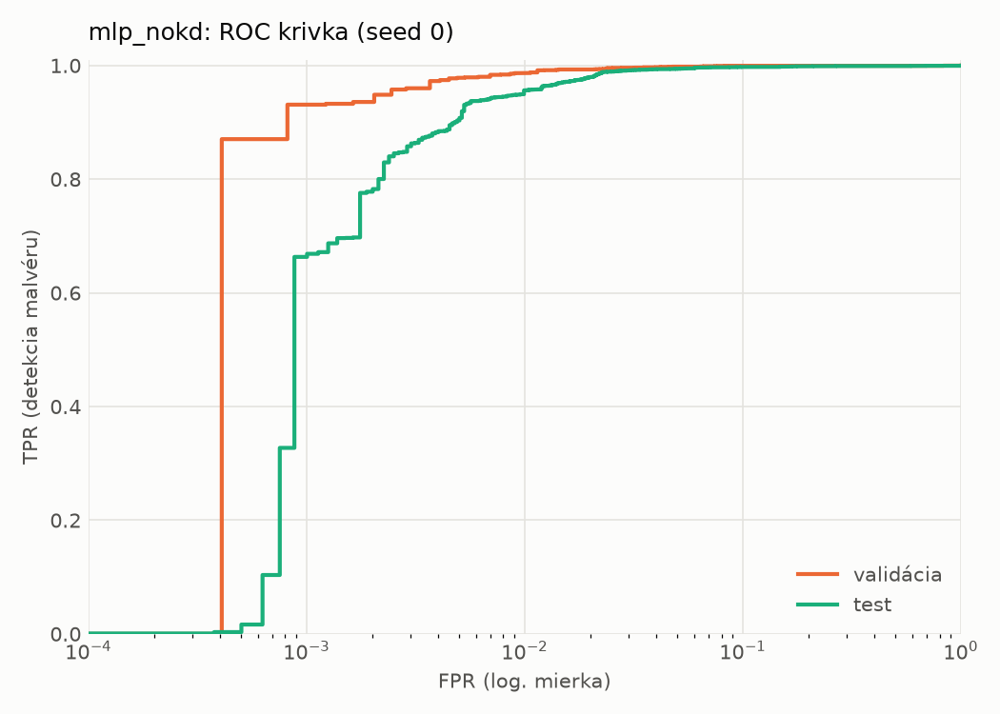
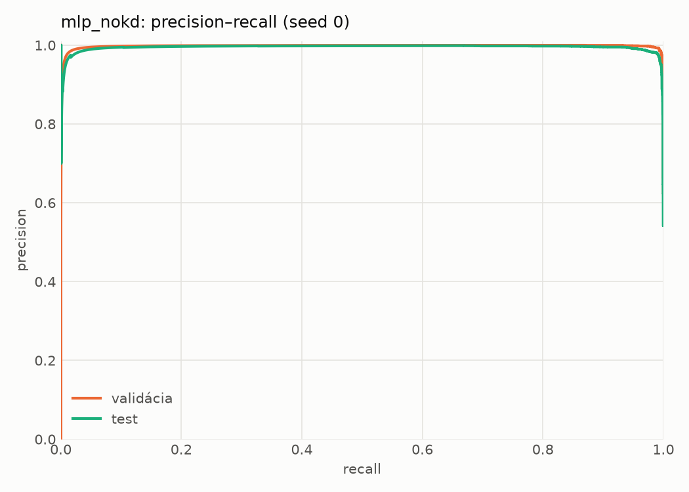
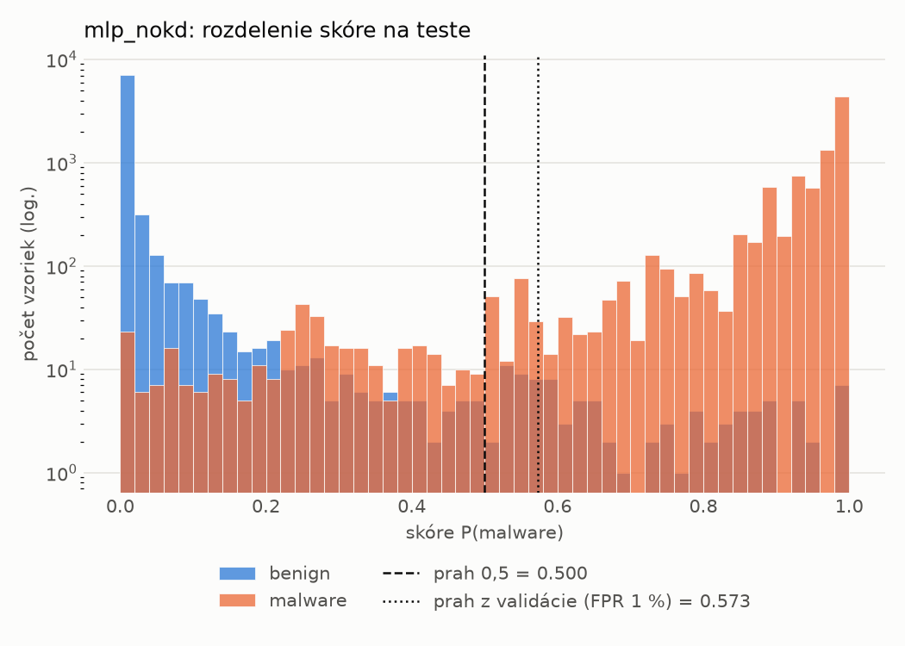
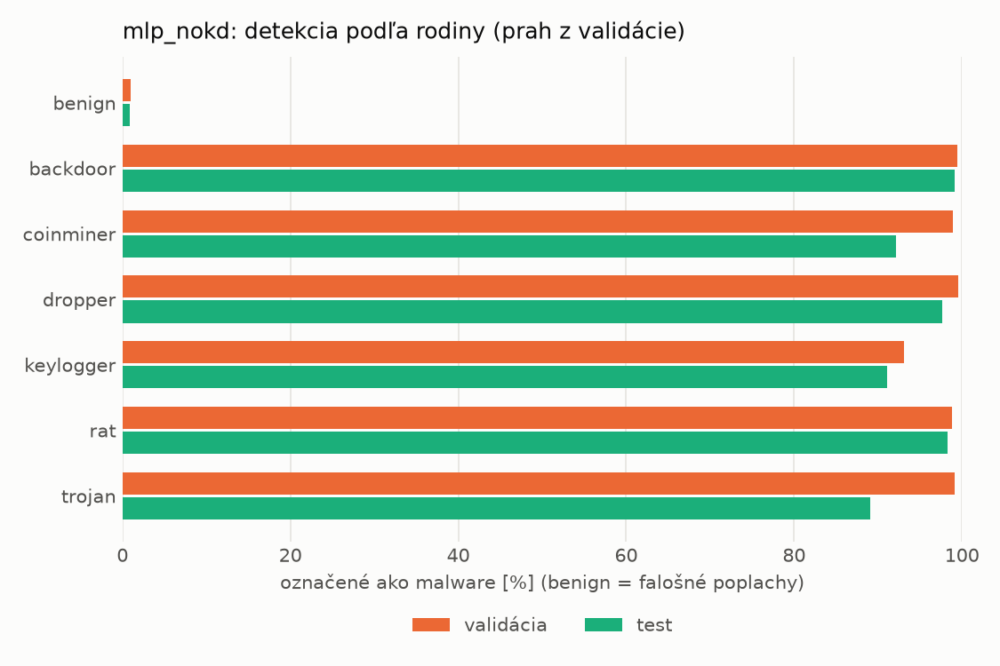
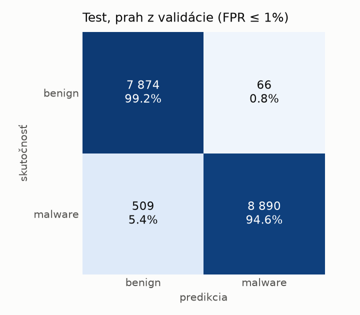
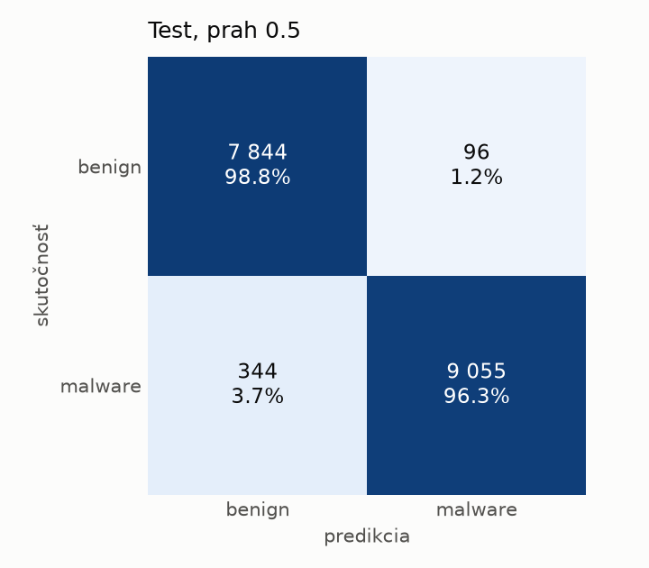
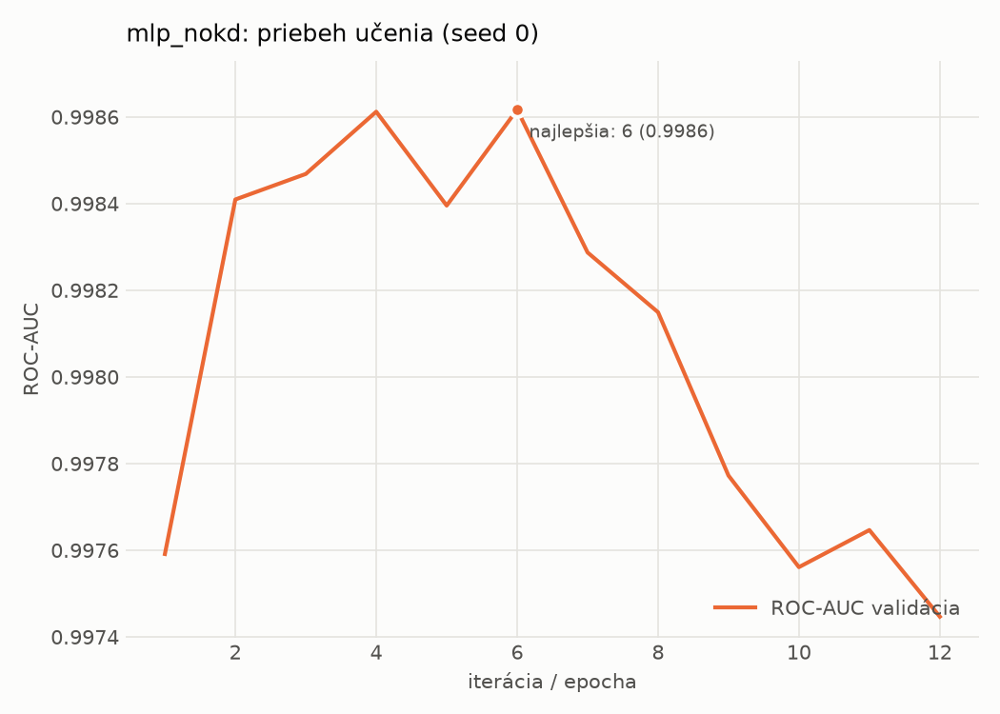

# static/mlp_nokd – beh `20261104-075733`

> Automaticky generované (`src/training/run_tabular.py`). Konfigurácia: `config.yaml`, protokol: `protocol.yaml`.

- **Model:** `mlp` – kontrola – rovnaké malé MLP bez destilácie (iba skutočné označenia)
- **Ladenie:** bez ladenia – hyperparametre prevzaté z `runs_final/students_static/mlp_nokd/20261102-211710`
- **Finálne modely:** seedy [0, 1, 2]; hodnoty sú priemer ± smerodajná odchýlka cez seedy
- **Najlepšie hyperparametre:** `{"hidden_layers": 1, "max_epochs": 100, "patience": 8, "hidden_width": 32, "dropout": 0.137657909519708, "lr": 0.0007042503153050794, "weight_decay": 1.207246112223234e-05, "batch_size": 512}`

## Detekčná kvalita (bez prahu)
| metrika | train (podvzorka) | validácia | test |
|---|---|---|---|
| ROC-AUC | 0.9998 ± 0.0001 | 0.9987 ± 0.0002 | 0.9954 ± 0.0020 |
| PR-AUC | 0.9999 ± 0.0001 | 0.9976 ± 0.0001 | 0.9939 ± 0.0008 |
| TPR pri FPR 1 % | 0.9950 ± 0.0024 | 0.9852 ± 0.0023 | 0.9603 ± 0.0067 |
| TPR pri FPR 0,1 % | 0.9761 ± 0.0085 | 0.9249 ± 0.0205 | 0.6521 ± 0.0270 |
| log loss | 0.0301 ± 0.0097 | 0.0422 ± 0.0074 | 0.0883 ± 0.0119 |
| Brier skóre | 0.0061 ± 0.0016 | 0.0089 ± 0.0009 | 0.0212 ± 0.0019 |

Rozdiel ROC-AUC train − validácia: **0.0011** (veľký rozdiel = preučenie).

## Pri prahu z validácie (FPR ≤ 1% na validácii)
| metrika | train (podvzorka) | validácia | test |
|---|---|---|---|
| accuracy | 0.9895 ± 0.0024 | 0.9874 ± 0.0014 | 0.9662 ± 0.0006 |
| balanced accuracy | 0.9908 ± 0.0022 | 0.9881 ± 0.0012 | 0.9683 ± 0.0005 |
| precision | 0.9976 ± 0.0010 | 0.9945 ± 0.0002 | 0.9933 ± 0.0006 |
| recall (TPR) | 0.9853 ± 0.0032 | 0.9852 ± 0.0023 | 0.9440 ± 0.0018 |
| FPR | 0.0037 ± 0.0016 | 0.0090 ± 0.0004 | 0.0075 ± 0.0007 |
| F1 | 0.9914 ± 0.0020 | 0.9898 ± 0.0012 | 0.9681 ± 0.0006 |
| MCC | 0.9780 ± 0.0051 | 0.9734 ± 0.0030 | 0.9336 ± 0.0011 |

## Pri pevnom prahu 0.5
| metrika | train (podvzorka) | validácia | test |
|---|---|---|---|
| accuracy | 0.9926 ± 0.0016 | 0.9900 ± 0.0003 | 0.9753 ± 0.0027 |
| balanced accuracy | 0.9921 ± 0.0018 | 0.9895 ± 0.0004 | 0.9763 ± 0.0026 |
| precision | 0.9936 ± 0.0017 | 0.9921 ± 0.0005 | 0.9901 ± 0.0007 |
| recall (TPR) | 0.9944 ± 0.0010 | 0.9919 ± 0.0005 | 0.9640 ± 0.0046 |
| FPR | 0.0102 ± 0.0027 | 0.0130 ± 0.0009 | 0.0114 ± 0.0008 |
| F1 | 0.9940 ± 0.0013 | 0.9920 ± 0.0003 | 0.9769 ± 0.0026 |
| MCC | 0.9844 ± 0.0034 | 0.9788 ± 0.0007 | 0.9507 ± 0.0054 |

## Výpočtové nároky (seed 0, testovacia množina)
| meranie | hodnota |
|---|---|
| tréning finálneho modelu | 2.4 s (priemer cez seedy) |
| ladenie spolu | 0 s |
| počet parametrov / uzlov | 74 337 |
| veľkosť modelu na disku | 0.36 MB |
| transformácia vstupu – latencia (1 vlákno) | 0.041 ms |
| transformácia vstupu – priepustnosť | 38 494 vzoriek/s |
| CPU latencia modelu (batch 1, 1 vlákno) | 0.069 ms (p95 0.079) |
| CPU priepustnosť (24 vlákien) | 110 222 vzoriek/s |
| GPU latencia (batch 1) | 0.271 ms (p95 0.474) |
| GPU priepustnosť | 77 172 vzoriek/s |
| GPU špičková pamäť | 1381 MB |

## Grafy
| | |
|---|---|
|  |  |
|  |  |
|  |  |
|  |  |

## Súbory
`metrics.json` (všetky metriky po seedoch vrátane rodín), `timing.json`, `hpo_trials.csv`,
`predictions/<časť>_seed<N>.parquet` (sha256, family, label, score), `model/seed_<N>/`, `log.txt`.
