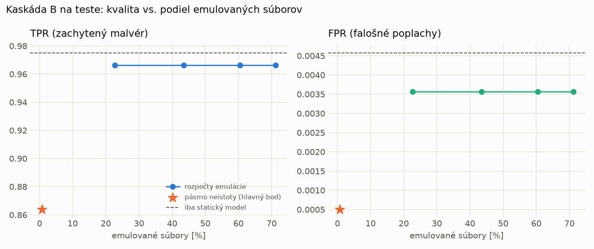

# Kaskáda B `b_baselines` – beh `20261104-184037`

> Generované `src/cascade/evaluate_b.py` (2026-11-04T18:40:37+01:00). Seedy: [0, 1, 2]; hodnoty = priemer ± sm. odchýlka.
> Všetky prahy a pásmo neistoty sú z validácie; test sa na nič nenastavuje. Postup: `docs/09_plan_v2.md`.

| rola | beh |
|---|---|
| static | `runs_v2/lofo/rat/static/lightgbm/20261104-080300` |
| dynamic | `runs_v2/lofo/rat/dynamic/lightgbm/20261104-081647` |
| hybrid | `runs_v2/lofo/rat/hybrid/lightgbm/20261104-172135` |

Druhý stupeň: **dynamic**. Pásmo neistoty statického modelu: FPR ≤ 0.1% nad `hi`,
najviac 1% malvéru validácie pod `lo` (seed 0: lo = 0.9416, hi = 0.9625, seed 1: lo = 0.9718, hi = 0.9775, seed 2: lo = 0.9749, hi = 0.9876).

## Test
| prístup | accuracy | balanced_accuracy | precision | recall_tpr | fpr | f1 | mcc |
|---|---|---|---|---|---|---|---|
| kaskáda B | 0.9260 ± 0.0034 | 0.9317 ± 0.0031 | 0.9995 ± 0.0000 | 0.8639 ± 0.0063 | 0.0005 ± 0.0000 | 0.9268 ± 0.0036 | 0.8620 ± 0.0059 |
| statický | 0.9844 ± 0.0005 | 0.9853 ± 0.0005 | 0.9961 ± 0.0003 | 0.9751 ± 0.0012 | 0.0046 ± 0.0003 | 0.9855 ± 0.0005 | 0.9689 ± 0.0010 |
| dynamický | 0.7974 ± 0.0071 | 0.8120 ± 0.0066 | 0.9807 ± 0.0009 | 0.6389 ± 0.0127 | 0.0149 ± 0.0004 | 0.7737 ± 0.0096 | 0.6505 ± 0.0109 |
| hybrid (každá vzorka) | 0.9828 ± 0.0065 | 0.9838 ± 0.0060 | 0.9963 ± 0.0007 | 0.9718 ± 0.0115 | 0.0043 ± 0.0008 | 0.9839 ± 0.0061 | 0.9657 ± 0.0126 |

- **emulované súbory: 0.71%** (ostatné rozhodne iba statický model); na hybrid ide 0.13% súborov
- chyby pri istom rozhodnutí statického modelu (seed 0): 1218
- validácia: emulované 0.12%, na hybrid 0.06%

## Validácia
| prístup | accuracy | balanced_accuracy | precision | recall_tpr | fpr | f1 | mcc |
|---|---|---|---|---|---|---|---|
| kaskáda B | 0.9930 ± 0.0000 | 0.9944 ± 0.0000 | 0.9994 ± 0.0000 | 0.9900 ± 0.0000 | 0.0012 ± 0.0000 | 0.9947 ± 0.0000 | 0.9844 ± 0.0000 |
| statický | 0.9952 ± 0.0002 | 0.9940 ± 0.0003 | 0.9952 ± 0.0002 | 0.9976 ± 0.0001 | 0.0096 ± 0.0005 | 0.9964 ± 0.0002 | 0.9892 ± 0.0005 |
| dynamický | 0.9673 ± 0.0001 | 0.9730 ± 0.0001 | 0.9949 ± 0.0001 | 0.9557 ± 0.0002 | 0.0097 ± 0.0002 | 0.9749 ± 0.0001 | 0.9298 ± 0.0003 |
| hybrid (každá vzorka) | 0.9948 ± 0.0001 | 0.9937 ± 0.0002 | 0.9952 ± 0.0002 | 0.9969 ± 0.0002 | 0.0094 ± 0.0004 | 0.9961 ± 0.0001 | 0.9883 ± 0.0003 |

## Januárové vzorky vynechanej rodiny (iba malvér → TPR)
| prístup | TPR |
|---|---|
| kaskáda B | 0.7079 ± 0.0335 |
| statický | 0.9644 ± 0.0009 |
| dynamický | 0.7743 ± 0.0000 |
| hybrid (každá vzorka) | 0.9684 ± 0.0043 |

Podiel emulovaných: 2.47%

## Krivka rozpočtu emulácie (test, priemer cez seedy)
| budget_val | emulation_rate | hybrid_rate | recall_tpr | fpr | f1 |
|---|---|---|---|---|---|
| 0.1000 | 0.2274 | 0.0481 | 0.9664 | 0.0036 | 0.9814 |
| 0.2000 | 0.4345 | 0.0902 | 0.9664 | 0.0036 | 0.9814 |
| 0.3000 | 0.6049 | 0.1045 | 0.9664 | 0.0036 | 0.9814 |
| 0.4000 | 0.7118 | 0.1282 | 0.9664 | 0.0036 | 0.9814 |

## Výpočtové nároky
Emulácia (Speakeasy) sa nedá zmerať (dataset neobsahuje PE súbory). **Predpoklad** 60 s na súbor
(limit z `speakeasy-config.json`): kaskáda B ≈ 0.4 s na súbor v priemere, dynamický/hybridný model
a kaskáda A 60 s (emulujú každý súbor).

_Chýba benchmark niektorého komponentu (v zero-day behoch sa nemeria)._

