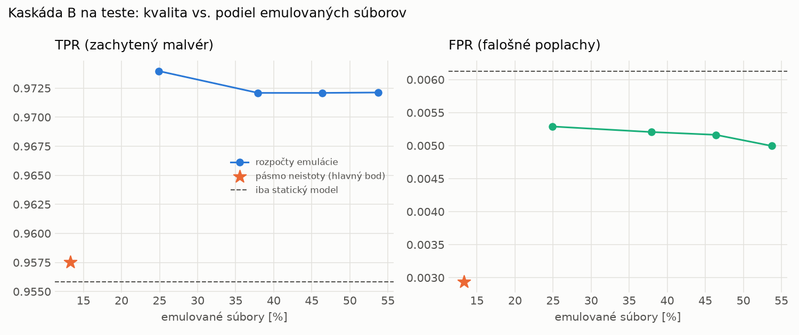

# Kaskáda B `b_direct` – beh `20261104-184033`

> Generované `src/cascade/evaluate_b.py` (2026-11-04T18:40:33+01:00). Seedy: [0, 1, 2]; hodnoty = priemer ± sm. odchýlka.
> Všetky prahy a pásmo neistoty sú z validácie; test sa na nič nenastavuje. Postup: `docs/09_plan_v2.md`.

| rola | beh |
|---|---|
| static | `runs_v2/lofo/rat/students_static/mlp_kd/20261104-183610` |
| hybrid | `runs_v2/lofo/rat/hybrid/lightgbm/20261104-172135` |

Druhý stupeň: **hybrid**. Pásmo neistoty statického modelu: FPR ≤ 0.1% nad `hi`,
najviac 1% malvéru validácie pod `lo` (seed 0: lo = 0.5985, hi = 0.9988, seed 1: lo = 0.5522, hi = 0.9979, seed 2: lo = 0.5889, hi = 0.9993).

## Test
| prístup | accuracy | balanced_accuracy | precision | recall_tpr | fpr | f1 | mcc |
|---|---|---|---|---|---|---|---|
| kaskáda B | 0.9756 ± 0.0062 | 0.9773 ± 0.0058 | 0.9974 ± 0.0005 | 0.9575 ± 0.0112 | 0.0029 ± 0.0005 | 0.9770 ± 0.0060 | 0.9520 ± 0.0119 |
| statický | 0.9733 ± 0.0039 | 0.9749 ± 0.0036 | 0.9946 ± 0.0002 | 0.9558 ± 0.0075 | 0.0061 ± 0.0003 | 0.9748 ± 0.0038 | 0.9472 ± 0.0075 |
| hybrid (každá vzorka) | 0.9828 ± 0.0065 | 0.9838 ± 0.0060 | 0.9963 ± 0.0007 | 0.9718 ± 0.0115 | 0.0043 ± 0.0008 | 0.9839 ± 0.0061 | 0.9657 ± 0.0126 |

- **emulované súbory: 13.29%** (ostatné rozhodne iba statický model); na hybrid ide 13.29% súborov
- chyby pri istom rozhodnutí statického modelu (seed 0): 292
- validácia: emulované 4.49%, na hybrid 4.49%

## Validácia
| prístup | accuracy | balanced_accuracy | precision | recall_tpr | fpr | f1 | mcc |
|---|---|---|---|---|---|---|---|
| kaskáda B | 0.9915 ± 0.0001 | 0.9924 ± 0.0003 | 0.9976 ± 0.0003 | 0.9895 ± 0.0001 | 0.0046 ± 0.0006 | 0.9935 ± 0.0001 | 0.9810 ± 0.0003 |
| statický | 0.9887 ± 0.0004 | 0.9891 ± 0.0002 | 0.9951 ± 0.0002 | 0.9877 ± 0.0009 | 0.0096 ± 0.0005 | 0.9914 ± 0.0003 | 0.9747 ± 0.0010 |
| hybrid (každá vzorka) | 0.9948 ± 0.0001 | 0.9937 ± 0.0002 | 0.9952 ± 0.0002 | 0.9969 ± 0.0002 | 0.0094 ± 0.0004 | 0.9961 ± 0.0001 | 0.9883 ± 0.0003 |

## Januárové vzorky vynechanej rodiny (iba malvér → TPR)
| prístup | TPR |
|---|---|
| kaskáda B | 0.9644 ± 0.0077 |
| statický | 0.9330 ± 0.0553 |
| hybrid (každá vzorka) | 0.9684 ± 0.0043 |

Podiel emulovaných: 36.52%

## Krivka rozpočtu emulácie (test, priemer cez seedy)
| budget_val | emulation_rate | hybrid_rate | recall_tpr | fpr | f1 |
|---|---|---|---|---|---|
| 0.1000 | 0.2490 | 0.2490 | 0.9740 | 0.0053 | 0.9846 |
| 0.2000 | 0.3794 | 0.3794 | 0.9721 | 0.0052 | 0.9836 |
| 0.3000 | 0.4636 | 0.4636 | 0.9721 | 0.0052 | 0.9836 |
| 0.4000 | 0.5371 | 0.5371 | 0.9721 | 0.0050 | 0.9837 |

## Výpočtové nároky
Emulácia (Speakeasy) sa nedá zmerať (dataset neobsahuje PE súbory). **Predpoklad** 60 s na súbor
(limit z `speakeasy-config.json`): kaskáda B ≈ 8.0 s na súbor v priemere, dynamický/hybridný model
a kaskáda A 60 s (emulujú každý súbor).

_Chýba benchmark niektorého komponentu (v zero-day behoch sa nemeria)._

