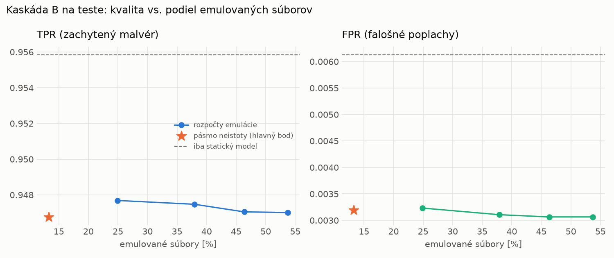

# Kaskáda B `b_heavy` – beh `20261104-184035`

> Generované `src/cascade/evaluate_b.py` (2026-11-04T18:40:35+01:00). Seedy: [0, 1, 2]; hodnoty = priemer ± sm. odchýlka.
> Všetky prahy a pásmo neistoty sú z validácie; test sa na nič nenastavuje. Postup: `docs/09_plan_v2.md`.

| rola | beh |
|---|---|
| static | `runs_v2/lofo/rat/students_static/mlp_kd/20261104-183610` |
| dynamic | `runs_v2/lofo/rat/students_dynamic/mlp_kd/20261104-183809` |
| hybrid | `runs_v2/lofo/rat/hybrid/two_branch/20261104-172337` |

Druhý stupeň: **dynamic**. Pásmo neistoty statického modelu: FPR ≤ 0.1% nad `hi`,
najviac 1% malvéru validácie pod `lo` (seed 0: lo = 0.5985, hi = 0.9988, seed 1: lo = 0.5522, hi = 0.9979, seed 2: lo = 0.5889, hi = 0.9993).

## Test
| prístup | accuracy | balanced_accuracy | precision | recall_tpr | fpr | f1 | mcc |
|---|---|---|---|---|---|---|---|
| kaskáda B | 0.9697 ± 0.0075 | 0.9718 ± 0.0069 | 0.9972 ± 0.0004 | 0.9468 ± 0.0143 | 0.0032 ± 0.0005 | 0.9713 ± 0.0074 | 0.9407 ± 0.0142 |
| statický | 0.9733 ± 0.0039 | 0.9749 ± 0.0036 | 0.9946 ± 0.0002 | 0.9558 ± 0.0075 | 0.0061 ± 0.0003 | 0.9748 ± 0.0038 | 0.9472 ± 0.0075 |
| dynamický | 0.7190 ± 0.0050 | 0.7396 ± 0.0046 | 0.9749 ± 0.0036 | 0.4943 ± 0.0093 | 0.0151 ± 0.0023 | 0.6560 ± 0.0082 | 0.5348 ± 0.0074 |
| hybrid (každá vzorka) | 0.9776 ± 0.0079 | 0.9788 ± 0.0071 | 0.9936 ± 0.0030 | 0.9650 ± 0.0165 | 0.0074 ± 0.0036 | 0.9790 ± 0.0076 | 0.9557 ± 0.0152 |

- **emulované súbory: 13.29%** (ostatné rozhodne iba statický model); na hybrid ide 8.18% súborov
- chyby pri istom rozhodnutí statického modelu (seed 0): 292
- validácia: emulované 4.49%, na hybrid 2.31%

## Validácia
| prístup | accuracy | balanced_accuracy | precision | recall_tpr | fpr | f1 | mcc |
|---|---|---|---|---|---|---|---|
| kaskáda B | 0.9904 ± 0.0006 | 0.9916 ± 0.0003 | 0.9975 ± 0.0004 | 0.9880 ± 0.0012 | 0.0049 ± 0.0007 | 0.9927 ± 0.0004 | 0.9787 ± 0.0012 |
| statický | 0.9887 ± 0.0004 | 0.9891 ± 0.0002 | 0.9951 ± 0.0002 | 0.9877 ± 0.0009 | 0.0096 ± 0.0005 | 0.9914 ± 0.0003 | 0.9747 ± 0.0010 |
| dynamický | 0.9447 ± 0.0103 | 0.9559 ± 0.0078 | 0.9946 ± 0.0001 | 0.9216 ± 0.0156 | 0.0098 ± 0.0000 | 0.9567 ± 0.0085 | 0.8855 ± 0.0194 |
| hybrid (každá vzorka) | 0.9930 ± 0.0014 | 0.9925 ± 0.0009 | 0.9953 ± 0.0003 | 0.9942 ± 0.0024 | 0.0093 ± 0.0006 | 0.9947 ± 0.0010 | 0.9844 ± 0.0031 |

## Januárové vzorky vynechanej rodiny (iba malvér → TPR)
| prístup | TPR |
|---|---|
| kaskáda B | 0.9340 ± 0.0538 |
| statický | 0.9330 ± 0.0553 |
| dynamický | 0.7505 ± 0.0012 |
| hybrid (každá vzorka) | 0.9760 ± 0.0074 |

Podiel emulovaných: 36.52%

## Krivka rozpočtu emulácie (test, priemer cez seedy)
| budget_val | emulation_rate | hybrid_rate | recall_tpr | fpr | f1 |
|---|---|---|---|---|---|
| 0.1000 | 0.2490 | 0.1088 | 0.9477 | 0.0032 | 0.9717 |
| 0.2000 | 0.3794 | 0.1625 | 0.9475 | 0.0031 | 0.9717 |
| 0.3000 | 0.4636 | 0.1988 | 0.9471 | 0.0031 | 0.9715 |
| 0.4000 | 0.5371 | 0.2451 | 0.9470 | 0.0031 | 0.9715 |

## Výpočtové nároky
Emulácia (Speakeasy) sa nedá zmerať (dataset neobsahuje PE súbory). **Predpoklad** 60 s na súbor
(limit z `speakeasy-config.json`): kaskáda B ≈ 8.0 s na súbor v priemere, dynamický/hybridný model
a kaskáda A 60 s (emulujú každý súbor).

_Chýba benchmark niektorého komponentu (v zero-day behoch sa nemeria)._

