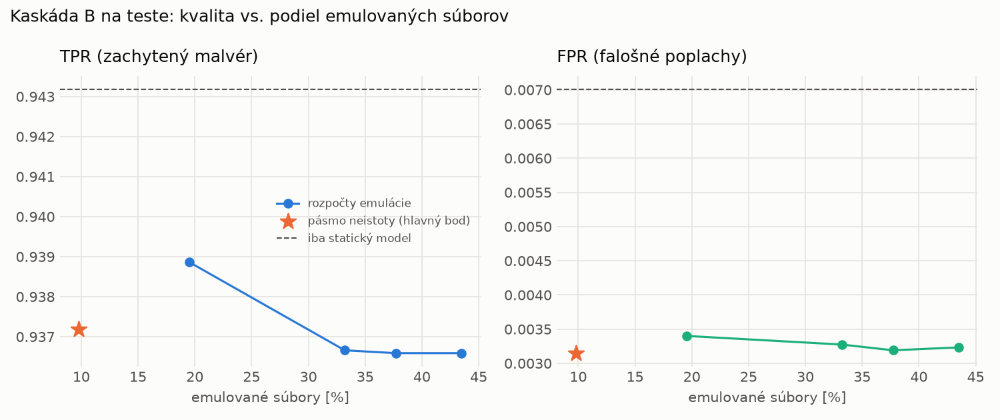

# Kaskáda B `b_nokd` – beh `20261104-184039`

> Generované `src/cascade/evaluate_b.py` (2026-11-04T18:40:39+01:00). Seedy: [0, 1, 2]; hodnoty = priemer ± sm. odchýlka.
> Všetky prahy a pásmo neistoty sú z validácie; test sa na nič nenastavuje. Postup: `docs/09_plan_v2.md`.

| rola | beh |
|---|---|
| static | `runs_v2/lofo/rat/students_static/mlp_nokd/20261104-183650` |
| dynamic | `runs_v2/lofo/rat/students_dynamic/mlp_nokd/20261104-183842` |
| hybrid | `runs_v2/lofo/rat/hybrid/lightgbm/20261104-172135` |

Druhý stupeň: **dynamic**. Pásmo neistoty statického modelu: FPR ≤ 0.1% nad `hi`,
najviac 1% malvéru validácie pod `lo` (seed 0: lo = 0.5294, hi = 0.9338, seed 1: lo = 0.5504, hi = 0.9708, seed 2: lo = 0.4772, hi = 0.9081).

## Test
| prístup | accuracy | balanced_accuracy | precision | recall_tpr | fpr | f1 | mcc |
|---|---|---|---|---|---|---|---|
| kaskáda B | 0.9645 ± 0.0097 | 0.9670 ± 0.0089 | 0.9972 ± 0.0002 | 0.9372 ± 0.0180 | 0.0031 ± 0.0002 | 0.9662 ± 0.0096 | 0.9310 ± 0.0181 |
| statický | 0.9660 ± 0.0046 | 0.9681 ± 0.0043 | 0.9938 ± 0.0005 | 0.9432 ± 0.0082 | 0.0070 ± 0.0005 | 0.9678 ± 0.0045 | 0.9333 ± 0.0088 |
| dynamický | 0.7263 ± 0.0135 | 0.7454 ± 0.0138 | 0.9570 ± 0.0273 | 0.5185 ± 0.0101 | 0.0277 ± 0.0179 | 0.6726 ± 0.0151 | 0.5369 ± 0.0317 |
| hybrid (každá vzorka) | 0.9828 ± 0.0065 | 0.9838 ± 0.0060 | 0.9963 ± 0.0007 | 0.9718 ± 0.0115 | 0.0043 ± 0.0008 | 0.9839 ± 0.0061 | 0.9657 ± 0.0126 |

- **emulované súbory: 9.80%** (ostatné rozhodne iba statický model); na hybrid ide 6.35% súborov
- chyby pri istom rozhodnutí statického modelu (seed 0): 413
- validácia: emulované 4.30%, na hybrid 1.88%

## Validácia
| prístup | accuracy | balanced_accuracy | precision | recall_tpr | fpr | f1 | mcc |
|---|---|---|---|---|---|---|---|
| kaskáda B | 0.9892 ± 0.0019 | 0.9906 ± 0.0015 | 0.9975 ± 0.0002 | 0.9862 ± 0.0027 | 0.0049 ± 0.0004 | 0.9918 ± 0.0014 | 0.9760 ± 0.0041 |
| statický | 0.9875 ± 0.0020 | 0.9882 ± 0.0015 | 0.9950 ± 0.0000 | 0.9862 ± 0.0031 | 0.0098 ± 0.0000 | 0.9905 ± 0.0016 | 0.9722 ± 0.0045 |
| dynamický | 0.9540 ± 0.0004 | 0.9630 ± 0.0003 | 0.9948 ± 0.0001 | 0.9355 ± 0.0007 | 0.0096 ± 0.0002 | 0.9643 ± 0.0003 | 0.9033 ± 0.0008 |
| hybrid (každá vzorka) | 0.9948 ± 0.0001 | 0.9937 ± 0.0002 | 0.9952 ± 0.0002 | 0.9969 ± 0.0002 | 0.0094 ± 0.0004 | 0.9961 ± 0.0001 | 0.9883 ± 0.0003 |

## Januárové vzorky vynechanej rodiny (iba malvér → TPR)
| prístup | TPR |
|---|---|
| kaskáda B | 0.9142 ± 0.0740 |
| statický | 0.9195 ± 0.0738 |
| dynamický | 0.7694 ± 0.0262 |
| hybrid (každá vzorka) | 0.9684 ± 0.0043 |

Podiel emulovaných: 19.90%

## Krivka rozpočtu emulácie (test, priemer cez seedy)
| budget_val | emulation_rate | hybrid_rate | recall_tpr | fpr | f1 |
|---|---|---|---|---|---|
| 0.1000 | 0.1954 | 0.1041 | 0.9389 | 0.0034 | 0.9670 |
| 0.2000 | 0.3321 | 0.1817 | 0.9367 | 0.0033 | 0.9659 |
| 0.3000 | 0.3772 | 0.1937 | 0.9366 | 0.0032 | 0.9659 |
| 0.4000 | 0.4348 | 0.2108 | 0.9366 | 0.0032 | 0.9658 |

## Výpočtové nároky
Emulácia (Speakeasy) sa nedá zmerať (dataset neobsahuje PE súbory). **Predpoklad** 60 s na súbor
(limit z `speakeasy-config.json`): kaskáda B ≈ 5.9 s na súbor v priemere, dynamický/hybridný model
a kaskáda A 60 s (emulujú každý súbor).

_Chýba benchmark niektorého komponentu (v zero-day behoch sa nemeria)._

