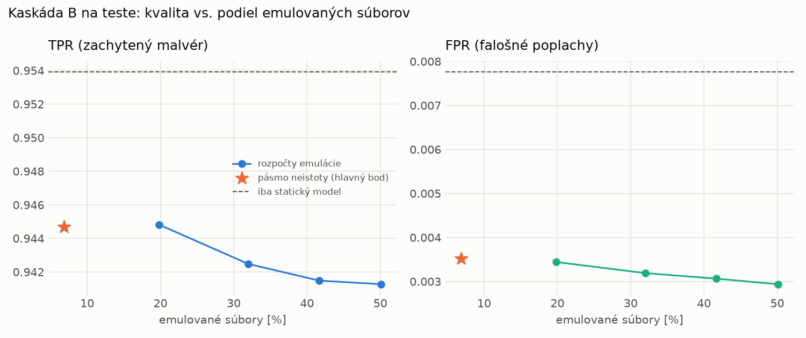

# Kaskáda B `b_twobranch` – beh `20261104-184041`

> Generované `src/cascade/evaluate_b.py` (2026-11-04T18:40:41+01:00). Seedy: [0, 1, 2]; hodnoty = priemer ± sm. odchýlka.
> Všetky prahy a pásmo neistoty sú z validácie; test sa na nič nenastavuje. Postup: `docs/09_plan_v2.md`.

| rola | beh |
|---|---|
| static | `runs_v2/lofo/rat/students_static/mlp_kd_twobranch/20261104-183737` |
| dynamic | `runs_v2/lofo/rat/students_dynamic/mlp_kd_twobranch/20261104-183943` |
| hybrid | `runs_v2/lofo/rat/hybrid/lightgbm/20261104-172135` |

Druhý stupeň: **dynamic**. Pásmo neistoty statického modelu: FPR ≤ 0.1% nad `hi`,
najviac 1% malvéru validácie pod `lo` (seed 0: lo = 0.5955, hi = 0.9947, seed 1: lo = 0.5823, hi = 0.9906, seed 2: lo = 0.6503, hi = 0.9951).

## Test
| prístup | accuracy | balanced_accuracy | precision | recall_tpr | fpr | f1 | mcc |
|---|---|---|---|---|---|---|---|
| kaskáda B | 0.9684 ± 0.0068 | 0.9706 ± 0.0063 | 0.9969 ± 0.0003 | 0.9447 ± 0.0126 | 0.0035 ± 0.0004 | 0.9700 ± 0.0067 | 0.9382 ± 0.0129 |
| statický | 0.9715 ± 0.0003 | 0.9731 ± 0.0002 | 0.9932 ± 0.0004 | 0.9539 ± 0.0010 | 0.0078 ± 0.0005 | 0.9732 ± 0.0003 | 0.9436 ± 0.0005 |
| dynamický | 0.7088 ± 0.0122 | 0.7296 ± 0.0127 | 0.9613 ± 0.0301 | 0.4824 ± 0.0077 | 0.0232 ± 0.0185 | 0.6424 ± 0.0130 | 0.5142 ± 0.0310 |
| hybrid (každá vzorka) | 0.9828 ± 0.0065 | 0.9838 ± 0.0060 | 0.9963 ± 0.0007 | 0.9718 ± 0.0115 | 0.0043 ± 0.0008 | 0.9839 ± 0.0061 | 0.9657 ± 0.0126 |

- **emulované súbory: 6.86%** (ostatné rozhodne iba statický model); na hybrid ide 4.96% súborov
- chyby pri istom rozhodnutí statického modelu (seed 0): 339
- validácia: emulované 2.83%, na hybrid 1.73%

## Validácia
| prístup | accuracy | balanced_accuracy | precision | recall_tpr | fpr | f1 | mcc |
|---|---|---|---|---|---|---|---|
| kaskáda B | 0.9909 ± 0.0008 | 0.9920 ± 0.0007 | 0.9977 ± 0.0002 | 0.9885 ± 0.0010 | 0.0045 ± 0.0004 | 0.9931 ± 0.0006 | 0.9797 ± 0.0017 |
| statický | 0.9893 ± 0.0009 | 0.9895 ± 0.0008 | 0.9951 ± 0.0002 | 0.9886 ± 0.0011 | 0.0096 ± 0.0005 | 0.9919 ± 0.0007 | 0.9761 ± 0.0020 |
| dynamický | 0.9328 ± 0.0008 | 0.9471 ± 0.0005 | 0.9948 ± 0.0003 | 0.9034 ± 0.0014 | 0.0093 ± 0.0005 | 0.9469 ± 0.0006 | 0.8633 ± 0.0013 |
| hybrid (každá vzorka) | 0.9948 ± 0.0001 | 0.9937 ± 0.0002 | 0.9952 ± 0.0002 | 0.9969 ± 0.0002 | 0.0094 ± 0.0004 | 0.9961 ± 0.0001 | 0.9883 ± 0.0003 |

## Januárové vzorky vynechanej rodiny (iba malvér → TPR)
| prístup | TPR |
|---|---|
| kaskáda B | 0.9142 ± 0.0519 |
| statický | 0.9197 ± 0.0503 |
| dynamický | 0.7405 ± 0.0089 |
| hybrid (každá vzorka) | 0.9684 ± 0.0043 |

Podiel emulovaných: 13.65%

## Krivka rozpočtu emulácie (test, priemer cez seedy)
| budget_val | emulation_rate | hybrid_rate | recall_tpr | fpr | f1 |
|---|---|---|---|---|---|
| 0.1000 | 0.1982 | 0.1098 | 0.9448 | 0.0034 | 0.9701 |
| 0.2000 | 0.3199 | 0.1617 | 0.9425 | 0.0032 | 0.9690 |
| 0.3000 | 0.4169 | 0.2053 | 0.9415 | 0.0031 | 0.9685 |
| 0.4000 | 0.5011 | 0.2230 | 0.9413 | 0.0029 | 0.9685 |

## Výpočtové nároky
Emulácia (Speakeasy) sa nedá zmerať (dataset neobsahuje PE súbory). **Predpoklad** 60 s na súbor
(limit z `speakeasy-config.json`): kaskáda B ≈ 4.1 s na súbor v priemere, dynamický/hybridný model
a kaskáda A 60 s (emulujú každý súbor).

_Chýba benchmark niektorého komponentu (v zero-day behoch sa nemeria)._

