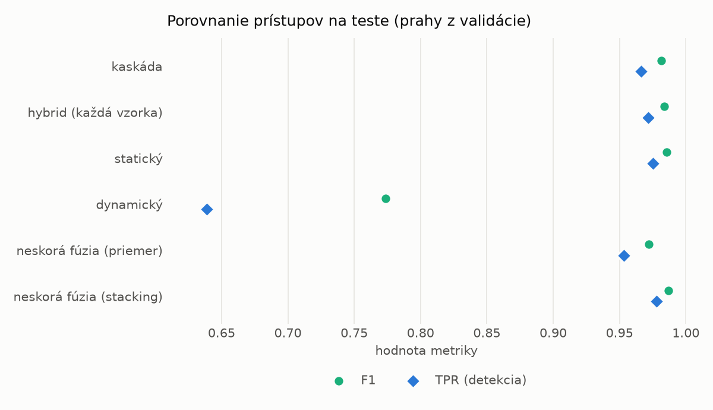
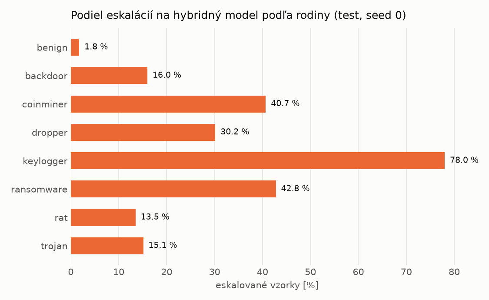

# Kaskáda `baselines` – beh `20261104-184027`

> Generované `src/cascade/evaluate.py` (2026-11-04T18:40:27+01:00). Seedy: [0, 1, 2]; hodnoty = priemer ± sm. odchýlka.
> Všetky prahy sú určené na validácii (FPR ≤ 1 %); test sa na nič nenastavuje.

| rola | beh |
|---|---|
| static | `runs_v2/lofo/rat/static/lightgbm/20261104-080300` |
| dynamic | `runs_v2/lofo/rat/dynamic/lightgbm/20261104-081647` |
| hybrid | `runs_v2/lofo/rat/hybrid/lightgbm/20261104-172135` |

## Test
| prístup | accuracy | balanced_accuracy | precision | recall_tpr | fpr | f1 | mcc |
|---|---|---|---|---|---|---|---|
| kaskáda | 0.9801 ± 0.0052 | 0.9814 ± 0.0048 | 0.9969 ± 0.0003 | 0.9664 ± 0.0095 | 0.0036 ± 0.0004 | 0.9814 ± 0.0050 | 0.9607 ± 0.0101 |
| hybrid (každá vzorka) | 0.9828 ± 0.0065 | 0.9838 ± 0.0060 | 0.9963 ± 0.0007 | 0.9718 ± 0.0115 | 0.0043 ± 0.0008 | 0.9839 ± 0.0061 | 0.9657 ± 0.0126 |
| statický | 0.9844 ± 0.0005 | 0.9853 ± 0.0005 | 0.9961 ± 0.0003 | 0.9751 ± 0.0012 | 0.0046 ± 0.0003 | 0.9855 ± 0.0005 | 0.9689 ± 0.0010 |
| dynamický | 0.7974 ± 0.0071 | 0.8120 ± 0.0066 | 0.9807 ± 0.0009 | 0.6389 ± 0.0127 | 0.0149 ± 0.0004 | 0.7737 ± 0.0096 | 0.6505 ± 0.0109 |
| neskorá fúzia (priemer) | 0.9703 ± 0.0055 | 0.9718 ± 0.0049 | 0.9914 ± 0.0015 | 0.9535 ± 0.0116 | 0.0098 ± 0.0019 | 0.9720 ± 0.0053 | 0.9412 ± 0.0104 |
| neskorá fúzia (stacking) | 0.9861 ± 0.0027 | 0.9868 ± 0.0024 | 0.9962 ± 0.0007 | 0.9780 ± 0.0057 | 0.0044 ± 0.0008 | 0.9870 ± 0.0026 | 0.9722 ± 0.0053 |

## Validácia
| prístup | accuracy | balanced_accuracy | precision | recall_tpr | fpr | f1 | mcc |
|---|---|---|---|---|---|---|---|
| kaskáda | 0.9954 ± 0.0002 | 0.9946 ± 0.0003 | 0.9961 ± 0.0002 | 0.9970 ± 0.0001 | 0.0078 ± 0.0004 | 0.9965 ± 0.0002 | 0.9896 ± 0.0005 |
| hybrid (každá vzorka) | 0.9948 ± 0.0001 | 0.9937 ± 0.0002 | 0.9952 ± 0.0002 | 0.9969 ± 0.0002 | 0.0094 ± 0.0004 | 0.9961 ± 0.0001 | 0.9883 ± 0.0003 |
| statický | 0.9952 ± 0.0002 | 0.9940 ± 0.0003 | 0.9952 ± 0.0002 | 0.9976 ± 0.0001 | 0.0096 ± 0.0005 | 0.9964 ± 0.0002 | 0.9892 ± 0.0005 |
| dynamický | 0.9673 ± 0.0001 | 0.9730 ± 0.0001 | 0.9949 ± 0.0001 | 0.9557 ± 0.0002 | 0.0097 ± 0.0002 | 0.9749 ± 0.0001 | 0.9298 ± 0.0003 |
| neskorá fúzia (priemer) | 0.9943 ± 0.0001 | 0.9935 ± 0.0002 | 0.9954 ± 0.0003 | 0.9961 ± 0.0002 | 0.0091 ± 0.0006 | 0.9957 ± 0.0001 | 0.9872 ± 0.0002 |
| neskorá fúzia (stacking) | 0.9954 ± 0.0003 | 0.9942 ± 0.0005 | 0.9953 ± 0.0005 | 0.9977 ± 0.0002 | 0.0093 ± 0.0009 | 0.9965 ± 0.0003 | 0.9896 ± 0.0008 |

## Správanie kaskády (test, seed 0)
- podiel eskalácií na hybrid: **18.87%** (3272 vzoriek)
- chyby pri zhode študentov (kaskáda ich nemôže opraviť): **224**
  (1.592% zo zhôd; FP 6, FN 218)
- úspešnosť na eskalovaných vzorkách: hybrid 0.9776894865525673, statický 0.9834963325183375,
  dynamický 0.01650366748166259  → prínos hybridu pri nezhode

## Výpočtové nároky (odhad z benchmarkov komponentov)
_Chýba benchmark niektorého komponentu (`python -m src.evaluation.benchmark`)._

