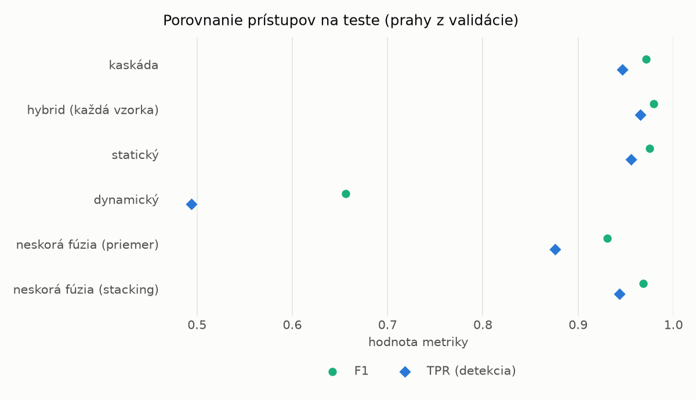
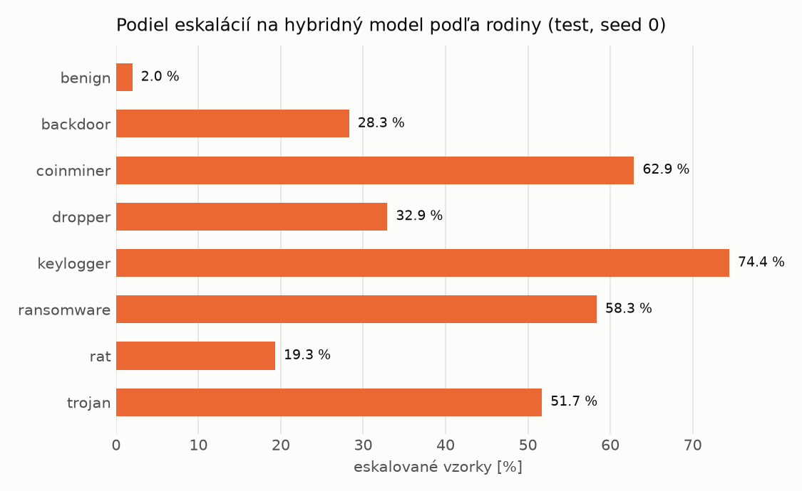

# Kaskáda `heavy` – beh `20261104-184025`

> Generované `src/cascade/evaluate.py` (2026-11-04T18:40:25+01:00). Seedy: [0, 1, 2]; hodnoty = priemer ± sm. odchýlka.
> Všetky prahy sú určené na validácii (FPR ≤ 1 %); test sa na nič nenastavuje.

| rola | beh |
|---|---|
| static | `runs_v2/lofo/rat/students_static/mlp_kd/20261104-183610` |
| dynamic | `runs_v2/lofo/rat/students_dynamic/mlp_kd/20261104-183809` |
| hybrid | `runs_v2/lofo/rat/hybrid/two_branch/20261104-172337` |

## Test
| prístup | accuracy | balanced_accuracy | precision | recall_tpr | fpr | f1 | mcc |
|---|---|---|---|---|---|---|---|
| kaskáda | 0.9698 ± 0.0080 | 0.9719 ± 0.0074 | 0.9974 ± 0.0005 | 0.9467 ± 0.0151 | 0.0029 ± 0.0006 | 0.9714 ± 0.0078 | 0.9409 ± 0.0151 |
| hybrid (každá vzorka) | 0.9776 ± 0.0079 | 0.9788 ± 0.0071 | 0.9936 ± 0.0030 | 0.9650 ± 0.0165 | 0.0074 ± 0.0036 | 0.9790 ± 0.0076 | 0.9557 ± 0.0152 |
| statický | 0.9733 ± 0.0039 | 0.9749 ± 0.0036 | 0.9946 ± 0.0002 | 0.9558 ± 0.0075 | 0.0061 ± 0.0003 | 0.9748 ± 0.0038 | 0.9472 ± 0.0075 |
| dynamický | 0.7190 ± 0.0050 | 0.7396 ± 0.0046 | 0.9749 ± 0.0036 | 0.4943 ± 0.0093 | 0.0151 ± 0.0023 | 0.6560 ± 0.0082 | 0.5348 ± 0.0074 |
| neskorá fúzia (priemer) | 0.9298 ± 0.0287 | 0.9347 ± 0.0262 | 0.9938 ± 0.0034 | 0.8760 ± 0.0564 | 0.0066 ± 0.0041 | 0.9305 ± 0.0299 | 0.8683 ± 0.0507 |
| neskorá fúzia (stacking) | 0.9666 ± 0.0022 | 0.9688 ± 0.0020 | 0.9948 ± 0.0004 | 0.9434 ± 0.0045 | 0.0058 ± 0.0005 | 0.9684 ± 0.0022 | 0.9346 ± 0.0042 |

## Validácia
| prístup | accuracy | balanced_accuracy | precision | recall_tpr | fpr | f1 | mcc |
|---|---|---|---|---|---|---|---|
| kaskáda | 0.9910 ± 0.0006 | 0.9918 ± 0.0003 | 0.9971 ± 0.0003 | 0.9892 ± 0.0011 | 0.0056 ± 0.0006 | 0.9932 ± 0.0004 | 0.9799 ± 0.0012 |
| hybrid (každá vzorka) | 0.9930 ± 0.0014 | 0.9925 ± 0.0009 | 0.9953 ± 0.0003 | 0.9942 ± 0.0024 | 0.0093 ± 0.0006 | 0.9947 ± 0.0010 | 0.9844 ± 0.0031 |
| statický | 0.9887 ± 0.0004 | 0.9891 ± 0.0002 | 0.9951 ± 0.0002 | 0.9877 ± 0.0009 | 0.0096 ± 0.0005 | 0.9914 ± 0.0003 | 0.9747 ± 0.0010 |
| dynamický | 0.9447 ± 0.0103 | 0.9559 ± 0.0078 | 0.9946 ± 0.0001 | 0.9216 ± 0.0156 | 0.0098 ± 0.0000 | 0.9567 ± 0.0085 | 0.8855 ± 0.0194 |
| neskorá fúzia (priemer) | 0.9909 ± 0.0014 | 0.9909 ± 0.0009 | 0.9953 ± 0.0004 | 0.9909 ± 0.0024 | 0.0091 ± 0.0009 | 0.9931 ± 0.0010 | 0.9796 ± 0.0030 |
| neskorá fúzia (stacking) | 0.9914 ± 0.0012 | 0.9911 ± 0.0009 | 0.9950 ± 0.0000 | 0.9920 ± 0.0019 | 0.0098 ± 0.0000 | 0.9935 ± 0.0009 | 0.9807 ± 0.0027 |

## Správanie kaskády (test, seed 0)
- podiel eskalácií na hybrid: **26.96%** (4675 vzoriek)
- chyby pri zhode študentov (kaskáda ich nemôže opraviť): **356**
  (2.811% zo zhôd; FP 3, FN 353)
- úspešnosť na eskalovaných vzorkách: hybrid 0.9745454545454545, statický 0.986524064171123,
  dynamický 0.013475935828877005  → prínos hybridu pri nezhode

## Výpočtové nároky (odhad z benchmarkov komponentov)
_Chýba benchmark niektorého komponentu (`python -m src.evaluation.benchmark`)._

