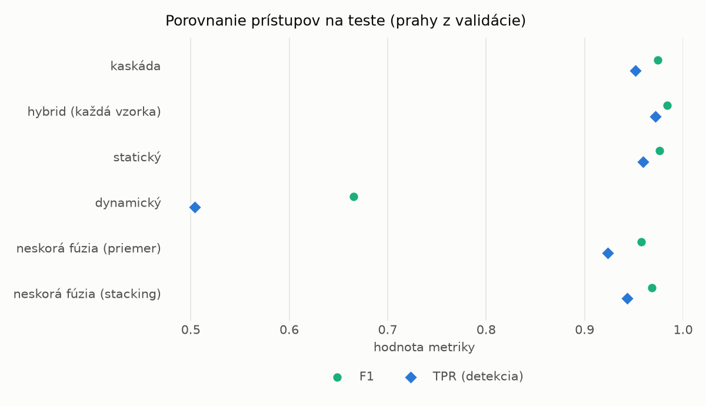
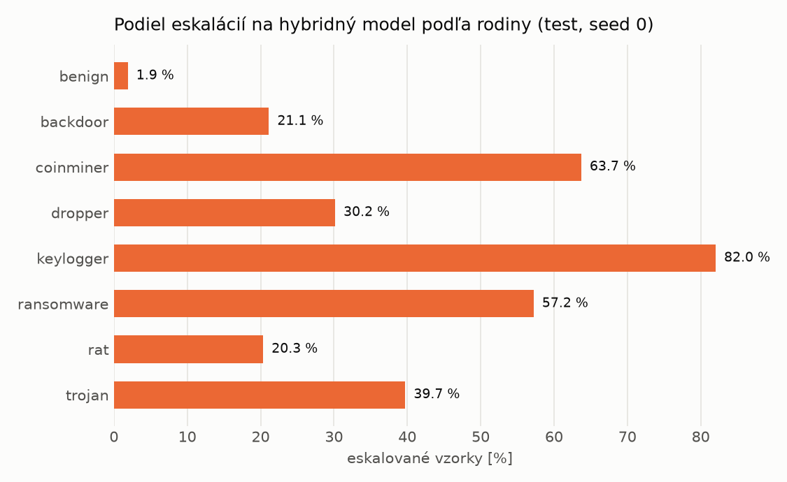

# Kaskáda `modal` – beh `20261104-184023`

> Generované `src/cascade/evaluate.py` (2026-11-04T18:40:23+01:00). Seedy: [0, 1, 2]; hodnoty = priemer ± sm. odchýlka.
> Všetky prahy sú určené na validácii (FPR ≤ 1 %); test sa na nič nenastavuje.

| rola | beh |
|---|---|
| static | `runs_v2/lofo/rat/students_static/mlp_kd_modal/20261104-183707` |
| dynamic | `runs_v2/lofo/rat/students_dynamic/mlp_kd_modal/20261104-183911` |
| hybrid | `runs_v2/lofo/rat/hybrid/lightgbm/20261104-172135` |

## Test
| prístup | accuracy | balanced_accuracy | precision | recall_tpr | fpr | f1 | mcc |
|---|---|---|---|---|---|---|---|
| kaskáda | 0.9726 ± 0.0107 | 0.9745 ± 0.0099 | 0.9978 ± 0.0002 | 0.9516 ± 0.0197 | 0.0025 ± 0.0002 | 0.9741 ± 0.0105 | 0.9464 ± 0.0204 |
| hybrid (každá vzorka) | 0.9828 ± 0.0065 | 0.9838 ± 0.0060 | 0.9963 ± 0.0007 | 0.9718 ± 0.0115 | 0.0043 ± 0.0008 | 0.9839 ± 0.0061 | 0.9657 ± 0.0126 |
| statický | 0.9748 ± 0.0099 | 0.9762 ± 0.0092 | 0.9941 ± 0.0004 | 0.9592 ± 0.0180 | 0.0068 ± 0.0004 | 0.9763 ± 0.0096 | 0.9502 ± 0.0191 |
| dynamický | 0.7255 ± 0.0057 | 0.7458 ± 0.0053 | 0.9793 ± 0.0005 | 0.5042 ± 0.0110 | 0.0126 ± 0.0005 | 0.6656 ± 0.0095 | 0.5461 ± 0.0080 |
| neskorá fúzia (priemer) | 0.9559 ± 0.0099 | 0.9589 ± 0.0090 | 0.9948 ± 0.0028 | 0.9235 ± 0.0199 | 0.0058 ± 0.0032 | 0.9578 ± 0.0100 | 0.9147 ± 0.0179 |
| neskorá fúzia (stacking) | 0.9666 ± 0.0055 | 0.9687 ± 0.0050 | 0.9950 ± 0.0004 | 0.9430 ± 0.0104 | 0.0056 ± 0.0005 | 0.9683 ± 0.0054 | 0.9345 ± 0.0103 |

## Validácia
| prístup | accuracy | balanced_accuracy | precision | recall_tpr | fpr | f1 | mcc |
|---|---|---|---|---|---|---|---|
| kaskáda | 0.9921 ± 0.0024 | 0.9928 ± 0.0019 | 0.9975 ± 0.0002 | 0.9906 ± 0.0034 | 0.0049 ± 0.0004 | 0.9940 ± 0.0018 | 0.9824 ± 0.0052 |
| hybrid (každá vzorka) | 0.9948 ± 0.0001 | 0.9937 ± 0.0002 | 0.9952 ± 0.0002 | 0.9969 ± 0.0002 | 0.0094 ± 0.0004 | 0.9961 ± 0.0001 | 0.9883 ± 0.0003 |
| statický | 0.9894 ± 0.0028 | 0.9896 ± 0.0021 | 0.9950 ± 0.0000 | 0.9891 ± 0.0042 | 0.0098 ± 0.0000 | 0.9920 ± 0.0021 | 0.9765 ± 0.0061 |
| dynamický | 0.9397 ± 0.0116 | 0.9522 ± 0.0087 | 0.9947 ± 0.0000 | 0.9140 ± 0.0176 | 0.0096 ± 0.0002 | 0.9526 ± 0.0095 | 0.8763 ± 0.0218 |
| neskorá fúzia (priemer) | 0.9915 ± 0.0020 | 0.9914 ± 0.0018 | 0.9954 ± 0.0006 | 0.9918 ± 0.0025 | 0.0090 ± 0.0011 | 0.9936 ± 0.0015 | 0.9810 ± 0.0044 |
| neskorá fúzia (stacking) | 0.9925 ± 0.0018 | 0.9920 ± 0.0014 | 0.9953 ± 0.0001 | 0.9934 ± 0.0027 | 0.0093 ± 0.0002 | 0.9943 ± 0.0014 | 0.9832 ± 0.0041 |

## Správanie kaskády (test, seed 0)
- podiel eskalácií na hybrid: **25.81%** (4475 vzoriek)
- chyby pri zhode študentov (kaskáda ich nemôže opraviť): **235**
  (1.827% zo zhôd; FP 3, FN 232)
- úspešnosť na eskalovaných vzorkách: hybrid 0.9781005586592179, statický 0.9854748603351955,
  dynamický 0.01452513966480447  → prínos hybridu pri nezhode

## Výpočtové nároky (odhad z benchmarkov komponentov)
_Chýba benchmark niektorého komponentu (`python -m src.evaluation.benchmark`)._

