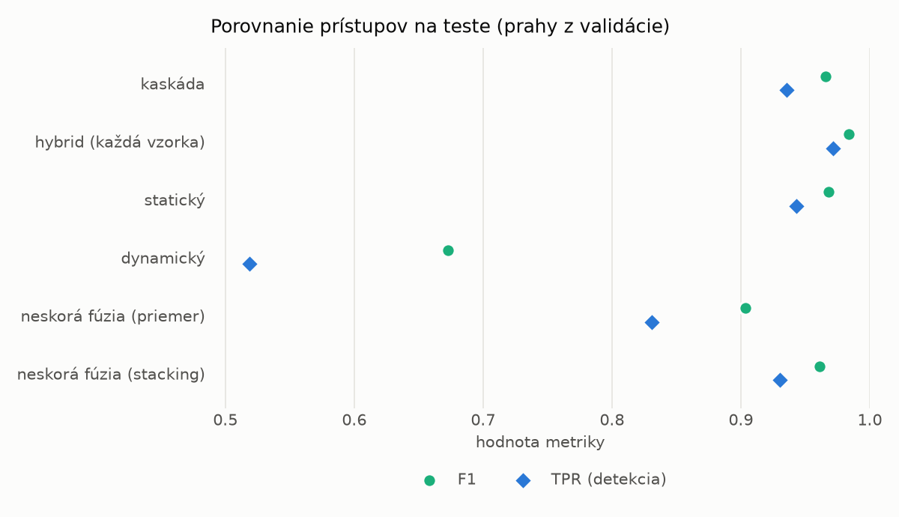
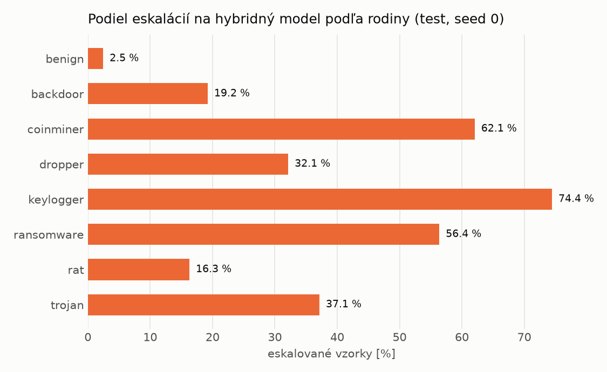

# Kaskáda `nokd` – beh `20261104-184021`

> Generované `src/cascade/evaluate.py` (2026-11-04T18:40:21+01:00). Seedy: [0, 1, 2]; hodnoty = priemer ± sm. odchýlka.
> Všetky prahy sú určené na validácii (FPR ≤ 1 %); test sa na nič nenastavuje.

| rola | beh |
|---|---|
| static | `runs_v2/lofo/rat/students_static/mlp_nokd/20261104-183650` |
| dynamic | `runs_v2/lofo/rat/students_dynamic/mlp_nokd/20261104-183842` |
| hybrid | `runs_v2/lofo/rat/hybrid/lightgbm/20261104-172135` |

## Test
| prístup | accuracy | balanced_accuracy | precision | recall_tpr | fpr | f1 | mcc |
|---|---|---|---|---|---|---|---|
| kaskáda | 0.9639 ± 0.0091 | 0.9665 ± 0.0084 | 0.9978 ± 0.0006 | 0.9356 ± 0.0164 | 0.0025 ± 0.0006 | 0.9656 ± 0.0089 | 0.9300 ± 0.0169 |
| hybrid (každá vzorka) | 0.9828 ± 0.0065 | 0.9838 ± 0.0060 | 0.9963 ± 0.0007 | 0.9718 ± 0.0115 | 0.0043 ± 0.0008 | 0.9839 ± 0.0061 | 0.9657 ± 0.0126 |
| statický | 0.9660 ± 0.0046 | 0.9681 ± 0.0043 | 0.9938 ± 0.0005 | 0.9432 ± 0.0082 | 0.0070 ± 0.0005 | 0.9678 ± 0.0045 | 0.9333 ± 0.0088 |
| dynamický | 0.7263 ± 0.0135 | 0.7454 ± 0.0138 | 0.9570 ± 0.0273 | 0.5185 ± 0.0101 | 0.0277 ± 0.0179 | 0.6726 ± 0.0151 | 0.5369 ± 0.0317 |
| neskorá fúzia (priemer) | 0.9052 ± 0.0418 | 0.9121 ± 0.0387 | 0.9933 ± 0.0028 | 0.8306 ± 0.0754 | 0.0065 ± 0.0023 | 0.9036 ± 0.0449 | 0.8263 ± 0.0727 |
| neskorá fúzia (stacking) | 0.9592 ± 0.0094 | 0.9619 ± 0.0086 | 0.9939 ± 0.0011 | 0.9305 ± 0.0182 | 0.0068 ± 0.0013 | 0.9611 ± 0.0093 | 0.9207 ± 0.0175 |

## Validácia
| prístup | accuracy | balanced_accuracy | precision | recall_tpr | fpr | f1 | mcc |
|---|---|---|---|---|---|---|---|
| kaskáda | 0.9905 ± 0.0016 | 0.9916 ± 0.0013 | 0.9973 ± 0.0002 | 0.9884 ± 0.0022 | 0.0053 ± 0.0004 | 0.9928 ± 0.0012 | 0.9790 ± 0.0035 |
| hybrid (každá vzorka) | 0.9948 ± 0.0001 | 0.9937 ± 0.0002 | 0.9952 ± 0.0002 | 0.9969 ± 0.0002 | 0.0094 ± 0.0004 | 0.9961 ± 0.0001 | 0.9883 ± 0.0003 |
| statický | 0.9875 ± 0.0020 | 0.9882 ± 0.0015 | 0.9950 ± 0.0000 | 0.9862 ± 0.0031 | 0.0098 ± 0.0000 | 0.9905 ± 0.0016 | 0.9722 ± 0.0045 |
| dynamický | 0.9540 ± 0.0004 | 0.9630 ± 0.0003 | 0.9948 ± 0.0001 | 0.9355 ± 0.0007 | 0.0096 ± 0.0002 | 0.9643 ± 0.0003 | 0.9033 ± 0.0008 |
| neskorá fúzia (priemer) | 0.9893 ± 0.0013 | 0.9896 ± 0.0010 | 0.9951 ± 0.0002 | 0.9888 ± 0.0019 | 0.0096 ± 0.0005 | 0.9919 ± 0.0010 | 0.9763 ± 0.0029 |
| neskorá fúzia (stacking) | 0.9921 ± 0.0019 | 0.9917 ± 0.0015 | 0.9951 ± 0.0001 | 0.9931 ± 0.0029 | 0.0097 ± 0.0002 | 0.9941 ± 0.0015 | 0.9824 ± 0.0043 |

## Správanie kaskády (test, seed 0)
- podiel eskalácií na hybrid: **24.70%** (4283 vzoriek)
- chyby pri zhode študentov (kaskáda ich nemôže opraviť): **442**
  (3.385% zo zhôd; FP 5, FN 437)
- úspešnosť na eskalovaných vzorkách: hybrid 0.9684800373569927, statický 0.972215736633201,
  dynamický 0.027784263366798973  → prínos hybridu pri nezhode

## Výpočtové nároky (odhad z benchmarkov komponentov)
_Chýba benchmark niektorého komponentu (`python -m src.evaluation.benchmark`)._

