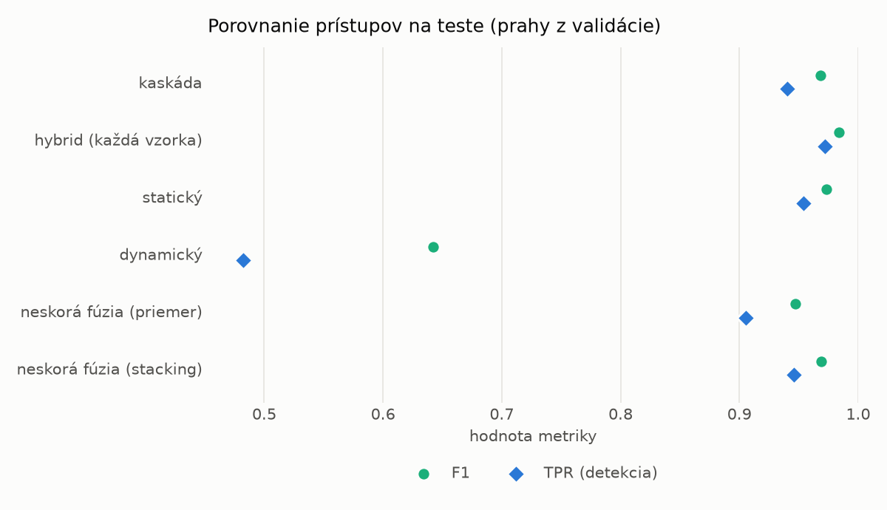
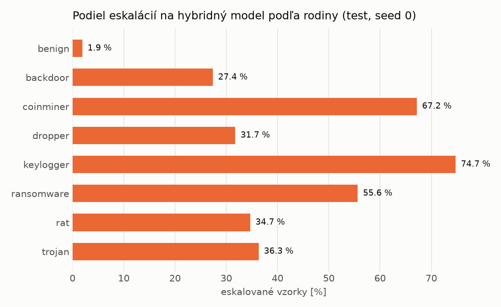

# Kaskáda `twobranch` – beh `20261104-184029`

> Generované `src/cascade/evaluate.py` (2026-11-04T18:40:29+01:00). Seedy: [0, 1, 2]; hodnoty = priemer ± sm. odchýlka.
> Všetky prahy sú určené na validácii (FPR ≤ 1 %); test sa na nič nenastavuje.

| rola | beh |
|---|---|
| static | `runs_v2/lofo/rat/students_static/mlp_kd_twobranch/20261104-183737` |
| dynamic | `runs_v2/lofo/rat/students_dynamic/mlp_kd_twobranch/20261104-183943` |
| hybrid | `runs_v2/lofo/rat/hybrid/lightgbm/20261104-172135` |

## Test
| prístup | accuracy | balanced_accuracy | precision | recall_tpr | fpr | f1 | mcc |
|---|---|---|---|---|---|---|---|
| kaskáda | 0.9667 ± 0.0065 | 0.9691 ± 0.0060 | 0.9981 ± 0.0002 | 0.9404 ± 0.0119 | 0.0021 ± 0.0002 | 0.9684 ± 0.0064 | 0.9352 ± 0.0121 |
| hybrid (každá vzorka) | 0.9828 ± 0.0065 | 0.9838 ± 0.0060 | 0.9963 ± 0.0007 | 0.9718 ± 0.0115 | 0.0043 ± 0.0008 | 0.9839 ± 0.0061 | 0.9657 ± 0.0126 |
| statický | 0.9715 ± 0.0003 | 0.9731 ± 0.0002 | 0.9932 ± 0.0004 | 0.9539 ± 0.0010 | 0.0078 ± 0.0005 | 0.9732 ± 0.0003 | 0.9436 ± 0.0005 |
| dynamický | 0.7088 ± 0.0122 | 0.7296 ± 0.0127 | 0.9613 ± 0.0301 | 0.4824 ± 0.0077 | 0.0232 ± 0.0185 | 0.6424 ± 0.0130 | 0.5142 ± 0.0310 |
| neskorá fúzia (priemer) | 0.9457 ± 0.0251 | 0.9493 ± 0.0230 | 0.9938 ± 0.0008 | 0.9055 ± 0.0472 | 0.0068 ± 0.0012 | 0.9471 ± 0.0258 | 0.8963 ± 0.0449 |
| neskorá fúzia (stacking) | 0.9672 ± 0.0057 | 0.9692 ± 0.0052 | 0.9935 ± 0.0008 | 0.9457 ± 0.0112 | 0.0073 ± 0.0009 | 0.9690 ± 0.0055 | 0.9356 ± 0.0107 |

## Validácia
| prístup | accuracy | balanced_accuracy | precision | recall_tpr | fpr | f1 | mcc |
|---|---|---|---|---|---|---|---|
| kaskáda | 0.9913 ± 0.0006 | 0.9921 ± 0.0005 | 0.9971 ± 0.0002 | 0.9898 ± 0.0008 | 0.0056 ± 0.0005 | 0.9934 ± 0.0005 | 0.9807 ± 0.0013 |
| hybrid (každá vzorka) | 0.9948 ± 0.0001 | 0.9937 ± 0.0002 | 0.9952 ± 0.0002 | 0.9969 ± 0.0002 | 0.0094 ± 0.0004 | 0.9961 ± 0.0001 | 0.9883 ± 0.0003 |
| statický | 0.9893 ± 0.0009 | 0.9895 ± 0.0008 | 0.9951 ± 0.0002 | 0.9886 ± 0.0011 | 0.0096 ± 0.0005 | 0.9919 ± 0.0007 | 0.9761 ± 0.0020 |
| dynamický | 0.9328 ± 0.0008 | 0.9471 ± 0.0005 | 0.9948 ± 0.0003 | 0.9034 ± 0.0014 | 0.0093 ± 0.0005 | 0.9469 ± 0.0006 | 0.8633 ± 0.0013 |
| neskorá fúzia (priemer) | 0.9906 ± 0.0004 | 0.9905 ± 0.0002 | 0.9951 ± 0.0001 | 0.9908 ± 0.0006 | 0.0097 ± 0.0002 | 0.9929 ± 0.0003 | 0.9791 ± 0.0008 |
| neskorá fúzia (stacking) | 0.9920 ± 0.0012 | 0.9916 ± 0.0008 | 0.9952 ± 0.0002 | 0.9927 ± 0.0020 | 0.0094 ± 0.0004 | 0.9939 ± 0.0009 | 0.9820 ± 0.0026 |

## Správanie kaskády (test, seed 0)
- podiel eskalácií na hybrid: **27.05%** (4691 vzoriek)
- chyby pri zhode študentov (kaskáda ich nemôže opraviť): **389**
  (3.076% zo zhôd; FP 4, FN 385)
- úspešnosť na eskalovaných vzorkách: hybrid 0.9714346621189511, statický 0.9763376678746536,
  dynamický 0.023662332125346408  → prínos hybridu pri nezhode

## Výpočtové nároky (odhad z benchmarkov komponentov)
_Chýba benchmark niektorého komponentu (`python -m src.evaluation.benchmark`)._

