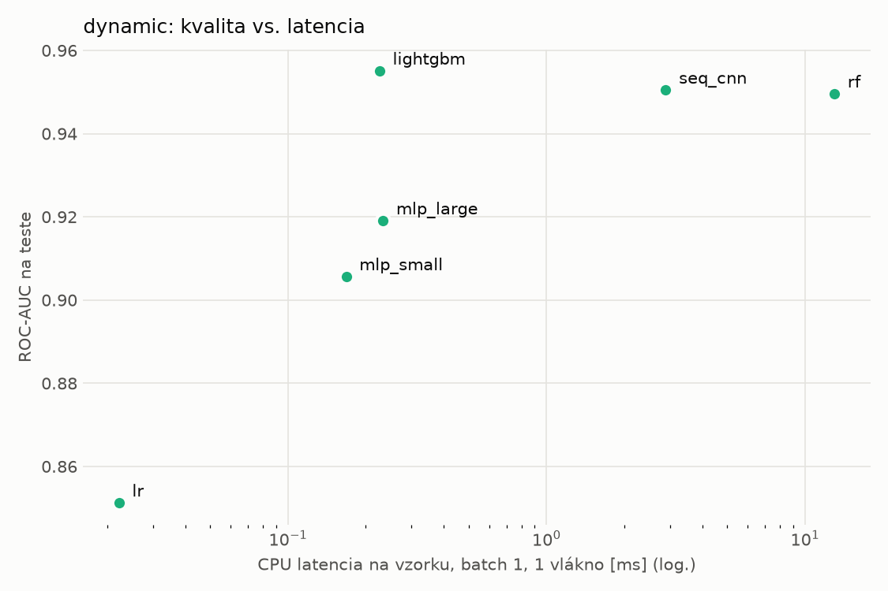
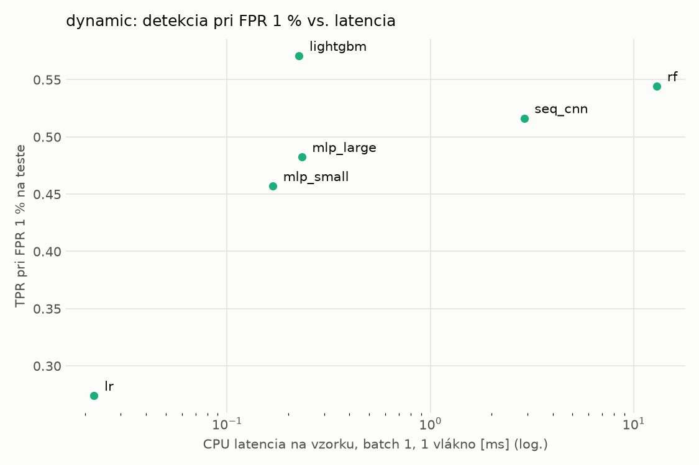
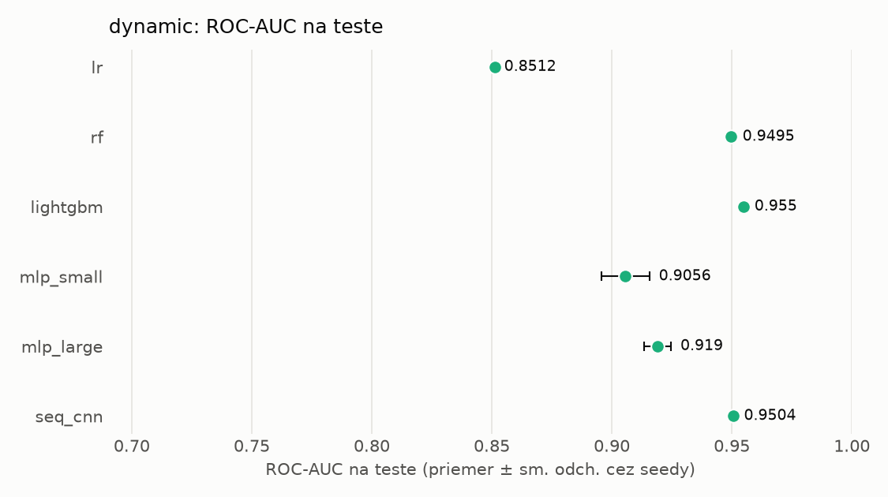
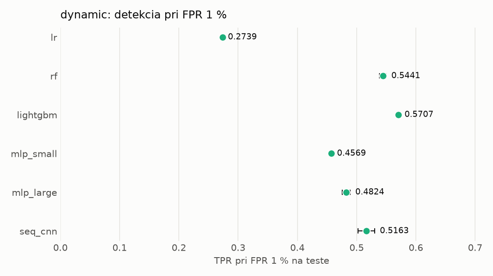

# Porovnanie modelov – dynamic

> Generované `src/evaluation/compare.py` (2026-11-04T17:14:09+01:00); použitý je posledný beh každého modelu.
> Metriky sú priemer cez seedy. \* = pri prahu určenom na validácii (FPR ≤ 1 %).
> CPU ms/vz. = medián latencie jednej vzorky na 1 vlákne vrátane transformácie vstupu (meranie hneď po tréningu,
> orientačné). Oficiálne merania spotreby sú v časti „Spotreba zdrojov pri inferencii“.

## Detekčná kvalita a orientačné časy
| model | ROC-AUC val | ROC-AUC test | TPR@FPR 1 % test | TPR@FPR 0,1 % test | F1 test* | FPR test* | gap train−val | CPU ms/vz. | CPU vz./s | GPU ms/vz. | parametre | MB | tréning s | ladenie min |
|---|---|---|---|---|---|---|---|---|---|---|---|---|---|---|
| [lr](../../dynamic/lr/20261104-081421/README.md) | 0.9940 | 0.8512 ± 0.0000 | 0.2739 | 0.1737 | 0.6167 | 0.1016 | 0.0019 | 0.022 | 339 348 | – | 2 001 | 0.06 | 5.4 | 0.0 |
| [rf](../../dynamic/rf/20261104-081447/README.md) | 0.9970 | 0.9495 ± 0.0010 | 0.5441 | 0.0000 | 0.7056 | 0.0105 | 0.0017 | 12.993 | 91 845 | – | 997 918 | 80.28 | 36.6 | 0.0 |
| [lightgbm](../../dynamic/lightgbm/20261104-081647/README.md) | 0.9971 | 0.9550 ± 0.0004 | 0.5707 | 0.3158 | 0.7737 | 0.0149 | 0.0015 | 0.226 | 60 098 | – | 600 543 | 34.09 | 24.9 | 0.0 |
| [mlp_small](../../dynamic/mlp_small/20261104-081822/README.md) | 0.9963 | 0.9056 ± 0.0100 | 0.4569 | 0.2873 | 0.6661 | 0.0150 | 0.0011 | 0.168 | 87 912 | 0.626 | 546 049 | 2.24 | 4.5 | 0.0 |
| [mlp_large](../../dynamic/mlp_large/20261104-081843/README.md) | 0.9961 | 0.9190 ± 0.0056 | 0.4824 | 0.3051 | 0.6904 | 0.0154 | 0.0014 | 0.233 | 76 112 | 0.418 | 1 190 657 | 4.83 | 24.0 | 0.0 |
| [seq_cnn](../../dynamic/seq_cnn/20261104-165202/README.md) | 0.9972 | 0.9504 ± 0.0006 | 0.5163 | 0.3200 | 0.7645 | 0.0149 | 0.0009 | 2.892 | 1 224 | 0.762 | 209 857 | 0.84 | 405.0 | 0.0 |

## Nízka prevalencia malvéru (test, prah z validácie)
| model | TPR | FPR | precision @ 1 % | falošné na 1 skutočný poplach @ 1 % | precision @ 0.1 % | falošné na 1 skutočný poplach @ 0.1 % |
|---|---|---|---|---|---|---|
| lr | 0.4841 | 0.1016 | 0.046 | 20.79 | 0.005 | 209.74 |
| rf | 0.5499 | 0.0105 | 0.345 | 1.90 | 0.050 | 19.14 |
| lightgbm | 0.6389 | 0.0149 | 0.303 | 2.30 | 0.041 | 23.24 |
| mlp_small | 0.5057 | 0.0150 | 0.254 | 2.94 | 0.033 | 29.69 |
| mlp_large | 0.5341 | 0.0154 | 0.260 | 2.85 | 0.034 | 28.74 |
| seq_cnn | 0.6282 | 0.0149 | 0.299 | 2.35 | 0.040 | 23.70 |

Prepočet: TPR a FPR nezávisia od podielu malvéru, preto sa dajú preniesť na nízku prevalenciu (v reálnej prevádzke je malvéru ~1 % alebo menej; v teste 54 %). „Falošné na 1 skutočný poplach“ = koľko neškodných súborov je označených na každý zachytený malvér.

## Spotreba zdrojov pri inferencii (benchmark, testovacia množina)
_Benchmark zatiaľ nebol spustený (`python -m src.evaluation.benchmark --approach dynamic`)._

## Grafy

