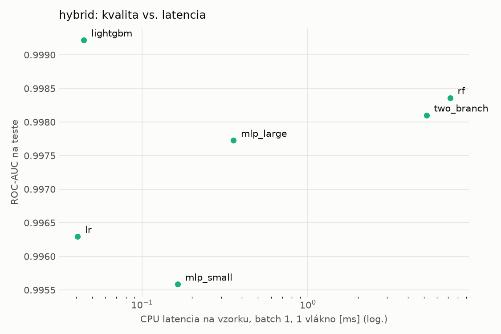
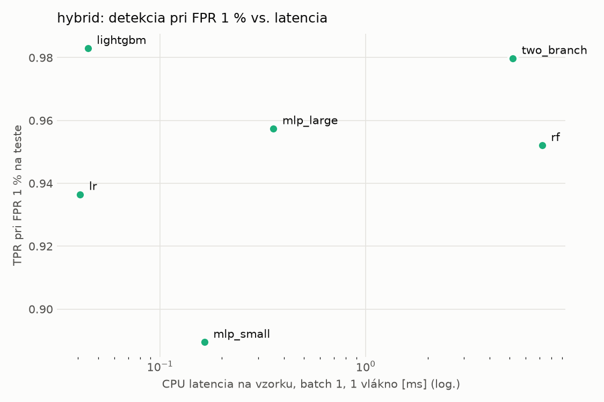
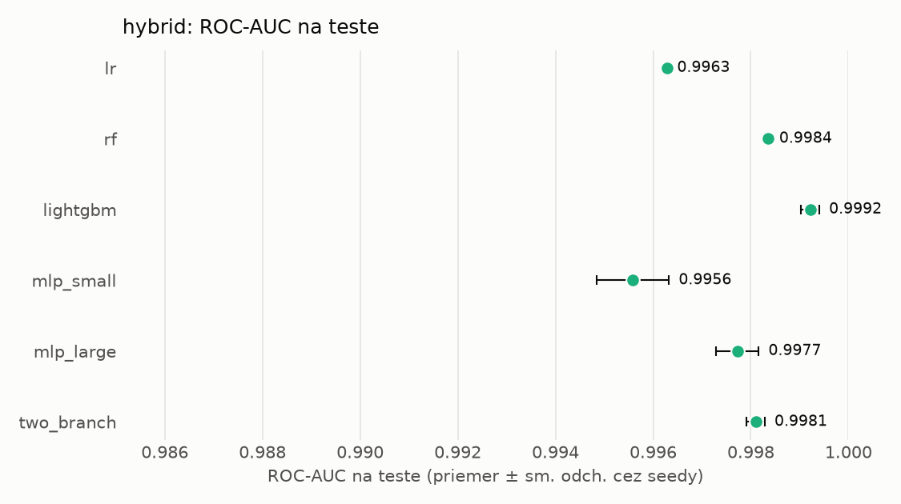
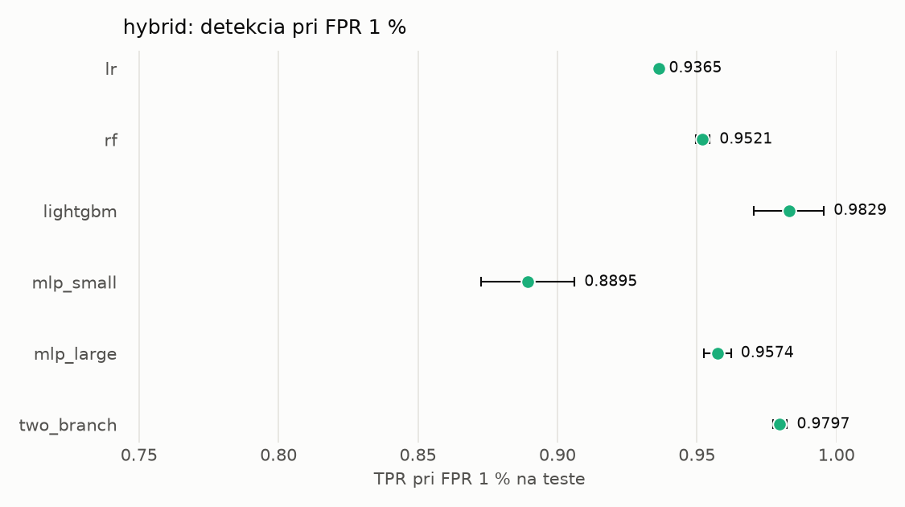

# Porovnanie modelov – hybrid

> Generované `src/evaluation/compare.py` (2026-11-04T17:44:06+01:00); použitý je posledný beh každého modelu.
> Metriky sú priemer cez seedy. \* = pri prahu určenom na validácii (FPR ≤ 1 %).
> CPU ms/vz. = medián latencie jednej vzorky na 1 vlákne vrátane transformácie vstupu (meranie hneď po tréningu,
> orientačné). Oficiálne merania spotreby sú v časti „Spotreba zdrojov pri inferencii“.

## Detekčná kvalita a orientačné časy
| model | ROC-AUC val | ROC-AUC test | TPR@FPR 1 % test | TPR@FPR 0,1 % test | F1 test* | FPR test* | gap train−val | CPU ms/vz. | CPU vz./s | GPU ms/vz. | parametre | MB | tréning s | ladenie min |
|---|---|---|---|---|---|---|---|---|---|---|---|---|---|---|
| [lr](../../hybrid/lr/20261104-171412/README.md) | 0.9989 | 0.9963 ± 0.0000 | 0.9365 | 0.7265 | 0.9595 | 0.0079 | 0.0008 | 0.041 | 160 759 | – | 4 320 | 0.13 | 5.1 | 0.0 |
| [rf](../../hybrid/rf/20261104-171444/README.md) | 0.9998 | 0.9984 ± 0.0000 | 0.9521 | 0.8303 | 0.9692 | 0.0078 | 0.0002 | 7.199 | 99 582 | – | 271 792 | 22.11 | 134.5 | 0.0 |
| [lightgbm](../../hybrid/lightgbm/20261104-172135/README.md) | 0.9998 | 0.9992 ± 0.0002 | 0.9829 | 0.9271 | 0.9839 | 0.0043 | 0.0002 | 0.045 | 274 584 | – | 31 746 | 1.77 | 16.5 | 0.0 |
| [mlp_small](../../hybrid/mlp_small/20261104-172229/README.md) | 0.9993 | 0.9956 ± 0.0007 | 0.8895 | 0.7414 | 0.9245 | 0.0075 | 0.0005 | 0.164 | 45 967 | 0.362 | 138 881 | 0.67 | 4.4 | 0.0 |
| [mlp_large](../../hybrid/mlp_large/20261104-172301/README.md) | 0.9996 | 0.9977 ± 0.0004 | 0.9574 | 0.8240 | 0.9627 | 0.0063 | 0.0003 | 0.356 | 37 847 | 0.526 | 2 386 305 | 9.67 | 5.6 | 0.0 |
| [two_branch](../../hybrid/two_branch/20261104-172337/README.md) | 0.9995 | 0.9981 ± 0.0002 | 0.9797 | 0.7832 | 0.9790 | 0.0074 | 0.0003 | 5.187 | 645 | 1.242 | 1 757 442 | 7.10 | 345.8 | 0.0 |

## Nízka prevalencia malvéru (test, prah z validácie)
| model | TPR | FPR | precision @ 1 % | falošné na 1 skutočný poplach @ 1 % | precision @ 0.1 % | falošné na 1 skutočný poplach @ 0.1 % |
|---|---|---|---|---|---|---|
| lr | 0.9284 | 0.0079 | 0.542 | 0.85 | 0.105 | 8.54 |
| rf | 0.9464 | 0.0078 | 0.552 | 0.81 | 0.109 | 8.20 |
| lightgbm | 0.9718 | 0.0043 | 0.696 | 0.44 | 0.185 | 4.40 |
| mlp_small | 0.8651 | 0.0075 | 0.539 | 0.86 | 0.104 | 8.63 |
| mlp_large | 0.9331 | 0.0063 | 0.598 | 0.67 | 0.128 | 6.79 |
| two_branch | 0.9650 | 0.0074 | 0.567 | 0.76 | 0.115 | 7.69 |

Prepočet: TPR a FPR nezávisia od podielu malvéru, preto sa dajú preniesť na nízku prevalenciu (v reálnej prevádzke je malvéru ~1 % alebo menej; v teste 54 %). „Falošné na 1 skutočný poplach“ = koľko neškodných súborov je označených na každý zachytený malvér.

## Spotreba zdrojov pri inferencii (benchmark, testovacia množina)
_Benchmark zatiaľ nebol spustený (`python -m src.evaluation.benchmark --approach hybrid`)._

## Grafy

