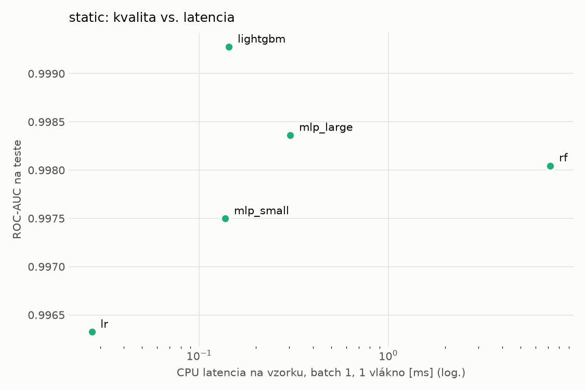
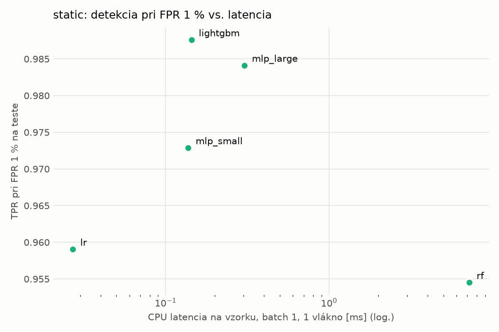
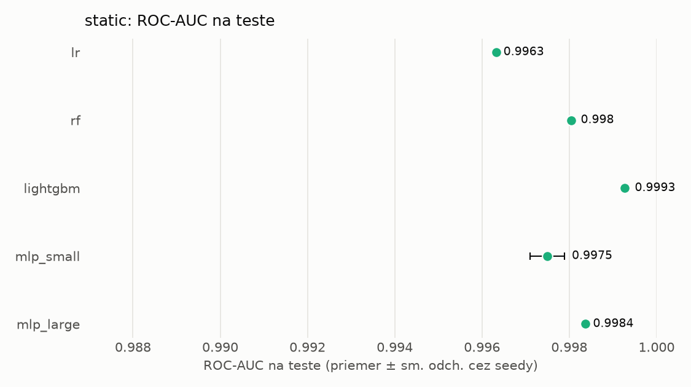
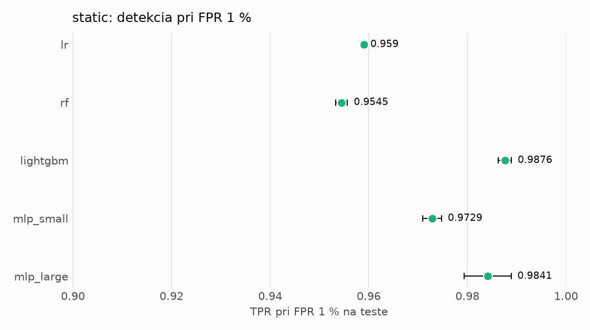

# Porovnanie modelov – static

> Generované `src/evaluation/compare.py` (2026-11-04T08:13:25+01:00); použitý je posledný beh každého modelu.
> Metriky sú priemer cez seedy. \* = pri prahu určenom na validácii (FPR ≤ 1 %).
> CPU ms/vz. = medián latencie jednej vzorky na 1 vlákne vrátane transformácie vstupu (meranie hneď po tréningu,
> orientačné). Oficiálne merania spotreby sú v časti „Spotreba zdrojov pri inferencii“.

## Detekčná kvalita a orientačné časy
| model | ROC-AUC val | ROC-AUC test | TPR@FPR 1 % test | TPR@FPR 0,1 % test | F1 test* | FPR test* | gap train−val | CPU ms/vz. | CPU vz./s | GPU ms/vz. | parametre | MB | tréning s | ladenie min |
|---|---|---|---|---|---|---|---|---|---|---|---|---|---|---|
| [lr](../../static/lr/20261104-080123/README.md) | 0.9986 | 0.9963 ± 0.0000 | 0.9590 | 0.0597 | 0.9644 | 0.0079 | 0.0010 | 0.027 | 293 492 | – | 2 320 | 0.07 | 2.3 | 0.0 |
| [rf](../../static/rf/20261104-080139/README.md) | 0.9998 | 0.9980 ± 0.0000 | 0.9545 | 0.8968 | 0.9694 | 0.0070 | 0.0002 | 7.197 | 125 620 | – | 379 078 | 30.69 | 24.9 | 0.0 |
| [lightgbm](../../static/lightgbm/20261104-080300/README.md) | 0.9998 | 0.9993 ± 0.0001 | 0.9876 | 0.9443 | 0.9855 | 0.0046 | 0.0002 | 0.144 | 104 093 | – | 228 229 | 13.23 | 185.4 | 0.0 |
| [mlp_small](../../static/mlp_small/20261104-081228/README.md) | 0.9991 | 0.9975 ± 0.0004 | 0.9729 | 0.4771 | 0.9736 | 0.0066 | 0.0008 | 0.138 | 109 182 | 0.382 | 74 881 | 0.36 | 7.0 | 0.0 |
| [mlp_large](../../static/mlp_large/20261104-081259/README.md) | 0.9996 | 0.9984 ± 0.0000 | 0.9841 | 0.8557 | 0.9832 | 0.0058 | 0.0003 | 0.304 | 51 114 | 0.710 | 1 364 417 | 5.53 | 5.1 | 0.0 |

## Nízka prevalencia malvéru (test, prah z validácie)
| model | TPR | FPR | precision @ 1 % | falošné na 1 skutočný poplach @ 1 % | precision @ 0.1 % | falošné na 1 skutočný poplach @ 0.1 % |
|---|---|---|---|---|---|---|
| lr | 0.9374 | 0.0079 | 0.544 | 0.84 | 0.106 | 8.46 |
| rf | 0.9463 | 0.0070 | 0.577 | 0.73 | 0.119 | 7.40 |
| lightgbm | 0.9751 | 0.0046 | 0.683 | 0.46 | 0.176 | 4.69 |
| mlp_small | 0.9539 | 0.0066 | 0.594 | 0.68 | 0.127 | 6.90 |
| mlp_large | 0.9717 | 0.0058 | 0.629 | 0.59 | 0.144 | 5.96 |

Prepočet: TPR a FPR nezávisia od podielu malvéru, preto sa dajú preniesť na nízku prevalenciu (v reálnej prevádzke je malvéru ~1 % alebo menej; v teste 54 %). „Falošné na 1 skutočný poplach“ = koľko neškodných súborov je označených na každý zachytený malvér.

## Spotreba zdrojov pri inferencii (benchmark, testovacia množina)
_Benchmark zatiaľ nebol spustený (`python -m src.evaluation.benchmark --approach static`)._

## Grafy

