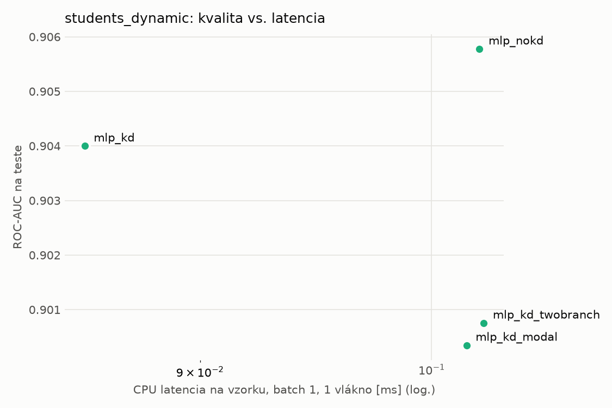
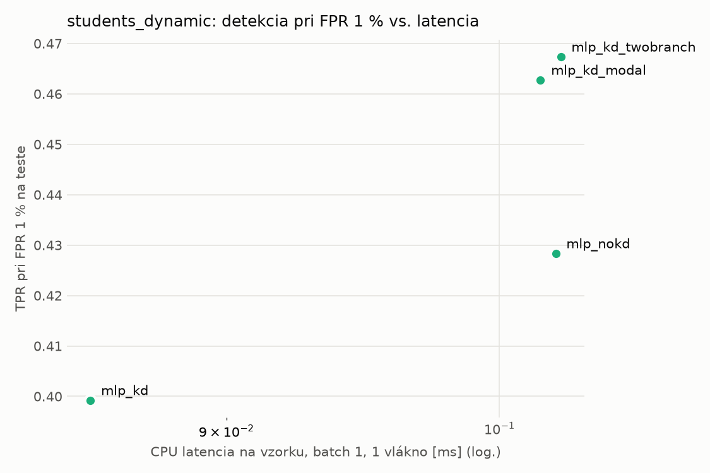
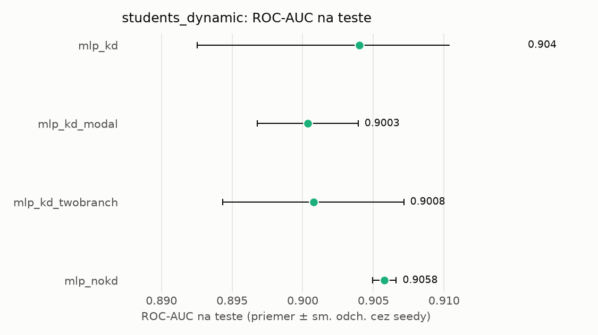
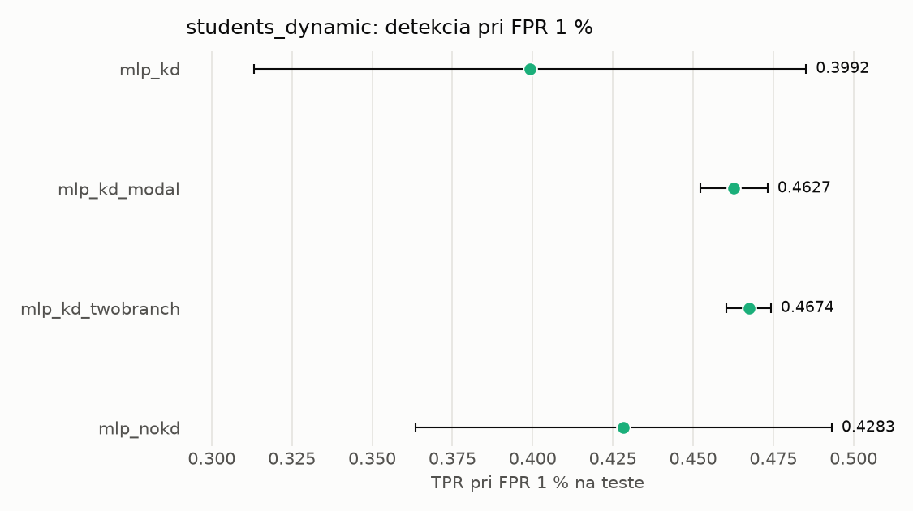

# Porovnanie modelov – students_dynamic

> Generované `src/evaluation/compare.py` (2026-11-04T18:40:16+01:00); použitý je posledný beh každého modelu.
> Metriky sú priemer cez seedy. \* = pri prahu určenom na validácii (FPR ≤ 1 %).
> CPU ms/vz. = medián latencie jednej vzorky na 1 vlákne vrátane transformácie vstupu (meranie hneď po tréningu,
> orientačné). Oficiálne merania spotreby sú v časti „Spotreba zdrojov pri inferencii“.

## Detekčná kvalita a orientačné časy
| model | ROC-AUC val | ROC-AUC test | TPR@FPR 1 % test | TPR@FPR 0,1 % test | F1 test* | FPR test* | gap train−val | CPU ms/vz. | CPU vz./s | GPU ms/vz. | parametre | MB | tréning s | ladenie min |
|---|---|---|---|---|---|---|---|---|---|---|---|---|---|---|
| [mlp_kd](../../students_dynamic/mlp_kd/20261104-183809/README.md) | 0.9960 | 0.9040 ± 0.0115 | 0.3992 | 0.2821 | 0.6560 | 0.0151 | 0.0013 | 0.085 | 96 050 | 0.454 | 64 129 | 0.31 | 8.2 | 0.0 |
| [mlp_kd_modal](../../students_dynamic/mlp_kd_modal/20261104-183911/README.md) | 0.9961 | 0.9003 ± 0.0036 | 0.4627 | 0.2788 | 0.6656 | 0.0126 | 0.0012 | 0.102 | 97 188 | 0.450 | 64 129 | 0.31 | 8.1 | 0.0 |
| [mlp_kd_twobranch](../../students_dynamic/mlp_kd_twobranch/20261104-183943/README.md) | 0.9960 | 0.9008 ± 0.0064 | 0.4674 | 0.2924 | 0.6424 | 0.0232 | 0.0012 | 0.102 | 94 988 | 0.476 | 64 129 | 0.31 | 8.2 | 0.0 |
| [mlp_nokd](../../students_dynamic/mlp_nokd/20261104-183842/README.md) | 0.9961 | 0.9058 ± 0.0008 | 0.4283 | 0.3166 | 0.6726 | 0.0277 | 0.0012 | 0.102 | 137 526 | 0.289 | 64 129 | 0.31 | 6.9 | 0.0 |

## Nízka prevalencia malvéru (test, prah z validácie)
| model | TPR | FPR | precision @ 1 % | falošné na 1 skutočný poplach @ 1 % | precision @ 0.1 % | falošné na 1 skutočný poplach @ 0.1 % |
|---|---|---|---|---|---|---|
| mlp_kd | 0.4943 | 0.0151 | 0.249 | 3.02 | 0.032 | 30.46 |
| mlp_kd_modal | 0.5042 | 0.0126 | 0.288 | 2.47 | 0.039 | 24.95 |
| mlp_kd_twobranch | 0.4824 | 0.0232 | 0.173 | 4.76 | 0.020 | 48.07 |
| mlp_nokd | 0.5185 | 0.0277 | 0.159 | 5.29 | 0.018 | 53.39 |

Prepočet: TPR a FPR nezávisia od podielu malvéru, preto sa dajú preniesť na nízku prevalenciu (v reálnej prevádzke je malvéru ~1 % alebo menej; v teste 54 %). „Falošné na 1 skutočný poplach“ = koľko neškodných súborov je označených na každý zachytený malvér.

## Spotreba zdrojov pri inferencii (benchmark, testovacia množina)
_Benchmark zatiaľ nebol spustený (`python -m src.evaluation.benchmark --approach students_dynamic`)._

## Grafy

