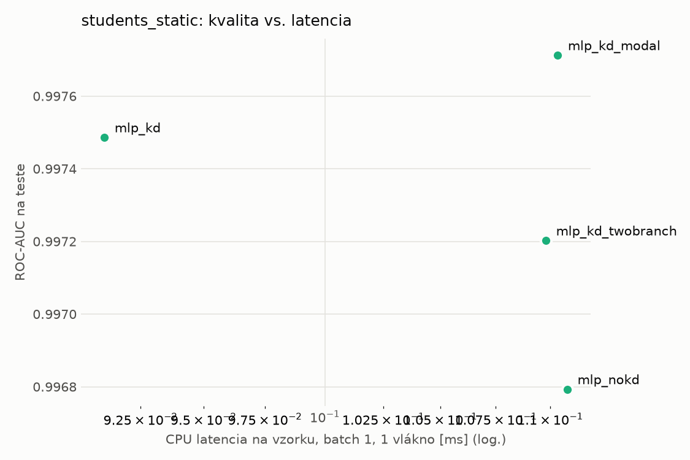
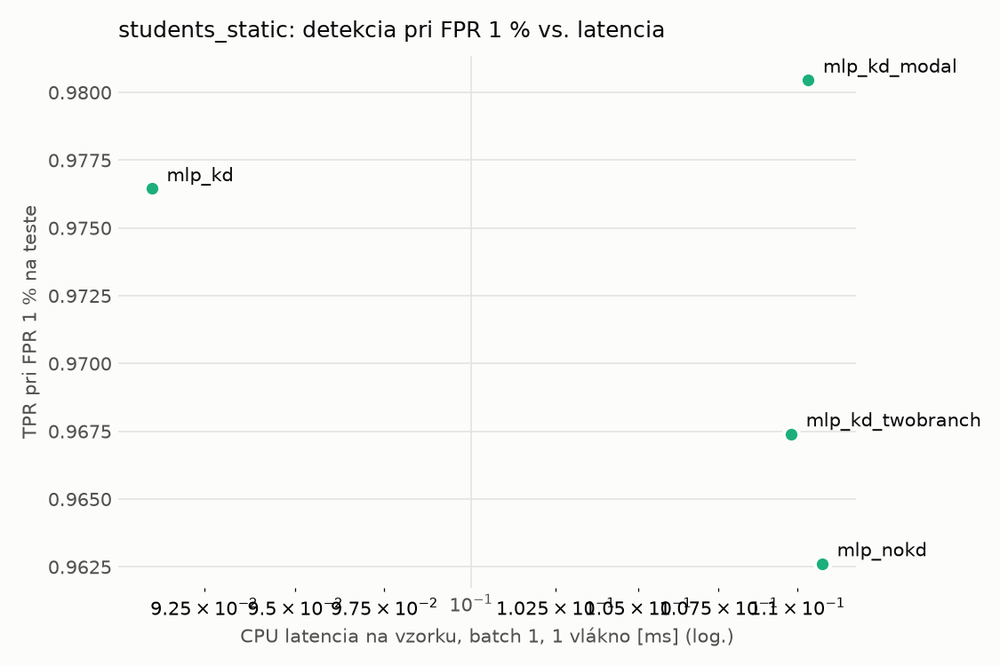
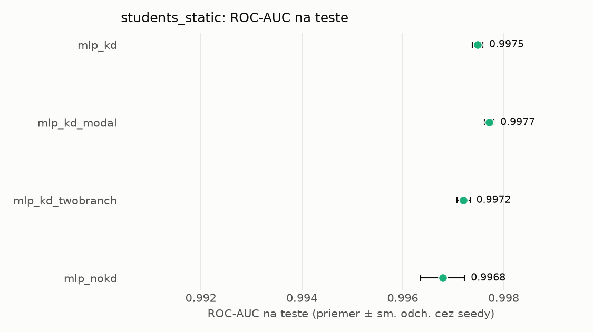
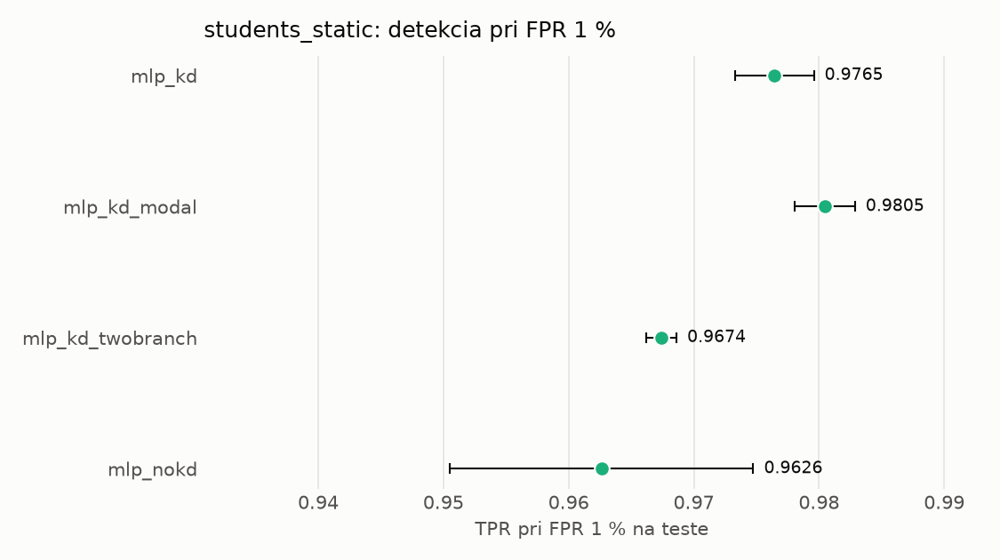

# Porovnanie modelov – students_static

> Generované `src/evaluation/compare.py` (2026-11-04T18:38:06+01:00); použitý je posledný beh každého modelu.
> Metriky sú priemer cez seedy. \* = pri prahu určenom na validácii (FPR ≤ 1 %).
> CPU ms/vz. = medián latencie jednej vzorky na 1 vlákne vrátane transformácie vstupu (meranie hneď po tréningu,
> orientačné). Oficiálne merania spotreby sú v časti „Spotreba zdrojov pri inferencii“.

## Detekčná kvalita a orientačné časy
| model | ROC-AUC val | ROC-AUC test | TPR@FPR 1 % test | TPR@FPR 0,1 % test | F1 test* | FPR test* | gap train−val | CPU ms/vz. | CPU vz./s | GPU ms/vz. | parametre | MB | tréning s | ladenie min |
|---|---|---|---|---|---|---|---|---|---|---|---|---|---|---|
| [mlp_kd](../../students_static/mlp_kd/20261104-183610/README.md) | 0.9991 | 0.9975 ± 0.0001 | 0.9765 | 0.4378 | 0.9748 | 0.0061 | 0.0007 | 0.091 | 109 693 | 0.308 | 74 337 | 0.36 | 10.3 | 0.0 |
| [mlp_kd_modal](../../students_static/mlp_kd_modal/20261104-183707/README.md) | 0.9990 | 0.9977 ± 0.0001 | 0.9805 | 0.7089 | 0.9763 | 0.0068 | 0.0008 | 0.110 | 60 829 | 0.294 | 74 337 | 0.36 | 6.8 | 0.0 |
| [mlp_kd_twobranch](../../students_static/mlp_kd_twobranch/20261104-183737/README.md) | 0.9991 | 0.9972 ± 0.0001 | 0.9674 | 0.3768 | 0.9732 | 0.0078 | 0.0007 | 0.110 | 109 150 | 0.287 | 74 337 | 0.36 | 6.6 | 0.0 |
| [mlp_nokd](../../students_static/mlp_nokd/20261104-183650/README.md) | 0.9989 | 0.9968 ± 0.0004 | 0.9626 | 0.5144 | 0.9678 | 0.0070 | 0.0008 | 0.111 | 109 339 | 0.284 | 74 337 | 0.36 | 2.5 | 0.0 |

## Nízka prevalencia malvéru (test, prah z validácie)
| model | TPR | FPR | precision @ 1 % | falošné na 1 skutočný poplach @ 1 % | precision @ 0.1 % | falošné na 1 skutočný poplach @ 0.1 % |
|---|---|---|---|---|---|---|
| mlp_kd | 0.9558 | 0.0061 | 0.612 | 0.63 | 0.135 | 6.41 |
| mlp_kd_modal | 0.9592 | 0.0068 | 0.589 | 0.70 | 0.124 | 7.04 |
| mlp_kd_twobranch | 0.9539 | 0.0078 | 0.554 | 0.81 | 0.109 | 8.13 |
| mlp_nokd | 0.9432 | 0.0070 | 0.576 | 0.74 | 0.119 | 7.43 |

Prepočet: TPR a FPR nezávisia od podielu malvéru, preto sa dajú preniesť na nízku prevalenciu (v reálnej prevádzke je malvéru ~1 % alebo menej; v teste 54 %). „Falošné na 1 skutočný poplach“ = koľko neškodných súborov je označených na každý zachytený malvér.

## Spotreba zdrojov pri inferencii (benchmark, testovacia množina)
_Benchmark zatiaľ nebol spustený (`python -m src.evaluation.benchmark --approach students_static`)._

## Grafy

