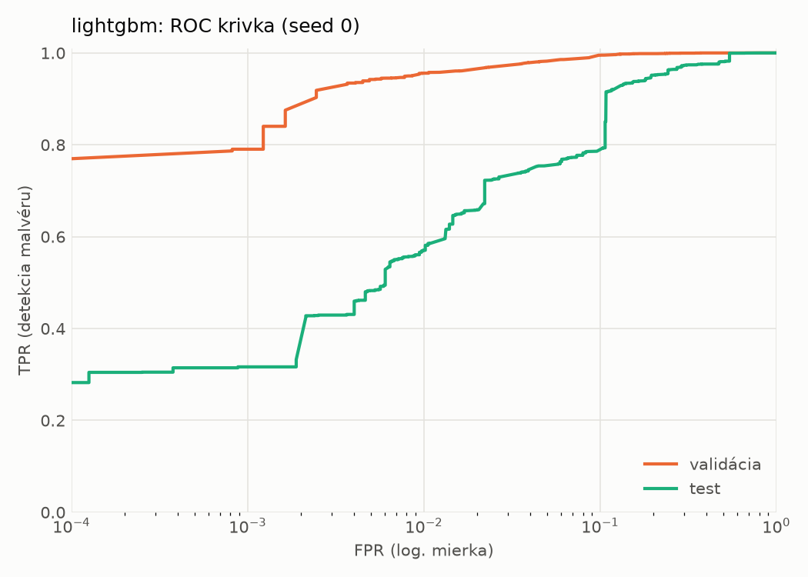
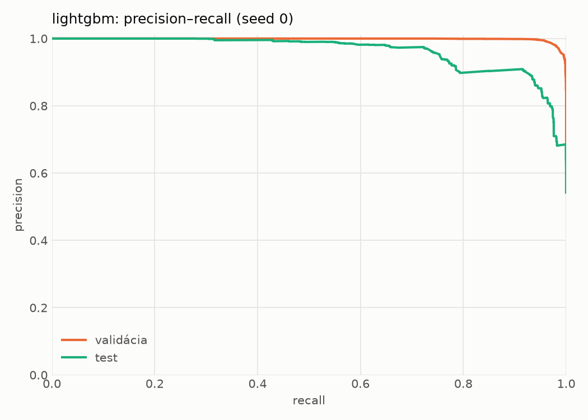
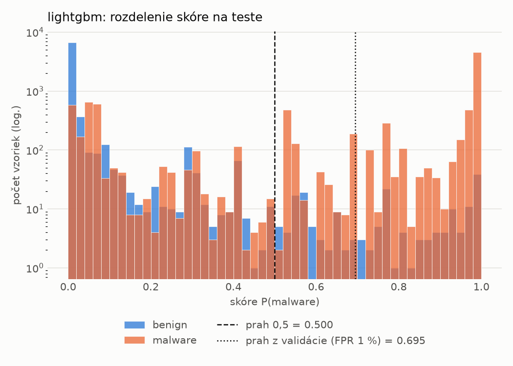
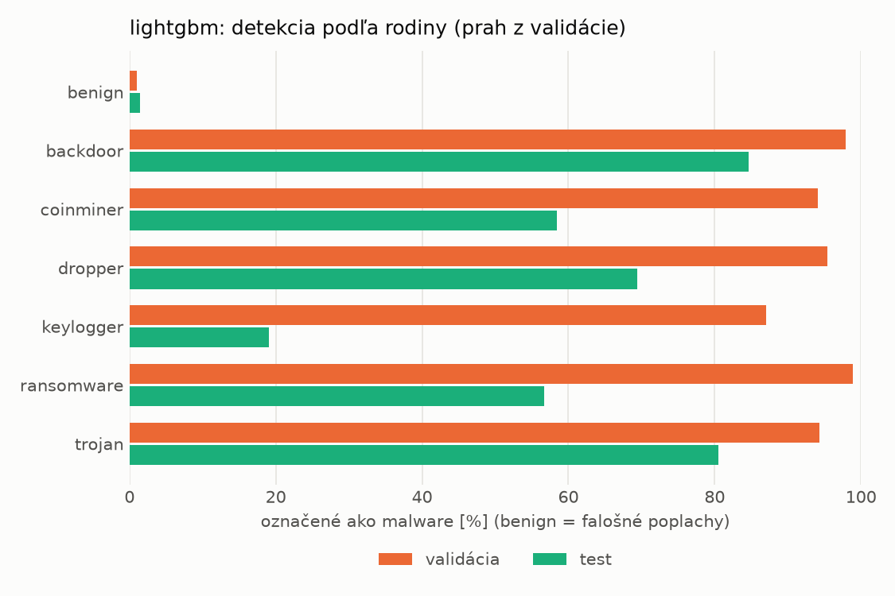
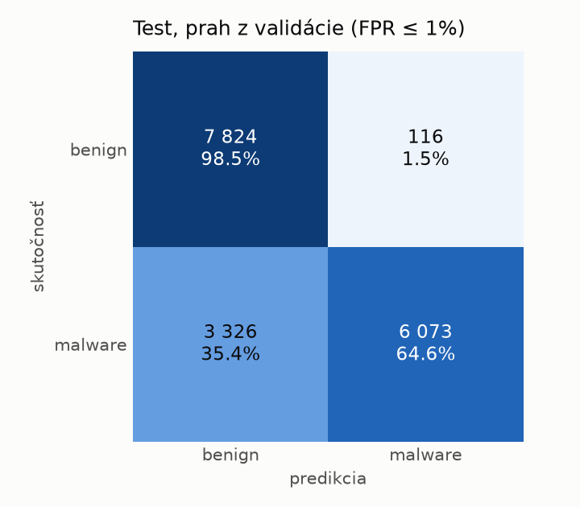
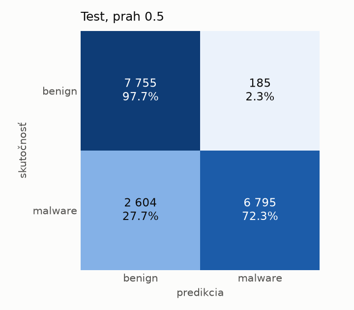
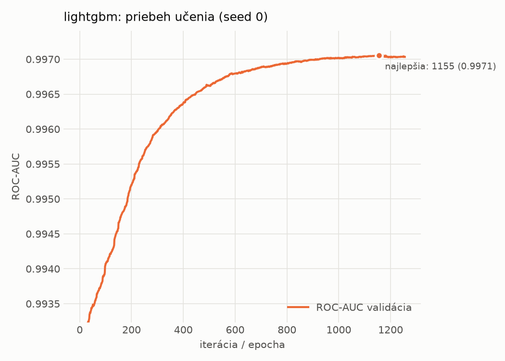

# dynamic/lightgbm – beh `20261104-081647`

> Automaticky generované (`src/training/run_tabular.py`). Konfigurácia: `config.yaml`, protokol: `protocol.yaml`.

- **Model:** `lightgbm` – LightGBM, gradient boosting stromov s early stopping na validácii (pôvodné hodnoty príznakov)
- **Ladenie:** bez ladenia – hyperparametre prevzaté z `runs_final/dynamic/lightgbm/20261102-003953`
- **Finálne modely:** seedy [0, 1, 2]; hodnoty sú priemer ± smerodajná odchýlka cez seedy
- **Najlepšie hyperparametre:** `{"num_boost_round": 5000, "early_stopping_rounds": 100, "learning_rate": 0.012600391102852807, "num_leaves": 261, "min_child_samples": 12, "feature_fraction": 0.7323605840883831, "bagging_fraction": 0.7241803281580393, "lambda_l1": 9.843384499248837e-06, "lambda_l2": 0.7301583949167907}`

## Detekčná kvalita (bez prahu)
| metrika | train (podvzorka) | validácia | test |
|---|---|---|---|
| ROC-AUC | 0.9985 ± 0.0000 | 0.9971 ± 0.0000 | 0.9550 ± 0.0004 |
| PR-AUC | 0.9992 ± 0.0000 | 0.9985 ± 0.0000 | 0.9633 ± 0.0004 |
| TPR pri FPR 1 % | 0.9639 ± 0.0002 | 0.9557 ± 0.0002 | 0.5707 ± 0.0013 |
| TPR pri FPR 0,1 % | 0.9390 ± 0.0005 | 0.7910 ± 0.0032 | 0.3158 ± 0.0012 |
| log loss | 0.0497 ± 0.0001 | 0.0670 ± 0.0000 | 0.5435 ± 0.0063 |
| Brier skóre | 0.0158 ± 0.0000 | 0.0201 ± 0.0000 | 0.1443 ± 0.0009 |

Rozdiel ROC-AUC train − validácia: **0.0015** (veľký rozdiel = preučenie).

## Pri prahu z validácie (FPR ≤ 1% na validácii)
| metrika | train (podvzorka) | validácia | test |
|---|---|---|---|
| accuracy | 0.9710 ± 0.0001 | 0.9673 ± 0.0001 | 0.7974 ± 0.0071 |
| balanced accuracy | 0.9770 ± 0.0000 | 0.9730 ± 0.0001 | 0.8120 ± 0.0066 |
| precision | 0.9978 ± 0.0000 | 0.9949 ± 0.0001 | 0.9807 ± 0.0009 |
| recall (TPR) | 0.9581 ± 0.0001 | 0.9557 ± 0.0002 | 0.6389 ± 0.0127 |
| FPR | 0.0041 ± 0.0000 | 0.0097 ± 0.0002 | 0.0149 ± 0.0004 |
| F1 | 0.9775 ± 0.0000 | 0.9749 ± 0.0001 | 0.7737 ± 0.0096 |
| MCC | 0.9383 ± 0.0001 | 0.9298 ± 0.0003 | 0.6505 ± 0.0109 |

## Pri pevnom prahu 0.5
| metrika | train (podvzorka) | validácia | test |
|---|---|---|---|
| accuracy | 0.9741 ± 0.0001 | 0.9688 ± 0.0003 | 0.8397 ± 0.0011 |
| balanced accuracy | 0.9789 ± 0.0000 | 0.9726 ± 0.0003 | 0.8503 ± 0.0010 |
| precision | 0.9968 ± 0.0001 | 0.9917 ± 0.0001 | 0.9728 ± 0.0006 |
| recall (TPR) | 0.9638 ± 0.0002 | 0.9610 ± 0.0003 | 0.7246 ± 0.0023 |
| FPR | 0.0060 ± 0.0002 | 0.0158 ± 0.0002 | 0.0240 ± 0.0006 |
| F1 | 0.9800 ± 0.0000 | 0.9761 ± 0.0002 | 0.8305 ± 0.0014 |
| MCC | 0.9445 ± 0.0001 | 0.9321 ± 0.0006 | 0.7114 ± 0.0017 |

## Výpočtové nároky (seed 0, testovacia množina)
| meranie | hodnota |
|---|---|
| tréning finálneho modelu | 24.9 s (priemer cez seedy) |
| ladenie spolu | 0 s |
| počet parametrov / uzlov | 600 543 |
| veľkosť modelu na disku | 34.09 MB |
| CPU latencia modelu (batch 1, 1 vlákno) | 0.226 ms (p95 0.295) |
| CPU priepustnosť (24 vlákien) | 60 098 vzoriek/s |

## Grafy
| | |
|---|---|
|  |  |
|  |  |
|  |  |
|  |  |

## Súbory
`metrics.json` (všetky metriky po seedoch vrátane rodín), `timing.json`, `hpo_trials.csv`,
`predictions/<časť>_seed<N>.parquet` (sha256, family, label, score), `model/seed_<N>/`, `log.txt`.
