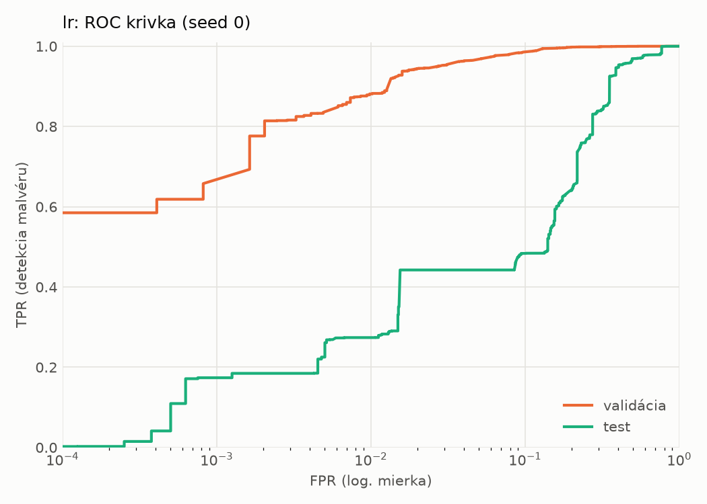
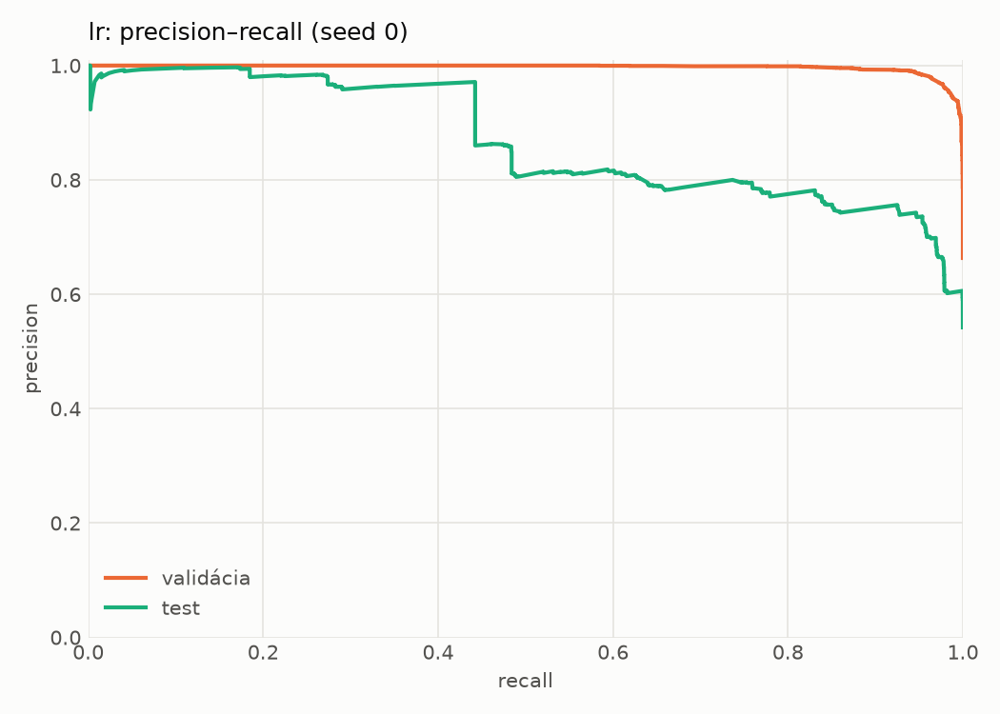
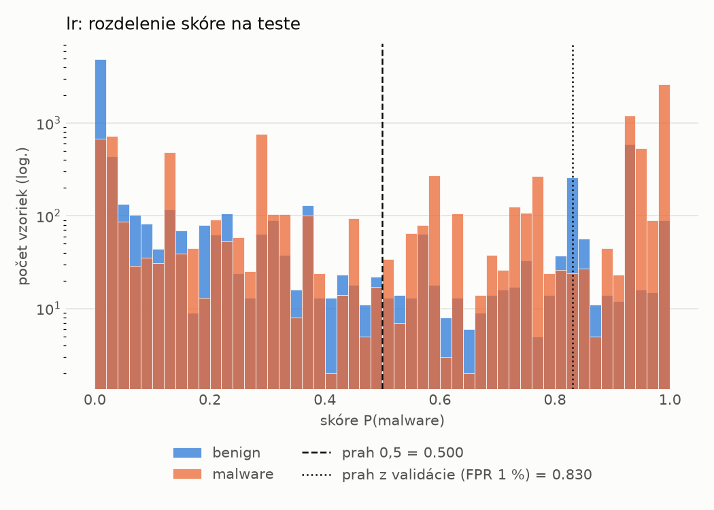
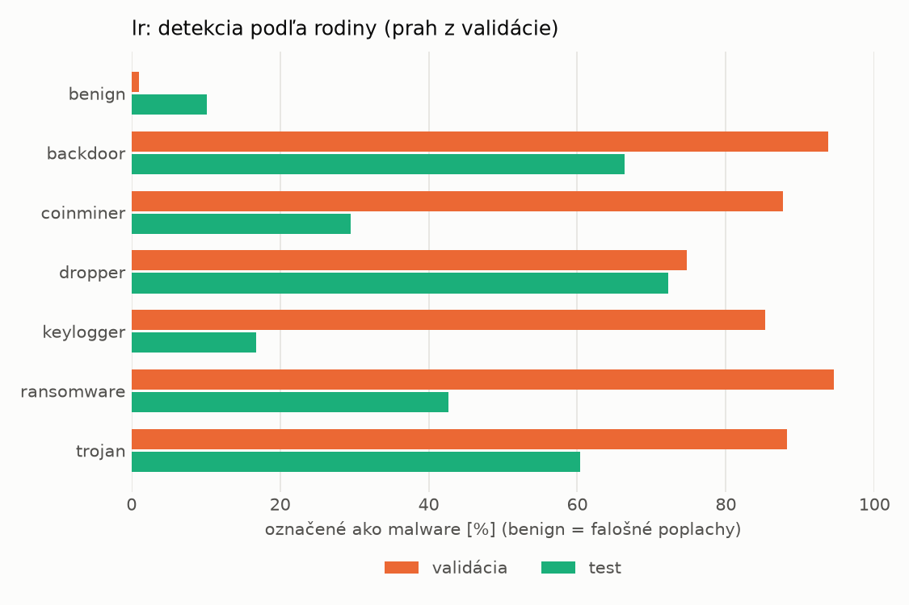
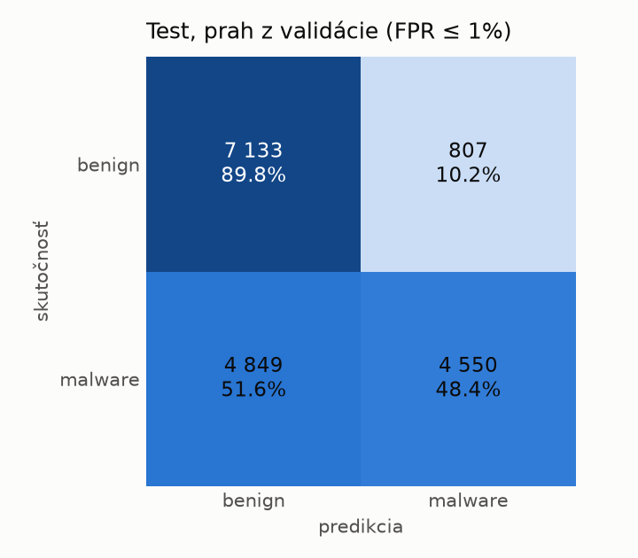
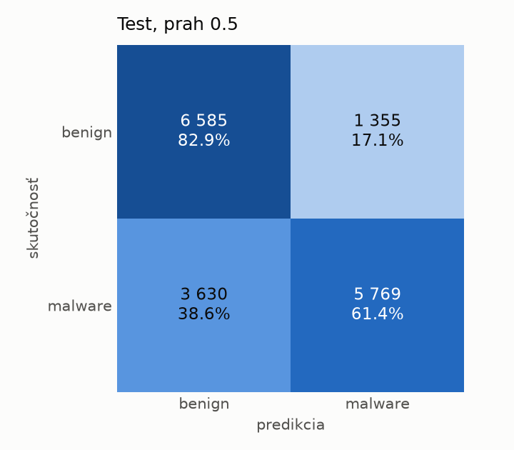

# dynamic/lr – beh `20261104-081421`

> Automaticky generované (`src/training/run_tabular.py`). Konfigurácia: `config.yaml`, protokol: `protocol.yaml`.

- **Model:** `logreg` – logistická regresia s L2 regularizáciou (vstup signed log1p + štandardizácia)
- **Ladenie:** bez ladenia – hyperparametre prevzaté z `runs_final/dynamic/lr/20261102-002602`
- **Finálne modely:** seedy [0, 1, 2]; hodnoty sú priemer ± smerodajná odchýlka cez seedy
- **Najlepšie hyperparametre:** `{"max_iter": 2000, "C": 0.04224422279858655}`

## Detekčná kvalita (bez prahu)
| metrika | train (podvzorka) | validácia | test |
|---|---|---|---|
| ROC-AUC | 0.9959 ± 0.0000 | 0.9940 ± 0.0000 | 0.8512 ± 0.0000 |
| PR-AUC | 0.9978 ± 0.0000 | 0.9969 ± 0.0000 | 0.8702 ± 0.0000 |
| TPR pri FPR 1 % | 0.9170 ± 0.0000 | 0.8812 ± 0.0000 | 0.2739 ± 0.0000 |
| TPR pri FPR 0,1 % | 0.8672 ± 0.0000 | 0.6577 ± 0.0000 | 0.1737 ± 0.0000 |
| log loss | 0.0851 ± 0.0000 | 0.0982 ± 0.0000 | 0.8311 ± 0.0000 |
| Brier skóre | 0.0259 ± 0.0000 | 0.0289 ± 0.0000 | 0.2235 ± 0.0000 |

Rozdiel ROC-AUC train − validácia: **0.0019** (veľký rozdiel = preučenie).

## Pri prahu z validácie (FPR ≤ 1% na validácii)
| metrika | train (podvzorka) | validácia | test |
|---|---|---|---|
| accuracy | 0.9168 ± 0.0000 | 0.9179 ± 0.0000 | 0.6738 ± 0.0000 |
| balanced accuracy | 0.9360 ± 0.0000 | 0.9357 ± 0.0000 | 0.6912 ± 0.0000 |
| precision | 0.9981 ± 0.0000 | 0.9944 ± 0.0000 | 0.8494 ± 0.0000 |
| recall (TPR) | 0.8752 ± 0.0000 | 0.8812 ± 0.0000 | 0.4841 ± 0.0000 |
| FPR | 0.0032 ± 0.0000 | 0.0098 ± 0.0000 | 0.1016 ± 0.0000 |
| F1 | 0.9326 ± 0.0000 | 0.9344 ± 0.0000 | 0.6167 ± 0.0000 |
| MCC | 0.8373 ± 0.0000 | 0.8365 ± 0.0000 | 0.4124 ± 0.0000 |

## Pri pevnom prahu 0.5
| metrika | train (podvzorka) | validácia | test |
|---|---|---|---|
| accuracy | 0.9617 ± 0.0000 | 0.9585 ± 0.0000 | 0.7125 ± 0.0000 |
| balanced accuracy | 0.9653 ± 0.0000 | 0.9614 ± 0.0000 | 0.7216 ± 0.0000 |
| precision | 0.9874 ± 0.0000 | 0.9843 ± 0.0000 | 0.8098 ± 0.0000 |
| recall (TPR) | 0.9540 ± 0.0000 | 0.9526 ± 0.0000 | 0.6138 ± 0.0000 |
| FPR | 0.0234 ± 0.0000 | 0.0299 ± 0.0000 | 0.1707 ± 0.0000 |
| F1 | 0.9704 ± 0.0000 | 0.9682 ± 0.0000 | 0.6983 ± 0.0000 |
| MCC | 0.9173 ± 0.0000 | 0.9095 ± 0.0000 | 0.4488 ± 0.0000 |

## Výpočtové nároky (seed 0, testovacia množina)
| meranie | hodnota |
|---|---|
| tréning finálneho modelu | 5.4 s (priemer cez seedy) |
| ladenie spolu | 0 s |
| počet parametrov / uzlov | 2 001 |
| veľkosť modelu na disku | 0.06 MB |
| transformácia vstupu – latencia (1 vlákno) | 0.017 ms |
| transformácia vstupu – priepustnosť | 55 403 vzoriek/s |
| CPU latencia modelu (batch 1, 1 vlákno) | 0.005 ms (p95 0.006) |
| CPU priepustnosť (24 vlákien) | 339 348 vzoriek/s |

## Grafy
| | |
|---|---|
|  |  |
|  |  |
|  |  |
|  |  |

## Súbory
`metrics.json` (všetky metriky po seedoch vrátane rodín), `timing.json`, `hpo_trials.csv`,
`predictions/<časť>_seed<N>.parquet` (sha256, family, label, score), `model/seed_<N>/`, `log.txt`.
